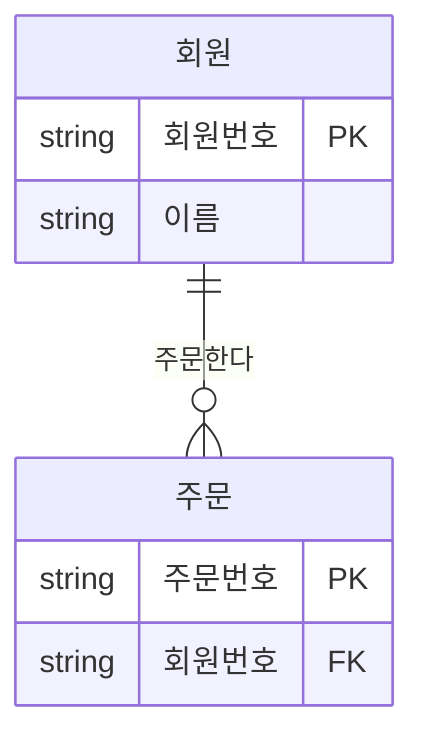
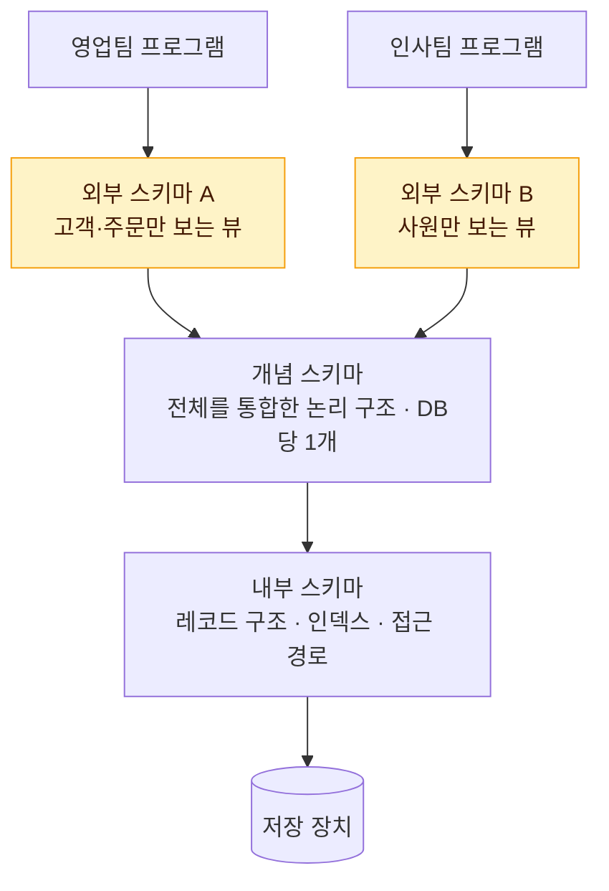

# 데이터 모델의 이해

데이터 모델링은 현실 세계의 업무를 **데이터 관점**에서 바라보고, 약속된 표기법으로 그려내는 과정이다. 1과목의 모든 개념이 여기서 출발하므로 용어와 분류를 정확히 구분해 두자.

## 데이터 모델링이란

현실의 업무는 복잡하다. 데이터 모델링은 이 복잡한 업무를 **데이터베이스로 옮길 수 있는 설계도**로 바꾸는 작업이다.

::: cards 2
- **업무 이해** 업무 내용을 정확하게 파악하고 분석하는 수단
- **의사소통** 현업 담당자, 분석가, 개발자 사이의 공통 언어
- **설계 산출물** 실제 데이터베이스 구조를 만들기 위한 근거
- **문서화** 시스템 운영과 유지보수 때 참고하는 자료
:::

모델링은 DB 설계만을 위한 것이 아니다. **업무 분석, 의사소통, 문서화**의 목적도 함께 가진다.

## 모델링의 특징

데이터 모델링에는 세 가지 특징이 있다. 한 문장으로 말하면 "현실을 **필요한 것만**(추상화), **간단한 기호로**(단순화), **오해 없이**(명확화) 표현한다"이다.

::: cards 3
- **🧩 추상화** 다양한 현상에서 공통점만 뽑아 하나의 개념으로 묶는다. 손님 수만 명을 "회원" 하나로.
- **✏️ 단순화** 복잡한 현실을 약속된 규약과 제한된 표기법으로 쉽게 표현한다. 긴 업무 설명을 ERD 선 하나로.
- **🎯 명확화** 애매함을 없애 누가 보아도 한 가지 뜻으로 이해되게 한다. "주문일"이 정확히 언제인지 못 박기.
:::

### 비유: 지하철 노선도

지하철 노선도는 데이터 모델과 똑같은 원리로 만들어진다.

<figure class="md-figure">
<svg viewBox="0 0 640 230" xmlns="http://www.w3.org/2000/svg" font-family="Pretendard Variable, Pretendard, sans-serif" role="img" aria-label="실제 지도와 지하철 노선도 비교">
<text x="150" y="22" text-anchor="middle" font-size="14" font-weight="700" fill="var(--foreground)">실제 지도</text>
<text x="490" y="22" text-anchor="middle" font-size="14" font-weight="700" fill="var(--foreground)">지하철 노선도</text>
<rect x="10" y="36" width="280" height="180" rx="12" fill="var(--muted)"/>
<rect x="28" y="52" width="38" height="26" rx="4" fill="var(--border)"/><rect x="88" y="60" width="26" height="40" rx="4" fill="var(--border)"/><rect x="200" y="50" width="52" height="22" rx="4" fill="var(--border)"/><rect x="230" y="150" width="40" height="44" rx="4" fill="var(--border)"/><rect x="40" y="160" width="44" height="30" rx="4" fill="var(--border)"/><rect x="140" y="178" width="30" height="24" rx="4" fill="var(--border)"/><circle cx="170" cy="70" r="14" fill="var(--border)"/><circle cx="110" cy="150" r="10" fill="var(--border)"/>
<path d="M20 120 C60 90, 80 150, 120 118 S180 80, 210 120 S260 150, 285 110" fill="none" stroke="oklch(0.62 0.17 255)" stroke-width="4" stroke-linecap="round"/>
<path d="M150 40 C120 80, 190 100, 150 130 S120 190, 160 212" fill="none" stroke="oklch(0.65 0.14 160)" stroke-width="4" stroke-linecap="round"/>
<path d="M20 200 Q60 70 140 40" fill="none" stroke="var(--muted-foreground)" stroke-width="1.5" stroke-dasharray="4 4"/>
<path d="M300 126 L340 126" stroke="var(--primary)" stroke-width="3" marker-end="url(#arrow)"/>
<defs><marker id="arrow" viewBox="0 0 10 10" refX="8" refY="5" markerWidth="6" markerHeight="6" orient="auto"><path d="M0 0 L10 5 L0 10z" fill="var(--primary)"/></marker></defs>
<text x="320" y="114" text-anchor="middle" font-size="11" fill="var(--primary)" font-weight="700">모델링</text>
<rect x="350" y="36" width="280" height="180" rx="12" fill="var(--card)" stroke="var(--border)"/>
<path d="M370 126 L610 126" stroke="oklch(0.62 0.17 255)" stroke-width="5" stroke-linecap="round"/>
<path d="M490 54 L490 96 L520 126 L520 198" fill="none" stroke="oklch(0.65 0.14 160)" stroke-width="5" stroke-linejoin="round" stroke-linecap="round"/>
<circle cx="390" cy="126" r="7" fill="var(--card)" stroke="oklch(0.62 0.17 255)" stroke-width="3"/><circle cx="450" cy="126" r="7" fill="var(--card)" stroke="oklch(0.62 0.17 255)" stroke-width="3"/><circle cx="590" cy="126" r="7" fill="var(--card)" stroke="oklch(0.62 0.17 255)" stroke-width="3"/>
<circle cx="490" cy="62" r="7" fill="var(--card)" stroke="oklch(0.65 0.14 160)" stroke-width="3"/><circle cx="520" cy="190" r="7" fill="var(--card)" stroke="oklch(0.65 0.14 160)" stroke-width="3"/>
<circle cx="520" cy="126" r="10" fill="var(--card)" stroke="var(--foreground)" stroke-width="3"/>
<text x="390" y="150" text-anchor="middle" font-size="11" fill="var(--muted-foreground)">시청</text><text x="450" y="150" text-anchor="middle" font-size="11" fill="var(--muted-foreground)">을지로</text><text x="590" y="150" text-anchor="middle" font-size="11" fill="var(--muted-foreground)">강변</text><text x="508" y="62" font-size="11" fill="var(--muted-foreground)">충무로</text><text x="538" y="194" font-size="11" fill="var(--muted-foreground)">약수</text><text x="540" y="116" font-size="11" font-weight="700" fill="var(--foreground)">환승</text>
</svg>
<figcaption>건물·지형은 빼고(추상화), 선로는 직선과 동그라미로(단순화), 역 이름과 환승은 분명하게(명확화)</figcaption>
</figure>

::: flow
- **추상화** 건물, 도로, 지형은 버리고 "역"과 "노선"만 남긴다
- **단순화** 구불구불한 선로를 직선으로, 역은 동그라미 하나로
- **명확화** 역 이름, 노선 색, 환승 표시가 분명하다
:::

정보는 실제 지도보다 적지만, 목적(길 찾기)에는 훨씬 이해하기 쉽다. 데이터 모델도 업무라는 목적에 맞게 현실을 정리한 지도다.

### 추상화 예시: 공통점만 뽑아 하나의 개념으로

::: example 온라인 쇼핑몰의 손님 수만 명
사람마다 특징은 제각각이지만, 쇼핑몰 업무에 필요한 **공통 성질**만 뽑아 "회원"이라는 개념 하나로 묶는다.

| 현실의 손님 | 쇼핑몰이 관심 있는 것 | 버리는 것 |
| --- | --- | --- |
| 홍길동 | 이름, 주소(서울), 등급(VIP) | 키 175cm, 안경 착용 |
| 김영희 | 이름, 주소(부산), 등급(일반) | 고양이 2마리 |

결과는 **회원**(회원번호, 이름, 주소, 등급)이다. 수만 명을 "회원"이라는 같은 틀로 다룰 수 있게 된다.
:::

### 단순화 예시: 약속된 표기법으로 간단하게

업무 담당자의 설명은 길고, 사람마다 표현이 다르다.

> "회원은 여러 번 주문할 수 있어요. 가입만 하고 주문을 안 한 회원도 있고요. 그런데 주문은 꼭 회원 한 명이 한 거예요."

같은 내용을 ERD로 그리면 선 하나로 끝난다.



선 끝의 기호만 알면 누구나 같은 내용을 읽어낸다. 회원 쪽의 두 줄(`||`)은 "반드시 한 명", 주문 쪽의 원과 까마귀 발(`o{`)은 "0건 이상 여러 건"이라는 뜻이다. 표기법은 [관계](/theory/relationship)에서 자세히 다룬다.

### 명확화 예시: 누가 봐도 한 가지 뜻으로

같은 단어도 사람마다 다르게 이해하면 데이터가 엉망이 된다. 모델링에서는 의미를 하나로 확정한다.

::: compare
- **😵 애매한 표현** "주문일" — 장바구니에 담은 날? 결제한 날? 배송 시작일? 사람마다 다르게 입력해서 매출 집계가 매번 다르게 나온다.
- **✅ 명확한 정의** **주문일자**: 결제가 완료된 날짜 (YYYY-MM-DD). 누가 입력하고 누가 조회하든 같은 날짜를 가리킨다.
:::

| 애매한 표현 | 사람마다 다른 해석 | 명확하게 정의한 결과 |
| --- | --- | --- |
| 금액 | 할인 전? 할인 후? 배송비 포함? | **결제금액**: 할인 적용 후, 배송비 포함 실제 결제액(원) |
| 회원 상태 | "휴면"과 "탈퇴"를 같은 뜻으로 쓰는 사람도 있음 | **회원상태코드**: 정상 / 휴면 / 탈퇴 중 하나 |

> 시험 포인트: 모델링의 3가지 특징은 <strong>추상화·단순화·명확화(정확화)</strong>다. "구체화", "복잡화", "상세화" 같은 보기는 오답으로 자주 나온다.

## 모델링 시 유의점

좋은 모델을 만들려면 피해야 할 것이 세 가지 있다.

::: cards 3
- **🔁 중복** 같은 데이터가 여러 곳에 저장되어 관리 비용이 늘고 불일치 위험이 생긴다. → 데이터가 **한 곳에만** 저장되게.
- **🧱 비유연성** 업무 프로세스가 조금만 바뀌어도 모델을 자주 고쳐야 한다. → 데이터 정의를 **사용 프로세스와 분리**.
- **⚠️ 비일관성** 데이터 간 연관 관계가 불분명해 서로 모순된 데이터가 생긴다. → 데이터 간 **연관 관계를 명확히** 정의.
:::

::: info 함께 기억하기
중복을 없애면 비일관성 위험도 함께 줄어든다. 비유연성을 줄이는 열쇠는 **데이터 정의와 데이터를 사용하는 프로세스를 분리**하는 것이다.
:::

## 데이터 모델링의 3가지 관점

| 관점 | 관심사 | 분석 방법 |
| --- | --- | --- |
| 데이터 관점 (What) | 업무가 어떤 데이터와 관련 있는지, 데이터 간 관계 | 정적 분석, 구조 분석 |
| 프로세스 관점 (How) | 업무가 실제로 무엇을 하는지, 무엇을 해야 하는지 | 시나리오 분석, 동적 분석 |
| 상관 관점 (Interaction) | 업무 처리 방법에 따라 데이터가 어떤 영향을 받는지 | CRUD 매트릭스 분석 |

## 데이터 모델링의 3단계

현실 세계에서 데이터베이스 쪽으로 갈수록 **추상화 수준은 낮아지고 구체성은 높아진다**.

::: flow
- **개념적 모델링** 핵심 엔터티와 관계 도출, 전사적 큰 그림 · 추상화 높음
- **논리적 모델링** 키·속성·관계 확정, **정규화** · 재사용성 최고
- **물리적 모델링** 테이블·인덱스·저장 구조, 성능 고려 · 추상화 낮음
:::

| 단계 | 하는 일 | 산출물 |
| --- | --- | --- |
| 개념적 | 업무 중심의 포괄적 모델링. 전사적 모델링, EA(Enterprise Architecture) 수립에 활용 | 엔터티와 관계 위주의 ERD 초안 |
| 논리적 | 시스템 구축을 염두에 두고 키, 속성, 관계를 정확히 정의. 정규화 수행 | 식별자 확정, 정규화된 ERD |
| 물리적 | 실제 DBMS에 구현. 성능, 보안, 가용성 고려 | 테이블 정의서, 데이터 타입, 인덱스, 반정규화 |

> 시험 포인트: **정규화는 논리적 모델링** 단계에서 한다. 성능을 위한 반정규화, 인덱스·저장 구조 설계는 **물리적 모델링** 단계다. "재사용성이 가장 높은 단계"는 논리적 모델링이다.

## 데이터 독립성과 3단계 스키마

데이터와 프로그램이 강하게 묶여 있으면, 한쪽을 바꿀 때 다른 쪽까지 줄줄이 고쳐야 한다. 그래서 DB 구조를 세 계층으로 나누고 **한 계층의 변경이 다른 계층에 번지지 않게** 한다. 이것이 데이터 독립성이다.

### ANSI-SPARC 3단계 스키마



::: cards 3
- **외부 스키마** 사용자 관점. 개별 사용자나 프로그램이 보는 DB 구조로, 여러 개 존재할 수 있다 (View 개념).
- **개념 스키마** 통합 관점. 모든 사용자 관점을 합친 전체 DB의 논리 구조. 엔터티, 관계, 제약조건을 포함하며 DB당 하나.
- **내부 스키마** 물리적 저장 관점. 데이터가 실제 저장 장치에 어떻게 저장되는지 (레코드 구조, 인덱스).
:::

### 논리적 독립성과 물리적 독립성

::: compare
- **논리적 독립성** **개념 스키마**가 바뀌어도 외부 스키마(응용 프로그램)는 영향을 받지 않는다. 외부/개념 사상(논리적 사상)이 담당한다. 예: 테이블에 컬럼을 추가해도 기존 뷰와 프로그램은 그대로 동작.
- **물리적 독립성** **내부 스키마**가 바뀌어도 개념 스키마는 영향을 받지 않는다. 개념/내부 사상(물리적 사상)이 담당한다. 예: 인덱스를 추가하거나 저장 구조를 바꿔도 테이블 정의는 그대로.
:::

```sql
-- 외부 스키마의 예: 사용자에게 필요한 컬럼만 보여주는 뷰
CREATE VIEW V_EMP_PUBLIC AS
SELECT EMP_NO, EMP_NM, DEPT_NO
  FROM EMP;
-- EMP 테이블에 컬럼이 추가되어도 V_EMP_PUBLIC 사용자는 영향 없음 (논리적 독립성)
```

> 시험 포인트: "사용자 관점 = 외부", "통합 관점 = 개념", "물리적 저장 관점 = 내부"를 짝지어 묻는다. 논리적 독립성은 **개념 스키마 변경**, 물리적 독립성은 **내부 스키마 변경**과 연결된다는 점을 헷갈리지 말자.

## 데이터 모델링의 3요소

모든 데이터 모델은 세 가지로 이루어진다.

::: cards 3
- **Things → 엔터티** 업무가 관여하는 어떤 것. 업무에서 관리할 대상 (회원, 주문)
- **Attributes → 속성** 어떤 것이 가지는 성격. 대상의 특성 (이름, 주문일자)
- **Relationships → 관계** 어떤 것 사이의 연관 (회원이 주문을 한다)
:::

각 요소는 <strong>집합(타입)</strong>과 <strong>개별 항목(인스턴스)</strong>으로 나눠 부른다.

| 집합 단위 | 개별 단위 |
| --- | --- |
| 엔터티 타입 | 엔터티 인스턴스 (어커런스) |
| 관계 | 페어링 (Pairing) |
| 속성 | 속성값 |

세부 내용은 [엔터티](/theory/entity), [속성](/theory/attribute), [관계](/theory/relationship)에서 다룬다.

## ERD 표기법

ERD(Entity Relationship Diagram)는 엔터티와 관계를 그림으로 표현한 것으로, 1976년 Peter Chen이 처음 제안했다.

| 표기법 | 특징 |
| --- | --- |
| Chen | 엔터티는 사각형, 관계는 마름모, 속성은 타원. 개념 설명용 |
| IE / Crow's Foot | "다(多)" 쪽을 까마귀 발 모양으로 표시. 선택은 원(O), 필수는 막대. 실무에서 가장 많이 사용 |
| Barker | Oracle CASE 도구에서 사용. 선택 관계는 점선, 필수 관계는 실선, 까마귀 발로 다(多) 표현 |

::: info 시험에 나오는 표기법
SQLD에서는 주로 **IE 표기법**과 **Barker 표기법**으로 ERD가 제시된다. IE 표기법에서 식별 관계는 실선, 비식별 관계는 점선이다 ([식별자](/theory/identifier) 참고).
:::

### ERD 작성 순서

::: steps
1. **엔터티를 그린다**
2. **엔터티를 적절하게 배치한다** 가장 중요한 엔터티는 왼쪽 상단, 업무 흐름에 따라 오른쪽·아래로 전개. 관계선이 교차하지 않게.
3. **엔터티 간 관계를 설정한다**
4. **관계명을 기술한다**
5. **관계의 참여도(차수)를 기술한다**
6. **관계의 필수 여부(선택사양)를 기술한다**
:::

> 시험 포인트: "관계 설정 → 관계명 → 관계차수 → 관계 선택사양" 순서를 묻는다. 가장 중요한 엔터티는 **왼쪽 상단**에 배치한다.

## 좋은 데이터 모델의 요소

::: cards 3
- **완전성** 업무에 필요한 모든 데이터가 모델에 정의되어 있다
- **중복 배제** 같은 사실은 한 번만 기록한다
- **업무 규칙** 업무 규칙이 모델에 드러나 모든 사용자가 공유한다
- **데이터 재사용** 특정 프로세스에 묶이지 않고 통합 설계되어 여러 곳에서 재사용
- **의사소통** 모델이 업무 규칙을 명확히 보여주어 관련자 간 소통 도구가 된다
- **통합성** 같은 데이터는 조직 전체에서 한 번만 정의되고 여러 영역이 참조한다
:::

## 핵심 요약

- 모델링 특징은 **추상화·단순화·명확화**, 유의점은 **중복·비유연성·비일관성**
- 모델링 단계는 개념 → 논리 → 물리. 정규화는 논리, 반정규화·인덱스는 물리 단계
- 3단계 스키마: 외부(사용자 관점), 개념(통합 관점), 내부(물리 저장 관점)
- 논리적 독립성은 개념 스키마 변경으로부터, 물리적 독립성은 내부 스키마 변경으로부터 상위 계층을 보호
- 모델링 3요소는 엔터티(Things)·속성(Attributes)·관계(Relationships)
- ERD 작성 순서: 엔터티 그리기 → 배치 → 관계 설정 → 관계명 → 관계차수 → 선택사양
- 좋은 모델: 완전성, 중복 배제, 업무 규칙, 데이터 재사용, 의사소통, 통합성
