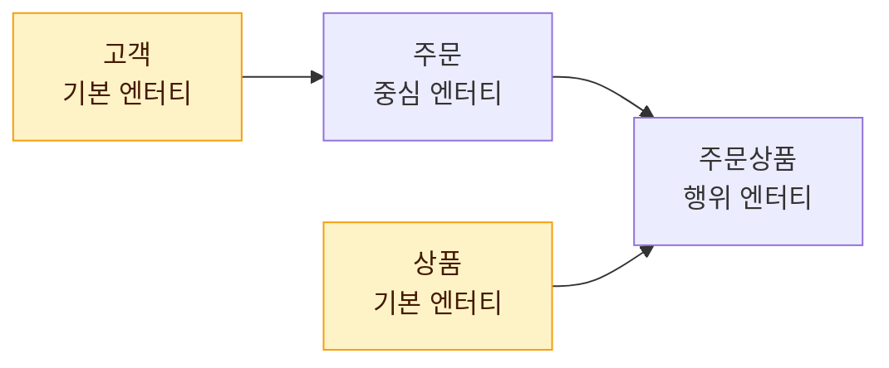

# 엔터티

엔터티(Entity)는 업무에서 관리해야 할 대상을 하나의 집합으로 묶은 것이다. 데이터 모델링의 출발점이며, 어떤 것을 엔터티로 볼 수 있는지 판단하는 기준이 자주 출제된다.

## 엔터티의 개념

엔터티는 업무에 필요하고 유용한 정보를 저장·관리하기 위한 **집합적인 것**(Thing)이다. 사람, 장소, 물건, 사건, 개념처럼 **명사**로 표현되는 대상이 후보가 된다.

- 물리적 모델에서는 보통 **테이블**로 구현된다
- 엔터티는 **속성**으로 설명되고, 다른 엔터티와 **관계**를 맺는다

| 모델링 용어 | 물리 구현 시 대응 |
| --- | --- |
| 엔터티 | 테이블 |
| 인스턴스 | 행(Row) |
| 속성 | 컬럼(Column) |

## 엔터티와 인스턴스

**인스턴스**(Instance)는 엔터티에 속한 개별 대상 하나로, 어커런스(Occurrence)라고도 한다. 엔터티는 인스턴스의 집합이고, 인스턴스는 그 집합의 원소다.

<figure class="md-figure">
<svg viewBox="0 0 640 200" xmlns="http://www.w3.org/2000/svg" font-family="Pretendard Variable, Pretendard, sans-serif" role="img" aria-label="사원 엔터티와 인스턴스, 그리고 EMP 테이블의 행 대응">
<defs><marker id="entity-arrow" viewBox="0 0 10 10" refX="8" refY="5" markerWidth="6" markerHeight="6" orient="auto"><path d="M0 0 L10 5 L0 10z" fill="var(--primary)"/></marker></defs>
<rect x="20" y="30" width="360" height="150" rx="14" fill="var(--muted)"/>
<text x="40" y="56" font-size="14" font-weight="700" fill="var(--foreground)">사원 엔터티 (집합)</text>
<rect x="40" y="80" width="100" height="70" rx="10" fill="var(--card)" stroke="oklch(0.62 0.17 255)" stroke-width="2"/>
<rect x="150" y="80" width="100" height="70" rx="10" fill="var(--card)" stroke="oklch(0.62 0.17 255)" stroke-width="2"/>
<rect x="260" y="80" width="100" height="70" rx="10" fill="var(--card)" stroke="oklch(0.62 0.17 255)" stroke-width="2"/>
<text x="90" y="112" text-anchor="middle" font-size="14" font-weight="700" fill="var(--foreground)">홍길동</text>
<text x="200" y="112" text-anchor="middle" font-size="14" font-weight="700" fill="var(--foreground)">김철수</text>
<text x="310" y="112" text-anchor="middle" font-size="14" font-weight="700" fill="var(--foreground)">이영희</text>
<text x="90" y="134" text-anchor="middle" font-size="11" fill="var(--muted-foreground)">인스턴스</text>
<text x="200" y="134" text-anchor="middle" font-size="11" fill="var(--muted-foreground)">인스턴스</text>
<text x="310" y="134" text-anchor="middle" font-size="11" fill="var(--muted-foreground)">인스턴스</text>
<path d="M388 115 L412 115" stroke="var(--primary)" stroke-width="3" marker-end="url(#entity-arrow)"/>
<text x="520" y="48" text-anchor="middle" font-size="13" font-weight="700" fill="var(--foreground)">EMP 테이블</text>
<rect x="420" y="60" width="200" height="28" fill="oklch(0.62 0.17 255)" fill-opacity="0.15" stroke="var(--border)"/>
<rect x="420" y="88" width="200" height="28" fill="var(--card)" stroke="var(--border)"/>
<rect x="420" y="116" width="200" height="28" fill="var(--card)" stroke="var(--border)"/>
<rect x="420" y="144" width="200" height="28" fill="var(--card)" stroke="var(--border)"/>
<path d="M520 60 L520 172" stroke="var(--border)"/>
<text x="470" y="79" text-anchor="middle" font-size="12" font-weight="700" fill="var(--foreground)">EMP_NO</text>
<text x="570" y="79" text-anchor="middle" font-size="12" font-weight="700" fill="var(--foreground)">EMP_NM</text>
<text x="470" y="107" text-anchor="middle" font-size="12" fill="var(--foreground)">1001</text>
<text x="570" y="107" text-anchor="middle" font-size="12" fill="var(--foreground)">홍길동</text>
<text x="470" y="135" text-anchor="middle" font-size="12" fill="var(--foreground)">1002</text>
<text x="570" y="135" text-anchor="middle" font-size="12" fill="var(--foreground)">김철수</text>
<text x="470" y="163" text-anchor="middle" font-size="12" fill="var(--foreground)">1003</text>
<text x="570" y="163" text-anchor="middle" font-size="12" fill="var(--foreground)">이영희</text>
</svg>
<figcaption>엔터티(집합)는 테이블로, 인스턴스(원소) 하나하나는 테이블의 행으로 구현된다</figcaption>
</figure>

| 엔터티 | 인스턴스 예 |
| --- | --- |
| 사원 | 홍길동, 김철수 |
| 과목 | 데이터베이스, 운영체제 |
| 주문 | 2024-001번 주문, 2024-002번 주문 |

## 엔터티의 특징

다음 6가지를 **모두** 만족해야 올바른 엔터티로 볼 수 있다.

::: cards 2
- **💼 업무에서 필요하고 관리하고자 하는 정보** 해당 업무 영역에서 실제로 관리할 필요가 있어야 한다. 같은 "환자"라도 병원 시스템에서는 엔터티지만, 일반 쇼핑몰에서는 관리 대상이 아니다.
- **🔑 유일한 식별자에 의해 식별 가능** 각 인스턴스를 구별할 수 있는 식별자가 있어야 한다.
- **👥 영속적으로 존재하는 2개 이상의 인스턴스 집합** 인스턴스가 하나뿐이면 집합으로 볼 수 없다. 회사 정보처럼 한 건뿐인 대상은 엔터티로 보기 어렵다.
- **⚙️ 업무 프로세스에 의해 이용** 생성·조회·수정·삭제 중 어떤 프로세스에서든 쓰여야 한다. 어디서도 안 쓰이면 잘못 도출된 엔터티일 가능성이 크며, CRUD 매트릭스로 검증한다.
- **🏷️ 반드시 속성을 가짐** 엔터티를 설명하는 속성이 있어야 한다. 관계 엔터티처럼 주식별자만으로 의미가 있는 경우는 예외적으로 인정한다.
- **🔗 다른 엔터티와 최소 1개 이상의 관계** 고립된 엔터티는 업무적으로 의미가 약하다.
:::

::: warning 관계가 없어도 되는 예외
**통계성 엔터티**, **코드성 엔터티**, **시스템 처리용 내부 엔터티**(트랜잭션 로그 등)는 관계를 생략하기도 한다. "모든 엔터티는 예외 없이 관계를 가져야 한다"는 보기는 틀린 설명이다.
:::

> 시험 포인트: 엔터티 특징 중 "반드시 2개 이상의 인스턴스", "업무 프로세스에 의해 이용", "최소 1개 이상의 관계"가 자주 출제된다. 관계가 없어도 되는 예외(통계·코드·내부 처리용 엔터티)도 함께 기억한다.

## 엔터티의 분류

엔터티는 **유무형에 따른 분류**와 **발생 시점에 따른 분류** 두 가지 기준으로 나눈다. 같은 엔터티가 두 기준에서 각각 다른 이름으로 불린다.

### 유무형에 따른 분류

"눈에 보이는가, 개념인가, 일어난 일인가"로 나눈다.

::: cards 3
- **📦 유형 엔터티 (Tangible)** 물리적인 형태가 있고 안정적이며 지속적으로 활용된다. 예: 사원, 물품, 강사, 차량
- **💡 개념 엔터티 (Conceptual)** 물리적 형태는 없지만 관리할 가치가 있는 개념적 정보. 예: 조직, 보험상품, 과목, 계좌 유형
- **⚡ 사건 엔터티 (Event)** 업무 수행 과정에서 발생하며, 발생량이 많고 각종 통계에 활용된다. 예: 주문, 청구, 미납, 입출금
:::

### 발생 시점에 따른 분류

"원래 있던 것인가, 무엇으로부터 생겨났는가"로 나눈다.

::: cards 3
- **🌱 기본 엔터티 (Basic, 키 엔터티)** 업무에 원래 존재하는 정보. 다른 엔터티와 관계없이 독립적으로 생성되며 **자신만의 주식별자**를 가진다. 다른 엔터티의 부모 역할. 예: 사원, 부서, 고객, 상품
- **🎯 중심 엔터티 (Main)** 기본 엔터티로부터 발생하며 업무의 중심 역할. 데이터 양이 많고 다른 엔터티와 많은 관계를 맺으며, 행위 엔터티를 생성한다. 예: 계약, 주문, 매출, 사고
- **🔄 행위 엔터티 (Active)** **2개 이상의 부모 엔터티**로부터 발생. 내용이 자주 바뀌거나 양이 증가한다. 상세 설계·프로세스 모델링 단계에서 주로 도출. 예: 주문목록, 사원변경이력, 구매이력
:::

### 발생 흐름 예



::: flow
- **기본** 고객과 상품은 원래 존재한다
- **중심** 주문은 고객으로부터 발생한다
- **행위** 주문상품은 주문과 상품 **두 부모**로부터 발생한다
:::

::: example 하나의 엔터티, 두 개의 이름
"주문"은 유무형 기준으로는 **사건 엔터티**, 발생 시점 기준으로는 **중심 엔터티**다. "사원"은 유형 엔터티이면서 기본 엔터티다.
:::

> 시험 포인트: 분류 기준을 섞어 묻는 문제가 많다. "유형/개념/사건"은 **유무형** 기준, "기본/중심/행위"는 **발생 시점** 기준이다. 예를 들어 "주문"은 유무형 기준으로는 사건 엔터티, 발생 시점 기준으로는 중심 엔터티에 해당한다.

## 엔터티 명명 규칙

| 규칙 | 설명 |
| --- | --- |
| 현업 업무 용어 사용 | 가능하면 실제 업무에서 쓰는 용어로 이름을 붙임 |
| 약어 사용 지양 | 의미가 모호해지지 않도록 약어를 가급적 피함 |
| 단수 명사 사용 | "사원들"이 아니라 "사원" |
| 유일한 이름 | 모든 엔터티 이름은 모델 내에서 중복되지 않아야 함 |
| 생성 의미대로 부여 | 엔터티가 생성되는 업무 의미가 드러나도록 명명 (예: "고객제품"보다 "계약") |

::: info 왜 단수 명사일까
엔터티는 집합이지만, 그 이름은 집합에 속한 "**한 개체**"의 의미를 나타내기 때문이다. 명명을 정확히 하면 관계와 속성 정의도 자연스럽게 명확해진다.
:::

## 엔터티 도출 시 확인 사항

::: steps
1. **명사 후보 추출** 업무 기술서·장표에서 반복적으로 등장하는 명사를 후보로 뽑는다
2. **6가지 특징 검토** 후보마다 엔터티의 특징을 모두 만족하는지 확인한다
3. **속성과 구분** 단순 속성에 불과한 명사(예: 사원의 "이름")는 엔터티가 아니라 속성으로 처리한다
4. **동의어 통합** 같은 의미를 가진 다른 이름의 후보는 하나로 합친다
:::

```sql
-- 엔터티 "사원"이 물리 모델에서 테이블로 구현된 예
CREATE TABLE EMP (
    EMP_NO   VARCHAR2(10) PRIMARY KEY,  -- 식별자
    EMP_NM   VARCHAR2(50) NOT NULL,     -- 속성
    DEPT_NO  VARCHAR2(10)               -- 부서와의 관계 (FK)
);
```

자세한 속성 개념은 [속성](/theory/attribute), 식별자는 [식별자](/theory/identifier)에서 다룬다.

## 핵심 요약

- 엔터티는 업무에서 관리할 대상의 집합이며, 인스턴스는 그 집합의 개별 원소
- 특징 6가지: 업무 필요, 식별자, 2개 이상 인스턴스, 프로세스 이용, 속성 보유, 관계 보유
- 통계·코드·내부 처리용 엔터티는 관계를 생략하는 예외가 있음
- 유무형 분류: 유형(사원) / 개념(보험상품) / 사건(주문)
- 발생 시점 분류: 기본(고객) / 중심(주문) / 행위(주문목록)
- 기본 엔터티는 독립 생성되고 자신의 주식별자를 가지며, 행위 엔터티는 2개 이상 부모에서 발생
- 명명: 현업 용어, 약어 지양, 단수 명사, 유일한 이름, 생성 의미대로
