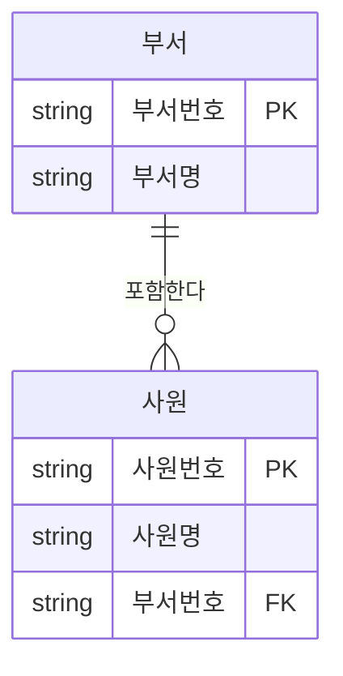
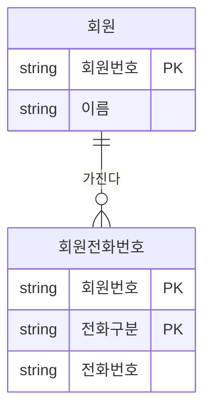

# 속성

속성(Attribute)은 엔터티가 가진 성질을 나타내는 가장 작은 데이터 단위다. 분류 기준이 여러 가지이므로 각 기준과 그에 속한 종류를 정확히 짝지어 기억해야 한다.

## 속성의 개념

속성은 업무에서 필요로 하는 정보 중 **의미상 더 이상 분리되지 않는** 최소의 데이터 단위다.

- 엔터티를 설명하고, 인스턴스를 구성하는 요소
- 물리 모델에서는 **컬럼**으로 구현된다

### 속성인지 판단하는 기준

::: cards 2
- **업무 필요성** 업무에서 관리할 필요가 있는가
- **분리 불가** 의미상 더 쪼갤 수 없는가. "주소"를 시·구·동으로 나눠 관리할 업무 요구가 있으면 각각이 속성이다.
- **설명 정보** 엔터티를 설명하는 정보인가
- **단일 값** 하나의 인스턴스에서 하나의 값만 가지는가
:::

> 시험 포인트: 속성 판단 기준은 "업무 요구"가 우선이다. 같은 "주소"라도 업무에서 분리해 관리할 필요가 없으면 하나의 속성으로 둔다.

## 엔터티, 인스턴스, 속성, 속성값의 관계

표 하나로 네 용어를 한 번에 짚을 수 있다. 표 전체가 엔터티, 가로 한 줄이 인스턴스, 세로 한 줄이 속성, 칸 하나가 속성값이다.

<figure class="md-figure">
<svg viewBox="0 0 640 180" xmlns="http://www.w3.org/2000/svg" font-family="Pretendard Variable, Pretendard, sans-serif" role="img" aria-label="사원 표에서 엔터티, 인스턴스, 속성, 속성값의 위치">
<rect x="140" y="60" width="360" height="34" fill="var(--muted)" stroke="var(--border)"/>
<rect x="140" y="94" width="360" height="34" fill="var(--card)" stroke="var(--border)"/>
<rect x="140" y="128" width="360" height="34" fill="var(--card)" stroke="var(--border)"/>
<path d="M260 60 L260 162 M380 60 L380 162" stroke="var(--border)"/>
<rect x="260" y="60" width="120" height="102" fill="oklch(0.65 0.14 160)" fill-opacity="0.12" stroke="oklch(0.65 0.14 160)" stroke-width="2" stroke-dasharray="5 3"/>
<rect x="140" y="128" width="360" height="34" fill="oklch(0.62 0.17 255)" fill-opacity="0.12" stroke="oklch(0.62 0.17 255)" stroke-width="2"/>
<rect x="380" y="94" width="120" height="34" fill="oklch(0.75 0.16 75)" fill-opacity="0.25" stroke="oklch(0.75 0.16 75)" stroke-width="2"/>
<text x="200" y="82" text-anchor="middle" font-size="13" font-weight="700" fill="var(--foreground)">사원번호</text>
<text x="320" y="82" text-anchor="middle" font-size="13" font-weight="700" fill="var(--foreground)">이름</text>
<text x="440" y="82" text-anchor="middle" font-size="13" font-weight="700" fill="var(--foreground)">부서</text>
<text x="200" y="116" text-anchor="middle" font-size="13" fill="var(--foreground)">1001</text>
<text x="320" y="116" text-anchor="middle" font-size="13" fill="var(--foreground)">홍길동</text>
<text x="440" y="116" text-anchor="middle" font-size="13" fill="var(--foreground)">영업</text>
<text x="200" y="150" text-anchor="middle" font-size="13" fill="var(--foreground)">1002</text>
<text x="320" y="150" text-anchor="middle" font-size="13" fill="var(--foreground)">김철수</text>
<text x="440" y="150" text-anchor="middle" font-size="13" fill="var(--foreground)">개발</text>
<text x="320" y="48" text-anchor="middle" font-size="12" font-weight="700" fill="oklch(0.65 0.14 160)">속성 (컬럼)</text>
<text x="510" y="116" font-size="12" font-weight="700" fill="oklch(0.75 0.16 75)">속성값</text>
<text x="510" y="150" font-size="12" font-weight="700" fill="oklch(0.62 0.17 255)">인스턴스 (행)</text>
<path d="M134 60 L128 60 L128 162 L134 162" fill="none" stroke="var(--foreground)" stroke-width="1.5"/>
<text x="120" y="108" text-anchor="end" font-size="13" font-weight="700" fill="var(--foreground)">사원 엔터티</text>
<text x="120" y="126" text-anchor="end" font-size="11" fill="var(--muted-foreground)">(전체 집합)</text>
</svg>
<figcaption>엔터티: 사원 / 인스턴스: 1001 행, 1002 행 / 속성: 사원번호, 이름, 부서 / 속성값: 1001, 홍길동, 영업 등</figcaption>
</figure>

| 관계 | 설명 |
| --- | --- |
| 엔터티 : 인스턴스 | 한 엔터티는 2개 이상의 인스턴스를 가짐 |
| 엔터티 : 속성 | 한 엔터티는 2개 이상의 속성을 가짐 |
| 인스턴스 : 속성 | 한 인스턴스는 엔터티에 정의된 모든 속성을 가짐 |
| 속성 : 속성값 | 한 인스턴스에서 **하나의 속성은 하나의 속성값만** 가짐 |

::: info 한 칸에 값이 여러 개라면
하나의 속성에 여러 값이 들어가야 한다면 **다중값 속성**이며, 별도 엔터티로 분리하는 것이 원칙이다 (제1정규형).
:::

## 특성에 따른 분류

"원래 업무에 있던 값인가, 설계자가 만든 값인가, 계산한 값인가"로 나눈다.

::: cards 3
- **📝 기본 속성 (Basic)** 업무 분석을 통해 바로 정의되는 본래의 속성. 대부분의 속성이 여기에 해당한다. 예: 제품명, 가격, 제조일자
- **🛠️ 설계 속성 (Designed)** 업무상 필요하지는 않지만 설계 과정에서 **새로 만들거나 변형**한 속성. 코드성 데이터, 일련번호 등. 예: 상품코드, 주문일련번호, 상태코드
- **🧮 파생 속성 (Derived)** 다른 속성으로부터 **계산·변형**되어 만들어진 속성. 예: 주문총액, 합계, 평균점수, 나이
:::

### 파생 속성 유의점

::: warning 파생 속성은 최소한으로
- 원본 값이 바뀌면 파생 값도 함께 갱신해야 하므로 **데이터 정합성** 관리가 필요하다
- 가급적 적게 정의하는 것이 좋으며, 조회 성능 등을 위해 꼭 필요할 때만 사용한다
- 물리 설계 단계의 반정규화 결과로 추가되는 경우가 많다
:::

```sql
-- 파생 속성 없이 조회 시 계산
SELECT ORDER_NO, SUM(QTY * UNIT_PRICE) AS TOTAL_AMT
  FROM ORDER_ITEM
 GROUP BY ORDER_NO;

-- 파생 속성(TOTAL_AMT)을 주문 테이블에 둔다면
-- ORDER_ITEM 변경 시마다 ORDER.TOTAL_AMT도 함께 갱신해야 정합성이 유지됨
```

> 시험 포인트: "일련번호, 코드"처럼 업무에 원래 없던 값을 설계자가 만든 것은 **설계 속성**, "합계, 평균, 총액"처럼 계산된 값은 **파생 속성**이다. 파생 속성은 가능한 한 적게 정의한다는 점도 출제된다.

## 구성 방식에 따른 분류

| 분류 | 설명 |
| --- | --- |
| PK 속성 (Primary Key) | 엔터티의 인스턴스를 유일하게 식별하는 속성 |
| FK 속성 (Foreign Key) | 다른 엔터티와의 관계에서 포함된 속성 (부모의 식별자를 상속) |
| 일반 속성 | PK, FK에 포함되지 않는 나머지 속성 |

ERD에서 보면 다음과 같다. 사원의 부서번호는 부서로부터 받아온 FK 속성이고, 사원명은 일반 속성이다.



하나의 속성이 PK이면서 동시에 FK일 수도 있다. 식별 관계에서 자식 엔터티가 부모의 식별자를 자기 PK의 일부로 받는 경우다 ([식별자](/theory/identifier) 참고).

## 분해 여부와 값의 개수에 따른 분류

### 단일 속성과 복합 속성

::: compare
- **단일 속성 (Simple)** 하나의 의미로만 구성되어 더 이상 분해되지 않는다. 예: 회원번호, 이름, 나이
- **복합 속성 (Composite)** 여러 의미 있는 하위 속성으로 분해될 수 있다. 예: 주소(시, 구, 동, 상세주소), 날짜(연, 월, 일)
:::

### 단일값 속성과 다중값 속성

::: compare
- **단일값 속성 (Single-Valued)** 하나의 인스턴스에서 하나의 값만 가진다. 예: 주민등록번호, 생년월일
- **다중값 속성 (Multi-Valued)** 하나의 인스턴스에서 여러 값을 가질 수 있다. 예: 전화번호(집, 휴대폰, 회사), 차량 색상
:::

다중값 속성은 그대로 두면 하나의 속성에 여러 값이 들어가므로 **별도 엔터티로 분리**하여 1:M 관계로 표현한다.



## 도메인

**도메인**(Domain)은 각 속성이 가질 수 있는 **값의 범위**다. 엔터티 내에서 속성에 대한 데이터 타입과 크기, 제약사항을 정의하는 것으로, 다음을 포함한다.

- 데이터 타입, 길이(크기), 허용 값, 제약조건(NOT NULL, CHECK 등)

| 속성 | 도메인 예 |
| --- | --- |
| 학점 | 0.0 이상 4.5 이하의 숫자 |
| 성별 | 'M' 또는 'F' |
| 나이 | 0 이상의 정수 |

```sql
CREATE TABLE STUDENT (
    STU_NO   VARCHAR2(10) PRIMARY KEY,
    GENDER   CHAR(1)      CHECK (GENDER IN ('M', 'F')),
    GPA      NUMBER(2,1)  CHECK (GPA BETWEEN 0 AND 4.5)
);
-- 데이터 타입, 길이, CHECK 제약으로 도메인을 물리적으로 구현
```

::: info 실무에서는 공통 도메인
"금액", "일자", "코드"처럼 공통 도메인을 정의해 여러 속성에 일관되게 적용한다 (표준화).
:::

> 시험 포인트: "속성이 가질 수 있는 값의 범위"를 묻는 용어는 **도메인**이다. 도메인은 데이터 타입·크기·제약조건을 함께 포함하는 개념이다.

## 속성 명명 규칙

| 규칙 | 설명 |
| --- | --- |
| 현업 업무 용어 사용 | 실제 업무에서 쓰는 이름을 사용 |
| 서술식 이름 지양 | "고객이 주문한 날짜"보다 "주문일자"처럼 명사형으로 |
| 약어 사용 지양 | 의미 혼란 방지 |
| 수식어·소유격 지양 | "고객의 이름"보다 "고객명" |
| 전체 모델에서 유일한 이름 권장 | 같은 이름이 다른 의미로 쓰이지 않도록 하여 반정규화·통합 시 혼란 방지 |

## 핵심 요약

- 속성은 업무상 필요하고 의미상 더 이상 분리되지 않는 최소 데이터 단위
- 한 인스턴스에서 한 속성은 하나의 속성값만 가짐
- 특성 분류: 기본 / 설계(코드, 일련번호) / 파생(계산값, 정합성 주의, 최소화)
- 구성 방식 분류: PK / FK / 일반 속성
- 분해 여부: 단일 / 복합
- 값의 개수: 단일값 / 다중값 (다중값은 별도 엔터티로 분리)
- 도메인은 속성이 가질 수 있는 값의 범위 (타입, 크기, 제약조건)
- 명명: 현업 용어, 서술식·약어·소유격 지양, 모델 전체에서 유일하게
