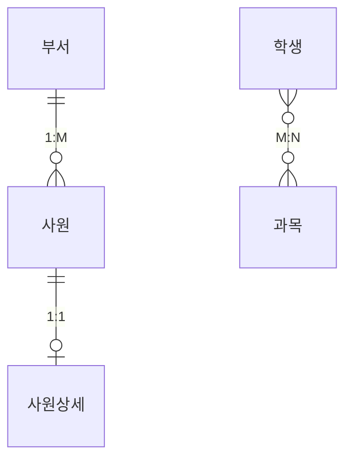
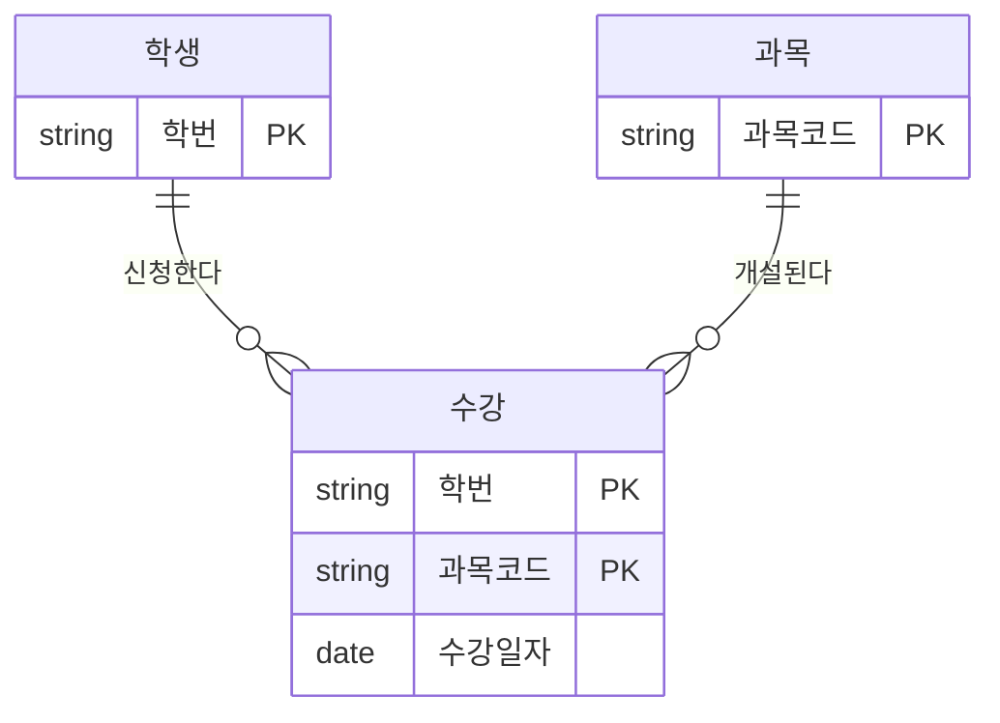

# 관계

관계(Relationship)는 엔터티와 엔터티 사이의 논리적인 연관성을 의미한다. ERD에서 선으로 표현되며, 관계명·관계차수·관계선택사양 세 가지 표기 요소를 정확히 읽을 수 있어야 한다.

## 관계의 개념

- 엔터티의 인스턴스 사이에 존재하는 **논리적인 연관성**
- 존재의 형태나 행위로서 서로에게 연관성이 부여된 상태
- 관계는 엔터티 간에 정의되지만, 실제 연결은 **인스턴스 단위**로 이루어진다
- 인스턴스 간 개별 연결을 **페어링**(Pairing)이라 하고, 페어링의 집합이 관계다

<figure class="md-figure">
<svg viewBox="0 0 640 220" xmlns="http://www.w3.org/2000/svg" font-family="Pretendard Variable, Pretendard, sans-serif" role="img" aria-label="부서 인스턴스와 사원 인스턴스를 잇는 페어링">
<rect x="40" y="30" width="180" height="170" rx="12" fill="var(--muted)"/>
<rect x="420" y="30" width="180" height="170" rx="12" fill="var(--muted)"/>
<text x="130" y="54" text-anchor="middle" font-size="14" font-weight="700" fill="var(--foreground)">부서 엔터티</text>
<text x="510" y="54" text-anchor="middle" font-size="14" font-weight="700" fill="var(--foreground)">사원 엔터티</text>
<path d="M190 91 L450 83 M190 91 L450 129 M190 157 L450 175" stroke="oklch(0.65 0.14 160)" stroke-width="2.5"/>
<rect x="70" y="74" width="120" height="34" rx="17" fill="var(--card)" stroke="oklch(0.62 0.17 255)" stroke-width="2"/>
<rect x="70" y="140" width="120" height="34" rx="17" fill="var(--card)" stroke="oklch(0.62 0.17 255)" stroke-width="2"/>
<rect x="450" y="66" width="120" height="34" rx="17" fill="var(--card)" stroke="oklch(0.62 0.17 255)" stroke-width="2"/>
<rect x="450" y="112" width="120" height="34" rx="17" fill="var(--card)" stroke="oklch(0.62 0.17 255)" stroke-width="2"/>
<rect x="450" y="158" width="120" height="34" rx="17" fill="var(--card)" stroke="oklch(0.62 0.17 255)" stroke-width="2"/>
<text x="130" y="96" text-anchor="middle" font-size="13" fill="var(--foreground)">영업부</text>
<text x="130" y="162" text-anchor="middle" font-size="13" fill="var(--foreground)">개발부</text>
<text x="510" y="88" text-anchor="middle" font-size="13" fill="var(--foreground)">홍길동</text>
<text x="510" y="134" text-anchor="middle" font-size="13" fill="var(--foreground)">김철수</text>
<text x="510" y="180" text-anchor="middle" font-size="13" fill="var(--foreground)">이영희</text>
<text x="320" y="74" text-anchor="middle" font-size="12" font-weight="700" fill="oklch(0.65 0.14 160)">페어링</text>
<text x="320" y="190" text-anchor="middle" font-size="12" font-weight="700" fill="oklch(0.65 0.14 160)">페어링</text>
<text x="320" y="24" text-anchor="middle" font-size="12" fill="var(--muted-foreground)">초록 선 하나하나 = 페어링, 페어링 전체 = 관계</text>
</svg>
<figcaption>관계는 엔터티 사이에 정의하지만, 실제로 연결되는 것은 인스턴스와 인스턴스다</figcaption>
</figure>

| 개념 | 설명 |
| --- | --- |
| 관계 (Relationship) | 엔터티 간 연관성의 집합적 표현 |
| 페어링 (Pairing) | 개별 인스턴스 간의 실제 연결 |

## 관계의 분류

::: compare
- **존재적 관계** 한 엔터티의 존재가 다른 엔터티의 존재에 영향을 주는 관계. 예: 부서와 사원 (사원은 부서에 소속되어 존재)
- **행위적 관계** 엔터티 간에 어떤 행위가 있어야 성립하는 관계. 예: 고객과 주문 (고객이 주문 행위를 해야 연결됨)
:::

ERD에서는 존재적 관계와 행위적 관계를 **구분하지 않고** 동일한 관계선으로 표현한다.

::: info UML 클래스 다이어그램은 구분한다
- **연관 관계(Association)**: 실선, 멤버 변수로 참조 (존재적 관계에 가까움)
- **의존 관계(Dependency)**: 점선, 행위(오퍼레이션) 중에 참조 (행위적 관계에 가까움)
:::

> 시험 포인트: "ERD에서는 존재적 관계와 행위적 관계를 구분하지 않는다"가 자주 출제된다. UML에서 연관 관계는 실선, 의존 관계는 점선이다.

## 관계의 표기법

관계는 다음 세 가지 요소로 표현한다.

::: cards 3
- **🏷️ 관계명 (Membership)** 관계의 이름. 엔터티가 관계에 참여하는 형태를 동사로 표현한다
- **🔢 관계차수 (Cardinality)** 두 엔터티 간 관계에 참여하는 인스턴스의 수 (1:1, 1:M, M:N)
- **❓ 관계선택사양 (Optionality)** 관계 참여가 필수인지 선택인지
:::

### 관계명

- 관계의 시작점과 끝점 양쪽에 각각 이름을 붙인다 (하나의 관계는 **두 개의 관계명**을 가짐)
- 예: 부서 "포함한다" ↔ 사원 "소속된다"

::: warning 관계명 명명 규칙
- **애매한 동사를 피한다**: "관계된다", "관련이 있다", "이다", "한다" 등은 구체적이지 않다
- **현재형**으로 표현한다: "수강을 신청했다"(X) → "수강 신청한다"(O)
:::

### 관계차수 (Cardinality)

| 차수 | 의미 | 예 |
| --- | --- | --- |
| 1:1 | 한 인스턴스가 상대 엔터티의 인스턴스 하나와만 관계 | 사원 - 사원상세 |
| 1:M | 한 인스턴스가 상대 엔터티의 여러 인스턴스와 관계 | 부서 - 사원 |
| M:N | 양쪽 모두 여러 인스턴스와 관계 | 학생 - 과목 |

IE 표기법에서 "여러(M)" 쪽은 **까마귀 발**로 표시한다. 세 가지 차수를 ERD로 그리면 다음과 같다.



M:N 관계는 관계형 DB에서 직접 구현할 수 없으므로 **관계(교차) 엔터티**를 두어 두 개의 1:M 관계로 해소한다.



```sql
-- 학생(M) : 과목(N) 관계를 수강 엔터티로 해소
CREATE TABLE ENROLL (
    STU_NO   VARCHAR2(10),
    SUBJ_CD  VARCHAR2(10),
    ENROLL_DT DATE,
    CONSTRAINT PK_ENROLL PRIMARY KEY (STU_NO, SUBJ_CD),
    CONSTRAINT FK_ENROLL_STU  FOREIGN KEY (STU_NO)  REFERENCES STUDENT (STU_NO),
    CONSTRAINT FK_ENROLL_SUBJ FOREIGN KEY (SUBJ_CD) REFERENCES SUBJECT (SUBJ_CD)
);
```

### 관계선택사양 (Optionality)

| 구분 | 의미 | IE 표기 | Barker 표기 |
| --- | --- | --- | --- |
| 필수 참여 (Mandatory) | 모든 인스턴스가 반드시 관계에 참여해야 함 | 막대(｜) | 실선 |
| 선택 참여 (Optional) | 관계에 참여하지 않는 인스턴스가 있을 수 있음 | 원(O) | 점선 |

IE 표기법의 선 끝 기호를 그림으로 보면 다음과 같다.

<figure class="md-figure">
<svg viewBox="0 0 640 210" xmlns="http://www.w3.org/2000/svg" font-family="Pretendard Variable, Pretendard, sans-serif" role="img" aria-label="IE 표기법에서 막대, 원, 까마귀 발 기호의 의미">
<text x="320" y="28" text-anchor="middle" font-size="12" fill="var(--muted-foreground)">기호는 선의 끝, 해당 엔터티 바로 앞에 붙는다</text>
<path d="M150 95 L490 95" stroke="var(--foreground)" stroke-width="2"/>
<rect x="30" y="70" width="120" height="50" rx="10" fill="var(--card)" stroke="var(--foreground)" stroke-width="1.5"/>
<rect x="490" y="70" width="120" height="50" rx="10" fill="var(--card)" stroke="var(--foreground)" stroke-width="1.5"/>
<text x="90" y="100" text-anchor="middle" font-size="14" font-weight="700" fill="var(--foreground)">부서</text>
<text x="550" y="100" text-anchor="middle" font-size="14" font-weight="700" fill="var(--foreground)">사원</text>
<path d="M166 83 L166 107 M176 83 L176 107" stroke="oklch(0.62 0.17 255)" stroke-width="2.5"/>
<path d="M470 95 L490 81 M470 95 L490 109 M470 95 L490 95" stroke="oklch(0.75 0.16 75)" stroke-width="2.5"/>
<circle cx="455" cy="95" r="8" fill="var(--card)" stroke="oklch(0.65 0.14 160)" stroke-width="2.5"/>
<text x="320" y="86" text-anchor="middle" font-size="12" fill="var(--foreground)">포함한다 / 소속된다</text>
<text x="171" y="145" text-anchor="middle" font-size="12" font-weight="700" fill="oklch(0.62 0.17 255)">막대 두 개</text>
<text x="171" y="163" text-anchor="middle" font-size="11" fill="var(--muted-foreground)">반드시 하나 (필수 · 1)</text>
<text x="420" y="145" text-anchor="middle" font-size="12" font-weight="700" fill="oklch(0.65 0.14 160)">원 = 선택 (0건 가능)</text>
<text x="420" y="163" text-anchor="middle" font-size="12" font-weight="700" fill="oklch(0.75 0.16 75)">까마귀 발 = 여러 (M)</text>
<text x="320" y="198" text-anchor="middle" font-size="12" fill="var(--foreground)">부서 기준으로 읽을 때는 사원 쪽 기호를 본다 → 여러 사원이 때때로 소속된다</text>
</svg>
<figcaption>부서 쪽 막대 두 개는 "사원은 반드시 하나의 부서", 사원 쪽 원과 까마귀 발은 "부서에는 0명 이상 여러 사원"</figcaption>
</figure>

- 예: 주문은 반드시 주문목록을 가져야 함(필수), 고객은 주문을 하지 않을 수도 있음(선택)
- 필수 참여는 물리적으로 FK 컬럼의 NOT NULL 또는 애플리케이션 로직으로 구현된다
- 선택 참여 여부를 잘못 정의하면 조인 결과(내부 조인 vs 외부 조인) 판단에도 영향을 준다

> 시험 포인트: 선택사양 기호는 **상대편 엔터티 쪽 끝**에 표시된다는 점에 주의한다. IE 표기법에서 원(O)은 선택, 막대는 필수이며, Barker 표기법은 점선이 선택, 실선이 필수이다.

## 관계 정의 시 체크사항

두 엔터티 사이에 관계를 정의할지 판단할 때 다음을 확인한다.

1. 두 엔터티 사이에 관심 있는 **연관 규칙**이 존재하는가
2. 두 엔터티 사이에 **정보의 조합**이 발생하는가
3. 업무 기술서, 장표에 **관계 연결에 대한 규칙**이 서술되어 있는가
4. 업무 기술서, 장표에 관계 연결을 가능하게 하는 **동사**(Verb)가 있는가

::: tip 명사는 엔터티, 동사는 관계
엔터티 후보는 업무 기술서의 명사에서, 관계 후보는 동사에서 찾는다고 기억하면 쉽다.
:::

## 관계 읽는 방법

관계는 한쪽 엔터티를 기준으로 다음 순서로 읽는다.

::: steps
1. **기준 엔터티** 기준 엔터티를 **한**(One) 또는 **각**(Each)으로 읽는다
2. **관계차수** 대상 엔터티의 관계차수를 읽는다 (하나, 여러)
3. **관계선택사양** 필수면 "항상/반드시", 선택이면 "때때로/가끔"으로 읽는다
4. **관계명** 마지막에 관계명을 읽는다
:::

### 예: 부서 - 사원 (1:M)

위 그림의 부서-사원 관계를 양쪽 방향으로 읽어 보자.

- 부서 → 사원 방향: "**각각의** 부서에는 **여러** 사원이 **때때로** 소속된다." (사원이 없는 부서 허용 시)
- 사원 → 부서 방향: "**각** 사원은 **하나의** 부서에 **항상** 소속된다." (모든 사원이 부서를 가져야 하는 경우)

| 순서 | 부서 기준 | 사원 기준 |
| --- | --- | --- |
| 기준 엔터티 | 각각의 부서에는 | 각 사원은 |
| 관계차수 | 여러 사원이 | 하나의 부서에 |
| 선택사양 | 때때로 | 항상 |
| 관계명 | 소속된다 | 소속된다 |

> 시험 포인트: ERD 그림을 주고 올바른 해석을 고르는 문제가 많다. 차수와 선택사양 기호는 **읽는 방향의 반대편(대상 엔터티 쪽)** 기호를 보고 읽어야 한다.

## 식별 관계와 비식별 관계

부모 엔터티의 식별자가 자식 엔터티의 **주식별자 일부**로 상속되면 식별 관계, **일반 속성**으로 상속되면 비식별 관계다. 상세한 비교와 선택 기준은 [식별자](/theory/identifier) 문서에서 다룬다.

## 핵심 요약

- 관계는 엔터티 간 논리적 연관성이며, 인스턴스 간 개별 연결은 페어링
- 존재적 관계(부서-사원)와 행위적 관계(고객-주문)는 ERD에서 구분하지 않음
- UML은 연관 관계(실선)와 의존 관계(점선)로 구분
- 관계 표기 3요소: 관계명, 관계차수(1:1, 1:M, M:N), 관계선택사양(필수/선택)
- 관계명은 애매한 동사를 피하고 현재형으로 표현
- M:N 관계는 관계 엔터티로 두 개의 1:M 관계로 해소
- 관계 체크사항: 연관 규칙, 정보 조합, 업무 기술서의 규칙, 동사 존재
- 읽는 순서: 기준 엔터티(각/한) → 관계차수 → 선택사양 → 관계명
