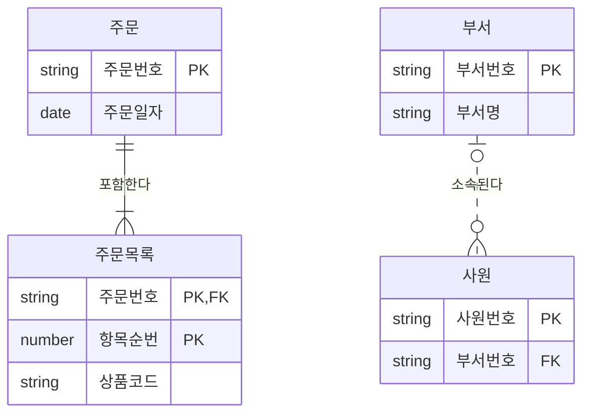

# 식별자

식별자(Identifier)는 엔터티 내의 각 인스턴스를 구분하는 구분자다. 주식별자의 4가지 특징, 4가지 분류 기준, 식별 관계와 비식별 관계의 차이가 매회 출제되는 핵심 영역이다.

## 식별자의 개념

- 하나의 엔터티에 속한 인스턴스들을 **유일하게 구별**하기 위한 속성 또는 속성들의 조합
- 모든 엔터티는 반드시 하나의 주식별자를 가져야 한다
- 논리 모델의 **식별자**는 물리 모델의 **키**(Key)에 대응된다

| 논리 모델 | 물리 모델 |
| --- | --- |
| 주식별자 | 기본키 (Primary Key) |
| 외부식별자 | 외래키 (Foreign Key) |
| 보조식별자 | 대체키 / 유니크 인덱스 |

## 주식별자의 특징

주식별자가 되려면 네 가지 조건을 모두 갖춰야 한다. "**유**일하고, **최**소이며, **불**변이고, **존**재한다"로 묶어 기억하자.

::: cards 2
- **🔑 유일성** 주식별자에 의해 모든 인스턴스를 **유일하게 구분**한다. 예: 사원번호로 모든 사원을 구분
- **✂️ 최소성** 유일성을 만족하는 **최소한의 속성 수**로 구성한다. 예: 사원번호만으로 충분하면 사원번호+이름은 부적합
- **🧊 불변성** 한 번 지정된 값은 **자주 변하지 않아야** 한다. 예: 이름·주소처럼 바뀌는 값은 부적합
- **✅ 존재성** 주식별자로 지정되면 **반드시 값이 존재**한다 (NULL 불가). 예: 사원번호 없는 사원은 존재할 수 없음
:::

```sql
CREATE TABLE EMP (
    EMP_NO  VARCHAR2(10),
    EMP_NM  VARCHAR2(50) NOT NULL,
    CONSTRAINT PK_EMP PRIMARY KEY (EMP_NO)
);
-- PRIMARY KEY 제약 = UNIQUE(유일성) + NOT NULL(존재성)
```

> 시험 포인트: 주식별자 특징 4가지는 "유일성·최소성·불변성·존재성"이다. "참조성", "독립성", "확장성" 같은 보기는 오답이다. 특히 "자주 변경되는 속성"이 주식별자로 부적합한 이유는 **불변성** 위반이다.

## 식별자의 분류

분류 기준은 4가지이고, 기준마다 두 종류로 나뉜다.

::: cards 2
- **대표성 여부** 주식별자 vs 보조식별자
  - **주식별자**: 인스턴스를 구분하며, 다른 엔터티와 참조 관계를 연결할 수 있음
  - **보조식별자**: 인스턴스를 구분할 수는 있으나 대표성이 없어 **참조 관계 연결에 사용하지 않음**
- **스스로 생성 여부** 내부식별자 vs 외부식별자
  - **내부식별자**: 엔터티 내부에서 스스로 만들어지는 식별자
  - **외부식별자**: 다른 엔터티와의 관계를 통해 **부모로부터 받아오는** 식별자 (FK)
- **속성의 수** 단일식별자 vs 복합식별자
  - **단일식별자**: 하나의 속성으로 구성
  - **복합식별자**: 둘 이상의 속성으로 구성
- **대체 여부** 본질식별자 vs 인조식별자
  - **본질식별자**: 업무에 의해 만들어지는 식별자
  - **인조식별자**: 업무적으로 만들어지지 않았지만 원래 식별자가 복잡하여 **인위적으로 만든** 식별자
:::

### 분류 예시

::: example 같은 식별자도 기준마다 이름이 다르다
- 사원 엔터티: 사원번호(주식별자), 주민등록번호(보조식별자)
- 주문목록 엔터티: (주문번호 + 상품코드) → 복합식별자이며 둘 다 외부식별자에서 온 본질식별자
- 주문목록에 "주문목록번호" 일련번호를 새로 만들어 PK로 쓰면 → 인조식별자
:::

### 인조식별자 사용 시 유의점

::: warning 인조식별자의 함정
- 원래 식별자(본질식별자)에 대한 유일성 보장이 사라져 **중복 데이터가 발생할 가능성**이 있다
- 중복 방지를 위해 본질식별자에 별도 유니크 인덱스를 만들면 **불필요한 인덱스가 추가**된다
- 무조건 인조식별자를 쓰기보다, 본질식별자가 지나치게 복잡할 때 선택적으로 사용한다
:::

```sql
-- 인조식별자 사용 시 본질식별자 중복 방지 장치가 별도로 필요
CREATE TABLE ORDER_ITEM (
    ORDER_ITEM_SEQ NUMBER PRIMARY KEY,         -- 인조식별자
    ORDER_NO       VARCHAR2(20) NOT NULL,
    PROD_CD        VARCHAR2(20) NOT NULL,
    QTY            NUMBER,
    CONSTRAINT UK_ORDER_ITEM UNIQUE (ORDER_NO, PROD_CD)  -- 추가 인덱스 발생
);
```

> 시험 포인트: 분류 기준과 종류의 짝을 정확히 기억한다. 대표성 → 주/보조, 스스로 생성 → 내부/외부, 속성 수 → 단일/복합, 대체 여부 → 본질/인조. 보조식별자는 **참조 관계 연결에 사용할 수 없다**는 점도 자주 나온다.

## 주식별자 도출 기준

| 기준 | 설명 |
| --- | --- |
| 업무에서 자주 이용되는 속성 | 해당 업무에서 실제로 인스턴스를 구분할 때 쓰는 속성을 주식별자로 |
| 명칭·내역 등 이름은 피함 | "부서명", "상품명"처럼 이름으로 기술되는 속성은 동명이인·변경 가능성 때문에 부적합. 별도 코드를 부여 |
| 속성 수가 너무 많지 않도록 | 복합식별자의 속성이 많으면(대략 7~8개 이상) 인조식별자 생성 검토. 조인과 SQL이 복잡해짐 |

같은 엔터티 안에서도 업무에서 더 자주 쓰이고 대표성이 있는 쪽을 주식별자로, 나머지는 보조식별자로 둔다. 예를 들어 사원번호와 주민등록번호 중 업무상 사원번호를 주로 사용한다면 사원번호가 주식별자다.

## 식별 관계와 비식별 관계

부모 엔터티의 주식별자를 자식 엔터티가 **어디에** 상속받는지에 따라 구분한다.

::: compare
- **식별 관계 (Identifying)** 부모의 주식별자가 자식의 **주식별자 일부**(또는 전부)가 된다. 강한 연결 관계이며 IE 표기는 **실선**. 부모 없이 자식을 만들 수 없다.
- **비식별 관계 (Non-Identifying)** 부모의 주식별자가 자식의 **일반 속성**이 된다. 약한 연결 관계이며 IE 표기는 **점선**. FK NULL을 허용하면 부모 없이도 자식을 만들 수 있다.
:::

ERD에서는 선 모양으로 구분된다. 주문-주문목록은 실선(식별), 부서-사원은 점선(비식별)이다.



| 구분 | 식별 관계 (Identifying) | 비식별 관계 (Non-Identifying) |
| --- | --- | --- |
| 상속 형태 | 부모의 주식별자가 자식의 **주식별자 일부**(또는 전부)가 됨 | 부모의 주식별자가 자식의 **일반 속성**이 됨 |
| 연결 강도 | 강한 연결 관계 | 약한 연결 관계 |
| IE 표기 | 실선 | 점선 |
| 자식의 독립성 | 부모 없이 자식 생성 불가 | 부모 없이 자식 생성 가능 (FK NULL 허용 시) |
| 자식 PK | 하위로 갈수록 속성이 누적되어 증가 | 자식 고유의 PK로 단순하게 유지 |

```sql
-- 식별 관계: 부모 PK(ORDER_NO)가 자식 PK의 일부
CREATE TABLE ORDER_ITEM (
    ORDER_NO  VARCHAR2(20),
    ITEM_SEQ  NUMBER,
    PROD_CD   VARCHAR2(20),
    CONSTRAINT PK_ORDER_ITEM PRIMARY KEY (ORDER_NO, ITEM_SEQ),
    CONSTRAINT FK_ORDER_ITEM FOREIGN KEY (ORDER_NO) REFERENCES ORDERS (ORDER_NO)
);

-- 비식별 관계: 부모 PK(DEPT_NO)가 자식의 일반 속성
CREATE TABLE EMP (
    EMP_NO   VARCHAR2(10) PRIMARY KEY,
    DEPT_NO  VARCHAR2(10),            -- NULL 허용 시 부서 없는 사원 가능
    CONSTRAINT FK_EMP_DEPT FOREIGN KEY (DEPT_NO) REFERENCES DEPT (DEPT_NO)
);
```

### 식별 관계를 사용하는 경우

- 자식이 부모에 **강하게 종속**되어 부모 없이는 의미가 없을 때 (주문 - 주문목록)
- 부모 주식별자를 자식 주식별자에 포함해 상위 엔터티 정보를 **조인 없이** 바로 활용하고 싶을 때
- 자식의 주식별자로 부모의 주식별자를 사용하는 것이 업무적으로 자연스러울 때

### 비식별 관계를 사용하는 경우

| 상황 | 설명 |
| --- | --- |
| 자식만 독립적으로 생성될 수 있을 때 | 부모 없이 자식 데이터가 먼저 생길 수 있음 (FK NULL 허용) |
| 부모가 삭제되어도 자식은 남아야 할 때 | 예: 이력 데이터, 퇴사한 부서의 과거 기록 |
| 여러 엔터티가 하나로 통합되어 표현될 때 | 부모가 여러 개여서 각 부모의 식별자를 모두 PK에 넣기 어려움 |
| 자식에 별도 주식별자가 더 유리할 때 | 상속받은 PK가 너무 많아져 독립 PK가 SQL·관리에 유리 |

### 각 관계의 문제점

식별 관계를 계속 이어가면 아래로 내려갈수록 PK가 불어난다.

::: flow
- **주문** PK: 주문번호
- **주문목록** PK: 주문번호 + 항목순번
- **배송** PK: 주문번호 + 항목순번 + 배송순번
- **배송이력** PK가 4개 속성으로 늘어남
:::

| 구분 | 과도하게 사용할 때의 문제 |
| --- | --- |
| 식별 관계만 사용 | 하위로 내려갈수록 PK 속성 수가 계속 증가 → 복합키가 커지고 **조인 조건이 복잡**해짐, 인덱스 크기 증가, SQL 작성 시 오류 가능성 증가 |
| 비식별 관계만 사용 | 상위 엔터티의 정보가 자식 PK에 없으므로 상위 정보를 조회할 때 **불필요한 조인이 많이 발생**하여 SQL이 길어지고 성능 저하 |

::: info 정답은 균형
어느 한쪽만 고집하지 말고, 업무 특성에 따라 두 관계를 **균형 있게** 선택하는 것이 중요하다.
:::

> 시험 포인트: "부모 없이 자식이 생성될 수 있다", "부모 삭제 후에도 자식 유지", "자식의 PK를 독립적으로 구성" 등은 모두 **비식별 관계**의 사용 근거다. 식별 관계만 계속 사용하면 **PK 속성이 늘어나 조인이 복잡**해지고, 비식별 관계만 사용하면 **상위 정보 조회 시 조인이 많아진다**.

## 핵심 요약

- 식별자는 인스턴스를 유일하게 구분하는 속성(조합)이며, 물리 모델의 키에 대응
- 주식별자 특징: 유일성, 최소성, 불변성, 존재성
- 분류: 대표성(주/보조), 생성(내부/외부), 속성 수(단일/복합), 대체(본질/인조)
- 보조식별자는 참조 관계 연결에 쓰지 않음, 인조식별자는 중복 데이터·추가 인덱스 문제
- 주식별자 도출: 업무에서 자주 쓰는 속성, 이름·명칭 회피, 속성 수 최소화
- 식별 관계: 부모 PK가 자식 PK에 포함, 실선, 강한 연결, PK 증가로 조인 복잡
- 비식별 관계: 부모 PK가 자식 일반 속성, 점선, 약한 연결, 상위 조회 시 조인 증가
- 자식 독립 생성·부모 삭제 후 자식 유지·독립 PK 필요 시 비식별 관계 선택
