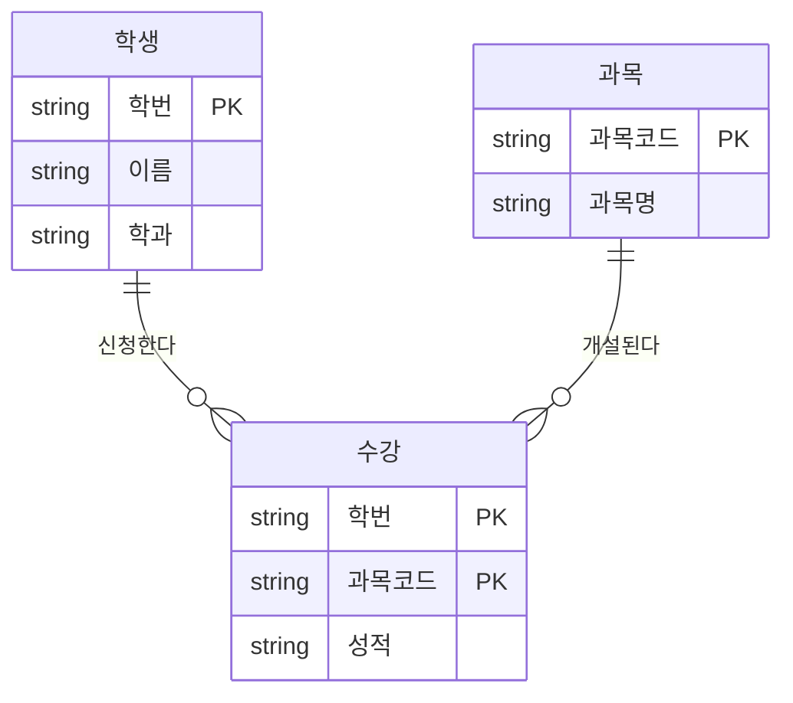
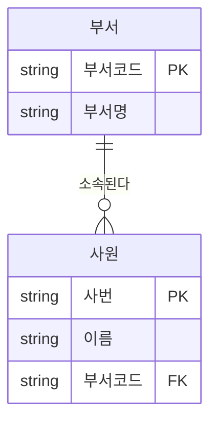

# 정규화

정규화(Normalization)는 **함수 종속성**을 근거로 릴레이션을 분해하여 데이터 중복을 줄이고 <strong>이상현상(Anomaly)</strong>을 제거하는 과정이다. 논리 데이터 모델링 단계에서 수행하며, 모델의 일관성과 확장성을 확보하는 핵심 기법이다.

## 정규화의 목적

::: cards 2
- **중복 최소화** 같은 데이터를 여러 번 저장하지 않아 저장 공간을 아끼고 불일치를 막는다.
- **이상현상 제거** 삽입·갱신·삭제 때 생기는 이상현상을 없앤다.
- **이해도·확장성** 엔터티를 업무 의미 단위로 분리해 모델을 읽기 쉽고 넓히기 쉽게 만든다.
- **변경 영향 축소** 데이터 구조가 바뀌어도 영향 범위가 좁아진다.
:::

정규화는 "하나의 사실은 한 곳에만 저장한다(**One Fact in One Place**)"는 원칙을 구현하는 방법이라고 볼 수 있다.

## 이상현상(Anomaly) 예시

아래는 정규화되지 않은 `수강` 테이블이다. PK는 (학번, 과목코드)다.

| 학번 | 이름 | 학과 | 과목코드 | 과목명 | 성적 |
|---|---|---|---|---|---|
| 1001 | 김철수 | 컴퓨터 | C01 | 데이터베이스 | A |
| 1001 | 김철수 | 컴퓨터 | C02 | 운영체제 | B |
| 1002 | 이영희 | 경영 | C01 | 데이터베이스 | B |

학생 정보와 과목 정보가 한 테이블에 섞여 있어서, 이 테이블을 다루는 순간 세 가지 문제가 생긴다.

::: cards 3
- **삽입 이상** 신규 과목 `C03 네트워크`를 등록하려 해도 수강생이 없으면 PK의 `학번`이 없어 저장할 수 없다. 원하지 않는 데이터(가짜 학번 등)를 함께 넣어야만 삽입되는 문제다.
- **갱신 이상** 김철수의 학과를 `전자`로 바꾸려면 김철수의 **모든 행**을 수정해야 한다. 일부 행만 수정되면 같은 학생이 두 개의 학과를 갖는 불일치가 발생한다.
- **삭제 이상** 이영희의 C01 수강 취소로 해당 행을 삭제하면 이영희의 학생 정보(이름, 학과)까지 함께 사라진다. 의도하지 않은 정보 손실이다.
:::

> 시험 포인트: 이상현상은 삽입·갱신(수정)·삭제 3가지다. "조회 이상"은 존재하지 않으므로 보기에 나오면 오답이다.

## 함수 종속성과 결정자

### 함수 종속성(Functional Dependency)

속성 X의 값이 정해지면 속성 Y의 값이 오직 하나로 정해질 때, **Y는 X에 함수 종속**된다고 한다.

- 표기: `X → Y` (X: **결정자**, Y: **종속자**)
- 예: `학번 → 이름`, `학번 → 학과`, `과목코드 → 과목명`, `(학번, 과목코드) → 성적`
- 쉽게 말해 "학번 1001을 알면 이름은 김철수 하나로 정해진다"는 뜻이다.

### 종속성의 종류

<figure class="md-figure">
<svg viewBox="0 0 640 262" xmlns="http://www.w3.org/2000/svg" font-family="Pretendard Variable, Pretendard, sans-serif" role="img" aria-label="완전, 부분, 이행 함수 종속 비교 그림">
<defs><marker id="norm-arrow" viewBox="0 0 10 10" refX="8" refY="5" markerWidth="6" markerHeight="6" orient="auto"><path d="M0 0 L10 5 L0 10z" fill="var(--foreground)"/></marker></defs>
<text x="20" y="55" font-size="13" font-weight="700" fill="oklch(0.65 0.14 160)">완전 종속</text>
<rect x="130" y="32" width="140" height="36" rx="8" fill="oklch(0.65 0.14 160)" fill-opacity="0.18" stroke="oklch(0.65 0.14 160)"/>
<line x1="186" y1="32" x2="186" y2="68" stroke="oklch(0.65 0.14 160)"/>
<text x="158" y="55" text-anchor="middle" font-size="13" fill="var(--foreground)">학번</text>
<text x="228" y="55" text-anchor="middle" font-size="13" fill="var(--foreground)">과목코드</text>
<line x1="270" y1="50" x2="356" y2="50" stroke="var(--foreground)" stroke-width="2" marker-end="url(#norm-arrow)"/>
<rect x="360" y="32" width="100" height="36" rx="8" fill="var(--card)" stroke="var(--border)"/>
<text x="410" y="55" text-anchor="middle" font-size="13" fill="var(--foreground)">성적</text>
<text x="480" y="46" font-size="11" fill="var(--muted-foreground)">키 전체에 종속</text>
<text x="480" y="62" font-size="11" font-weight="700" fill="oklch(0.65 0.14 160)">정상</text>
<text x="20" y="125" font-size="13" font-weight="700" fill="oklch(0.75 0.16 75)">부분 종속</text>
<rect x="130" y="102" width="140" height="36" rx="8" fill="var(--card)" stroke="var(--border)"/>
<rect x="130" y="102" width="56" height="36" rx="8" fill="oklch(0.75 0.16 75)" fill-opacity="0.3"/>
<line x1="186" y1="102" x2="186" y2="138" stroke="var(--border)"/>
<text x="158" y="125" text-anchor="middle" font-size="13" font-weight="700" fill="var(--foreground)">학번</text>
<text x="228" y="125" text-anchor="middle" font-size="13" fill="var(--muted-foreground)">과목코드</text>
<line x1="270" y1="120" x2="356" y2="120" stroke="var(--foreground)" stroke-width="2" marker-end="url(#norm-arrow)"/>
<rect x="360" y="102" width="100" height="36" rx="8" fill="var(--card)" stroke="var(--border)"/>
<text x="410" y="125" text-anchor="middle" font-size="13" fill="var(--foreground)">이름, 학과</text>
<text x="480" y="116" font-size="11" fill="var(--muted-foreground)">키 일부에만 종속</text>
<text x="480" y="132" font-size="11" font-weight="700" fill="oklch(0.75 0.16 75)">2NF에서 제거</text>
<text x="20" y="195" font-size="13" font-weight="700" fill="oklch(0.63 0.21 25)">이행 종속</text>
<rect x="130" y="172" width="90" height="36" rx="8" fill="var(--card)" stroke="var(--border)"/>
<text x="175" y="195" text-anchor="middle" font-size="13" fill="var(--foreground)">사번</text>
<line x1="220" y1="190" x2="256" y2="190" stroke="var(--foreground)" stroke-width="2" marker-end="url(#norm-arrow)"/>
<rect x="260" y="172" width="100" height="36" rx="8" fill="oklch(0.63 0.21 25)" fill-opacity="0.15" stroke="oklch(0.63 0.21 25)"/>
<text x="310" y="195" text-anchor="middle" font-size="13" fill="var(--foreground)">부서코드</text>
<line x1="360" y1="190" x2="396" y2="190" stroke="var(--foreground)" stroke-width="2" marker-end="url(#norm-arrow)"/>
<rect x="400" y="172" width="90" height="36" rx="8" fill="var(--card)" stroke="var(--border)"/>
<text x="445" y="195" text-anchor="middle" font-size="13" fill="var(--foreground)">부서명</text>
<text x="505" y="186" font-size="11" fill="var(--muted-foreground)">일반 속성 경유</text>
<text x="505" y="202" font-size="11" font-weight="700" fill="oklch(0.63 0.21 25)">3NF에서 제거</text>
<path d="M175 208 Q310 252 441 210" fill="none" stroke="var(--muted-foreground)" stroke-width="1.5" stroke-dasharray="4 4" marker-end="url(#norm-arrow)"/>
<text x="310" y="254" text-anchor="middle" font-size="11" fill="var(--muted-foreground)">사번 → 부서명 (간접적으로 결정)</text>
</svg>
<figcaption>화살표의 출발점이 결정자, 도착점이 종속자다. 결정자가 무엇이냐에 따라 종속의 종류가 갈린다.</figcaption>
</figure>

| 종류 | 설명 | 예 |
|---|---|---|
| 완전 함수 종속 | 복합키 전체에 종속 | (학번, 과목코드) → 성적 |
| 부분 함수 종속 | 복합키의 일부에만 종속 | 학번 → 이름 |
| 이행 함수 종속 | X → Y, Y → Z 이면서 X → Z | 사번 → 부서코드 → 부서명 |

::: info 결정자(Determinant)
다른 속성의 값을 결정하는 속성(또는 속성 집합)이다. 정규화는 결국 **"모든 결정자가 후보키가 되도록"** 분해해 나가는 과정이다.
:::

## 정규형 한눈에 보기

각 단계는 이전 단계를 만족한 상태에서 한 가지씩 더 제거한다.

::: flow
- **1NF** 다중값·반복 그룹 제거 (원자값)
- **2NF** 부분 함수 종속 제거
- **3NF** 이행 함수 종속 제거
- **BCNF** 후보키 아닌 결정자 제거
:::

## 제1정규형(1NF)

- 모든 속성이 <strong>원자값(Atomic Value)</strong>만 가져야 한다.
- 다중값 속성, 반복 그룹(같은 성격의 컬럼 반복)을 제거한다.

::: example 다중값을 행으로 풀기
변경 전 (다중값 존재)

| 학번 | 이름 | 수강과목 |
|---|---|---|
| 1001 | 김철수 | 데이터베이스, 운영체제 |

변경 후

| 학번 | 이름 | 수강과목 |
|---|---|---|
| 1001 | 김철수 | 데이터베이스 |
| 1001 | 김철수 | 운영체제 |
:::

`전화번호1`, `전화번호2`, `전화번호3`처럼 컬럼이 반복되는 구조도 1NF 위반으로 보고 별도 엔터티로 분리한다.

## 제2정규형(2NF)

- 1NF를 만족하고, **부분 함수 종속**을 제거한 상태다.
- PK가 복합키일 때만 문제가 된다. 단일 속성 PK라면 1NF이면 곧 2NF다.

변경 전: `수강(학번, 과목코드, 이름, 과목명, 성적)` — 이름은 학번에만, 과목명은 과목코드에만 종속된다.

변경 후

| 학생 (PK: 학번) | 과목 (PK: 과목코드) | 수강 (PK: 학번+과목코드) |
|---|---|---|
| 학번, 이름, 학과 | 과목코드, 과목명 | 학번, 과목코드, 성적 |

앞의 이상현상 예시 대부분이 이 분해로 해소된다. 과목은 수강생 없이도 등록할 수 있고(삽입), 학과는 학생 테이블 한 행만 고치면 되며(갱신), 수강을 취소해도 학생 정보는 남는다(삭제).

## 제3정규형(3NF)

- 2NF를 만족하고, **이행 함수 종속**을 제거한 상태다.
- 일반 속성이 다른 일반 속성을 결정하는 구조를 분리한다.

변경 전 `사원`

| 사번 | 이름 | 부서코드 | 부서명 |
|---|---|---|---|
| E01 | 홍길동 | D10 | 영업 |
| E02 | 박민수 | D10 | 영업 |

`사번 → 부서코드 → 부서명` 이행 종속이 존재한다. 부서명 "영업"이 사원 수만큼 반복 저장된다.

변경 후

| 사원 (PK: 사번) | 부서 (PK: 부서코드) |
|---|---|
| 사번, 이름, 부서코드(FK) | 부서코드, 부서명 |

## BCNF(Boyce-Codd 정규형)

- 3NF를 만족하고, **모든 결정자가 후보키**인 상태다.
- 3NF까지는 "일반 속성 → 키 속성" 종속이 남을 수 있는데, 이를 제거한 것이 BCNF다.

::: example 특강수강(학번, 특강명, 교수), PK = (학번, 특강명)
제약: 교수 한 명은 한 특강만 담당 → `교수 → 특강명`

교수는 결정자이지만 후보키가 아니다 → **BCNF 위반**

| 학번 | 특강명 | 교수 |
|---|---|---|
| 1001 | AI 입문 | 정교수 |
| 1002 | AI 입문 | 정교수 |
| 1001 | 클라우드 | 최교수 |

분해 결과

| 교수특강 (PK: 교수) | 수강신청 (PK: 학번+교수) |
|---|---|
| 교수, 특강명 | 학번, 교수 |
:::

> 시험 포인트: 정규형별 제거 대상을 짝지어 외울 것. 1NF 원자값, 2NF 부분 종속, 3NF 이행 종속, BCNF 결정자이면서 후보키가 아닌 것. 각 단계는 이전 단계를 만족해야 한다.

## 제4정규형과 제5정규형

| 정규형 | 제거 대상 | 설명 |
|---|---|---|
| 4NF | 다치 종속(MVD) | 하나의 키에 서로 독립적인 다중값 속성이 둘 이상 붙어 있을 때 분리 |
| 5NF | 조인 종속(JD) | 후보키를 통하지 않는 조인 종속을 제거, 분해 후 조인해도 원래 정보가 손실 없이 복원 |

- 4NF 예: `직원(사번, 보유기술, 사용언어)`에서 기술과 언어가 서로 무관하면 `직원기술`, `직원언어`로 분리한다.
- 실무 및 시험에서는 BCNF까지가 중심이며 4NF·5NF는 개념만 확인한다.

## 정규화와 성능

| 작업 | 정규화 영향 |
|---|---|
| 입력(INSERT) | 중복 저장이 없어 대체로 향상 |
| 수정(UPDATE) | 한 곳만 수정하면 되므로 향상 |
| 삭제(DELETE) | 불필요한 정보 손실 없이 처리, 향상 |
| 조회(SELECT) | 조인 증가로 저하될 수 있으나, 테이블이 작아져 오히려 빨라지는 경우도 있음 |

::: warning "정규화 = 조회 성능 저하"로 단정하지 말 것
정규화된 모델은 조인이 늘어 조회가 느려질 수 있다는 것이 일반적 인식이다. 그러나 분리된 작은 테이블에서 인덱스를 활용하거나, 중복 행이 사라져 처리량이 줄면 조회 성능이 **향상**되기도 한다.
:::

> 시험 포인트: "정규화를 하면 조회 성능은 항상 저하된다"는 틀린 문장이다. 입력·수정·삭제는 일반적으로 향상되고, 조회는 경우에 따라 향상 또는 저하된다.

## 반정규화 개념과 기법

반정규화(De-normalization)는 성능 향상이나 개발 편의를 위해 정규화된 모델에 의도적으로 **중복·통합·분리**를 허용하는 기법이다. 데이터 무결성 저하 위험이 있으므로 충분한 검토 후 적용한다.

### 적용 절차

::: steps
1. **반정규화 대상 조사** 범위 처리 빈도, 대량 범위 처리, 통계성 프로세스, 과도한 조인
2. **다른 방법 우선 검토** 뷰, 클러스터링, 인덱스 조정, 파티셔닝, 응용 로직 변경
3. **반정규화 적용**
:::

### 주요 기법

::: cards 3
- **테이블** 테이블 병합, 분할, 추가
  - 병합: 1:1, 1:M, 슈퍼/서브타입
  - 분할: 수직·수평
  - 추가: 중복·통계·이력·부분 테이블
- **컬럼** 컬럼 단위로 중복 허용
  - 중복 컬럼 추가
  - 파생 컬럼 추가
  - 이력 테이블 컬럼 추가
  - PK에 의한 컬럼 추가
  - 응용시스템 오작동 대비 컬럼 추가
- **관계** 중복 관계 추가
  - 조인 경로 단축
  - 무결성을 해치지 않음
:::

> 시험 포인트: 반정규화 전에 뷰·인덱스·클러스터링·파티셔닝 같은 대안을 먼저 검토하는 것이 원칙이다. 관계의 반정규화(중복 관계 추가)는 무결성을 해치지 않으면서 조인 경로를 줄이는 기법이다.

관련 문서: [엔터티](/theory/entity), [속성](/theory/attribute), [관계](/theory/relationship), [식별자](/theory/identifier)

## 핵심 요약

- 정규화는 함수 종속성을 기준으로 릴레이션을 분해해 중복과 이상현상을 제거하는 과정
- 이상현상은 삽입·갱신·삭제 3종류
- 1NF 원자값, 2NF 부분 종속 제거, 3NF 이행 종속 제거, BCNF 모든 결정자가 후보키
- 4NF는 다치 종속, 5NF는 조인 종속 제거
- 정규화 시 입력·수정·삭제 성능은 향상, 조회는 경우에 따라 향상 또는 저하
- 반정규화는 성능을 위해 중복을 허용하는 기법이며, 대안 검토 후 적용
- 반정규화 기법은 테이블·컬럼·관계 단위로 구분
