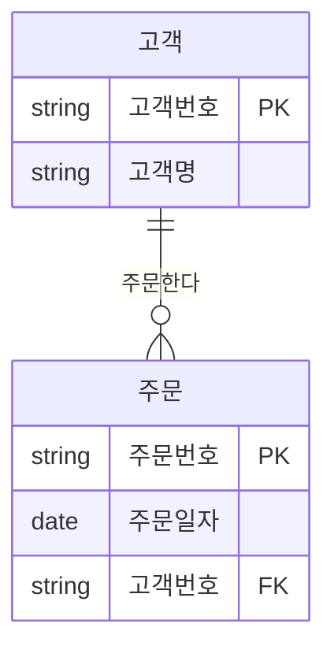
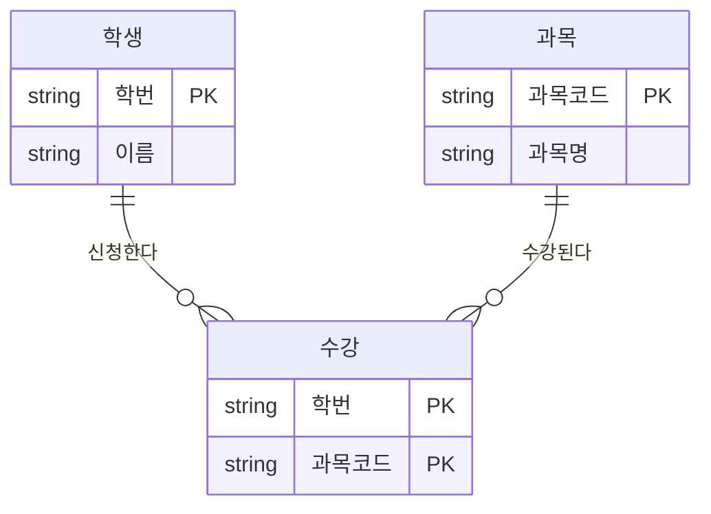
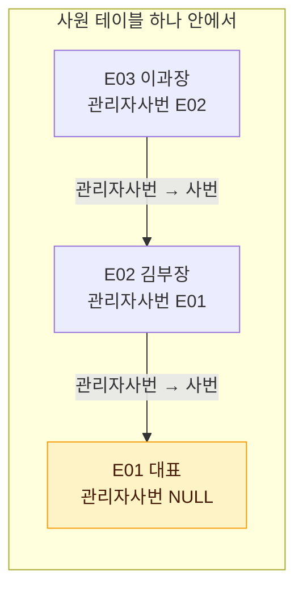

# 관계와 조인의 이해

데이터 모델에서 정의한 관계는 물리적으로 <strong>외래키(FK)</strong>로 구현되며, SQL에서는 이 FK를 매개로 한 **조인**으로 데이터를 다시 결합한다. 즉, 관계는 조인의 설계도이고 조인은 관계를 실행하는 연산이다.

## 관계가 조인의 토대가 되는 원리

::: flow
- **정규화** 데이터를 여러 엔터티로 나눈다
- **관계** 부모 식별자가 자식에 상속되어 FK가 된다
- **조인** 부모 PK = 자식 FK 조건으로 다시 결합한다
:::

예: `고객`과 `주문`

| 고객 (PK: 고객번호) | 주문 (PK: 주문번호) |
|---|---|
| 고객번호, 고객명 | 주문번호, 주문일자, 고객번호(FK) |



ERD의 관계선이 연결하는 두 컬럼(`고객.고객번호`와 `주문.고객번호`)이 그대로 조인 조건이 된다.

```sql
SELECT C.고객명, O.주문번호, O.주문일자
  FROM 고객 C, 주문 O
 WHERE C.고객번호 = O.고객번호;
```

- 위 WHERE 조건이 모델의 "고객은 주문을 한다" 관계를 그대로 표현한다.
- 관계가 정의되지 않은 엔터티끼리 조인하면 의미 없는 결과나 카티션 곱이 나오기 쉽다.

> 시험 포인트: 정규화로 분리된 데이터를 다시 합치는 연산이 조인이며, 조인의 근거는 모델의 관계(PK-FK)이다. 조인 조건을 빠뜨리면 카티션 곱(CROSS JOIN 결과)이 발생한다.

## 조인 키와 PK/FK

### 식별 관계와 비식별 관계에서의 조인 키

| 구분 | FK 위치 | 조인 키 특징 |
|---|---|---|
| 식별 관계 | 부모 PK가 자식 PK의 일부 | 자식 PK 앞부분으로 조인, 인덱스 활용이 쉬움 |
| 비식별 관계 | 부모 PK가 자식의 일반 속성 | 별도 FK 인덱스 필요 여부 검토 |

::: compare
- **식별 관계를 이어갈 때** 하위 엔터티의 PK가 점점 길어진다. 대신 상위 엔터티를 거치지 않고 **바로 조인**할 수 있다.
- **비식별 관계로 끊을 때** PK는 단순해진다. 대신 최상위 정보가 필요하면 **중간 테이블을 거쳐야** 해서 조인이 늘어난다.
:::

### 조인 키 설계 시 주의

::: warning 조인 키 체크리스트
- 조인 컬럼의 **데이터 타입과 길이**를 부모·자식에서 동일하게 유지한다 (암시적 형변환 방지).
- FK 컬럼에는 조회 패턴에 따라 **인덱스**를 고려한다.
- 물리적 FK 제약을 생성하지 않더라도 논리적 관계는 조인 조건으로 반드시 표현된다.
:::

## 관계 차수별 조인 결과

::: cards 3
- **1:1** 조인 결과 행 수는 양쪽과 동일하다.
- **1:M** 결과 행 수는 **M쪽** 기준이다. 1쪽 정보가 M쪽 행 수만큼 반복된다.
- **M:N** 직접 구현 불가. 교차 엔터티로 1:M 두 개로 해소한 뒤 3개 테이블을 조인한다.
:::

### 1:1 관계

| 사원 | 사원상세 |
|---|---|
| E01 홍길동 | E01 주소A |
| E02 박민수 | E02 주소B |

조인 결과 행 수는 양쪽과 동일하다 (2건).

### 1:M 관계

| 부서 | 사원 |
|---|---|
| D10 영업 | E01(D10), E02(D10) |
| D20 개발 | E03(D20) |

```sql
SELECT D.부서명, E.사원명
  FROM 부서 D JOIN 사원 E
    ON D.부서코드 = E.부서코드;
```

| 부서명 | 사원명 |
|---|---|
| 영업 | 홍길동 |
| 영업 | 박민수 |
| 개발 | 김영수 |

- 결과 행 수는 M쪽(사원) 기준 → 3건
- 부서 정보는 사원 수만큼 반복된다.
- 사원이 없는 부서는 INNER JOIN 결과에서 빠지므로, 포함하려면 **OUTER JOIN**이 필요하다.

### M:N 관계

관계형 DB에서는 M:N을 직접 구현할 수 없어 **교차(연관) 엔터티**로 해소한다. 예: `학생` M:N `과목` → `학생` 1:M `수강` M:1 `과목`



조인 시 3개 테이블을 연결한다.

```sql
SELECT S.이름, C.과목명
  FROM 학생 S
  JOIN 수강 R ON S.학번 = R.학번
  JOIN 과목 C ON R.과목코드 = C.과목코드;
```

> 시험 포인트: 1:M 조인 결과의 행 수는 M쪽 행 수를 따른다(매칭되는 경우). M:N 관계는 반드시 교차 엔터티를 두어 1:M 두 개로 분해한다.

## 계층형 데이터 모델

하나의 엔터티 안에서 레코드끼리 상하 관계를 갖는 구조다 (**자기참조, Self Relationship**). 예: 사원의 관리자도 사원, 조직의 상위 조직도 조직, 상품 분류의 상위 분류.

| 사번 | 이름 | 관리자사번 |
|---|---|---|
| E01 | 대표 | NULL |
| E02 | 김부장 | E01 |
| E03 | 이과장 | E02 |



- `관리자사번`이 같은 테이블의 `사번`을 참조하는 FK다.
- 최상위 노드(대표)는 상위가 없으므로 FK가 **NULL**이다.

### 셀프 조인

```sql
SELECT E.이름 AS 사원, M.이름 AS 관리자
  FROM 사원 E, 사원 M
 WHERE E.관리자사번 = M.사번(+);
```

- 같은 테이블에 별칭을 다르게 주어(E, M) 두 테이블처럼 조인한다.
- 여러 단계를 한 번에 펼치려면 계층형 질의(Oracle `START WITH ... CONNECT BY`, SQL Server는 재귀 CTE)를 사용한다.

## 상호배타적 관계(아크 관계)

하나의 엔터티가 두 개 이상의 엔터티 중 **오직 하나**와만 관계를 맺는 구조다. ERD에서 관계선 위에 호(Arc)를 그려 표현한다.

<figure class="md-figure">
<svg viewBox="0 0 560 200" xmlns="http://www.w3.org/2000/svg" font-family="Pretendard Variable, Pretendard, sans-serif" role="img" aria-label="주문이 개인고객 또는 법인고객 중 하나와만 관계를 맺는 아크 관계">
<line x1="150" y1="100" x2="380" y2="50" stroke="var(--muted-foreground)" stroke-width="2"/>
<line x1="150" y1="100" x2="380" y2="150" stroke="var(--muted-foreground)" stroke-width="2"/>
<rect x="40" y="80" width="110" height="40" rx="8" fill="var(--card)" stroke="var(--border)"/>
<text x="95" y="105" text-anchor="middle" font-size="14" font-weight="700" fill="var(--foreground)">주문</text>
<rect x="380" y="30" width="130" height="40" rx="8" fill="oklch(0.62 0.17 255)" fill-opacity="0.15" stroke="oklch(0.62 0.17 255)"/>
<text x="445" y="55" text-anchor="middle" font-size="14" font-weight="700" fill="var(--foreground)">개인고객</text>
<rect x="380" y="130" width="130" height="40" rx="8" fill="oklch(0.65 0.14 160)" fill-opacity="0.15" stroke="oklch(0.65 0.14 160)"/>
<text x="445" y="155" text-anchor="middle" font-size="14" font-weight="700" fill="var(--foreground)">법인고객</text>
<path d="M216.6 78.4 A70 70 0 0 1 216.6 121.6" fill="none" stroke="oklch(0.75 0.16 75)" stroke-width="3" stroke-linecap="round"/>
<text x="230" y="105" font-size="12" font-weight="700" fill="oklch(0.75 0.16 75)">아크</text>
<text x="300" y="44" text-anchor="middle" font-size="11" fill="var(--muted-foreground)">O1 → P001</text>
<text x="300" y="168" text-anchor="middle" font-size="11" fill="var(--muted-foreground)">O2 → B001</text>
<text x="445" y="94" text-anchor="middle" font-size="11" fill="var(--muted-foreground)">둘 중 하나만</text>
</svg>
<figcaption>아크로 묶인 관계선은 "이 중 하나만" 성립한다. 주문 O1은 개인고객, O2는 법인고객과만 연결된다.</figcaption>
</figure>

예: `주문`은 `개인고객` 또는 `법인고객` 중 하나에 속한다.

| 주문번호 | 고객구분 | 개인고객번호 | 법인고객번호 |
|---|---|---|---|
| O1 | 개인 | P001 | NULL |
| O2 | 법인 | NULL | B001 |

::: compare
- **구현 방법 1: FK를 각각** 개인고객번호, 법인고객번호 FK를 따로 두고 하나만 값이 채워지게 한다 (위 예).
- **구현 방법 2: FK 하나 + 구분 컬럼** 하나의 FK 컬럼에 구분 컬럼을 함께 둔다. 대상 테이블이 행마다 달라 물리적 FK 제약을 걸기 어렵다.
:::

조인 시 구분 값에 따라 대상 테이블이 달라지므로 OUTER JOIN이나 UNION ALL을 활용한다.

```sql
SELECT O.주문번호, NVL(P.고객명, B.법인명) AS 고객명
  FROM 주문 O
  LEFT OUTER JOIN 개인고객 P ON O.개인고객번호 = P.개인고객번호
  LEFT OUTER JOIN 법인고객 B ON O.법인고객번호 = B.법인고객번호;
```

> 시험 포인트: 아크 관계는 "어느 한 시점에 둘 중 하나와만 관계"를 뜻하며, 아크 안의 관계들은 같은 엔터티에 연결되고 보통 필수/선택 성격이 동일하게 설계된다.

관련 문서: [관계](/theory/relationship), [식별자](/theory/identifier), [조인](/theory/join), [표준 조인](/theory/standard-join)

## 핵심 요약

- 모델의 관계는 FK로 구현되고, SQL의 조인 조건(PK = FK)으로 실행됨
- 조인은 정규화로 분리된 데이터를 다시 결합하는 연산
- 1:M 조인 결과는 M쪽 행 수 기준, M:N은 교차 엔터티로 해소 후 조인
- 식별 관계는 PK가 길어지지만 조인 경로가 짧고, 비식별 관계는 그 반대
- 계층형 모델은 자기참조 FK로 구현하며 셀프 조인·계층형 질의로 조회
- 상호배타적(아크) 관계는 여러 부모 중 하나와만 관계를 맺는 구조
- 조인 키는 타입·길이를 일치시키고 인덱스를 고려해야 함
