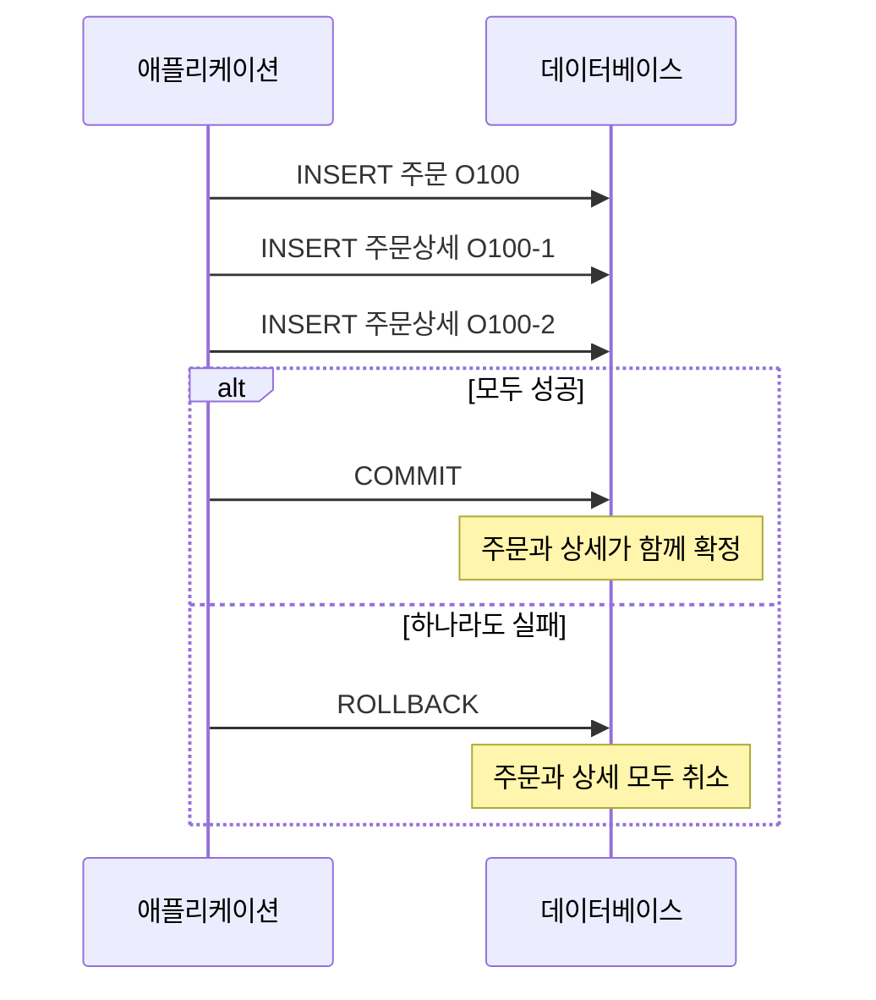
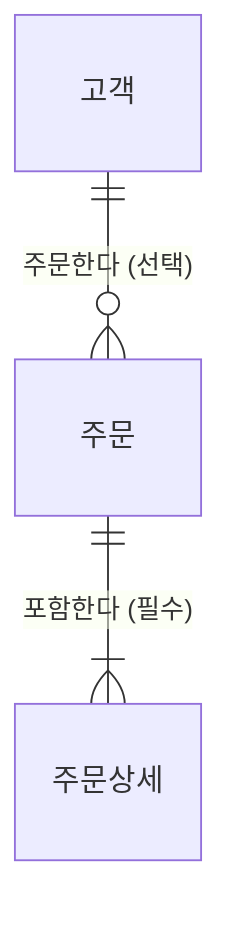

# 모델이 표현하는 트랜잭션의 이해

데이터 모델은 정적인 구조만이 아니라, 어떤 데이터들이 **함께 생성·변경되어야 하는지**도 표현한다. 관계의 필수/선택 여부를 보면 하나의 트랜잭션으로 묶어야 할 엔터티 범위를 알 수 있다.

## 트랜잭션의 개념

- 트랜잭션(Transaction)은 데이터베이스의 **논리적 작업 단위**다.
- 여러 SQL 문으로 구성되더라도 전부 성공(COMMIT)하거나 전부 취소(ROLLBACK)되어야 한다.
- 업무 관점에서 "쪼갤 수 없는 하나의 일"이 트랜잭션의 범위다.

예: 계좌이체

::: steps
1. **A 계좌 잔액 차감** UPDATE
2. **B 계좌 잔액 증가** UPDATE
3. **이체 내역 기록** INSERT
:::

::: warning 하나만 반영되면?
1번만 반영되고 2번이 실패하면 A에서 빠진 돈이 B에 들어가지 않아 **돈이 사라진다**. 그래서 셋을 하나의 트랜잭션으로 처리한다.
:::

## 트랜잭션의 특성 ACID

::: cards 2
- **원자성(Atomicity)** 모두 반영되거나 하나도 반영되지 않는다 (All or Nothing). 이체의 3단계는 전부 되거나 전부 안 된다.
- **일관성(Consistency)** 트랜잭션 전후로 데이터베이스가 무결성 제약을 만족하는 일관된 상태를 유지한다. 이체 전후 총 잔액은 같다.
- **고립성(Isolation)** 실행 중인 트랜잭션의 중간 결과를 다른 트랜잭션이 볼 수 없다. A만 차감된 순간을 남이 보지 못한다.
- **지속성(Durability)** 커밋된 결과는 장애가 발생해도 영구히 보존된다. 커밋 직후 서버가 꺼져도 이체는 남는다.
:::

> 시험 포인트: ACID 각 특성의 설명을 바꿔 놓는 문제가 자주 나온다. "다른 트랜잭션의 간섭을 받지 않는다"는 고립성, "커밋 후 영구 반영"은 지속성, "전부 또는 전무"는 원자성이다.

## 하나의 트랜잭션으로 묶이는 엔터티

### 주문과 주문상세

| 주문 (PK: 주문번호) | 주문상세 (PK: 주문번호+순번) |
|---|---|
| 주문번호, 고객번호, 주문일자, 총금액 | 주문번호, 순번, 상품코드, 수량, 금액 |

- 주문 헤더만 있고 상세 품목이 없는 주문은 업무적으로 의미가 없다.
- 상세만 있고 헤더가 없는 경우도 불가능하다.
- 따라서 주문과 주문상세는 반드시 **함께 INSERT**되어야 하는 하나의 트랜잭션 단위다.



```sql
INSERT INTO 주문 (주문번호, 고객번호, 주문일자, 총금액)
VALUES ('O100', 'C01', SYSDATE, 30000);

INSERT INTO 주문상세 (주문번호, 순번, 상품코드, 수량, 금액)
VALUES ('O100', 1, 'P01', 1, 10000);

INSERT INTO 주문상세 (주문번호, 순번, 상품코드, 수량, 금액)
VALUES ('O100', 2, 'P02', 2, 20000);

COMMIT;
```

- 중간에 하나라도 실패하면 `ROLLBACK`으로 전체를 취소해야 한다.

::: warning 주문만 먼저 커밋하면
주문 INSERT 후 바로 COMMIT하고 상세를 따로 커밋하면, 상세 실패 시 <strong>"빈 주문"</strong>이 남는 무결성 오류가 생긴다.
:::

### 독립적으로 처리되는 엔터티

- `고객`과 `주문`: 고객은 주문 없이도 가입 가능 → 고객 등록과 주문 등록은 **별개의 트랜잭션**이다.
- 고객 등록 트랜잭션과 주문 트랜잭션은 시점도 다르고 주체도 다르다.

## 관계의 필수/선택과 트랜잭션

관계의 선택성(Optionality)은 "상대 엔터티 인스턴스가 반드시 존재해야 하는가"를 나타낸다.

::: compare
- **필수(Mandatory) 관계** 상대 인스턴스가 반드시 있어야 한다. 양쪽을 함께 생성·삭제 → **하나의 트랜잭션**.
- **선택(Optional) 관계** 상대 인스턴스가 없어도 된다. 각각 독립적으로 생성 가능 → **별도 트랜잭션** 가능.
:::



| 관계 | 선택성 | 트랜잭션 |
|---|---|---|
| 주문 → 주문상세 | 주문은 반드시 1건 이상의 상세를 가짐 (필수) | 양방향 모두 필수 → 같은 트랜잭션에서 함께 처리 |
| 주문상세 → 주문 | 상세는 반드시 하나의 주문에 속함 (필수) | 〃 |
| 고객 → 주문 | 고객은 주문이 없을 수도 있음 (선택) | 분리된 트랜잭션 |

> 시험 포인트: 양쪽이 모두 필수(Mandatory)인 관계로 연결된 엔터티는 하나의 트랜잭션으로 함께 입력·삭제되어야 한다. 한쪽이라도 선택이면 독립 트랜잭션으로 처리할 수 있다.

## ERD에서 트랜잭션 읽기

### 표기법별 필수/선택 표현

| 표기법 | 필수 | 선택 |
|---|---|---|
| IE(Crow's Foot) | 관계선 끝 가까이 수직선(\|) | 관계선 끝 가까이 원(O) |
| Barker | 실선 | 점선 |

IE 표기에서 관계선 끝의 <strong>까마귀발(Crow's Foot)</strong>은 "다수(Many)"를 뜻하며, 그 안쪽의 `|` 또는 `O`가 필수/선택을 나타낸다. 위 ERD에서 주문상세 쪽 `|{`는 "1건 이상(필수)", 주문 쪽 `o{`는 "0건 이상(선택)"이다.

### 읽는 순서

::: steps
1. **차수 확인** 관계의 차수(1:1, 1:M)를 확인한다.
2. **기호 확인** 양쪽 끝의 필수/선택 기호를 확인한다.
3. **양방향 필수라면** 하나의 트랜잭션 단위로 묶는다.
4. **선택이 섞이면** 생성 시점과 주체를 확인해 트랜잭션을 분리한다.
:::

### 모델을 잘못 표현한 경우

::: cards 2
- **필수를 선택으로 그리면** 개발자가 헤더만 먼저 커밋하는 코드를 작성할 위험이 생긴다.
- **선택을 필수로 그리면** 불필요하게 큰 트랜잭션이 되어 잠금 경합이 증가한다.
:::

따라서 관계의 선택성은 데이터 무결성과 애플리케이션 트랜잭션 설계에 직접 영향을 준다.

> 시험 포인트: 모델의 필수/선택 표기는 단순한 문서 표현이 아니라 트랜잭션 경계(COMMIT 시점)를 결정하는 근거이다. 주문-주문상세처럼 함께 생겨야 하는 데이터를 따로 커밋하면 정합성이 깨진다.

관련 문서: [관계](/theory/relationship), [엔터티](/theory/entity), [TCL](/theory/tcl)

## 핵심 요약

- 트랜잭션은 전부 성공하거나 전부 취소되는 논리적 작업 단위
- ACID: 원자성·일관성·고립성·지속성
- 주문과 주문상세처럼 함께 존재해야 의미가 있는 엔터티는 하나의 트랜잭션으로 처리
- 양방향 필수 관계는 한 트랜잭션, 선택 관계는 독립 트랜잭션 가능
- IE 표기법에서 `|`는 필수, `O`는 선택, 까마귀발은 다수
- 모델의 선택성이 COMMIT 경계와 데이터 정합성을 결정함
