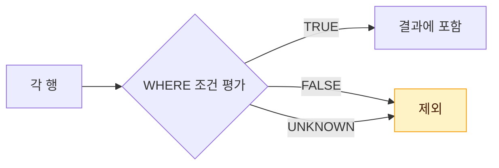

# Null 속성의 이해

NULL은 "값이 아직 정해지지 않았거나 알 수 없음"을 나타내는 특별한 표식이다. 0이나 공백 문자와 다르며, 연산·비교·집계에서 일반 값과 다른 규칙을 따르므로 모델링과 SQL 작성 모두에서 주의가 필요하다.

## NULL의 의미

::: cards 3
- **미확정** 아직 입력되지 않은 값. 예: 아직 정해지지 않은 퇴사일
- **해당 사항 없음** 그 행에는 의미가 없는 값. 예: 영업직이 아닌 사원의 커미션
- **알 수 없음** 값은 있지만 모르는 경우. 예: 고객이 밝히지 않은 생년월일
:::

- 숫자 0, 공백 문자 `' '`, 빈 문자열과는 다른 개념이다.
- Oracle은 길이 0인 빈 문자열 `''`을 NULL로 취급한다 (SQL Server는 빈 문자열과 NULL을 구분).
- PK 속성은 NULL을 가질 수 없다 (**엔터티 무결성**).

| 값 | NULL인가 |
|---|---|
| 0 | 아님 |
| `' '` (공백) | 아님 |
| `''` (빈 문자열) | Oracle: NULL / SQL Server: 아님 |

## NULL 규칙 한눈에 보기

::: cards 2
- **연산 → NULL** NULL이 낀 산술 연산은 결과도 NULL이다. `NULL + 10` = NULL
- **비교 → UNKNOWN** `=`, `<>`, `>` 비교는 TRUE도 FALSE도 아닌 UNKNOWN. 조건 검사는 `IS NULL`
- **집계 → 제외** `COUNT(*)`를 뺀 집계 함수는 NULL 행을 건너뛰고 계산한다.
- **정렬 → DBMS별** Oracle은 가장 큰 값, SQL Server는 가장 작은 값으로 취급한다.
:::

## NULL과 연산

NULL이 포함된 산술 연산의 결과는 항상 NULL이다.

| 식 | 결과 |
|---|---|
| `NULL + 10` | NULL |
| `NULL * 0` | NULL |
| `NULL / 0` | NULL (오류 아님) |
| `'A' \|\| NULL` (Oracle) | `'A'` |

::: info 문자열 결합은 예외
Oracle의 문자열 결합 `||`은 NULL을 빈 문자열처럼 처리한다. 반면 SQL Server의 `+` 결합은 기본 설정(CONCAT_NULL_YIELDS_NULL ON)에서 NULL을 반환한다.
:::

## NULL과 비교 그리고 IS NULL

NULL과의 비교(`=`, `<>`, `>` 등) 결과는 TRUE도 FALSE도 아닌 **UNKNOWN**이다. WHERE 절은 TRUE인 행만 반환하므로 UNKNOWN 행은 결과에서 빠진다.



```sql
-- 결과 0건: NULL = NULL 도 UNKNOWN
SELECT * FROM 사원 WHERE 커미션 = NULL;

-- 올바른 방법
SELECT * FROM 사원 WHERE 커미션 IS NULL;
SELECT * FROM 사원 WHERE 커미션 IS NOT NULL;
```

### NOT IN과 NULL 함정

```sql
SELECT * FROM 사원 WHERE 부서코드 NOT IN (10, 20, NULL);
```

::: warning 결과가 0건이 되는 이유
- `부서코드 <> 10 AND 부서코드 <> 20 AND 부서코드 <> NULL`로 해석된다.
- 마지막 조건이 항상 UNKNOWN → AND 전체가 TRUE가 될 수 없어 **결과 0건**이다.
:::

> 시험 포인트: `= NULL`로는 아무 행도 조회되지 않으며 반드시 `IS NULL`을 써야 한다. `NOT IN` 목록(또는 서브쿼리 결과)에 NULL이 하나라도 있으면 결과는 0건이다.

## 3값 논리 진리표

TRUE(T), FALSE(F), UNKNOWN(U)의 조합 결과

### AND

| AND | T | F | U |
|---|---|---|---|
| T | T | F | U |
| F | F | F | F |
| U | U | F | U |

### OR

| OR | T | F | U |
|---|---|---|---|
| T | T | T | T |
| F | T | F | U |
| U | T | U | U |

### NOT

| 입력 | T | F | U |
|---|---|---|---|
| NOT | F | T | U |

::: tip 외우는 요령
AND는 **F가 하나라도 있으면 F**, OR는 **T가 하나라도 있으면 T**, 나머지 U가 끼면 U다. NOT U는 여전히 U다.
:::

## NULL과 집계 함수

`COUNT(*)`를 제외한 집계 함수(`COUNT(컬럼)`, `SUM`, `AVG`, `MAX`, `MIN`)는 NULL을 제외하고 계산한다.

::: example 커미션 3건 중 1건이 NULL
| 사번 | 커미션 |
|---|---|
| E01 | 100 |
| E02 | NULL |
| E03 | 200 |

| 식 | 결과 | 설명 |
|---|---|---|
| `COUNT(*)` | 3 | 행 수 |
| `COUNT(커미션)` | 2 | NULL 제외 |
| `SUM(커미션)` | 300 | |
| `AVG(커미션)` | 150 | 300 / 2 |
| `AVG(NVL(커미션, 0))` | 100 | 300 / 3 |
:::

- 대상 행이 모두 NULL이거나 0건이면 `SUM`, `AVG` 등은 NULL을 반환한다 (`COUNT`는 0).
- 행 단위 연산 `SUM(A + B)`와 컬럼별 합 `SUM(A) + SUM(B)`는 NULL이 있으면 결과가 다를 수 있다. 예: A=10, B=NULL인 행은 `A + B`가 NULL이라 `SUM(A + B)`에서 통째로 빠진다.

> 시험 포인트: `AVG(컬럼)`은 NULL 행을 분모에서도 제외한다. NULL을 0으로 보고 평균을 내려면 `AVG(NVL(컬럼, 0))`처럼 변환해야 하며, 두 결과가 다르게 나오는 문제가 자주 출제된다.

## NULL과 정렬

::: compare
- **Oracle** NULL을 **가장 큰 값**으로 취급한다. ASC 정렬 시 맨 뒤, DESC 정렬 시 맨 앞.
- **SQL Server** NULL을 **가장 작은 값**으로 취급한다. ASC 정렬 시 맨 앞, DESC 정렬 시 맨 뒤.
:::

<figure class="md-figure">
<svg viewBox="0 0 520 170" xmlns="http://www.w3.org/2000/svg" font-family="Pretendard Variable, Pretendard, sans-serif" role="img" aria-label="ORDER BY 커미션 ASC 결과에서 Oracle과 SQL Server의 NULL 위치 비교">
<text x="140" y="24" text-anchor="middle" font-size="14" font-weight="700" fill="var(--foreground)">Oracle · ASC</text>
<text x="380" y="24" text-anchor="middle" font-size="14" font-weight="700" fill="var(--foreground)">SQL Server · ASC</text>
<rect x="40" y="40" width="200" height="34" rx="8" fill="var(--card)" stroke="var(--border)"/>
<text x="140" y="62" text-anchor="middle" font-size="13" fill="var(--foreground)">100</text>
<rect x="40" y="80" width="200" height="34" rx="8" fill="var(--card)" stroke="var(--border)"/>
<text x="140" y="102" text-anchor="middle" font-size="13" fill="var(--foreground)">200</text>
<rect x="40" y="120" width="200" height="34" rx="8" fill="oklch(0.63 0.21 25)" fill-opacity="0.15" stroke="oklch(0.63 0.21 25)"/>
<text x="140" y="142" text-anchor="middle" font-size="13" font-weight="700" fill="var(--foreground)">NULL (가장 큰 값)</text>
<rect x="280" y="40" width="200" height="34" rx="8" fill="oklch(0.62 0.17 255)" fill-opacity="0.15" stroke="oklch(0.62 0.17 255)"/>
<text x="380" y="62" text-anchor="middle" font-size="13" font-weight="700" fill="var(--foreground)">NULL (가장 작은 값)</text>
<rect x="280" y="80" width="200" height="34" rx="8" fill="var(--card)" stroke="var(--border)"/>
<text x="380" y="102" text-anchor="middle" font-size="13" fill="var(--foreground)">100</text>
<rect x="280" y="120" width="200" height="34" rx="8" fill="var(--card)" stroke="var(--border)"/>
<text x="380" y="142" text-anchor="middle" font-size="13" fill="var(--foreground)">200</text>
</svg>
<figcaption>같은 ORDER BY 커미션 ASC라도 NULL의 위치가 정반대다. DESC면 둘 다 뒤집힌다.</figcaption>
</figure>

| DBMS | NULL의 위치 | ASC 정렬 시 | DESC 정렬 시 |
|---|---|---|---|
| Oracle | 가장 큰 값으로 취급 | 맨 뒤 | 맨 앞 |
| SQL Server | 가장 작은 값으로 취급 | 맨 앞 | 맨 뒤 |

Oracle은 `NULLS FIRST`, `NULLS LAST`로 위치를 직접 지정할 수 있다.

```sql
SELECT 사번, 커미션
  FROM 사원
 ORDER BY 커미션 DESC NULLS LAST;
```

## NULL 관련 함수

| 함수 | 결과 | 비고 |
|---|---|---|
| `NVL(a, b)` | a가 NULL이면 b, 아니면 a | Oracle |
| `ISNULL(a, b)` | a가 NULL이면 b, 아니면 a | SQL Server |
| `NVL2(a, b, c)` | a가 NULL이 아니면 b, NULL이면 c | Oracle |
| `NULLIF(a, b)` | a = b이면 NULL, 다르면 a | 공통 |
| `COALESCE(a, b, c, ...)` | 왼쪽부터 처음 NULL이 아닌 값 | 공통(ANSI) |

```sql
SELECT NVL(NULL, 0)            AS r1,  -- 0
       NVL2(100, 'Y', 'N')     AS r2,  -- 'Y'
       NULLIF(10, 10)          AS r3,  -- NULL
       NULLIF(10, 20)          AS r4,  -- 10
       COALESCE(NULL, NULL, 3) AS r5   -- 3
  FROM DUAL;
```

### 공집합과 NVL

::: warning 0건은 NULL이 아니다
조건에 맞는 행이 0건이면 `SELECT NVL(컬럼, 0)`도 0건(**공집합**)을 반환한다. NVL은 행이 있어야 동작하기 때문이다. 공집합을 0으로 바꾸려면 집계 함수로 감싸 한 행을 만든 뒤 NVL을 적용한다.

```sql
SELECT NVL(MAX(커미션), 0) FROM 사원 WHERE 사번 = 'X99';  -- 0
```
:::

## 모델링 관점의 NULL 허용 설계

NULL 허용 컬럼이 많으면 조회 조건, 집계, 조인 결과를 예측하기 어려워진다.

::: cards 2
- **NOT NULL 선언** 반드시 값이 있어야 하는 속성은 `NOT NULL` 제약으로 선언한다.
- **DEFAULT·코드값** 업무적으로 "없음"을 명확히 표현할 수 있으면 기본값(DEFAULT)이나 코드값 사용을 검토한다.
- **FK와 선택성** FK 컬럼이 NULL이면 INNER JOIN에서 빠지므로, 선택 관계인지 필수 관계인지 모델에서 분명히 해야 한다.
- **서브타입 분리** NULL이 많은 속성들이 특정 유형에만 값이 있다면 서브타입 분리를 검토한다.
:::

::: info 인덱스와 NULL
Oracle B-Tree 인덱스는 모든 컬럼이 NULL인 행을 저장하지 않으므로 `IS NULL` 조건은 인덱스를 활용하기 어렵다.
:::

관련 문서: [속성](/theory/attribute), [함수](/theory/functions), [WHERE 절](/theory/where), [DDL](/theory/ddl)

## 핵심 요약

- NULL은 0이나 공백과 다른 "알 수 없음/미정"의 표식
- NULL과의 산술 연산은 NULL, 비교는 UNKNOWN → 조건 검사는 `IS NULL`
- 3값 논리: AND는 F 우선, OR는 T 우선, 그 외 U 포함 시 U
- `COUNT(*)` 외 집계 함수는 NULL을 제외하고 계산
- 정렬 시 Oracle은 NULL을 최대값, SQL Server는 최소값으로 취급
- NVL/ISNULL/NVL2/NULLIF/COALESCE의 인자 순서와 반환값 구분
- 설계 시 필수 속성은 NOT NULL로 선언하고 NULL 허용은 최소화
