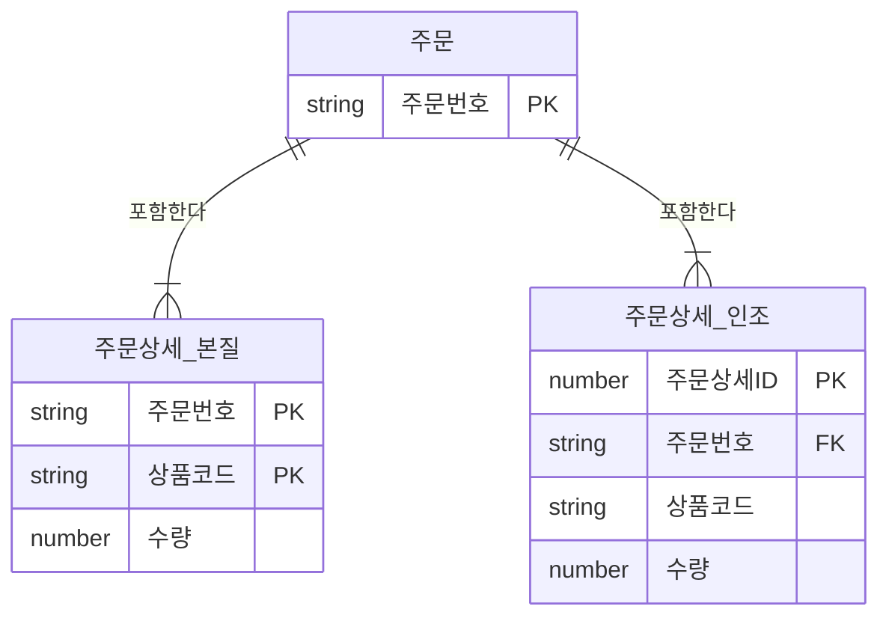

# 본질식별자와 인조식별자

식별자는 생성 방식에 따라 업무에서 자연스럽게 만들어지는 **본질식별자**와, 편의를 위해 인위적으로 만든 **인조식별자**로 나뉜다. 인조식별자는 단순하고 편리하지만 무분별하게 쓰면 중복 데이터와 불필요한 인덱스 문제가 생긴다.

## 본질식별자와 인조식별자의 정의

::: compare
- **본질식별자** 업무에 의해 자연스럽게 만들어지는 식별자다. 엔터티 인스턴스가 생성될 때 업무 규칙상 필연적으로 결정되는 값이며, 부모로부터 상속받은 식별자가 이에 해당하는 경우가 많다. 예: `주문상세`의 (주문번호 + 상품코드), `수강`의 (학번 + 과목코드)
- **인조식별자** 업무적으로 만들어지지는 않지만, 원조식별자가 복잡하거나 여러 속성으로 구성되어 인위적으로 만든 식별자다. 일련번호(Sequence), 자동 증가값(IDENTITY), 생성 규칙이 있는 코드 등. 예: `주문상세`의 (주문번호 + 순번), 단독 `주문상세ID`
:::

> 시험 포인트: 본질/인조식별자는 "업무에 의해 만들어지는가"로 구분한다. 이는 대표성(주식별자/보조식별자), 스스로 생성 여부(내부/외부식별자), 속성 수(단일/복합식별자)와는 다른 분류 기준이다.

## 본질식별자와 인조식별자 비교

| 구분 | 본질식별자 | 인조식별자 |
|---|---|---|
| 생성 근거 | 업무 규칙 | 시스템·개발 편의 |
| 업무 의미 | 있음 | 없음 |
| 구성 | 복합키인 경우가 많음 | 대부분 단일 속성 |
| 중복 방지 | 식별자 자체가 업무 중복을 막음 | 별도 유니크 제약 필요 |
| 인덱스 | PK 인덱스로 업무 조회 처리 | PK 인덱스 외에 업무 조회용 인덱스 추가 필요 |
| 조인/SQL | 조인 컬럼이 많아질 수 있음 | 조인 조건이 단순 |
| 변경 영향 | 업무 규칙 변경 시 영향 큼 | 업무 변경에 비교적 둔감 |

## 인조식별자 사용 시 문제점

::: cards 2
- **중복 데이터 발생 가능** PK 값만 다르면 업무상 같은 데이터가 두 번 들어가도 DB가 막지 못한다.
- **불필요한 인덱스 추가** PK 인덱스는 조회에 거의 안 쓰이고, 업무 조회용 인덱스를 따로 만들어야 한다.
:::

### 중복 데이터 발생 가능

주문상세의 본질식별자는 (주문번호, 상품코드)라고 가정한다. 한 주문에 같은 상품은 한 줄만 허용하는 업무 규칙이다.

::: example 인조식별자 주문상세ID를 PK로 사용한 경우
| 주문상세ID (PK) | 주문번호 | 상품코드 | 수량 |
|---|---|---|---|
| 1 | O100 | P01 | 2 |
| 2 | O100 | P01 | 2 |

- PK는 1, 2로 서로 다르므로 DB가 중복을 허용한다.
- 응용 프로그램 오류나 재전송으로 동일 주문 품목이 두 번 저장된다.
- 본질식별자 (주문번호, 상품코드)를 PK로 했다면 두 번째 INSERT는 **PK 위반으로 차단**된다.
:::



같은 주문상세를 두 방식으로 설계한 모습이다. 본질식별자 쪽은 (주문번호, 상품코드) 자체가 PK라 중복이 원천 차단되고, 인조식별자 쪽은 두 컬럼이 일반 속성이라 별도 제약이 없으면 중복이 들어온다.

### 불필요한 인덱스 추가

::: flow
- **업무 조회** 대부분 주문번호, 상품코드로 수행
- **PK 인덱스** 주문상세ID 인덱스는 조회에 거의 안 쓰임
- **추가 인덱스** (주문번호, 상품코드) 인덱스를 또 만듦
- **비용 증가** 저장 공간, INSERT·UPDATE·DELETE 시 유지 비용
:::

```sql
CREATE TABLE 주문상세 (
  주문상세ID NUMBER       PRIMARY KEY,   -- 인조식별자
  주문번호   VARCHAR2(10) NOT NULL,
  상품코드   VARCHAR2(10) NOT NULL,
  수량       NUMBER
);

-- 중복 방지와 업무 조회를 위해 결국 추가로 필요
CREATE UNIQUE INDEX UX_주문상세_01 ON 주문상세 (주문번호, 상품코드);
```

> 시험 포인트: 인조식별자의 대표적 문제점은 "중복 데이터 발생 가능성"과 "불필요한 인덱스 추가"이다. 이를 막으려면 본질 속성 조합에 유니크 제약(인덱스)을 별도로 걸어야 한다.

## 언제 무엇을 쓰는가

::: cards 2
- **본질식별자가 적합한 경우**
  - 업무 규칙상 식별 속성이 명확하고 값이 거의 변하지 않을 때
  - 부모 식별자를 상속하는 식별 관계로 업무 의미를 그대로 유지하고 싶을 때
  - 식별자 자체로 데이터 중복을 확실히 차단해야 할 때
- **인조식별자가 적합한 경우**
  - 본질식별자를 구성하는 속성이 너무 많아(일반적으로 7~8개 이상) 조인과 SQL이 복잡해질 때
  - 본질 속성 값이 변경될 가능성이 있을 때 (예: 주민번호·전화번호 등)
  - 하위 엔터티로 식별자가 계속 상속되어 PK가 지나치게 길어질 때
  - 외부 시스템 연계 등으로 짧고 고정된 키가 필요할 때
:::

### 사용 원칙

::: steps
1. **본질식별자를 우선 검토한다**
2. **인조식별자가 필요하면 도입한다** 속성이 너무 많거나, 값이 변하거나, PK가 지나치게 길어질 때
3. **본질 속성 조합에 유니크 제약을 함께 정의한다** 인조식별자를 쓸 때 반드시
4. **화면·보고서에는 노출하지 않는다** 인조식별자는 업무 의미가 없으므로 일반적으로 숨긴다
:::

## 주문상세 예제로 보는 선택

| 방식 | PK | 장점 | 단점 |
|---|---|---|---|
| 본질식별자 | 주문번호 + 상품코드 | 업무 중복 자동 차단, 추가 인덱스 불필요 | 같은 상품을 여러 줄로 나누어 담는 업무 변경에 취약 |
| 인조식별자(복합) | 주문번호 + 순번 | 부모 기준 조회 용이, 같은 상품 다회 입력 가능 | 상품 중복 허용 여부를 별도로 관리 |
| 인조식별자(단일) | 주문상세ID | PK 단순, 조인 간단 | 중복 위험, 업무 조회용 인덱스 추가 필요 |

> 시험 포인트: (주문번호 + 순번)처럼 부모 식별자에 일련번호를 붙인 형태도 인조식별자로 본다. 순번은 업무가 아니라 편의상 부여한 값이기 때문이다.

관련 문서: [식별자](/theory/identifier), [관계](/theory/relationship), [관계와 조인의 이해](/theory/relationship-and-join), [DDL](/theory/ddl)

## 핵심 요약

- 본질식별자는 업무에 의해 만들어지는 식별자, 인조식별자는 편의를 위해 인위적으로 만든 식별자
- 인조식별자는 PK가 단순해지고 조인이 쉬워지는 장점이 있음
- 인조식별자의 문제점은 중복 데이터 발생 가능성과 불필요한 인덱스 추가
- 인조식별자 사용 시 본질 속성 조합에 유니크 제약을 별도로 정의해야 함
- 본질식별자를 우선 검토하고, 속성이 너무 많거나 자주 변하면 인조식별자 고려
- (부모식별자 + 순번) 형태도 인조식별자에 해당
