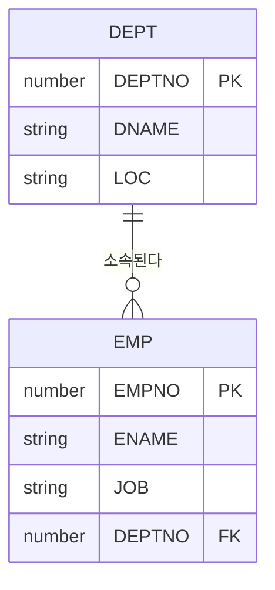
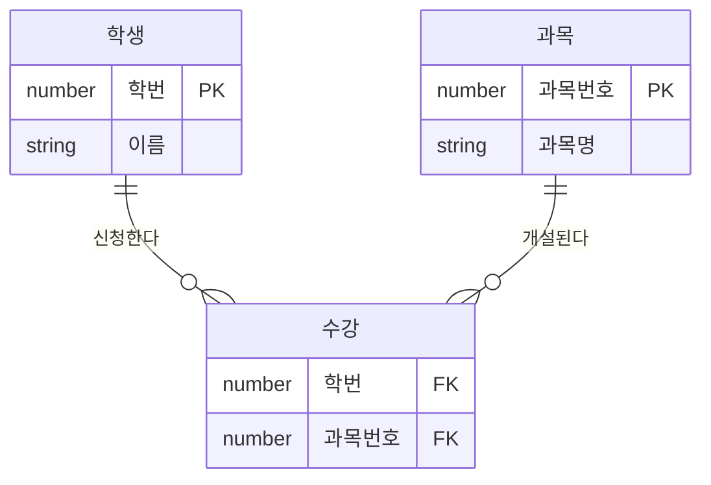

# 관계형 데이터베이스 개요

SQL을 배우기 전에 데이터베이스와 DBMS, 관계형 모델의 기본 용어를 정리한다. 명령어 분류(**DDL/DML/DCL/TCL**)는 매회 출제되는 단골 문제다.

## 데이터베이스와 DBMS

### 데이터베이스(Database)

여러 사용자가 공유하여 사용할 목적으로 **통합·저장·관리되는 데이터의 집합**이다. 단순한 파일 모음과 달리 중복을 최소화하고, 일관성과 무결성을 유지하도록 구조화되어 있다.

### DBMS(Database Management System)

데이터베이스를 정의·조작·제어하기 위한 소프트웨어다(Oracle, SQL Server, MySQL, PostgreSQL 등). 주요 기능은 다음과 같다.

| 기능 | 설명 |
|------|------|
| 정의 | 데이터 구조(테이블, 컬럼, 제약조건 등)를 정의한다 |
| 조작 | 데이터의 조회·삽입·수정·삭제를 처리한다 |
| 제어 | 권한 관리, 동시성 제어, 회복(Recovery) 등을 담당한다 |
| 무결성 | 제약조건을 통해 잘못된 데이터 입력을 막는다 |
| 보안 | 사용자별 접근 권한을 통제한다 |

### 데이터베이스 발전 과정

::: flow
- **파일 시스템** 프로그램마다 따로 저장
- **계층형 DB** 트리 구조
- **망(네트워크)형 DB** 그래프 구조
- **관계형 DB** 2차원 표 + 키
- **객체관계형 DB** 객체 개념 추가
:::

1970년 E.F. Codd 박사가 관계형 모델을 제안했고, 현재 대부분의 업무 시스템이 관계형 DB를 사용한다.

## 관계형 데이터베이스(RDB)의 특징

관계형 데이터베이스는 데이터를 **2차원 표(테이블) 형태**로 저장하고, 테이블 간의 관계를 키 값으로 표현하는 데이터베이스다.

::: cards 2
- **중복 감소** 정규화를 통해 데이터 중복과 이상현상(Anomaly)을 줄일 수 있다.
- **집합·관계 연산** 집합 연산(합집합, 차집합 등)과 관계 연산(선택, 투영, 조인 등)으로 데이터를 다룬다.
- **동시성 관리** 동시성 관리와 병행 제어로 여러 사용자가 동시에 데이터를 안전하게 사용할 수 있다.
- **무결성 보장** 무결성 제약조건(PK, FK, NOT NULL, CHECK 등)으로 데이터 품질을 보장한다.
:::

### 관계 연산과 집합 연산

| 구분 | 연산 | 의미 | SQL 대응 |
|------|------|------|----------|
| 집합 연산 | 합집합(Union) | 두 집합의 모든 행 | UNION |
| 집합 연산 | 차집합(Difference) | 한쪽에만 있는 행 | MINUS / EXCEPT |
| 집합 연산 | 교집합(Intersection) | 양쪽에 모두 있는 행 | INTERSECT |
| 집합 연산 | 곱집합(Product) | 모든 조합 | CROSS JOIN |
| 관계 연산 | 선택(Select) | 조건에 맞는 행 추출 | WHERE 절 |
| 관계 연산 | 투영(Projection) | 필요한 열만 추출 | SELECT 절 |
| 관계 연산 | 조인(Join) | 공통 속성으로 결합 | JOIN |
| 관계 연산 | 나누기(Division) | 기준 집합을 모두 만족하는 행 | 직접 대응 없음 |

::: compare
- **선택(Select)** 표에서 <strong>행(가로)</strong>을 고르는 연산. SQL에서는 **WHERE 절**이 담당한다.
- **투영(Projection)** 표에서 <strong>열(세로)</strong>을 고르는 연산. SQL에서는 **SELECT 절**이 담당한다.
:::

> 시험 포인트: 관계 연산의 "선택(Select)"은 행을 고르는 연산으로 SQL의 WHERE 절에 해당한다. SQL의 SELECT 절은 열을 고르는 "투영(Projection)"에 해당하므로 이름만 보고 혼동하지 말자.

## 테이블 관련 용어

테이블(Table)은 데이터를 저장하는 기본 단위로, 행과 열로 구성된다.

<figure class="md-figure">
<svg viewBox="0 0 640 240" xmlns="http://www.w3.org/2000/svg" font-family="Pretendard Variable, Pretendard, sans-serif" role="img" aria-label="EMP 테이블에서 테이블, 행, 열, 기본키, 외래키 위치 표시">
<text x="320" y="22" text-anchor="middle" font-size="14" font-weight="700" fill="var(--foreground)">테이블(Table) = 릴레이션(Relation)</text>
<text x="270" y="46" text-anchor="middle" font-size="12" font-weight="700" fill="oklch(0.62 0.17 255)">열 = 속성 = 필드</text>
<rect x="120" y="56" width="400" height="120" rx="6" fill="var(--card)" stroke="var(--border)"/>
<rect x="120" y="56" width="100" height="30" fill="oklch(0.75 0.16 75)" fill-opacity="0.3"/>
<rect x="420" y="56" width="100" height="30" fill="oklch(0.63 0.21 25)" fill-opacity="0.22"/>
<rect x="220" y="56" width="100" height="120" fill="oklch(0.62 0.17 255)" fill-opacity="0.14" stroke="oklch(0.62 0.17 255)" stroke-width="2"/>
<rect x="120" y="116" width="400" height="30" fill="oklch(0.65 0.14 160)" fill-opacity="0.16" stroke="oklch(0.65 0.14 160)" stroke-width="2"/>
<path d="M120 86 L520 86 M120 116 L520 116 M120 146 L520 146 M220 56 L220 176 M320 56 L320 176 M420 56 L420 176" stroke="var(--border)" stroke-width="1"/>
<text x="170" y="76" text-anchor="middle" font-size="12" font-weight="700" fill="var(--foreground)">EMPNO</text><text x="270" y="76" text-anchor="middle" font-size="12" font-weight="700" fill="var(--foreground)">ENAME</text><text x="370" y="76" text-anchor="middle" font-size="12" font-weight="700" fill="var(--foreground)">JOB</text><text x="470" y="76" text-anchor="middle" font-size="12" font-weight="700" fill="var(--foreground)">DEPTNO</text>
<text x="170" y="106" text-anchor="middle" font-size="12" fill="var(--foreground)">7369</text><text x="270" y="106" text-anchor="middle" font-size="12" fill="var(--foreground)">SMITH</text><text x="370" y="106" text-anchor="middle" font-size="12" fill="var(--foreground)">CLERK</text><text x="470" y="106" text-anchor="middle" font-size="12" fill="var(--foreground)">20</text>
<text x="170" y="136" text-anchor="middle" font-size="12" fill="var(--foreground)">7499</text><text x="270" y="136" text-anchor="middle" font-size="12" fill="var(--foreground)">ALLEN</text><text x="370" y="136" text-anchor="middle" font-size="12" fill="var(--foreground)">SALESMAN</text><text x="470" y="136" text-anchor="middle" font-size="12" fill="var(--foreground)">30</text>
<text x="170" y="166" text-anchor="middle" font-size="12" fill="var(--foreground)">7839</text><text x="270" y="166" text-anchor="middle" font-size="12" fill="var(--foreground)">KING</text><text x="370" y="166" text-anchor="middle" font-size="12" fill="var(--foreground)">PRESIDENT</text><text x="470" y="166" text-anchor="middle" font-size="12" fill="var(--foreground)">10</text>
<text x="112" y="129" text-anchor="end" font-size="12" font-weight="700" fill="oklch(0.65 0.14 160)">행 = 튜플</text>
<text x="112" y="143" text-anchor="end" font-size="11" fill="oklch(0.65 0.14 160)">= 레코드</text>
<path d="M170 176 L170 192 M470 176 L470 192" stroke="var(--muted-foreground)" stroke-width="1.5" stroke-dasharray="3 3"/>
<rect x="120" y="192" width="100" height="24" rx="12" fill="oklch(0.75 0.16 75)" fill-opacity="0.25" stroke="oklch(0.75 0.16 75)"/>
<text x="170" y="208" text-anchor="middle" font-size="12" font-weight="700" fill="var(--foreground)">PK · 기본키</text>
<rect x="420" y="192" width="100" height="24" rx="12" fill="oklch(0.63 0.21 25)" fill-opacity="0.18" stroke="oklch(0.63 0.21 25)"/>
<text x="470" y="208" text-anchor="middle" font-size="12" font-weight="700" fill="var(--foreground)">FK · 외래키</text>
<text x="530" y="208" font-size="11" fill="var(--muted-foreground)">→ DEPT.DEPTNO 참조</text>
<text x="170" y="232" text-anchor="middle" font-size="11" fill="var(--muted-foreground)">행을 유일하게 식별</text>
</svg>
<figcaption>EMP 테이블 한 장에 담긴 용어: 가로 한 줄은 행(튜플), 세로 한 줄은 열(속성), EMPNO는 PK, DEPTNO는 DEPT를 가리키는 FK</figcaption>
</figure>

| 용어 | 다른 이름 | 설명 |
|------|-----------|------|
| 테이블(Table) | 릴레이션(Relation) | 행과 열로 구성된 2차원 구조 |
| 행(Row) | 튜플(Tuple), 레코드 | 하나의 데이터 단위(가로 한 줄) |
| 열(Column) | 속성(Attribute), 필드 | 데이터의 항목(세로 한 줄) |
| 기본키(PK) | Primary Key | 행을 유일하게 식별하는 컬럼(또는 컬럼 조합) |
| 외래키(FK) | Foreign Key | 다른 테이블의 PK(또는 UK)를 참조하는 컬럼 |
| 정규화 | Normalization | 테이블을 분할해 중복과 이상현상을 제거하는 과정 |

### 예시 테이블

DEPT 테이블

| DEPTNO (PK) | DNAME | LOC |
|------|-------|-----|
| 10 | ACCOUNTING | NEW YORK |
| 20 | RESEARCH | DALLAS |
| 30 | SALES | CHICAGO |

EMP 테이블(일부)

| EMPNO (PK) | ENAME | JOB | DEPTNO (FK) |
|-------|-------|-----|--------|
| 7369 | SMITH | CLERK | 20 |
| 7499 | ALLEN | SALESMAN | 30 |
| 7839 | KING | PRESIDENT | 10 |

두 테이블의 관계를 ERD로 그리면 다음과 같다.

::: info 참조 무결성
EMP.DEPTNO는 DEPT.DEPTNO를 참조하는 외래키다. 외래키 컬럼에는 **참조 대상 테이블에 존재하는 값 또는 NULL**만 들어갈 수 있다. 예를 들어 DEPT에 없는 50번 부서로 사원을 등록하면 오류가 난다.
:::

### 기본키와 외래키 특성

| 구분 | 기본키(PK) | 외래키(FK) |
|------|-----------|-----------|
| NULL 허용 | 불가 | 가능(제약을 따로 걸지 않으면) |
| 중복 허용 | 불가 | 가능 |
| 테이블당 개수 | 1개 | 여러 개 가능 |
| 역할 | 개체 무결성 보장 | 참조 무결성 보장 |

## SQL 개요

SQL(Structured Query Language)은 관계형 데이터베이스에서 데이터를 정의·조작·제어하기 위해 사용하는 **표준 언어**다.

- ANSI/ISO에서 표준을 정하며, 각 DBMS 벤더는 표준에 자체 확장 문법을 추가해 제공한다.
- 집합 단위로 데이터를 처리한다.

::: compare
- **절차적 언어** "어떻게(How)" 처리할지 순서대로 기술한다. 반복문으로 한 건씩 읽고, 조건을 검사하고, 결과를 모은다.
- **SQL (비절차적·선언적)** "무엇을(What)" 원하는지만 기술한다. "어떻게" 가져올지는 **옵티마이저**가 결정한다.
:::

## SQL 명령어 분류

::: cards 2
- **DML · Data Manipulation Language** 데이터를 조회·변경한다.
  - SELECT, INSERT, UPDATE, DELETE, **MERGE**
- **DDL · Data Definition Language** 데이터 구조(객체)를 정의·변경한다.
  - CREATE, ALTER, DROP, **RENAME**, **TRUNCATE**
- **DCL · Data Control Language** 객체 접근 권한을 부여·회수한다.
  - GRANT, REVOKE
- **TCL · Transaction Control Language** 트랜잭션 단위로 변경을 확정·취소한다.
  - COMMIT, ROLLBACK, SAVEPOINT
:::

| 분류 | 명칭 | 명령어 | 설명 |
|------|------|--------|------|
| DML | Data Manipulation Language | SELECT, INSERT, UPDATE, DELETE, MERGE | 데이터를 조회·변경함 |
| DDL | Data Definition Language | CREATE, ALTER, DROP, RENAME, TRUNCATE | 데이터 구조(객체)를 정의·변경함 |
| DCL | Data Control Language | GRANT, REVOKE | 객체 접근 권한을 부여·회수함 |
| TCL | Transaction Control Language | COMMIT, ROLLBACK, SAVEPOINT | 트랜잭션 단위로 변경을 확정·취소함 |

- SELECT는 별도로 DQL(Data Query Language)로 분류하기도 하지만, 시험에서는 일반적으로 DML에 포함한다.

::: warning TRUNCATE는 DDL
TRUNCATE는 데이터를 지우지만 **DDL**로 분류한다. 롤백이 불가능(Oracle 기준)하고 자동 커밋된다. 데이터를 지운다는 이유로 DELETE와 같은 DML로 착각하기 쉽다.
:::

> 시험 포인트: "TRUNCATE는 DML이다"는 틀린 보기로 자주 나온다. TRUNCATE와 RENAME은 DDL, MERGE는 DML, GRANT/REVOKE는 DCL, COMMIT/ROLLBACK/SAVEPOINT는 TCL이다.

### 명령어별 상세 문서

- DML 상세: [DML](/theory/dml)
- DDL 상세: [DDL](/theory/ddl)
- TCL 상세: [TCL](/theory/tcl)
- DCL 상세: [DCL](/theory/dcl)

## ERD와 테이블 관계

ERD(Entity Relationship Diagram)는 엔터티(테이블)와 엔터티 간 관계를 도식화한 것이다. 논리 모델의 엔터티는 물리 모델에서 테이블이 되고, 관계는 외래키로 구현된다.

| 모델 요소 | 물리 구현 |
|-----------|-----------|
| 엔터티(Entity) | 테이블 |
| 속성(Attribute) | 컬럼 |
| 식별자(Identifier) | 기본키 |
| 관계(Relationship) | 외래키 |

### 관계의 종류

::: cards 3
- **1:1** 한 행이 상대 테이블의 최대 한 행과 대응한다. 예: 사원 – 사원상세.
- **1:N** 가장 흔한 형태로, **N쪽 테이블에 FK**를 둔다. 예: 부서(1) – 사원(N)
- **M:N** 물리 모델에서는 직접 표현하지 않고 **교차(연관) 테이블**로 분해해 두 개의 1:N 관계로 만든다.
:::

M:N 관계인 학생과 과목은 수강이라는 교차 테이블을 두어 다음처럼 풀어낸다.

### 관계와 조인

- 테이블 간 관계가 있으면 PK–FK 값을 비교하는 조인으로 연결된 데이터를 함께 조회할 수 있다.
- 다만 조인은 FK 제약조건이 없어도 컬럼 값만 비교하면 수행 가능하다. 자세한 내용은 [조인](/theory/join) 참고.

> 시험 포인트: 조인은 PK–FK 관계에 있는 컬럼끼리만 가능한 것이 아니다. 데이터 타입이 호환되고 의미가 맞으면 어떤 컬럼끼리도 조인 조건으로 사용할 수 있다.

## 핵심 요약

- DBMS는 데이터의 정의·조작·제어·무결성·보안 기능을 제공하는 소프트웨어다.
- 관계형 DB는 데이터를 2차원 테이블로 저장하고 PK–FK로 관계를 표현한다.
- 테이블=릴레이션, 행=튜플=레코드, 열=속성=필드로 대응된다.
- 관계 연산의 선택은 WHERE 절, 투영은 SELECT 절에 해당한다.
- PK는 NULL·중복 불가, FK는 참조 대상에 있는 값 또는 NULL만 허용한다.
- SQL은 비절차적 표준 언어이며 DML/DDL/DCL/TCL로 분류한다.
- TRUNCATE·RENAME은 DDL, MERGE는 DML, GRANT/REVOKE는 DCL, COMMIT/ROLLBACK/SAVEPOINT는 TCL이다.
- M:N 관계는 교차 테이블을 두어 두 개의 1:N 관계로 분해한다.
