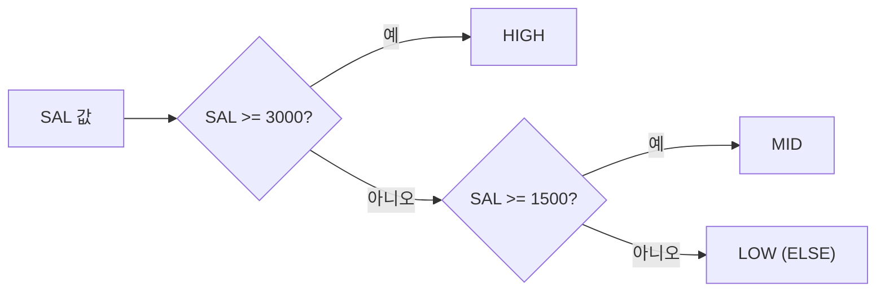

# 함수

SQL 함수는 입력값을 받아 가공된 결과를 돌려주는 기능이다. **함수별 결과값을 직접 계산**하는 문제와 **Oracle·SQL Server 함수명 차이**를 묻는 문제가 자주 출제된다.

## 단일행 함수와 다중행 함수

::: compare
- **단일행 함수** 행마다 하나의 결과를 반환한다. 문자, 숫자, 날짜, 변환, NULL 관련, CASE. SELECT, WHERE, ORDER BY, GROUP BY 등에서 사용한다.
- **다중행 함수** 여러 행을 묶어 하나의 결과를 반환한다. 집계 함수, 그룹 함수, 윈도우 함수. SELECT, HAVING, ORDER BY에서 사용한다.
:::

| 구분 | 단일행 함수 | 다중행 함수 |
|------|-------------|-------------|
| 처리 단위 | 행마다 하나의 결과 반환 | 여러 행을 묶어 하나의 결과 반환 |
| 종류 | 문자, 숫자, 날짜, 변환, NULL 관련, CASE | 집계 함수, 그룹 함수, 윈도우 함수 |
| 사용 위치 | SELECT, WHERE, ORDER BY, GROUP BY 등 | SELECT, HAVING, ORDER BY |

단일행 함수의 특징은 다음과 같다.

- 각 행에 개별적으로 적용되며 행 수가 변하지 않는다.
- 여러 인자를 받을 수 있지만 결과는 항상 하나의 값이다.
- 함수를 **중첩**해서 사용할 수 있다. 예: `UPPER(SUBSTR('smith', 1, 3))`는 안쪽부터 계산해 'smith' → 'smi' → 'SMI'.
- 다중행 함수는 [GROUP BY · HAVING 절](/theory/group-by-having), [그룹 함수](/theory/group-functions), [윈도우 함수](/theory/window-functions)에서 다룬다.

이 문서에서 다루는 단일행 함수는 여섯 갈래다.

::: cards 3
- **문자 함수** LOWER, UPPER, SUBSTR, LENGTH, TRIM, LPAD, REPLACE, INSTR
- **숫자 함수** ROUND, TRUNC, CEIL, FLOOR, MOD, ABS, SIGN
- **날짜 함수** SYSDATE, ADD_MONTHS, MONTHS_BETWEEN, LAST_DAY, EXTRACT
- **변환 함수** TO_CHAR, TO_NUMBER, TO_DATE, CAST
- **CASE · DECODE** 조건에 따라 다른 값을 돌려주는 분기
- **NULL 관련 함수** NVL, NVL2, NULLIF, COALESCE, ISNULL
:::

## 문자 함수

| 함수 | 예시 | 결과 |
|------|------|------|
| LOWER | `LOWER('SQL Expert')` | sql expert |
| UPPER | `UPPER('SQL Expert')` | SQL EXPERT |
| INITCAP | `INITCAP('sql expert')` | Sql Expert |
| CONCAT | `CONCAT('RDBMS', ' SQL')` | RDBMS SQL |
| SUBSTR | `SUBSTR('SQL Expert', 5, 3)` | Exp |
| SUBSTR | `SUBSTR('SQL Expert', 5)` | Expert |
| SUBSTR | `SUBSTR('SQL Expert', -3)` | ert |
| LENGTH | `LENGTH('SQL Expert')` | 10 |
| LTRIM | `LTRIM('xxYYZZxYZ', 'x')` | YYZZxYZ |
| RTRIM | `RTRIM('XXYYzzXYzz', 'z')` | XXYYzzXY |
| TRIM | `TRIM('x' FROM 'xxYYZZxYZxx')` | YYZZxYZ |
| LPAD | `LPAD('SQL', 6, '*')` | \*\*\*SQL |
| RPAD | `RPAD('SQL', 6, '*')` | SQL\*\*\* |
| REPLACE | `REPLACE('SQL Expert', 'SQL', 'DB')` | DB Expert |
| REPLACE | `REPLACE('A-B-C', '-')` | ABC |
| INSTR | `INSTR('CORPORATE FLOOR', 'OR')` | 2 |
| INSTR | `INSTR('CORPORATE FLOOR', 'OR', 3, 2)` | 14 |

::: cards 2
- **SUBSTR(문자열, 시작위치, 길이)** 길이를 생략하면 끝까지, 시작위치가 음수면 뒤에서부터 센다.
- **LENGTH** 공백도 한 글자로 센다. 'SQL Expert'는 공백 포함 10자다.
- **LTRIM / RTRIM** 지정 문자를 **연속으로 만나는 동안만** 제거하고, 다른 문자를 만나면 멈춘다. 문자를 생략하면 공백을 제거한다.
- **TRIM** 기본적으로 양쪽 공백을 제거하며 `TRIM(LEADING | TRAILING | BOTH '문자' FROM 문자열)` 형태로 방향을 지정한다. Oracle의 TRIM은 제거 문자로 한 글자만 지정 가능하다.
- **LPAD / RPAD** 지정 길이가 원래 문자열보다 짧으면 잘린다. `LPAD('SQLD', 2)` → SQ.
- **REPLACE** 바꿀 문자열을 생략하면 해당 문자열을 삭제한다.
:::

::: example INSTR('CORPORATE FLOOR', 'OR', 3, 2) 따라가기
INSTR(문자열, 찾을값, 시작위치, n번째) 형태다. 'CORPORATE FLOOR'에서 'OR'는 **2, 5, 14번째**에 있다. 3번째 위치부터 찾으면 5가 첫 번째, 14가 두 번째이므로 결과는 **14**다. 찾지 못하면 0을 반환한다.

```text
C O R P O R A T E    F  L  O  O  R
1 2 3 4 5 6 7 8 9 10 11 12 13 14 15
  ^     ^                     ^
  2     5                     14
```
:::

> 시험 포인트: SQL Server는 SUBSTR 대신 SUBSTRING, LENGTH 대신 LEN을 사용한다. LEN은 **뒤쪽 공백을 제외**하고 센다. 또한 SQL Server의 SUBSTRING은 길이 인수를 생략할 수 없다.

## 숫자 함수

| 함수 | 예시 | 결과 |
|------|------|------|
| ROUND | `ROUND(38.5235, 3)` | 38.524 |
| ROUND | `ROUND(38.5235, 1)` | 38.5 |
| ROUND | `ROUND(38.5235)` | 39 |
| ROUND | `ROUND(1250, -2)` | 1300 |
| TRUNC | `TRUNC(38.5235, 3)` | 38.523 |
| TRUNC | `TRUNC(38.5235)` | 38 |
| TRUNC | `TRUNC(1250, -2)` | 1200 |
| CEIL | `CEIL(38.123)` | 39 |
| CEIL | `CEIL(-38.123)` | -38 |
| FLOOR | `FLOOR(38.123)` | 38 |
| FLOOR | `FLOOR(-38.123)` | -39 |
| MOD | `MOD(7, 3)` | 1 |
| MOD | `MOD(-7, 3)` | -1 |
| ABS | `ABS(-15)` | 15 |
| SIGN | `SIGN(-15)`, `SIGN(0)`, `SIGN(15)` | -1, 0, 1 |

- ROUND/TRUNC의 두 번째 인자가 음수이면 소수점 왼쪽(정수 자리)에서 반올림·버림한다. 생략 시 0(정수)으로 처리한다.
- MOD 결과의 부호는 피제수(앞의 값)를 따른다.
- SQL Server는 CEIL 대신 **CEILING**, MOD 대신 **% 연산자**를 사용한다. TRUNC 함수는 없으며 `ROUND(n, d, 1)`로 버림 처리한다.

### CEIL과 FLOOR의 방향

CEIL은 크거나 같은 **최소 정수**, FLOOR는 작거나 같은 **최대 정수**다. 수직선 위에서 보면 CEIL은 항상 오른쪽, FLOOR는 항상 왼쪽으로 간다.

<figure class="md-figure">
<svg viewBox="0 0 640 180" xmlns="http://www.w3.org/2000/svg" font-family="Pretendard Variable, Pretendard, sans-serif" role="img" aria-label="수직선 위에서 CEIL은 오른쪽 정수, FLOOR는 왼쪽 정수로 이동">
<defs><marker id="functions-arr-blue" viewBox="0 0 10 10" refX="8" refY="5" markerWidth="6" markerHeight="6" orient="auto"><path d="M0 0 L10 5 L0 10z" fill="oklch(0.62 0.17 255)"/></marker><marker id="functions-arr-amber" viewBox="0 0 10 10" refX="8" refY="5" markerWidth="6" markerHeight="6" orient="auto"><path d="M0 0 L10 5 L0 10z" fill="oklch(0.75 0.16 75)"/></marker></defs>
<text x="20" y="69" font-size="14" font-weight="700" fill="var(--foreground)">38.123</text>
<path d="M140 65 L600 65" stroke="var(--muted-foreground)" stroke-width="2"/>
<path d="M180 58 L180 72 M560 58 L560 72" stroke="var(--foreground)" stroke-width="2"/>
<circle cx="227" cy="65" r="5" fill="var(--foreground)"/>
<path d="M227 48 L186 48" stroke="oklch(0.75 0.16 75)" stroke-width="2.5" marker-end="url(#functions-arr-amber)"/>
<path d="M227 48 L552 48" stroke="oklch(0.62 0.17 255)" stroke-width="2.5" marker-end="url(#functions-arr-blue)"/>
<text x="205" y="38" text-anchor="middle" font-size="12" font-weight="700" fill="oklch(0.75 0.16 75)">FLOOR = 38</text>
<text x="390" y="38" text-anchor="middle" font-size="12" font-weight="700" fill="oklch(0.62 0.17 255)">CEIL = 39</text>
<text x="180" y="88" text-anchor="middle" font-size="12" fill="var(--muted-foreground)">38</text>
<text x="560" y="88" text-anchor="middle" font-size="12" fill="var(--muted-foreground)">39</text>
<text x="20" y="149" font-size="14" font-weight="700" fill="var(--foreground)">-38.123</text>
<path d="M140 145 L600 145" stroke="var(--muted-foreground)" stroke-width="2"/>
<path d="M180 138 L180 152 M560 138 L560 152" stroke="var(--foreground)" stroke-width="2"/>
<circle cx="513" cy="145" r="5" fill="var(--foreground)"/>
<path d="M513 128 L186 128" stroke="oklch(0.75 0.16 75)" stroke-width="2.5" marker-end="url(#functions-arr-amber)"/>
<path d="M513 128 L552 128" stroke="oklch(0.62 0.17 255)" stroke-width="2.5" marker-end="url(#functions-arr-blue)"/>
<text x="350" y="118" text-anchor="middle" font-size="12" font-weight="700" fill="oklch(0.75 0.16 75)">FLOOR = -39</text>
<text x="560" y="118" text-anchor="middle" font-size="12" font-weight="700" fill="oklch(0.62 0.17 255)">CEIL = -38</text>
<text x="180" y="168" text-anchor="middle" font-size="12" fill="var(--muted-foreground)">-39</text>
<text x="560" y="168" text-anchor="middle" font-size="12" fill="var(--muted-foreground)">-38</text>
</svg>
<figcaption>음수에서도 방향은 같다. CEIL(-38.123)은 오른쪽의 -38, FLOOR(-38.123)는 왼쪽의 -39</figcaption>
</figure>

> 시험 포인트: 음수에서 CEIL과 FLOOR의 방향을 헷갈리지 않도록 주의한다. "버림이니까 -38"이라고 생각하면 FLOOR(-38.123)을 틀린다.

## 날짜 함수와 날짜 연산

| 함수 | 예시 | 결과 |
|------|------|------|
| SYSDATE | `SYSDATE` | 현재 날짜와 시각 |
| ADD_MONTHS | `ADD_MONTHS(DATE '2024-01-31', 1)` | 2024-02-29 |
| MONTHS_BETWEEN | `MONTHS_BETWEEN(DATE '2024-03-15', DATE '2024-01-15')` | 2 |
| LAST_DAY | `LAST_DAY(DATE '2024-02-10')` | 2024-02-29 |
| EXTRACT | `EXTRACT(YEAR FROM DATE '2024-05-20')` | 2024 |
| EXTRACT | `EXTRACT(MONTH FROM DATE '2024-05-20')` | 5 |

- ADD_MONTHS는 기준일이 월말이거나 결과 월에 해당 일자가 없으면 결과 월의 말일을 돌려준다.
- MONTHS_BETWEEN(늦은날짜, 이른날짜) 순서이며 반대로 쓰면 음수가 나온다.

### 날짜 연산 규칙

| 연산 | 결과 타입 | 예시 |
|------|-----------|------|
| 날짜 + 숫자 | 날짜 | `SYSDATE + 1` → 내일 같은 시각 |
| 날짜 - 숫자 | 날짜 | `SYSDATE - 7` → 일주일 전 |
| 날짜 - 날짜 | 숫자(일수) | `DATE '2024-03-01' - DATE '2024-02-01'` → 29 |
| 날짜 + 숫자/24 | 날짜 | `SYSDATE + 1/24` → 1시간 후 |
| 날짜 + 날짜 | 오류 | 허용되지 않음 |

::: info 숫자 1 = 하루
Oracle에서 숫자 1은 하루를 뜻하므로 **1/24는 1시간, 1/24/60은 1분**이다. SQL Server는 `GETDATE()`로 현재 시각을 구하고, `DATEADD(MONTH, 1, d)`, `DATEDIFF(DAY, d1, d2)`, `DATEPART(YEAR, d)` 또는 `YEAR(d)`를 사용한다.
:::

## 변환 함수

### 명시적 변환과 암시적 변환

- **명시적(Explicit) 변환**: 변환 함수를 사용해 개발자가 직접 타입을 바꾼다.
- **암시적(Implicit) 변환**: DBMS가 비교·연산 시 자동으로 타입을 맞춘다.

```sql
-- EMPNO는 NUMBER, 비교값은 문자 → 문자 '7369'가 숫자로 암시적 변환됨
SELECT ENAME FROM EMP WHERE EMPNO = '7369';
```

::: warning 암시적 변환의 부작용
암시적 변환은 의도치 않은 오류나 성능 저하(인덱스 컬럼이 변환되어 인덱스를 사용하지 못함)를 일으킬 수 있다. 그래서 **명시적 변환이 권장**된다.
:::

### Oracle 변환 함수

| 함수 | 예시 | 결과 |
|------|------|------|
| TO_CHAR(날짜, 포맷) | `TO_CHAR(DATE '2024-05-20', 'YYYY/MM/DD')` | 2024/05/20 |
| TO_CHAR(숫자, 포맷) | `TO_CHAR(1234567, 'FM9,999,999')` | 1,234,567 |
| TO_NUMBER(문자) | `TO_NUMBER('100') + 1` | 101 |
| TO_DATE(문자, 포맷) | `TO_DATE('20240520', 'YYYYMMDD')` | 2024-05-20 (DATE 타입) |
| CAST(값 AS 타입) | `CAST('100' AS NUMBER)` | 100 |

SQL Server는 `CAST(expr AS type)`과 `CONVERT(type, expr [, style])`를 사용한다. CAST는 ANSI 표준이라 양쪽 모두 사용 가능하다.

## CASE 표현식과 DECODE

### CASE 표현식

```sql
-- 단순 CASE (Simple Case Expression)
SELECT ENAME,
       CASE DEPTNO WHEN 10 THEN 'ACCOUNTING'
                   WHEN 20 THEN 'RESEARCH'
                   ELSE 'ETC'
       END AS DNAME
FROM   EMP;

-- 검색 CASE (Searched Case Expression)
SELECT ENAME, SAL,
       CASE WHEN SAL >= 3000 THEN 'HIGH'
            WHEN SAL >= 1500 THEN 'MID'
            ELSE 'LOW'
       END AS GRADE
FROM   EMP;
```

WHEN 조건은 위에서부터 평가하며 **처음 만족한 THEN 값을 반환하고 끝난다**. 위 검색 CASE로 SAL 5000을 넣으면 첫 WHEN에서 바로 'HIGH'가 되고, 두 번째 WHEN은 보지 않는다.



- **ELSE를 생략하고 만족하는 조건이 없으면 NULL**을 반환한다.
- 단순 CASE에서 `WHEN NULL`은 `=` 비교이므로 절대 참이 되지 않는다. NULL 판별은 검색 CASE의 `WHEN col IS NULL`로 해야 한다.

### DECODE (Oracle 전용)

```sql
SELECT ENAME, DECODE(DEPTNO, 10, 'ACCOUNTING', 20, 'RESEARCH', 'ETC') AS DNAME
FROM   EMP;
```

위 DECODE는 앞의 단순 CASE와 같은 결과를 낸다. 둘의 차이는 다음과 같다.

::: compare
- **CASE** ANSI 표준이라 Oracle·SQL Server 모두 사용한다. 검색 CASE는 `>=`, `BETWEEN`, `IS NULL` 등 **모든 조건**을 쓸 수 있다. 단순 CASE의 `WHEN NULL`은 참이 되지 않는다. ELSE 생략 시 NULL.
- **DECODE** **Oracle 전용**이다. `DECODE(대상, 값1, 결과1, 값2, 결과2, ..., 기본값)` 형태로 **등호(=) 비교만** 가능하다. **NULL과 NULL을 같은 값으로 취급**한다. 기본값 생략 시 NULL.
:::

> 시험 포인트: CASE에서 ELSE를 생략하면 NULL이 반환된다. 결과 테이블에서 일부 행 값이 NULL로 나오는 문제를 낼 때 자주 쓰인다.

## NULL 관련 함수

| 함수 | 의미 | 예시 | 결과 |
|------|------|------|------|
| NVL(a, b) | a가 NULL이면 b, 아니면 a | `NVL(NULL, 0)` | 0 |
| NVL2(a, b, c) | a가 NULL이 아니면 b, NULL이면 c | `NVL2(NULL, 'Y', 'N')` | N |
| NULLIF(a, b) | a = b이면 NULL, 다르면 a | `NULLIF(10, 10)` / `NULLIF(10, 20)` | NULL / 10 |
| COALESCE(a, b, ...) | NULL이 아닌 첫 번째 값 | `COALESCE(NULL, NULL, 3, 4)` | 3 |
| ISNULL(a, b) | SQL Server의 NVL | `ISNULL(NULL, 0)` | 0 |

- NVL/ISNULL의 두 인자는 데이터 타입이 호환되어야 한다.
- COALESCE는 인자가 모두 NULL이면 NULL을 반환한다.
- `COALESCE(a, b)`는 `NVL(a, b)`와 결과가 같고, `CASE WHEN a IS NOT NULL THEN a ELSE b END`로도 표현 가능하다.
- NULL의 성질(비교, 연산, 정렬)은 [NULL 속성](/theory/null-attribute)에서 자세히 다룬다.

> 시험 포인트: NVL2는 "NULL이 아닐 때" 값을 두 번째 인자에, "NULL일 때" 값을 세 번째 인자에 둔다. NVL과 순서가 반대처럼 느껴져 자주 틀린다. NULLIF는 두 값이 **같을 때** NULL을 반환한다.

## Oracle과 SQL Server 함수 비교

::: compare
- **Oracle** LENGTH, SUBSTR, `||`, CEIL, MOD, TRUNC, SYSDATE, ADD_MONTHS, EXTRACT, TO_CHAR·TO_NUMBER·TO_DATE, NVL, DECODE
- **SQL Server** LEN, SUBSTRING, `+`, CEILING, %, ROUND(n, d, 1), GETDATE(), DATEADD, DATEPART, CONVERT, ISNULL, (DECODE 없음)
:::

| 기능 | Oracle | SQL Server |
|------|--------|------------|
| 문자열 길이 | LENGTH | LEN |
| 부분 문자열 | SUBSTR | SUBSTRING |
| 문자열 연결 | `\|\|`, CONCAT | `+`, CONCAT |
| 올림 | CEIL | CEILING |
| 나머지 | MOD | % |
| 버림 | TRUNC | ROUND(n, d, 1) |
| 현재 일시 | SYSDATE | GETDATE() |
| 날짜 더하기 | 날짜 + n, ADD_MONTHS | DATEADD |
| 날짜 일부 추출 | EXTRACT | DATEPART, YEAR/MONTH/DAY |
| 타입 변환 | TO_CHAR, TO_NUMBER, TO_DATE, CAST | CAST, CONVERT |
| NULL 대체 | NVL | ISNULL |
| 조건 분기 | CASE, DECODE | CASE |

## 핵심 요약

- 단일행 함수는 행마다 결과를 하나씩 반환하고 중첩해서 사용할 수 있다.
- SUBSTR 음수 시작위치는 뒤에서부터 세며, INSTR은 찾지 못하면 0을 반환한다.
- ROUND/TRUNC의 음수 자릿수는 정수부에서 처리하며, CEIL/FLOOR는 음수 방향에 주의한다.
- 날짜 - 날짜 = 일수, 날짜 + 숫자 = 날짜, 날짜 + 날짜는 오류다.
- 암시적 변환보다 명시적 변환(TO_CHAR, TO_NUMBER, TO_DATE, CAST)이 권장된다.
- CASE에서 ELSE 생략 시 NULL을 반환하며, DECODE는 Oracle 전용이다.
- NVL2(a, NULL아님, NULL임), NULLIF는 같으면 NULL, COALESCE는 첫 번째 NOT NULL 값을 반환한다.
- SQL Server는 LEN, SUBSTRING, CEILING, GETDATE, ISNULL, CONVERT를 사용한다.
