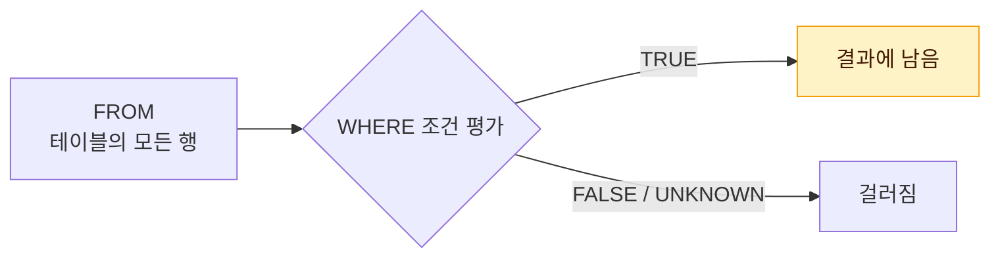
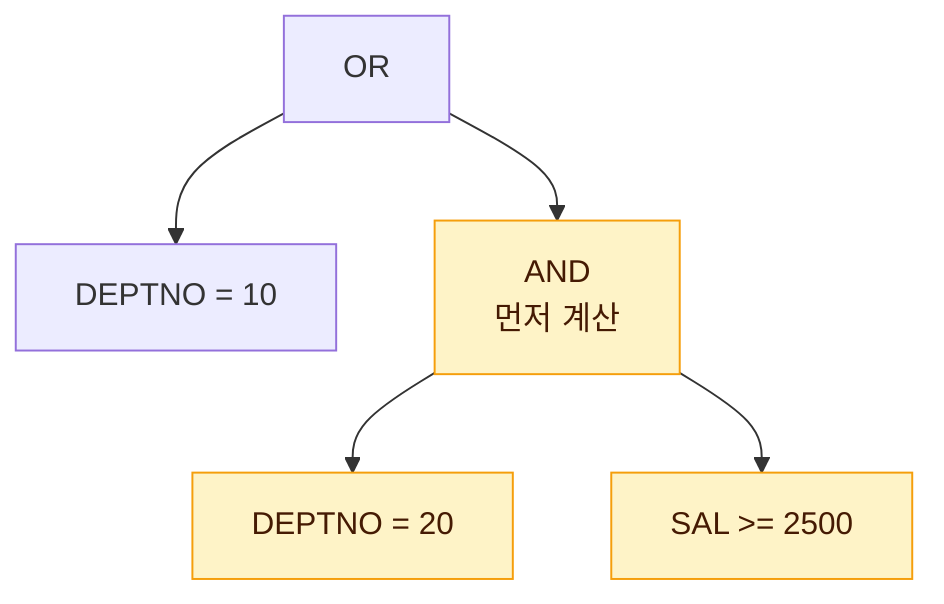

# WHERE 절

WHERE 절은 FROM 절로 읽은 행 중 조건을 만족하는 행만 남기는 **필터** 역할을 한다. 연산자 우선순위와 NULL이 섞인 조건의 결과를 묻는 문제가 자주 출제된다.



조건 결과가 **TRUE인 행만** 남는다. FALSE뿐 아니라 NULL 비교로 생기는 **UNKNOWN도 걸러진다**는 점이 이 문서 함정 문제의 핵심이다.

## 예제 테이블

이 문서의 예제는 아래 EMP 테이블(6행)을 기준으로 한다.

| EMPNO | ENAME | JOB | SAL | COMM | DEPTNO |
|-------|-------|-----|-----|------|--------|
| 7369 | SMITH | CLERK | 800 | NULL | 20 |
| 7499 | ALLEN | SALESMAN | 1600 | 300 | 30 |
| 7566 | JONES | MANAGER | 2975 | NULL | 20 |
| 7654 | MARTIN | SALESMAN | 1250 | 1400 | 30 |
| 7782 | CLARK | MANAGER | 2450 | NULL | 10 |
| 7839 | KING | PRESIDENT | 5000 | NULL | 10 |

## 비교 연산자

| 연산자 | 의미 |
|--------|------|
| = | 같다 |
| >, >= | 크다, 크거나 같다 |
| <, <= | 작다, 작거나 같다 |

- 문자와 날짜 값은 작은따옴표로 감싼다. 숫자는 따옴표 없이 쓴다.
- 문자열 비교는 대소문자를 구분한다. `ENAME = 'smith'`는 결과가 없다.

```sql
SELECT ENAME, SAL FROM EMP WHERE SAL >= 2450;
-- JONES 2975, CLARK 2450, KING 5000
```

## SQL 연산자

::: cards 2
- **BETWEEN a AND b** a 이상 b 이하. **양 끝을 포함**한다.
- **IN (list)** 목록 중 하나와 일치한다.
- **LIKE '패턴'** 문자 패턴과 일치한다.
- **IS NULL** NULL 값인지 확인한다.
:::

### BETWEEN

```sql
SELECT ENAME, SAL FROM EMP WHERE SAL BETWEEN 1250 AND 2450;
-- ALLEN 1600, MARTIN 1250, CLARK 2450 (경계값 포함 3행)
```

- `SAL >= 1250 AND SAL <= 2450`과 같다.
- 작은 값을 앞에 써야 한다. `BETWEEN 2450 AND 1250`은 오류가 아니라 **결과가 0건**이다(`SAL >= 2450 AND SAL <= 1250`을 만족하는 값이 없으므로).

### IN

```sql
SELECT ENAME, JOB FROM EMP WHERE JOB IN ('MANAGER', 'CLERK');
-- SMITH, JONES, CLARK
```

- `JOB = 'MANAGER' OR JOB = 'CLERK'`과 같다.
- 다중 컬럼 IN도 가능하다: `WHERE (JOB, DEPTNO) IN (('MANAGER', 20), ('CLERK', 10))` → JONES만 해당한다.

### LIKE와 와일드카드

| 와일드카드 | 의미 | 예시 | 매칭 |
|------------|------|------|------|
| % | 0개 이상의 임의 문자 | `'M%'` | MARTIN |
| _ | 정확히 1개의 임의 문자 | `'_A%'` | MARTIN (두 번째 글자 A) |

예제 테이블에 여러 패턴을 적용하면 다음과 같다.

| 패턴 | 뜻 | 결과 |
|------|----|------|
| `'%A%'` | A가 어디든 포함 | ALLEN, MARTIN, CLARK |
| `'%N'` | N으로 끝남 | ALLEN, MARTIN |
| `'%S'` | S로 끝남 | JONES |
| `'__A%'` | 세 번째 글자가 A | CLARK |
| `'K___'` | K로 시작하는 정확히 4글자 | KING |
| `'KING'` | 와일드카드 없음 = `'KING'`과 같음 | KING |

```sql
SELECT ENAME FROM EMP WHERE ENAME LIKE '%A%';
-- ALLEN, MARTIN, CLARK
```

- 와일드카드 없이 `LIKE 'KING'`을 쓰면 `= 'KING'`과 같은 의미다.
- `%`나 `_` 문자 자체를 찾으려면 **ESCAPE** 문자를 지정한다.

```sql
-- 이름에 '_' 문자가 포함된 행 검색
SELECT * FROM T WHERE NAME LIKE '%\_%' ESCAPE '\';
```

ESCAPE에 지정하는 문자는 어떤 문자든 가능하며(`'#'`, `'@'` 등), 바로 뒤의 한 글자를 일반 문자로 취급하게 한다.

### IS NULL

```sql
SELECT ENAME FROM EMP WHERE COMM IS NULL;   -- SMITH, JONES, CLARK, KING
SELECT ENAME FROM EMP WHERE COMM = NULL;    -- 0건 (오류는 아님)
```

NULL과의 비교(`=`, `<>`, `>` 등) 결과는 UNKNOWN이 되어 WHERE 절에서 걸러진다. 반드시 IS NULL / IS NOT NULL을 사용한다.

> 시험 포인트: `WHERE COMM = NULL`은 문법 오류가 아니라 항상 0건을 반환한다. "오류 발생"을 정답으로 고르지 않도록 주의하자.

## 논리 연산자와 우선순위

| 연산자 | 의미 |
|--------|------|
| AND | 앞뒤 조건이 모두 참이어야 참 |
| OR | 앞뒤 조건 중 하나라도 참이면 참 |
| NOT | 조건의 결과를 반대로 바꿈 |

### 연산자 우선순위

::: steps
1. **괄호 ( )** 가장 먼저 계산한다
2. **비교 연산자, SQL 연산자** =, >, BETWEEN, IN, LIKE, IS NULL 등
3. **NOT** 비교 결과를 뒤집는다
4. **AND**
5. **OR** 가장 나중에 계산한다
:::

- 논리 연산자끼리는 **NOT > AND > OR** 순이다. 교재에 따라 NOT을 비교 연산자보다 앞에 두기도 하지만, NOT은 비교 결과(참/거짓)에 적용되므로 실제 결과는 같다.
- 우선순위가 헷갈리는 조건은 괄호로 의도를 명확히 하는 것이 좋다.

### 우선순위 예제

```sql
-- (1) 괄호 없음: AND가 먼저 계산됨
SELECT ENAME FROM EMP
WHERE  DEPTNO = 10 OR DEPTNO = 20 AND SAL >= 2500;
```

해석: `DEPTNO = 10 OR (DEPTNO = 20 AND SAL >= 2500)`. AND가 먼저 묶이므로 조건은 아래 모양의 나무가 된다.



| ENAME | DEPTNO | SAL |
|-------|--------|-----|
| JONES | 20 | 2975 |
| CLARK | 10 | 2450 |
| KING | 10 | 5000 |

```sql
-- (2) 괄호로 OR를 먼저 계산
SELECT ENAME FROM EMP
WHERE  (DEPTNO = 10 OR DEPTNO = 20) AND SAL >= 2500;
```

| ENAME | DEPTNO | SAL |
|-------|--------|-----|
| JONES | 20 | 2975 |
| KING | 10 | 5000 |

::: compare
- **(1) 괄호 없음 · 3행** 10번 부서 전원(CLARK 포함)이 급여와 무관하게 포함된다. 급여 조건은 20번 부서에만 걸린다.
- **(2) 괄호 있음 · 2행** 급여 조건이 두 부서 모두에 적용되어 SAL 2450인 CLARK이 빠진다.
:::

> 시험 포인트: AND가 OR보다 먼저 계산된다. 괄호 유무만 다른 두 SQL의 결과 행 수를 비교하는 문제가 자주 나온다.

## 부정 연산자

| 구분 | 연산자 | 의미 |
|------|--------|------|
| 부정 비교 | `!=`, `^=`, `<>` | 같지 않다 (`<>`가 ANSI 표준) |
| 부정 비교 | `NOT 컬럼 = 값` | 같지 않다 |
| 부정 비교 | `NOT 컬럼 > 값` | 크지 않다(작거나 같다) |
| 부정 SQL | `NOT BETWEEN a AND b` | a와 b 사이가 아님(양 끝 미포함) |
| 부정 SQL | `NOT IN (list)` | 목록 어떤 값과도 일치하지 않음 |
| 부정 SQL | `NOT LIKE` | 패턴과 일치하지 않음 |
| 부정 SQL | `IS NOT NULL` | NULL이 아님 |

`^=`는 Oracle에서 지원한다. SQL Server는 `!=`와 `<>`를 사용한다.

## NOT IN과 NULL 함정

::: warning NOT IN 목록에 NULL이 있으면 0건
IN 목록이나 서브쿼리 결과에 NULL이 섞여 있으면 NOT IN의 결과가 **항상 0건**이 된다.

```sql
SELECT ENAME FROM EMP WHERE DEPTNO IN (10, NULL);
-- CLARK, KING
SELECT ENAME FROM EMP WHERE DEPTNO NOT IN (10, NULL);
-- 0건
```
:::

원리는 다음과 같다.

- `DEPTNO IN (10, NULL)` = `DEPTNO = 10 OR DEPTNO = NULL` → 10번 부서는 TRUE OR UNKNOWN = TRUE라 조회된다.
- `DEPTNO NOT IN (10, NULL)` = `DEPTNO <> 10 AND DEPTNO <> NULL` → 어떤 행이든 `DEPTNO <> NULL`이 UNKNOWN이므로 AND 결과는 FALSE 또는 UNKNOWN이 되어 모두 걸러진다.

UNKNOWN이 섞인 논리 연산 결과를 정리하면 다음과 같다.

| 연산 | 결과 | NOT IN에서의 의미 |
|------|------|-------------------|
| TRUE AND UNKNOWN | UNKNOWN | 20번 부서 행: `20 <> 10` 참이어도 걸러짐 |
| FALSE AND UNKNOWN | FALSE | 10번 부서 행: 걸러짐 |
| TRUE OR UNKNOWN | TRUE | IN에서 10번 부서가 조회되는 이유 |
| FALSE OR UNKNOWN | UNKNOWN | IN에서 NULL은 무시되는 효과 |

::: info 해결 방법
서브쿼리를 NOT IN으로 사용할 때도 동일하므로, 서브쿼리 쪽에 `IS NOT NULL` 조건을 넣거나 **NOT EXISTS**를 사용한다([서브쿼리](/theory/subquery) 참고).
:::

> 시험 포인트: NOT IN 목록에 NULL이 하나라도 있으면 결과는 0건이다. 반면 IN 목록의 NULL은 단순히 무시되는 것과 같은 효과를 낸다.

## 문자 타입 비교 규칙

CHAR(고정길이)와 VARCHAR2(가변길이)는 비교 방식이 다르다.

::: compare
- **CHAR와 CHAR** 짧은 쪽 뒤에 공백을 채워 길이를 맞춘 후 비교한다. `'AB'`와 `'AB  '`는 **같다**.
- **한쪽이라도 VARCHAR2** 공백을 채우지 않고 그대로 비교한다. 길이가 다르면 다르다. `'AB'`와 `'AB '`는 **다르다**.
:::

| 비교 대상 | 비교 방식 | 예시 |
|-----------|-----------|------|
| CHAR와 CHAR | 짧은 쪽 뒤에 공백을 채워 길이를 맞춘 후 비교 | `'AB'`와 `'AB  '`는 같음 |
| 한쪽이라도 VARCHAR2 | 공백을 채우지 않고 그대로 비교. 길이가 다르면 다름 | `'AB'`와 `'AB '`는 다름 |
| 컬럼과 상수 | 상수를 컬럼 타입에 맞춰 변환 후 위 규칙 적용 | CHAR 컬럼과 비교하면 공백 무시 효과 |

- 비교는 첫 글자부터 차례로 하며, 처음 다른 글자가 나온 위치의 문자 코드 크기로 대소를 판단한다.

::: example CHAR(5) vs VARCHAR2 저장
CHAR(5) 컬럼에 'AB'를 저장하면 실제로 'AB   '로 저장되므로 `WHERE COL = 'AB'`로 조회된다. 같은 값을 VARCHAR2 컬럼에 'AB '(뒤 공백 포함)로 저장하면 `= 'AB'`로는 조회되지 않는다.
:::

## ROWNUM과 TOP

- Oracle의 ROWNUM은 WHERE 절에서 출력 행 수를 제한할 때 사용하는 가상 컬럼이다.
- SQL Server의 TOP, 표준 FETCH FIRST와 함께 [TOP-N 쿼리](/theory/top-n)에서 자세히 다룬다.

## 핵심 요약

- WHERE 절은 FROM 다음에 실행되어 행 단위로 데이터를 걸러낸다. 조건이 TRUE인 행만 남는다.
- BETWEEN은 양 끝 값을 포함하며, 작은 값을 먼저 써야 결과가 나온다.
- LIKE의 `%`는 0개 이상, `_`는 정확히 1개 문자이며 ESCAPE로 와일드카드 자체를 검색한다.
- NULL 비교는 `=`가 아닌 IS NULL / IS NOT NULL로 해야 한다.
- 연산자 우선순위는 괄호 → 비교·SQL 연산자 → NOT → AND → OR이다.
- NOT IN 목록에 NULL이 있으면 결과는 항상 0건이다.
- CHAR끼리는 공백을 채워 비교하고, VARCHAR2가 섞이면 공백까지 그대로 비교한다.
