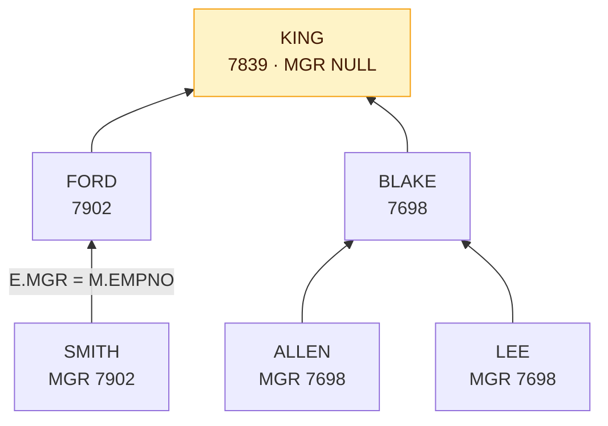

# 조인

조인(Join)은 둘 이상의 테이블을 연결해 **하나의 결과 집합**으로 만드는 연산이다. 이 문서는 WHERE 절에 조인 조건을 쓰는 Oracle 전통 방식을 다루며, ANSI 표준 문법은 [표준 조인](/theory/standard-join)에서 다룬다.

## 예제 테이블

EMP

| EMPNO | ENAME | SAL | MGR | DEPTNO |
|-------|-------|-----|-----|--------|
| 7369 | SMITH | 800 | 7902 | 20 |
| 7499 | ALLEN | 1600 | 7698 | 30 |
| 7698 | BLAKE | 2850 | 7839 | 30 |
| 7839 | KING | 5000 | NULL | 10 |
| 7902 | FORD | 3000 | 7839 | 20 |
| 7999 | LEE | 1200 | 7698 | NULL |

DEPT

| DEPTNO | DNAME | LOC |
|--------|-------|-----|
| 10 | ACCOUNTING | NEW YORK |
| 20 | RESEARCH | DALLAS |
| 30 | SALES | CHICAGO |
| 40 | OPERATIONS | BOSTON |

SALGRADE

| GRADE | LOSAL | HISAL |
|-------|-------|-------|
| 1 | 700 | 1200 |
| 2 | 1201 | 1400 |
| 3 | 1401 | 2000 |
| 4 | 2001 | 3000 |
| 5 | 3001 | 9999 |

눈여겨볼 데이터는 두 가지다. **LEE는 부서가 NULL**이고, **40번 부서에는 사원이 없다**. 이 두 행이 조인 종류마다 결과에 나오는지 빠지는지가 핵심이다.

## 조인의 개념

::: cards 2
- **왜 쓰나** 정규화로 분리된 테이블을 다시 연결해 필요한 정보를 함께 조회하기 위해 쓴다.
- **PK–FK 불필요** PK–FK 관계가 없어도 컬럼 값의 논리적 관계만 있으면 조인할 수 있다.
- **두 집합씩** FROM 절에 여러 테이블을 나열해도 조인은 내부적으로 **두 집합씩** 순차적으로 수행된다.
- **컬럼 구분** 여러 테이블에 같은 이름의 컬럼이 있으면 `테이블명.컬럼` 또는 `별칭.컬럼`으로 반드시 구분해야 한다(모호성 오류 방지).
:::

### 조인 종류 한눈에 보기

<figure class="md-figure">
<svg viewBox="0 0 640 196" xmlns="http://www.w3.org/2000/svg" font-family="Pretendard Variable, Pretendard, sans-serif" role="img" aria-label="INNER, LEFT OUTER, RIGHT OUTER, FULL OUTER 조인을 두 원의 색칠 영역으로 비교한 벤 다이어그램">
<g font-size="13" font-weight="700" fill="var(--foreground)" text-anchor="middle">
<text x="80" y="22">INNER</text><text x="240" y="22">LEFT OUTER</text><text x="400" y="22">RIGHT OUTER</text><text x="560" y="22">FULL OUTER</text>
</g>
<path d="M80 57.53 A42 42 0 0 1 80 126.47 A42 42 0 0 1 80 57.53 Z" fill="oklch(0.62 0.17 255)" fill-opacity="0.4"/>
<circle cx="216" cy="92" r="42" fill="oklch(0.62 0.17 255)" fill-opacity="0.4"/>
<circle cx="424" cy="92" r="42" fill="oklch(0.62 0.17 255)" fill-opacity="0.4"/>
<g opacity="0.4"><circle cx="536" cy="92" r="42" fill="oklch(0.62 0.17 255)"/><circle cx="584" cy="92" r="42" fill="oklch(0.62 0.17 255)"/></g>
<g fill="none" stroke="var(--foreground)" stroke-width="1.5">
<circle cx="56" cy="92" r="42"/><circle cx="104" cy="92" r="42"/>
<circle cx="216" cy="92" r="42"/><circle cx="264" cy="92" r="42"/>
<circle cx="376" cy="92" r="42"/><circle cx="424" cy="92" r="42"/>
<circle cx="536" cy="92" r="42"/><circle cx="584" cy="92" r="42"/>
</g>
<g font-size="11" font-weight="700" fill="var(--foreground)" text-anchor="middle">
<text x="38" y="96">EMP</text><text x="122" y="96">DEPT</text>
<text x="198" y="96">EMP</text><text x="282" y="96">DEPT</text>
<text x="358" y="96">EMP</text><text x="442" y="96">DEPT</text>
<text x="518" y="96">EMP</text><text x="602" y="96">DEPT</text>
</g>
<g font-size="12" fill="var(--foreground)" text-anchor="middle">
<text x="80" y="158">매칭된 행만</text><text x="240" y="158">EMP 전부 + 매칭</text><text x="400" y="158">DEPT 전부 + 매칭</text><text x="560" y="158">양쪽 전부</text>
</g>
<g font-size="11" fill="var(--muted-foreground)" text-anchor="middle">
<text x="80" y="180">E.D = D.D</text><text x="240" y="180">E.D = D.D(+)</text><text x="400" y="180">E.D(+) = D.D</text><text x="560" y="180">(+)로 표현 불가</text>
</g>
</svg>
<figcaption>색칠된 영역이 결과에 남는 행이다. 아래 줄은 Oracle (+) 표기(D = DEPTNO). 왼쪽에만 있는 LEE, 오른쪽에만 있는 40번 부서가 어디에 속하는지 떠올려 보자.</figcaption>
</figure>

## EQUI JOIN(등가 조인)

두 테이블의 컬럼 값이 <strong>정확히 일치(=)</strong>하는 행끼리 연결한다. 가장 많이 쓰는 조인이다.

```sql
SELECT E.ENAME, E.DEPTNO, D.DNAME
FROM   EMP E, DEPT D
WHERE  E.DEPTNO = D.DEPTNO;
```

| ENAME | DEPTNO | DNAME |
|-------|--------|-------|
| SMITH | 20 | RESEARCH |
| ALLEN | 30 | SALES |
| BLAKE | 30 | SALES |
| KING | 10 | ACCOUNTING |
| FORD | 20 | RESEARCH |

- DEPTNO가 NULL인 LEE는 어떤 DEPT 행과도 같지 않으므로 제외된다.
- 사원이 없는 40번 부서(OPERATIONS)도 결과에 나오지 않는다.
- 조인 조건 외의 일반 조건은 AND로 추가한다. 예: `AND D.LOC = 'DALLAS'` → SMITH, FORD.

## Non-EQUI JOIN(비등가 조인)

`=`가 아닌 BETWEEN, `>`, `<=` 등의 연산자로 연결한다. 값의 **범위로 등급**을 구할 때 주로 쓴다.

```sql
SELECT E.ENAME, E.SAL, S.GRADE
FROM   EMP E, SALGRADE S
WHERE  E.SAL BETWEEN S.LOSAL AND S.HISAL;
```

| ENAME | SAL | GRADE |
|-------|-----|-------|
| SMITH | 800 | 1 |
| ALLEN | 1600 | 3 |
| BLAKE | 2850 | 4 |
| KING | 5000 | 5 |
| FORD | 3000 | 4 |
| LEE | 1200 | 1 |

- FORD의 3000은 HISAL 경계값이지만 BETWEEN은 **양 끝을 포함**하므로 4등급이다.
- LEE는 부서가 NULL이어도 SAL로 연결하므로 결과에 나온다.

::: warning 등급 구간 설계
등급 구간이 겹치거나 비어 있으면 중복 행이나 누락이 생길 수 있다. 예를 들어 1등급이 700~1250이면 1201~1250 사이 급여는 1·2등급 두 행으로 나온다.
:::

## 3개 이상 테이블 조인

```sql
SELECT E.ENAME, D.DNAME, S.GRADE
FROM   EMP E, DEPT D, SALGRADE S
WHERE  E.DEPTNO = D.DEPTNO
AND    E.SAL BETWEEN S.LOSAL AND S.HISAL;
```

::: flow
- **EMP** 6행
- **+ DEPT** E.DEPTNO = D.DEPTNO → 5행
- **+ SALGRADE** SAL BETWEEN → 5행
:::

| ENAME | DNAME | GRADE |
|-------|-------|-------|
| SMITH | RESEARCH | 1 |
| ALLEN | SALES | 3 |
| BLAKE | SALES | 4 |
| KING | ACCOUNTING | 5 |
| FORD | RESEARCH | 4 |

- **N개 테이블을 조인하려면 최소 N-1개의 조인 조건**이 필요하다. 3개 테이블이면 최소 2개다.
- 조인 조건이 부족하면 연결되지 않은 테이블과 카티션 곱이 발생한다.

> 시험 포인트: "테이블 N개를 조인할 때 필요한 최소 조인 조건 수"는 N-1개다. 복합키로 연결하는 경우 조건식 개수는 더 늘어날 수 있다.

## SELF JOIN

하나의 테이블을 **별칭을 달리해 두 번 사용**하여 자기 자신과 조인한다. 사원–관리자처럼 같은 테이블 안의 계층 관계를 표현할 때 쓴다. E는 "사원 역할의 EMP", M은 "관리자 역할의 EMP"다.



```sql
SELECT E.ENAME AS 사원, M.ENAME AS 관리자
FROM   EMP E, EMP M
WHERE  E.MGR = M.EMPNO;
```

| 사원 | 관리자 |
|------|--------|
| SMITH | FORD |
| ALLEN | BLAKE |
| BLAKE | KING |
| FORD | KING |
| LEE | BLAKE |

- 별칭 없이 같은 테이블을 두 번 쓰면 컬럼을 구분할 수 없어 오류가 발생하므로 **별칭은 필수**다.
- MGR이 NULL인 KING은 관리자가 없으므로 제외된다. KING까지 출력하려면 OUTER JOIN을 쓴다.
- 여러 단계 상하 관계는 [계층형 질의](/theory/hierarchical-query)로 처리한다.

## OUTER JOIN과 Oracle (+) 표기

EQUI JOIN에서 조건을 만족하지 못해 빠지는 행도 결과에 포함시키는 조인이다. Oracle은 **데이터가 없는 쪽(NULL로 채워질 쪽)** 컬럼 뒤에 `(+)`를 붙인다.

::: compare
- **E.DEPTNO = D.DEPTNO(+)** DEPT 쪽이 부족한 쪽. **EMP가 기준**이므로 부서 없는 LEE도 나온다. LEFT OUTER JOIN과 같다.
- **E.DEPTNO(+) = D.DEPTNO** EMP 쪽이 부족한 쪽. **DEPT가 기준**이므로 사원 없는 40번 부서도 나온다. RIGHT OUTER JOIN과 같다.
:::

```sql
-- EMP 기준: 부서가 없는 사원도 포함 (LEFT OUTER JOIN과 같음)
SELECT E.ENAME, D.DNAME
FROM   EMP E, DEPT D
WHERE  E.DEPTNO = D.DEPTNO(+);
```

| ENAME | DNAME |
|-------|-------|
| SMITH | RESEARCH |
| ALLEN | SALES |
| BLAKE | SALES |
| KING | ACCOUNTING |
| FORD | RESEARCH |
| LEE | NULL |

```sql
-- DEPT 기준: 사원이 없는 부서도 포함 (RIGHT OUTER JOIN과 같음)
SELECT E.ENAME, D.DNAME
FROM   EMP E, DEPT D
WHERE  E.DEPTNO(+) = D.DEPTNO;
```

결과는 EQUI JOIN 5행 + 40번 부서(ENAME NULL, DNAME OPERATIONS) 1행으로 총 6행이다.

### (+) 사용 시 주의사항

::: warning (+) 표기의 제약
- 양쪽에 `(+)`를 동시에 붙일 수 없다. FULL OUTER JOIN은 ANSI 문법이나 UNION으로 구현한다.
- `(+)` 조건을 OR로 다른 조건과 결합할 수 없다.
- 기준 테이블의 반대편(NULL이 채워질 쪽) 테이블에 일반 조건을 추가할 때도 `(+)`를 붙여야 OUTER JOIN이 유지된다.
:::

```sql
-- D.LOC 조건에 (+)가 없으면 NULL 행이 걸러져 사실상 INNER JOIN이 됨
SELECT E.ENAME, D.DNAME
FROM   EMP E, DEPT D
WHERE  E.DEPTNO = D.DEPTNO(+)
AND    D.LOC(+) = 'DALLAS';
```

위 SQL은 사원 6명이 모두 나오고, DALLAS 부서(RESEARCH)에 속한 SMITH와 FORD만 DNAME이 채워지며 나머지는 NULL이다.

> 시험 포인트: (+)는 "기준 테이블"이 아니라 "부족한 쪽", 즉 NULL이 채워질 테이블 컬럼에 붙인다. `E.DEPTNO = D.DEPTNO(+)`는 EMP가 기준인 LEFT OUTER JOIN이다.

## CROSS JOIN(카티션 곱)

조인 조건이 없으면 두 테이블의 **모든 행 조합**이 만들어진다. 결과 행 수는 두 테이블 행 수의 곱이다.

```sql
SELECT E.ENAME, D.DNAME
FROM   EMP E, DEPT D;     -- 6 × 4 = 24행
```

<figure class="md-figure">
<svg viewBox="0 0 640 262" xmlns="http://www.w3.org/2000/svg" font-family="Pretendard Variable, Pretendard, sans-serif" role="img" aria-label="EMP 6행과 DEPT 4행의 모든 조합 24칸 격자. 그중 DEPTNO가 같은 5칸이 EQUI JOIN 결과">
<rect x="10" y="30" width="96" height="26" rx="6" fill="var(--muted)"/>
<text x="58" y="47" text-anchor="middle" font-size="11" fill="var(--muted-foreground)">EMP ╲ DEPT</text>
<g font-size="11" font-weight="700" fill="var(--foreground)" text-anchor="middle">
<rect x="110" y="30" width="116" height="26" rx="6" fill="var(--muted)"/><text x="168" y="47">10 ACCOUNTING</text>
<rect x="230" y="30" width="116" height="26" rx="6" fill="var(--muted)"/><text x="288" y="47">20 RESEARCH</text>
<rect x="350" y="30" width="116" height="26" rx="6" fill="var(--muted)"/><text x="408" y="47">30 SALES</text>
<rect x="470" y="30" width="116" height="26" rx="6" fill="var(--muted)"/><text x="528" y="47">40 OPERATIONS</text>
<rect x="10" y="62" width="96" height="24" rx="6" fill="var(--muted)"/><text x="58" y="78">SMITH (20)</text>
<rect x="10" y="90" width="96" height="24" rx="6" fill="var(--muted)"/><text x="58" y="106">ALLEN (30)</text>
<rect x="10" y="118" width="96" height="24" rx="6" fill="var(--muted)"/><text x="58" y="134">BLAKE (30)</text>
<rect x="10" y="146" width="96" height="24" rx="6" fill="var(--muted)"/><text x="58" y="162">KING (10)</text>
<rect x="10" y="174" width="96" height="24" rx="6" fill="var(--muted)"/><text x="58" y="190">FORD (20)</text>
<rect x="10" y="202" width="96" height="24" rx="6" fill="var(--muted)"/><text x="58" y="218">LEE (NULL)</text>
</g>
<g fill="var(--card)" stroke="var(--border)">
<rect x="110" y="62" width="116" height="24" rx="5"/><rect x="230" y="62" width="116" height="24" rx="5"/><rect x="350" y="62" width="116" height="24" rx="5"/><rect x="470" y="62" width="116" height="24" rx="5"/>
<rect x="110" y="90" width="116" height="24" rx="5"/><rect x="230" y="90" width="116" height="24" rx="5"/><rect x="350" y="90" width="116" height="24" rx="5"/><rect x="470" y="90" width="116" height="24" rx="5"/>
<rect x="110" y="118" width="116" height="24" rx="5"/><rect x="230" y="118" width="116" height="24" rx="5"/><rect x="350" y="118" width="116" height="24" rx="5"/><rect x="470" y="118" width="116" height="24" rx="5"/>
<rect x="110" y="146" width="116" height="24" rx="5"/><rect x="230" y="146" width="116" height="24" rx="5"/><rect x="350" y="146" width="116" height="24" rx="5"/><rect x="470" y="146" width="116" height="24" rx="5"/>
<rect x="110" y="174" width="116" height="24" rx="5"/><rect x="230" y="174" width="116" height="24" rx="5"/><rect x="350" y="174" width="116" height="24" rx="5"/><rect x="470" y="174" width="116" height="24" rx="5"/>
<rect x="110" y="202" width="116" height="24" rx="5"/><rect x="230" y="202" width="116" height="24" rx="5"/><rect x="350" y="202" width="116" height="24" rx="5"/><rect x="470" y="202" width="116" height="24" rx="5"/>
</g>
<g fill="oklch(0.65 0.14 160)" fill-opacity="0.3" stroke="oklch(0.65 0.14 160)" stroke-width="1.5">
<rect x="230" y="62" width="116" height="24" rx="5"/><rect x="350" y="90" width="116" height="24" rx="5"/><rect x="350" y="118" width="116" height="24" rx="5"/><rect x="110" y="146" width="116" height="24" rx="5"/><rect x="230" y="174" width="116" height="24" rx="5"/>
</g>
<g font-size="11" font-weight="700" fill="var(--foreground)" text-anchor="middle">
<text x="288" y="78">20 = 20</text><text x="408" y="106">30 = 30</text><text x="408" y="134">30 = 30</text><text x="168" y="162">10 = 10</text><text x="288" y="190">20 = 20</text>
</g>
<rect x="110" y="238" width="14" height="14" rx="3" fill="oklch(0.65 0.14 160)" fill-opacity="0.3" stroke="oklch(0.65 0.14 160)"/>
<text x="130" y="249" font-size="11" fill="var(--foreground)">E.DEPTNO = D.DEPTNO 만족 → EQUI JOIN 5행</text>
<rect x="400" y="238" width="14" height="14" rx="3" fill="var(--card)" stroke="var(--border)"/>
<text x="420" y="249" font-size="11" fill="var(--foreground)">나머지 19칸</text>
</svg>
<figcaption>CROSS JOIN은 24칸 전부를 돌려준다. 조인 조건은 이 격자에서 조건에 맞는 칸만 골라내는 필터라고 볼 수 있다.</figcaption>
</figure>

::: info 언제 쓰나
의도적으로 쓰는 경우(테스트 데이터 생성, 모든 조합 생성)도 있지만, 대부분은 **조인 조건 누락에 의한 실수**다.
:::

## 결과 행 수 계산

조인 결과 행 수는 **조건을 만족하는 행 쌍의 개수**다. 값이 중복되면 중복된 만큼 곱해져 늘어난다.

T1

| A |
|---|
| 1 |
| 2 |
| 3 |

T2

| A | B |
|---|---|
| 1 | x |
| 1 | y |
| 2 | z |
| 4 | w |

| SQL | 행 수 | 설명 |
|-----|-------|------|
| `WHERE T1.A = T2.A` | 3 | 1이 2건, 2가 1건 매칭 |
| `WHERE T1.A = T2.A(+)` | 4 | 매칭 3건 + T1의 3(짝 없음) 1건 |
| `WHERE T1.A(+) = T2.A` | 4 | 매칭 3건 + T2의 4(짝 없음) 1건 |
| FULL OUTER (ANSI) | 5 | 매칭 3건 + T1의 3 + T2의 4 |
| 조건 없음(CROSS) | 12 | 3 × 4 |

::: tip 행 수 계산 공식
**INNER** = 매칭 쌍 수, **LEFT/RIGHT** = INNER + 기준 쪽에만 있는 행 수, **FULL** = INNER + 왼쪽에만 + 오른쪽에만, **CROSS** = M × N. 매칭 쌍을 셀 때는 중복 값(T2의 1이 2건)을 빠뜨리지 말자.
:::

## 핵심 요약

- 조인은 두 집합씩 순차적으로 수행되며, PK–FK 관계가 없어도 가능하다.
- EQUI JOIN은 `=`로, Non-EQUI JOIN은 BETWEEN·부등호로 연결한다.
- N개 테이블 조인에는 최소 N-1개의 조인 조건이 필요하다.
- SELF JOIN은 같은 테이블에 서로 다른 별칭을 붙여 사용한다.
- Oracle OUTER JOIN은 NULL이 채워질 쪽 컬럼에 (+)를 붙이며, 양쪽 동시 사용은 불가하다.
- OUTER JOIN 시 반대편 테이블의 일반 조건에도 (+)를 붙여야 결과가 유지된다.
- 조인 조건이 없으면 카티션 곱(M × N행)이 발생한다.
