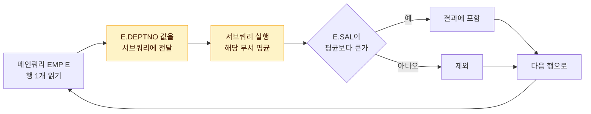

# 서브쿼리

서브쿼리(Subquery)는 하나의 SQL 문 안에 포함된 또 다른 SELECT 문이다. 괄호로 감싸서 사용하며, 바깥 쪽 쿼리를 **메인쿼리**라고 부른다. 서브쿼리는 **어디에 쓰였는지(위치)**, **몇 행·몇 컬럼을 돌려주는지(반환 형태)**, **메인쿼리 컬럼을 참조하는지(연관 여부)** 세 가지 기준으로 구분한다.

## 예제 데이터

이 문서의 예제는 아래 두 테이블을 기준으로 한다.

EMP 테이블

| EMPNO | ENAME | DEPTNO | SAL | MGR |
|---|---|---|---|---|
| 1001 | 김철수 | 10 | 5000 | NULL |
| 1002 | 이영희 | 10 | 3000 | 1001 |
| 1003 | 박민수 | 20 | 4000 | 1001 |
| 1004 | 최지은 | 20 | 2500 | 1003 |
| 1005 | 정우성 | 30 | 3500 | 1001 |

DEPT 테이블

| DEPTNO | DNAME |
|---|---|
| 10 | 기획 |
| 20 | 개발 |
| 30 | 영업 |
| 40 | 인사 |

## 서브쿼리 사용 시 기본 규칙

::: cards 2
- **괄호 필수** 서브쿼리는 반드시 괄호 `( )`로 감싼다.
- **단일행 연산자는 1건 이하** `=`, `<`, `>` 등과 함께 쓰면 서브쿼리 결과는 1건 이하여야 한다. 2건 이상이면 실행 시 오류가 발생한다.
- **다중행 연산자는 제한 없음** `IN`, `ANY`, `ALL`, `EXISTS`는 결과 건수에 제한이 없다.
- **WHERE·HAVING에는 ORDER BY 불가** 정렬은 메인쿼리 마지막에 한 번만 의미가 있기 때문이다.
:::

서브쿼리 결과는 **메인쿼리 결과의 행 수를 늘리지 않는다**. 조인은 1:M 관계에서 행이 늘어날 수 있지만, 서브쿼리는 메인쿼리 집합의 레벨을 그대로 유지한다.

> 시험 포인트: 서브쿼리에 ORDER BY를 쓸 수 있는 곳은 FROM 절의 인라인 뷰뿐이다(Oracle 기준). SQL Server는 인라인 뷰에서도 TOP 등과 함께 쓸 때만 ORDER BY를 허용한다.

## 위치에 따른 분류

같은 서브쿼리라도 SELECT 문의 어느 자리에 들어가느냐에 따라 이름과 역할이 달라진다.

<figure class="md-figure">
<svg viewBox="0 0 640 230" xmlns="http://www.w3.org/2000/svg" font-family="Pretendard Variable, Pretendard, sans-serif" role="img" aria-label="SELECT 문 안에서 스칼라 서브쿼리, 인라인 뷰, 중첩 서브쿼리의 위치">
<rect x="10" y="14" width="452" height="202" rx="12" fill="var(--muted)" fill-opacity="0.5" stroke="var(--border)"/>
<text x="24" y="54" font-size="13" font-weight="700" fill="var(--primary)" font-family="ui-monospace, monospace">SELECT</text>
<text x="88" y="54" font-size="13" fill="var(--foreground)" font-family="ui-monospace, monospace">ENAME,</text>
<rect x="150" y="32" width="300" height="34" rx="8" fill="oklch(0.62 0.17 255)" fill-opacity="0.15" stroke="oklch(0.62 0.17 255)" stroke-width="1.5"/>
<text x="162" y="54" font-size="13" fill="var(--foreground)" font-family="ui-monospace, monospace">(SELECT DNAME FROM DEPT ..)</text>
<text x="24" y="124" font-size="13" font-weight="700" fill="var(--primary)" font-family="ui-monospace, monospace">FROM</text>
<text x="88" y="124" font-size="13" fill="var(--foreground)" font-family="ui-monospace, monospace">EMP E,</text>
<rect x="150" y="102" width="300" height="34" rx="8" fill="oklch(0.65 0.14 160)" fill-opacity="0.15" stroke="oklch(0.65 0.14 160)" stroke-width="1.5"/>
<text x="162" y="124" font-size="13" fill="var(--foreground)" font-family="ui-monospace, monospace">(SELECT DEPTNO, AVG(SAL) ..) A</text>
<text x="24" y="194" font-size="13" font-weight="700" fill="var(--primary)" font-family="ui-monospace, monospace">WHERE</text>
<text x="88" y="194" font-size="13" fill="var(--foreground)" font-family="ui-monospace, monospace">SAL &gt;</text>
<rect x="150" y="172" width="300" height="34" rx="8" fill="oklch(0.75 0.16 75)" fill-opacity="0.2" stroke="oklch(0.75 0.16 75)" stroke-width="1.5"/>
<text x="162" y="194" font-size="13" fill="var(--foreground)" font-family="ui-monospace, monospace">(SELECT AVG(SAL) FROM EMP)</text>
<path d="M450 49 L480 49" stroke="oklch(0.62 0.17 255)" stroke-width="1.5"/>
<path d="M450 119 L480 119" stroke="oklch(0.65 0.14 160)" stroke-width="1.5"/>
<path d="M450 189 L480 189" stroke="oklch(0.75 0.16 75)" stroke-width="1.5"/>
<text x="488" y="46" font-size="14" font-weight="700" fill="var(--foreground)">스칼라 서브쿼리</text>
<text x="488" y="64" font-size="11" fill="var(--muted-foreground)">1행 1컬럼, 값 하나처럼</text>
<text x="488" y="116" font-size="14" font-weight="700" fill="var(--foreground)">인라인 뷰</text>
<text x="488" y="134" font-size="11" fill="var(--muted-foreground)">결과를 테이블처럼</text>
<text x="488" y="186" font-size="14" font-weight="700" fill="var(--foreground)">중첩 서브쿼리</text>
<text x="488" y="204" font-size="11" fill="var(--muted-foreground)">조건 비교 값 (HAVING도)</text>
</svg>
<figcaption>SELECT 절은 스칼라 서브쿼리, FROM 절은 인라인 뷰, WHERE·HAVING 절은 중첩 서브쿼리</figcaption>
</figure>

| 위치 | 명칭 | 특징 |
|---|---|---|
| SELECT 절 | 스칼라 서브쿼리 | 한 행, 한 컬럼만 반환. 값 하나처럼 사용 |
| FROM 절 | 인라인 뷰 | 결과를 테이블처럼 사용. 동적으로 생성되는 뷰 |
| WHERE 절 | 중첩 서브쿼리 | 조건 비교 값으로 사용 |
| HAVING 절 | 중첩 서브쿼리 | 그룹 조건 비교 값으로 사용 |

이 밖에 INSERT의 VALUES, UPDATE의 SET 절, ORDER BY 절 등에서도 스칼라 서브쿼리를 사용할 수 있다.

### 스칼라 서브쿼리

```sql
SELECT E.ENAME,
       (SELECT D.DNAME FROM DEPT D WHERE D.DEPTNO = E.DEPTNO) AS DNAME
FROM   EMP E;
```

- 메인쿼리 각 행마다 값 하나를 돌려준다. 결과가 **2행 이상이면 오류, 0행이면 NULL**이 된다.
- 일치하는 행이 없을 때 NULL을 반환하므로 결과적으로 **OUTER JOIN과 비슷한 효과**를 낸다.

### 인라인 뷰

```sql
SELECT E.ENAME, E.SAL, A.AVG_SAL
FROM   EMP E,
       (SELECT DEPTNO, AVG(SAL) AS AVG_SAL
        FROM   EMP
        GROUP  BY DEPTNO) A
WHERE  E.DEPTNO = A.DEPTNO;
```

- 인라인 뷰 안에서 정의한 컬럼(별칭 포함)은 메인쿼리에서 자유롭게 참조할 수 있다.
- 일회성 뷰이므로 데이터 사전에 저장되지 않는다.

### HAVING 절 서브쿼리

```sql
SELECT DEPTNO, AVG(SAL)
FROM   EMP
GROUP  BY DEPTNO
HAVING AVG(SAL) > (SELECT AVG(SAL) FROM EMP);
```

::: example 결과 따라가기
전체 평균은 3600이다. 부서 평균은 10번 4000, 20번 3250, 30번 3500이므로 결과는 **10번 부서 한 행**이다.
:::

## 반환 형태에 따른 분류

::: cards 3
- **단일행** 결과가 항상 1건 이하. `=` `<>` `>` `>=` `<` `<=`와 함께 쓴다.
- **다중행** 결과가 여러 건일 수 있다. `IN` `ANY` `ALL` `EXISTS`를 쓴다.
- **다중컬럼** 여러 컬럼을 반환해 `(A, B) IN (...)`처럼 컬럼 쌍으로 비교한다.
:::

### 단일행 서브쿼리

결과가 항상 1건 이하인 서브쿼리이며 `=`, `<>`, `>`, `>=`, `<`, `<=`와 함께 쓴다.

```sql
SELECT ENAME, SAL
FROM   EMP
WHERE  SAL > (SELECT AVG(SAL) FROM EMP);   -- 평균 3600
```

| ENAME | SAL |
|---|---|
| 김철수 | 5000 |
| 박민수 | 4000 |

### 다중행 서브쿼리

결과가 여러 건일 수 있으며 다중행 비교 연산자를 사용한다.

| 연산자 | 의미 | 동치 표현 |
|---|---|---|
| `IN (서브쿼리)` | 결과 중 하나와 같으면 참 | `= ANY` |
| `> ANY (서브쿼리)` | 결과 중 하나보다라도 크면 참 | `> MIN(결과)` |
| `< ANY (서브쿼리)` | 결과 중 하나보다라도 작으면 참 | `< MAX(결과)` |
| `> ALL (서브쿼리)` | 모든 결과보다 크면 참 | `> MAX(결과)` |
| `< ALL (서브쿼리)` | 모든 결과보다 작으면 참 | `< MIN(결과)` |
| `EXISTS (서브쿼리)` | 결과가 1건이라도 있으면 참 | - |

20번 부서 급여는 4000, 2500이다.

```sql
SELECT ENAME, SAL FROM EMP
WHERE  SAL > ANY (SELECT SAL FROM EMP WHERE DEPTNO = 20);  -- 2500 초과
-- 김철수 5000, 이영희 3000, 박민수 4000, 정우성 3500 (4행)

SELECT ENAME, SAL FROM EMP
WHERE  SAL > ALL (SELECT SAL FROM EMP WHERE DEPTNO = 20);  -- 4000 초과
-- 김철수 5000 (1행)
```

::: compare
- **> ANY** "하나라도 넘으면 OK" → 가장 작은 값(2500)만 넘으면 참. `> MIN`과 같다. 결과 4행.
- **> ALL** "전부 넘어야 OK" → 가장 큰 값(4000)을 넘어야 참. `> MAX`와 같다. 결과 1행.
:::

> 시험 포인트: `> ANY`는 최솟값보다 크면, `> ALL`은 최댓값보다 크면 참이다. 서브쿼리 결과가 0건이면 `ALL` 조건은 항상 참, `ANY` 조건은 항상 거짓이 된다.

### 다중컬럼 서브쿼리

서브쿼리가 여러 컬럼을 반환하고 메인쿼리에서 컬럼 쌍으로 비교한다.

```sql
SELECT ENAME, DEPTNO, SAL
FROM   EMP
WHERE  (DEPTNO, SAL) IN (SELECT DEPTNO, MAX(SAL)
                         FROM   EMP
                         GROUP  BY DEPTNO);
```

| ENAME | DEPTNO | SAL |
|---|---|---|
| 김철수 | 10 | 5000 |
| 박민수 | 20 | 4000 |
| 정우성 | 30 | 3500 |

::: info DBMS 차이
다중컬럼 IN 비교는 **Oracle에서 지원**하며 **SQL Server는 지원하지 않는다**. SQL Server에서는 EXISTS나 조인으로 바꿔 써야 한다.
:::

## 연관 서브쿼리와 비연관 서브쿼리

::: compare
- **비연관 (Un-correlated)** 메인쿼리 컬럼을 참조하지 않는다. 서브쿼리를 **먼저 한 번** 수행해 결과를 메인쿼리에 제공한다. 주로 메인쿼리에 상수 값을 제공할 때 쓴다.
- **연관 (Correlated)** 서브쿼리 안에서 **메인쿼리 컬럼을 참조**한다. 메인쿼리 **행마다** 값을 받아 서브쿼리를 평가한다. 주로 메인쿼리 각 행의 조건 판단에 쓴다.
:::

| 구분 | 비연관(Un-correlated) | 연관(Correlated) |
|---|---|---|
| 메인쿼리 컬럼 참조 | 하지 않음 | 서브쿼리 안에서 참조 |
| 실행 방식 | 서브쿼리를 먼저 한 번 수행해 결과를 메인쿼리에 제공 | 메인쿼리 행마다 값을 받아 서브쿼리를 평가 |
| 주 용도 | 메인쿼리에 상수 값 제공 | 메인쿼리 각 행의 조건 판단 |

부서 평균보다 급여가 높은 사원을 구하는 연관 서브쿼리 예시다.

```sql
SELECT E.ENAME, E.DEPTNO, E.SAL
FROM   EMP E
WHERE  E.SAL > (SELECT AVG(S.SAL)
                FROM   EMP S
                WHERE  S.DEPTNO = E.DEPTNO);
```

메인쿼리의 행 하나를 읽을 때마다 그 행의 `E.DEPTNO`가 서브쿼리로 넘어가 부서 평균이 다시 계산된다.



| ENAME | DEPTNO | SAL | 부서 평균 |
|---|---|---|---|
| 김철수 | 10 | 5000 | 4000 |
| 박민수 | 20 | 4000 | 3250 |

정우성(30번)은 부서 평균 3500과 같아서 `>` 조건에 해당하지 않는다.

## EXISTS와 IN 비교

```sql
-- 사원이 한 명이라도 있는 부서
SELECT D.DEPTNO, D.DNAME
FROM   DEPT D
WHERE  EXISTS (SELECT 1 FROM EMP E WHERE E.DEPTNO = D.DEPTNO);
-- 10 기획, 20 개발, 30 영업

-- 사원이 없는 부서
SELECT D.DEPTNO, D.DNAME
FROM   DEPT D
WHERE  NOT EXISTS (SELECT 1 FROM EMP E WHERE E.DEPTNO = D.DEPTNO);
-- 40 인사
```

- EXISTS는 **존재 여부만** 확인하므로 조건에 맞는 행을 하나 찾으면 더 탐색하지 않는다. SELECT 목록에는 보통 `1`이나 `'X'`를 쓴다.
- EXISTS는 TRUE/FALSE만 판단하므로 주로 연관 서브쿼리 형태로 쓴다.

### NOT IN과 NULL 함정

::: warning 결과가 0건이 되는 NOT IN
관리자가 아닌 사원을 구하려고 다음과 같이 작성하면 결과가 **0건**이다.

```sql
SELECT ENAME FROM EMP
WHERE  EMPNO NOT IN (SELECT MGR FROM EMP);   -- MGR에 NULL 포함
```

`NOT IN (1001, 1003, NULL)`은 `EMPNO <> 1001 AND EMPNO <> 1003 AND EMPNO <> NULL`로 풀린다. `EMPNO <> NULL`은 **UNKNOWN**이므로 전체 조건이 TRUE가 될 수 없다.
:::

```sql
-- 해결 1: NULL 제거
WHERE EMPNO NOT IN (SELECT MGR FROM EMP WHERE MGR IS NOT NULL)

-- 해결 2: NOT EXISTS 사용
WHERE NOT EXISTS (SELECT 1 FROM EMP M WHERE M.MGR = E.EMPNO)
```

두 방법 모두 결과는 이영희, 최지은, 정우성 3행이다.

> 시험 포인트: `NOT IN` 서브쿼리 결과에 NULL이 하나라도 있으면 결과는 항상 0건이다. 반면 `IN` 목록의 NULL은 무시되는 것처럼 동작하고, `NOT EXISTS`는 NULL의 영향을 받지 않는다.

## 뷰(VIEW)

뷰는 SELECT 문을 이름으로 저장해 둔 **가상 테이블**이다. 실제 데이터를 저장하지 않고 정의만 저장하며, 조회 시점에 정의된 쿼리가 실행된다.

```sql
CREATE VIEW V_EMP_DEPT AS
SELECT E.EMPNO, E.ENAME, D.DNAME
FROM   EMP E, DEPT D
WHERE  E.DEPTNO = D.DEPTNO;

SELECT * FROM V_EMP_DEPT WHERE DNAME = '개발';

DROP VIEW V_EMP_DEPT;
```

::: cards 3
- **독립성** 테이블 구조가 바뀌어도 뷰 정의만 고치면 응용 프로그램은 그대로 사용
- **편리성** 복잡한 조인·집계 쿼리를 단순한 이름으로 재사용
- **보안성** 노출하고 싶지 않은 컬럼을 빼고 뷰로만 접근 권한 부여
:::

- 뷰를 기반으로 또 다른 뷰를 만들 수 있다.
- Oracle은 뷰 정의를 ALTER로 바꾸지 못하므로 `CREATE OR REPLACE VIEW`로 다시 만든다.
- 데이터를 실제로 저장하는 형태는 Materialized View(Oracle), Indexed View(SQL Server)라고 부르며 일반 뷰와 구분한다.
- 인라인 뷰는 이름 없이 FROM 절에서 한 번만 쓰는 뷰라고 보면 된다.

> 시험 포인트: 일반 뷰는 데이터를 저장하지 않는다. "뷰는 저장 공간을 차지해 성능이 좋아진다" 같은 보기는 틀린 설명이다.

## 핵심 요약

- 위치별로 스칼라 서브쿼리(SELECT), 인라인 뷰(FROM), 중첩 서브쿼리(WHERE/HAVING)로 나뉜다.
- 단일행 연산자에 여러 행이 반환되면 오류, 스칼라 서브쿼리가 0행이면 NULL이다.
- `> ANY`는 최솟값 초과, `> ALL`은 최댓값 초과와 같다.
- 연관 서브쿼리는 메인쿼리 컬럼을 참조하며 행마다 평가된다.
- `NOT IN` 결과에 NULL이 섞이면 결과가 0건이므로 `NOT EXISTS`나 `IS NOT NULL` 조건을 쓴다.
- ORDER BY는 인라인 뷰에서만 쓸 수 있고 WHERE/HAVING 서브쿼리에는 쓸 수 없다.
- 뷰의 장점은 독립성·편리성·보안성이며 일반 뷰는 데이터를 저장하지 않는다.
- 조인과 비교는 [조인](/theory/join), 집계 함수는 [GROUP BY와 HAVING](/theory/group-by-having)을 참고한다.
