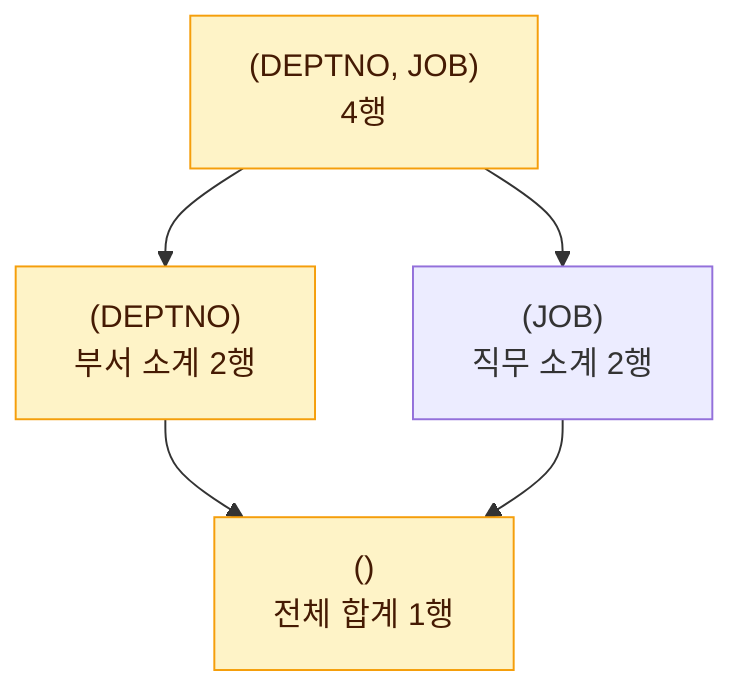

# 그룹 함수

그룹 함수(ROLLUP, CUBE, GROUPING SETS)는 GROUP BY 절에서 여러 수준의 **소계와 총계**를 한 번의 쿼리로 만들어 준다. 여러 개의 GROUP BY 쿼리를 UNION ALL로 이어 붙여야 하던 작업을 간단하게 표현할 수 있다.

::: cards 3
- **ROLLUP(A, B)** 오른쪽부터 하나씩 빼며 계층적 소계
  - (A, B) → (A) → ()
  - 인수 순서가 결과를 바꾼다
- **CUBE(A, B)** 가능한 모든 조합의 소계
  - (A, B), (A), (B), ()
  - 부하가 가장 크다
- **GROUPING SETS(A, B)** 나열한 그룹만 골라서 집계
  - (A), (B)
  - 총계는 `()`를 넣어야 나온다
:::

## 예제 데이터

EMP 테이블

| DEPTNO | JOB | SAL |
|---|---|---|
| 10 | MANAGER | 5000 |
| 10 | CLERK | 3000 |
| 20 | MANAGER | 4000 |
| 20 | CLERK | 2500 |
| 20 | CLERK | 1000 |

일반 GROUP BY 결과는 다음과 같다.

```sql
SELECT DEPTNO, JOB, SUM(SAL) AS SAL
FROM   EMP
GROUP  BY DEPTNO, JOB;
```

| DEPTNO | JOB | SAL |
|---|---|---|
| 10 | CLERK | 3000 |
| 10 | MANAGER | 5000 |
| 20 | CLERK | 3500 |
| 20 | MANAGER | 4000 |

::: info 미리 계산해 둔 합계
부서 합계는 10번 8000, 20번 7500이고 직무 합계는 CLERK 6500, MANAGER 9000, 전체 합계는 15500이다. 아래 결과표는 이해를 위해 보기 좋은 순서로 나열했으며, 실제 출력 순서는 **ORDER BY로만 보장**된다.
:::

## ROLLUP

`ROLLUP(A, B)`는 **오른쪽 컬럼부터 하나씩 제거**하며 계층적인 소계를 만든다. 생성되는 그룹 수준은 `(A, B)`, `(A)`, `()` 세 가지다.

::: flow
- **(DEPTNO, JOB)** 부서+직무별 상세 4행
- **(DEPTNO)** JOB을 빼고 부서 소계 2행
- **()** 모두 빼고 전체 합계 1행
:::

```sql
SELECT DEPTNO, JOB, SUM(SAL) AS SAL
FROM   EMP
GROUP  BY ROLLUP(DEPTNO, JOB);
```

| DEPTNO | JOB | SAL | 수준 |
|---|---|---|---|
| 10 | CLERK | 3000 | 부서+직무 |
| 10 | MANAGER | 5000 | 부서+직무 |
| 10 | NULL | 8000 | 부서 소계 |
| 20 | CLERK | 3500 | 부서+직무 |
| 20 | MANAGER | 4000 | 부서+직무 |
| 20 | NULL | 7500 | 부서 소계 |
| NULL | NULL | 15500 | 전체 합계 |

결과는 7행이다. 소계 행에서는 집계에서 빠진 컬럼이 NULL로 표시된다.

### ROLLUP 인수 순서의 영향

ROLLUP은 인수 순서가 계층 구조를 결정하므로 순서를 바꾸면 결과가 달라진다.

```sql
SELECT DEPTNO, JOB, SUM(SAL) AS SAL
FROM   EMP
GROUP  BY ROLLUP(JOB, DEPTNO);
```

| DEPTNO | JOB | SAL | 수준 |
|---|---|---|---|
| 10 | CLERK | 3000 | 직무+부서 |
| 20 | CLERK | 3500 | 직무+부서 |
| NULL | CLERK | 6500 | 직무 소계 |
| 10 | MANAGER | 5000 | 직무+부서 |
| 20 | MANAGER | 4000 | 직무+부서 |
| NULL | MANAGER | 9000 | 직무 소계 |
| NULL | NULL | 15500 | 전체 합계 |

행 수는 7행으로 같지만 소계 기준이 부서가 아니라 **직무**로 바뀐다.

> 시험 포인트: ROLLUP은 인수 순서에 따라 결과가 달라진다. CUBE와 GROUPING SETS는 인수 순서를 바꿔도 결과 집합(행의 구성)은 같다.

### 부분 ROLLUP과 컬럼 묶음

```sql
-- 부서별 소계만, 전체 합계 없음
GROUP BY DEPTNO, ROLLUP(JOB)          -- (DEPTNO, JOB), (DEPTNO) → 6행

-- 괄호로 묶은 컬럼은 하나의 단위로 취급
GROUP BY ROLLUP((DEPTNO, JOB))        -- (DEPTNO, JOB), () → 5행
```

## CUBE

`CUBE(A, B)`는 인수로 **가능한 모든 조합**의 소계를 만든다. 그룹 수준은 `(A, B)`, `(A)`, `(B)`, `()` 네 가지다. 아래 그림에서 노란 상자가 ROLLUP이 만드는 수준이고, CUBE는 여기에 `(JOB)`까지 더한다.



```sql
SELECT DEPTNO, JOB, SUM(SAL) AS SAL
FROM   EMP
GROUP  BY CUBE(DEPTNO, JOB);
```

| DEPTNO | JOB | SAL | 수준 |
|---|---|---|---|
| 10 | CLERK | 3000 | 부서+직무 |
| 10 | MANAGER | 5000 | 부서+직무 |
| 20 | CLERK | 3500 | 부서+직무 |
| 20 | MANAGER | 4000 | 부서+직무 |
| 10 | NULL | 8000 | 부서 소계 |
| 20 | NULL | 7500 | 부서 소계 |
| NULL | CLERK | 6500 | 직무 소계 |
| NULL | MANAGER | 9000 | 직무 소계 |
| NULL | NULL | 15500 | 전체 합계 |

결과는 9행이다. 모든 조합을 계산하므로 ROLLUP보다 **시스템 부하가 크다**.

## GROUPING SETS

GROUPING SETS는 원하는 그룹 수준만 골라서 나열한다. 나열한 각 그룹의 결과를 **UNION ALL 한 것과 같다**.

```sql
SELECT DEPTNO, JOB, SUM(SAL) AS SAL
FROM   EMP
GROUP  BY GROUPING SETS(DEPTNO, JOB);
```

| DEPTNO | JOB | SAL |
|---|---|---|
| 10 | NULL | 8000 |
| 20 | NULL | 7500 |
| NULL | CLERK | 6500 |
| NULL | MANAGER | 9000 |

::: warning 전체 합계가 없다
결과는 4행이며 **전체 합계는 포함되지 않는다**. 전체 합계가 필요하면 `GROUPING SETS(DEPTNO, JOB, ())`처럼 빈 괄호를 추가한다.
:::

### GROUPING SETS로 바꿔 쓰기

| 표현 | 동일한 GROUPING SETS |
|---|---|
| `ROLLUP(A, B)` | `GROUPING SETS((A, B), (A), ())` |
| `ROLLUP(B, A)` | `GROUPING SETS((B, A), (B), ())` |
| `CUBE(A, B)` | `GROUPING SETS((A, B), (A), (B), ())` |
| `GROUPING SETS(A, B)` | `(A)`별 집계 UNION ALL `(B)`별 집계 |

## 결과 행 수 계산법

| 함수 | 인수 n개일 때 그룹 수준 수 | 예제(n=2) 행 수 |
|---|---|---|
| GROUP BY A, B | 1 | 4 |
| ROLLUP(A, B) | n + 1 | 4 + 2 + 1 = 7 |
| CUBE(A, B) | 2의 n제곱 | 4 + 2 + 2 + 1 = 9 |
| GROUPING SETS(A, B) | 나열한 개수 | 2 + 2 = 4 |

::: steps
1. **그룹 수준을 나열한다** ROLLUP(DEPTNO, JOB) → (DEPTNO, JOB), (DEPTNO), ()
2. **수준별 그룹 개수를 센다** 데이터에 실제로 있는 조합만 센다. (부서, 직무) 4개, 부서 2개, 전체 1개
3. **모두 더한다** 4 + 2 + 1 = 7행
:::

> 시험 포인트: 행 수 문제는 "그룹 수준을 나열하고 수준별 그룹 개수를 더한다"로 푼다. 데이터에 존재하지 않는 조합(예: 30번 부서 CLERK)은 행이 생기지 않는다.

## GROUPING 함수로 소계·총계 라벨 붙이기

소계 행에서 집계된 컬럼은 NULL로 표시되어 원래 NULL 값과 구분하기 어렵다. `GROUPING(컬럼)`은 해당 컬럼이 **소계 계산으로 집계되어 NULL이 된 행에서 1**, 그 외에는 0을 반환한다.

```sql
SELECT CASE GROUPING(DEPTNO) WHEN 1 THEN '전체'
            ELSE TO_CHAR(DEPTNO) END            AS DEPT,
       CASE GROUPING(JOB) WHEN 1 THEN '합계'
            ELSE JOB END                        AS JOB,
       SUM(SAL)                                 AS SAL,
       GROUPING(DEPTNO)                         AS G_D,
       GROUPING(JOB)                            AS G_J
FROM   EMP
GROUP  BY ROLLUP(DEPTNO, JOB);
```

| DEPT | JOB | SAL | G_D | G_J |
|---|---|---|---|---|
| 10 | CLERK | 3000 | 0 | 0 |
| 10 | MANAGER | 5000 | 0 | 0 |
| 10 | 합계 | 8000 | 0 | 1 |
| 20 | CLERK | 3500 | 0 | 0 |
| 20 | MANAGER | 4000 | 0 | 0 |
| 20 | 합계 | 7500 | 0 | 1 |
| 전체 | 합계 | 15500 | 1 | 1 |

- DEPTNO는 숫자이므로 문자열 라벨과 한 컬럼에 담으려면 `TO_CHAR`로 타입을 맞춘다.
- Oracle은 `DECODE(GROUPING(JOB), 1, '합계', JOB)`처럼 DECODE로도 표현할 수 있다.
- SQL Server도 GROUPING 함수를 지원하며, 숫자 변환에는 `CAST`나 `CONVERT`를 쓴다.

> 시험 포인트: GROUPING 값이 1인 행이 소계·총계 행이다. 원본 데이터에 NULL이 있어도 일반 그룹 행이면 GROUPING 값은 0이다.

## 같은 결과를 UNION ALL로 표현

::: example ROLLUP(DEPTNO, JOB) 풀어 쓰기
`ROLLUP(DEPTNO, JOB)`은 다음 세 쿼리를 UNION ALL 한 것과 결과가 같다(순서 제외).

```sql
SELECT DEPTNO, JOB, SUM(SAL) FROM EMP GROUP BY DEPTNO, JOB
UNION ALL
SELECT DEPTNO, NULL, SUM(SAL) FROM EMP GROUP BY DEPTNO
UNION ALL
SELECT NULL, NULL, SUM(SAL) FROM EMP;
```

`CUBE(DEPTNO, JOB)`라면 여기에 `SELECT NULL, JOB, SUM(SAL) FROM EMP GROUP BY JOB`이 하나 더 추가된다.
:::

UNION ALL 방식은 **테이블을 여러 번 읽으므로** 그룹 함수를 쓰는 편이 효율적이다.

## DBMS별 참고

- Oracle과 SQL Server 모두 `GROUP BY ROLLUP(...)`, `CUBE(...)`, `GROUPING SETS(...)` 문법을 지원한다.
- SQL Server는 예전 방식인 `GROUP BY DEPTNO, JOB WITH ROLLUP`, `WITH CUBE` 문법도 지원한다.
- 그룹 함수 결과는 정렬이 보장되지 않으므로 보고서 형태가 필요하면 ORDER BY를 추가한다. 기본 GROUP BY 개념은 [GROUP BY와 HAVING](/theory/group-by-having)을 참고한다.

## 핵심 요약

- ROLLUP(A, B)는 (A, B), (A), () 수준을 만들며 인수 순서가 결과에 영향을 준다.
- CUBE(A, B)는 (A, B), (A), (B), () 모든 조합을 만들며 부하가 가장 크다.
- GROUPING SETS는 나열한 그룹만 만들고 전체 합계는 `()`를 넣어야 나온다.
- 그룹 수준 수는 ROLLUP이 n+1, CUBE가 2의 n제곱이다.
- GROUPING 함수는 소계·총계 행에서 1을 반환하므로 CASE·DECODE로 라벨을 붙인다.
- 모든 그룹 함수 결과는 GROUP BY 쿼리를 UNION ALL 한 것으로 바꿔 쓸 수 있다.
- 결과 순서는 ORDER BY로만 보장된다.
