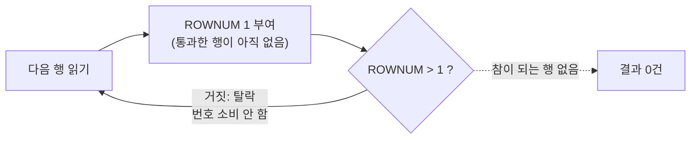

# Top N 쿼리

Top N 쿼리는 정렬된 결과에서 **상위 N건**만 가져오는 쿼리다. DBMS마다 문법이 다르고, 특히 Oracle ROWNUM은 **정렬보다 먼저 부여**된다는 점 때문에 함정 문제가 많이 출제된다.

::: cards 3
- **Oracle ROWNUM** 행이 추출될 때마다 1부터 붙는 가상 컬럼. 정렬 전에 붙으므로 **인라인 뷰**가 필요하다.
- **SQL Server TOP** `SELECT TOP (n)`. ORDER BY 이후에 적용되며 `WITH TIES`로 동점 포함.
- **표준 FETCH FIRST** `OFFSET m ROWS FETCH NEXT n ROWS ONLY`. Oracle 12c+, SQL Server 2012+.
:::

## 예제 데이터

EMP 테이블 (저장된 순서 그대로 표시)

| EMPNO | ENAME | SAL |
|---|---|---|
| 1 | 김민 | 3000 |
| 2 | 이준 | 2000 |
| 3 | 박솔 | 2000 |
| 4 | 최윤 | 4000 |
| 5 | 정하 | 3000 |
| 6 | 한결 | 1000 |

급여 내림차순(동점은 이름순)으로 정렬하면 최윤 4000, 김민 3000, 정하 3000, 박솔 2000, 이준 2000, 한결 1000 순서다.

## Oracle ROWNUM 동작 원리

ROWNUM은 쿼리 결과로 행이 하나씩 추출될 때마다 1부터 차례로 붙는 <strong>가상 컬럼(Pseudo Column)</strong>이다. 논리적인 처리 순서는 다음과 같다.

::: steps
1. **FROM, WHERE** 행을 읽으면서 조건을 통과한 행에 ROWNUM을 부여한다
2. **GROUP BY, HAVING, SELECT** 집계와 컬럼 선택을 처리한다
3. **ORDER BY** 마지막으로 정렬한다
:::

즉 **ROWNUM은 ORDER BY보다 먼저 부여**된다. 번호가 붙은 뒤에 정렬하므로, 정렬하면 번호 순서가 뒤섞일 뿐 "상위 N건"이 되지는 않는다.

### 함정 1: 정렬 전에 잘린다

::: compare
- **❌ 잘못된 예** 같은 쿼리 블록에 `WHERE ROWNUM <= 3`과 `ORDER BY`를 함께 쓴다. 먼저 읽힌 아무 3건을 고른 **뒤에** 정렬한다.
- **✅ 올바른 예** 인라인 뷰 안에서 **먼저 정렬**하고, 바깥 쿼리에서 `ROWNUM <= 3`을 건다. 정렬된 순서대로 번호가 붙는다.
:::

```sql
-- 잘못된 예: 급여 상위 3명을 기대
SELECT ENAME, SAL
FROM   EMP
WHERE  ROWNUM <= 3
ORDER  BY SAL DESC;
```

| ENAME | SAL |
|---|---|
| 김민 | 3000 |
| 이준 | 2000 |
| 박솔 | 2000 |

먼저 읽힌 아무 3건(여기서는 저장 순서상 앞의 3건)을 고른 뒤 정렬했으므로 실제 최고 급여자 **최윤이 빠졌다**.

### 올바른 방법: 인라인 뷰에서 먼저 정렬

```sql
SELECT ENAME, SAL
FROM   (SELECT ENAME, SAL
        FROM   EMP
        ORDER  BY SAL DESC, ENAME)
WHERE  ROWNUM <= 3;
```

| ENAME | SAL |
|---|---|
| 최윤 | 4000 |
| 김민 | 3000 |
| 정하 | 3000 |

### 함정 2: ROWNUM > 1, ROWNUM = 2는 결과가 없다

```sql
SELECT ENAME FROM EMP WHERE ROWNUM = 1;   -- 1건
SELECT ENAME FROM EMP WHERE ROWNUM <= 2;  -- 2건
SELECT ENAME FROM EMP WHERE ROWNUM = 2;   -- 0건
SELECT ENAME FROM EMP WHERE ROWNUM > 1;   -- 0건
```



첫 행은 ROWNUM 1을 받는데 `ROWNUM > 1` 조건에 탈락한다. **탈락한 행은 번호를 소비하지 않으므로** 다음 행도 다시 ROWNUM 1을 받고 또 탈락한다. 결국 어떤 행도 조건을 통과하지 못한다.

> 시험 포인트: ROWNUM은 `=1`, `<`, `<=` 조건에만 의미가 있다. `ROWNUM > n`이나 `ROWNUM = 2`처럼 1을 포함하지 않는 조건은 항상 0건이다.

## SQL Server TOP

SQL Server는 SELECT 절에 `TOP (n)`을 써서 출력 행 수를 제한한다. TOP은 **ORDER BY로 정렬된 결과에 적용**되므로 인라인 뷰가 필요 없다.

```sql
SELECT TOP (3) ENAME, SAL
FROM   EMP
ORDER  BY SAL DESC;
```

| ENAME | SAL |
|---|---|
| 최윤 | 4000 |
| 김민 | 3000 |
| 정하 | 3000 |

### WITH TIES

`WITH TIES`는 마지막 순위와 같은 값을 가진 행을 함께 출력한다. 반드시 ORDER BY와 함께 써야 한다.

```sql
SELECT TOP (2) WITH TIES ENAME, SAL
FROM   EMP
ORDER  BY SAL DESC;
```

| ENAME | SAL |
|---|---|
| 최윤 | 4000 |
| 김민 | 3000 |
| 정하 | 3000 |

2건을 요청했지만 2번째 행과 급여가 같은 정하까지 포함되어 **3건**이 출력된다.

::: info TOP 사용 시 참고
- `TOP (n) PERCENT`로 전체 대비 비율만큼 가져올 수도 있다.
- ORDER BY 없이 TOP만 쓰면 어떤 행이 나올지 보장되지 않는다.
:::

> 시험 포인트: TOP WITH TIES는 ORDER BY 없이 쓸 수 없고, 결과 건수가 n보다 많아질 수 있다.

## 표준 FETCH FIRST와 OFFSET

SQL 표준 문법으로 Oracle 12c 이상, SQL Server 2012 이상에서 지원한다(SQL Server는 **OFFSET 절이 필수**).

```sql
-- Oracle: 상위 3건
SELECT ENAME, SAL
FROM   EMP
ORDER  BY SAL DESC, ENAME
FETCH  FIRST 3 ROWS ONLY;

-- 동점 포함
SELECT ENAME, SAL
FROM   EMP
ORDER  BY SAL DESC
FETCH  FIRST 2 ROWS WITH TIES;   -- 최윤, 김민, 정하 (3건)

-- SQL Server
SELECT ENAME, SAL
FROM   EMP
ORDER  BY SAL DESC, ENAME
OFFSET 0 ROWS FETCH NEXT 3 ROWS ONLY;
```

| 구문 | 의미 |
|---|---|
| `OFFSET m ROWS` | 앞의 m건을 건너뜀 |
| `FETCH FIRST n ROWS ONLY` | n건만 가져옴 (FIRST와 NEXT는 같은 의미) |
| `FETCH FIRST n ROWS WITH TIES` | n번째와 정렬 값이 같은 행까지 포함 |
| `FETCH FIRST n PERCENT ROWS ONLY` | 비율로 가져옴 (Oracle) |

## ROW_NUMBER를 활용한 Top N

윈도우 함수를 쓰면 DBMS에 관계없이 같은 방식으로 표현할 수 있고, 그룹별 상위 N건도 쉽게 구할 수 있다.

```sql
SELECT ENAME, SAL
FROM   (SELECT ENAME, SAL,
               ROW_NUMBER() OVER (ORDER BY SAL DESC, ENAME) AS RN
        FROM   EMP)
WHERE  RN <= 3;
```

::: cards 3
- **동점 포함은 RANK** ROW_NUMBER 대신 RANK를 쓴다. `RANK() ... <= 2`는 최윤(1), 김민(2), 정하(2) 3건을 돌려준다.
- **그룹별 상위 N건** `ROW_NUMBER() OVER (PARTITION BY DEPTNO ORDER BY SAL DESC)`처럼 PARTITION BY를 추가한다.
- **인라인 뷰 필수** 윈도우 함수는 WHERE 절에 직접 쓸 수 없으므로 반드시 인라인 뷰로 감싼다.
:::

자세한 내용은 [윈도우 함수](/theory/window-functions)를 참고한다.

## 페이징 예제

한 페이지에 2건씩 보여줄 때 <strong>2페이지(정렬 기준 3~4번째 행)</strong>를 조회한다. 결과는 정하 3000, 박솔 2000이다.

### Oracle ROWNUM 방식

```sql
SELECT ENAME, SAL
FROM   (SELECT ROWNUM AS RN, A.*
        FROM   (SELECT ENAME, SAL
                FROM   EMP
                ORDER  BY SAL DESC, ENAME) A
        WHERE  ROWNUM <= 4)          -- 끝 번호
WHERE  RN >= 3;                      -- 시작 번호
```

::: flow
- **안쪽** ORDER BY로 먼저 정렬
- **가운데** ROWNUM에 별칭 RN, `ROWNUM <= 4`로 끝 번호까지
- **바깥** `RN >= 3`으로 시작 번호부터
:::

바깥에서 RN으로 시작 번호를 거른다. 별칭이 붙은 RN은 **이미 값이 확정된 일반 컬럼**이므로 `>=` 조건이 정상 동작한다.

### ROW_NUMBER 방식

```sql
SELECT ENAME, SAL
FROM   (SELECT ENAME, SAL,
               ROW_NUMBER() OVER (ORDER BY SAL DESC, ENAME) AS RN
        FROM   EMP)
WHERE  RN BETWEEN 3 AND 4;
```

### OFFSET FETCH 방식

```sql
SELECT ENAME, SAL
FROM   EMP
ORDER  BY SAL DESC, ENAME
OFFSET 2 ROWS FETCH NEXT 2 ROWS ONLY;
```

| ENAME | SAL |
|---|---|
| 정하 | 3000 |
| 박솔 | 2000 |

::: warning 동점이 있는 정렬 기준
SAL만으로 정렬하면 김민·정하(3000)처럼 같은 값끼리의 순서가 실행할 때마다 달라질 수 있다. 그러면 1페이지에 나온 행이 2페이지에 또 나오거나, 어떤 행은 아예 안 나올 수 있다.
:::

> 시험 포인트: 페이징에서 정렬 기준에 동점이 있으면 페이지 사이에 행이 중복되거나 누락될 수 있다. EMPNO 같은 고유 컬럼을 정렬 기준에 추가해 순서를 확정한다.

## 방식별 비교

| 방식 | DBMS | 정렬 후 적용 | 동점 포함 |
|---|---|---|---|
| ROWNUM | Oracle | 인라인 뷰 필요 | 불가 |
| TOP (n) | SQL Server | 자동 (ORDER BY 후) | WITH TIES |
| FETCH FIRST | Oracle 12c+, 표준 | 자동 | WITH TIES |
| OFFSET FETCH | SQL Server 2012+ | 자동 | 해당 없음 |
| ROW_NUMBER / RANK | 공통 | 인라인 뷰 필요 | RANK 사용 |

## 핵심 요약

- Oracle ROWNUM은 WHERE 처리 중 부여되어 ORDER BY보다 먼저 정해진다.
- 정렬 후 상위 N건은 인라인 뷰에서 ORDER BY 후 바깥에서 ROWNUM을 건다.
- `ROWNUM > 1`, `ROWNUM = 2`는 항상 0건이다.
- SQL Server TOP은 ORDER BY 이후 적용되며 WITH TIES는 동점 행을 추가로 포함한다.
- 표준 `OFFSET m ROWS FETCH NEXT n ROWS ONLY`로 페이징을 간단히 표현한다.
- ROW_NUMBER는 고유 번호, RANK는 동점 포함 Top N에 쓴다.
- 페이징 정렬 기준에는 고유 컬럼을 추가해 순서를 확정한다.
