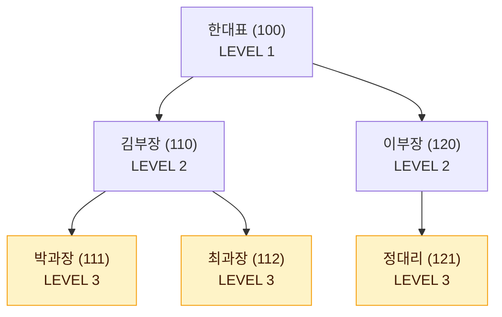

# 계층형 질의와 셀프 조인

한 테이블 안에서 행끼리 상하 관계를 갖는 데이터를 **계층형 데이터**라고 한다. 이런 데이터는 Oracle의 계층형 질의(START WITH, CONNECT BY), SQL Server의 재귀 CTE, 또는 셀프 조인으로 조회한다.

::: cards 3
- **Oracle 계층형 질의** `START WITH` + `CONNECT BY PRIOR`. 깊이에 관계없이 전체 계층을 전개한다.
- **SQL Server 재귀 CTE** WITH 절 안에서 앵커 멤버와 재귀 멤버를 UNION ALL로 연결한다.
- **셀프 조인** 같은 테이블을 별칭만 바꿔 조인한다. 한 단계 위·아래처럼 깊이가 정해진 조회용.
:::

## 계층형 데이터와 예제

사원 테이블에서 MGR 컬럼이 같은 테이블의 EMPNO를 참조하면 <strong>순환 관계(재귀 관계)</strong>가 된다. EMPNO를 자식 쪽 키, MGR을 부모 쪽 키로 보면 된다.

EMP 테이블

| EMPNO | ENAME | MGR |
|---|---|---|
| 100 | 한대표 | NULL |
| 110 | 김부장 | 100 |
| 120 | 이부장 | 100 |
| 111 | 박과장 | 110 |
| 112 | 최과장 | 110 |
| 121 | 정대리 | 120 |

조직도로 그리면 다음과 같다. MGR이 NULL인 한대표가 루트(LEVEL 1)다.



강조된 박과장·최과장·정대리는 자식이 없는 **리프(Leaf)** 행이다.

```text
한대표
├─ 김부장
│   ├─ 박과장
│   └─ 최과장
└─ 이부장
    └─ 정대리
```

## Oracle 계층형 질의 문법

```sql
SELECT ...
FROM   테이블
[WHERE 조건]
START  WITH 루트 조건
CONNECT BY [NOCYCLE] PRIOR 자식컬럼 = 부모컬럼
[ORDER SIBLINGS BY 컬럼];
```

| 구문 | 역할 |
|---|---|
| START WITH | 전개를 시작할 루트 행을 지정 |
| CONNECT BY | 다음에 전개될 행과의 연결 조건 |
| PRIOR | 이미 전개된(직전) 행의 컬럼을 가리킴 |
| NOCYCLE | 순환이 발생해도 오류 없이 그 지점에서 멈춤 |
| ORDER SIBLINGS BY | 계층 구조를 유지한 채 형제끼리만 정렬 |

### 가상 컬럼과 함수

::: cards 2
- **LEVEL** 루트가 1이고 한 단계 내려갈 때마다 1씩 증가. 예: 박과장은 3.
- **CONNECT_BY_ISLEAF** 자식이 없는 리프 행이면 1, 아니면 0. 예: 박과장 1, 김부장 0.
- **CONNECT_BY_ROOT 컬럼** 현재 행이 속한 루트 행의 컬럼 값. 예: 모든 행에서 한대표.
- **SYS_CONNECT_BY_PATH(컬럼, 구분자)** 루트부터 현재 행까지의 경로 문자열. 예: `/한대표/김부장/박과장`.
- **CONNECT_BY_ISCYCLE** 자식 중 조상과 같은 행이 있으면 1. NOCYCLE과 함께 사용한다.
:::

## 순방향 전개 (부모에서 자식으로)

```sql
SELECT LEVEL,
       LPAD(' ', 2 * (LEVEL - 1)) || ENAME     AS ENAME,
       CONNECT_BY_ISLEAF                       AS ISLEAF,
       CONNECT_BY_ROOT ENAME                   AS ROOT,
       SYS_CONNECT_BY_PATH(ENAME, '/')         AS PATH
FROM   EMP
START  WITH MGR IS NULL
CONNECT BY PRIOR EMPNO = MGR
ORDER  SIBLINGS BY ENAME;
```

| LEVEL | ENAME | ISLEAF | ROOT | PATH |
|---|---|---|---|---|
| 1 | 한대표 | 0 | 한대표 | /한대표 |
| 2 | 김부장 | 0 | 한대표 | /한대표/김부장 |
| 3 | 박과장 | 1 | 한대표 | /한대표/김부장/박과장 |
| 3 | 최과장 | 1 | 한대표 | /한대표/김부장/최과장 |
| 2 | 이부장 | 0 | 한대표 | /한대표/이부장 |
| 3 | 정대리 | 1 | 한대표 | /한대표/이부장/정대리 |

- `PRIOR EMPNO = MGR`은 "직전에 전개된 행의 EMPNO와 MGR이 같은 행을 다음으로 찾는다"는 뜻이다. 즉 직전 행의 부하 직원을 찾으므로 위에서 아래로 내려간다.
- `PRIOR 자식컬럼 = 부모컬럼` 형태가 **순방향**이다.
- 결과는 **깊이 우선** 순서로 출력된다. 루트 하나를 내려간 뒤 그 하위를 모두 출력하고 다음 형제로 넘어간다.

> 시험 포인트: 계층형 질의에서 일반 `ORDER BY`를 쓰면 계층 순서가 깨진다. 형제 사이에서만 정렬하려면 `ORDER SIBLINGS BY`를 쓴다.

## 역방향 전개 (자식에서 부모로)

```sql
SELECT LEVEL, ENAME, MGR
FROM   EMP
START  WITH ENAME = '박과장'
CONNECT BY PRIOR MGR = EMPNO;
```

| LEVEL | ENAME | MGR |
|---|---|---|
| 1 | 박과장 | 110 |
| 2 | 김부장 | 100 |
| 3 | 한대표 | NULL |

`PRIOR MGR = EMPNO`는 "직전 행의 MGR 값을 EMPNO로 가진 행", 즉 상사를 찾는다. `PRIOR 부모컬럼 = 자식컬럼` 형태는 **역방향**이다. 역방향에서는 시작한 행이 LEVEL 1이 되고 위로 올라갈수록 LEVEL이 커진다.

::: compare
- **⬇️ 순방향 (위 → 아래)** `PRIOR EMPNO = MGR`. PRIOR가 <strong>자식 쪽 키(EMPNO)</strong>에 붙는다. 직전 행의 부하 직원을 찾아 내려간다. 한대표에서 시작하면 한대표가 LEVEL 1.
- **⬆️ 역방향 (아래 → 위)** `PRIOR MGR = EMPNO` 또는 `EMPNO = PRIOR MGR`. PRIOR가 <strong>부모 쪽 키(MGR)</strong>에 붙는다. 직전 행의 상사를 찾아 올라간다. 박과장에서 시작하면 박과장이 LEVEL 1.
:::

| 조건 | 방향 | 결과 |
|---|---|---|
| `PRIOR EMPNO = MGR` | 순방향 (위 → 아래) | 부하 직원을 찾아 내려감 |
| `PRIOR MGR = EMPNO` | 역방향 (아래 → 위) | 상사를 찾아 올라감 |
| `EMPNO = PRIOR MGR` | 역방향 | 위와 같은 의미 (PRIOR 위치가 핵심) |

> 시험 포인트: 방향은 등호 좌우가 아니라 PRIOR가 어느 컬럼에 붙었는지로 판단한다. PRIOR가 자식 쪽 키(EMPNO)에 붙으면 순방향, 부모 쪽 키(MGR)에 붙으면 역방향이다.

## WHERE 조건과 CONNECT BY 조건의 차이

::: flow
- **START WITH** 루트 결정
- **CONNECT BY** 계층 전개
- **WHERE** 전개된 결과를 행 단위로 필터링
:::

WHERE는 **맨 마지막**에 적용된다. 그래서 같은 조건이라도 어디에 두느냐에 따라 결과가 달라진다.

::: warning 같은 조건, 다른 결과
`ENAME <> '김부장'`을 **WHERE**에 두면 김부장 한 행만 빠진다. **CONNECT BY**에 두면 김부장으로 전개 자체가 막혀 박과장·최과장까지 함께 사라진다.
:::

### WHERE 절: 전개 후 해당 행만 제거

```sql
SELECT LEVEL, ENAME
FROM   EMP
WHERE  ENAME <> '김부장'
START  WITH MGR IS NULL
CONNECT BY PRIOR EMPNO = MGR
ORDER  SIBLINGS BY ENAME;
```

| LEVEL | ENAME |
|---|---|
| 1 | 한대표 |
| 3 | 박과장 |
| 3 | 최과장 |
| 2 | 이부장 |
| 3 | 정대리 |

김부장 행만 빠지고 그 하위인 박과장, 최과장은 그대로 남는다. LEVEL도 3 그대로다.

### CONNECT BY 절: 해당 행과 하위 전체가 제외

```sql
SELECT LEVEL, ENAME
FROM   EMP
START  WITH MGR IS NULL
CONNECT BY PRIOR EMPNO = MGR
       AND ENAME <> '김부장'
ORDER  SIBLINGS BY ENAME;
```

| LEVEL | ENAME |
|---|---|
| 1 | 한대표 |
| 2 | 이부장 |
| 3 | 정대리 |

김부장으로 전개되지 않으므로 그 아래 가지 전체가 사라진다.

::: info 함께 기억하기
- START WITH 조건을 만족한 루트 행은 CONNECT BY 조건과 관계없이 결과에 포함된다.
- 계층 깊이를 제한할 때는 `CONNECT BY PRIOR EMPNO = MGR AND LEVEL <= 2`처럼 CONNECT BY 절에 LEVEL 조건을 둔다.
:::

> 시험 포인트: WHERE 조건은 전개가 끝난 뒤 행 단위로 거르고, CONNECT BY 조건은 전개 자체를 막아 하위 가지까지 제외한다.

## SQL Server 재귀 CTE

SQL Server는 CONNECT BY가 없으므로 WITH 절의 <strong>재귀 공통 테이블 식(CTE)</strong>으로 계층을 전개한다.

```sql
WITH EMP_CTE (EMPNO, ENAME, MGR, LVL) AS (
    -- 앵커 멤버: 루트
    SELECT EMPNO, ENAME, MGR, 1
    FROM   EMP
    WHERE  MGR IS NULL
    UNION ALL
    -- 재귀 멤버: 직전 결과의 부하 직원
    SELECT E.EMPNO, E.ENAME, E.MGR, C.LVL + 1
    FROM   EMP E
           INNER JOIN EMP_CTE C ON E.MGR = C.EMPNO
)
SELECT EMPNO, ENAME, MGR, LVL
FROM   EMP_CTE;
```

::: steps
1. **앵커 멤버 실행** 루트 행(한대표, LVL 1)을 만든다
2. **재귀 멤버 반복** 직전 결과와 조인해 부하 직원을 찾고 LVL을 1 늘린다. 앵커와는 **UNION ALL**로 연결한다
3. **종료** 재귀 멤버가 더 이상 행을 반환하지 않으면 끝난다
:::

결과 순서가 깊이 우선으로 보장되지 않으므로 경로 컬럼을 만들어 ORDER BY 하는 방식을 쓴다.

## 셀프 조인으로 상위·하위 조회

<strong>셀프 조인(Self Join)</strong>은 같은 테이블을 별칭을 달리해 두 번 이상 조인하는 방식이다. 한 단계 위·아래처럼 깊이가 정해진 조회에 적합하다.

```sql
-- 사원과 직속 상사
SELECT E.ENAME AS 사원, M.ENAME AS 상사
FROM   EMP E
       LEFT OUTER JOIN EMP M ON E.MGR = M.EMPNO;
```

| 사원 | 상사 |
|---|---|
| 한대표 | NULL |
| 김부장 | 한대표 |
| 이부장 | 한대표 |
| 박과장 | 김부장 |
| 최과장 | 김부장 |
| 정대리 | 이부장 |

INNER JOIN으로 쓰면 상사가 없는 한대표가 빠져 **5행**이 된다.

```sql
-- 사원, 상사, 상사의 상사
SELECT E.ENAME AS 사원, M.ENAME AS 상사, T.ENAME AS 차상위
FROM   EMP E
       JOIN EMP M ON E.MGR = M.EMPNO
       JOIN EMP T ON M.MGR = T.EMPNO;
-- 박과장-김부장-한대표, 최과장-김부장-한대표, 정대리-이부장-한대표
```

- 조인 조건 `E.MGR = M.EMPNO`에서 M은 상위(관리자) 역할이다.
- 깊이가 정해지지 않은 전체 계층은 셀프 조인보다 계층형 질의가 적합하다. 조인 일반은 [조인](/theory/join), [표준 조인](/theory/standard-join)을 참고한다.

## 핵심 요약

- START WITH는 루트, CONNECT BY는 전개 조건, PRIOR는 직전 행을 가리킨다.
- `PRIOR 자식 = 부모`(PRIOR EMPNO = MGR)는 순방향, `PRIOR 부모 = 자식`(PRIOR MGR = EMPNO)은 역방향이다.
- LEVEL은 루트가 1이며, 리프 여부는 CONNECT_BY_ISLEAF, 루트 값은 CONNECT_BY_ROOT로 확인한다.
- SYS_CONNECT_BY_PATH는 루트부터 현재까지 경로를 문자열로 만든다.
- 계층 순서를 유지하며 정렬하려면 ORDER SIBLINGS BY를 쓴다.
- WHERE 조건은 전개 후 해당 행만, CONNECT BY 조건은 하위 가지까지 제외한다.
- SQL Server는 앵커와 재귀 멤버를 UNION ALL로 연결한 재귀 CTE를 사용한다.
- 셀프 조인은 같은 테이블에 별칭을 달리해 상위·하위를 조회한다.
