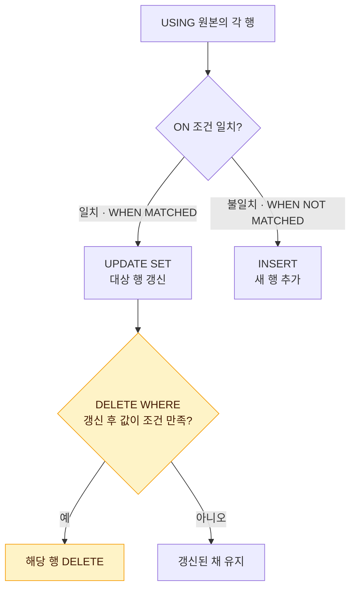

# DML

DML(Data Manipulation Language)은 테이블에 저장된 데이터를 입력·수정·삭제하는 명령어다. DML로 바꾼 내용은 [TCL](/theory/tcl)의 COMMIT이 있어야 영구 반영된다(Oracle 기준).

## DML 명령어 종류

::: cards 2
- **INSERT** 행을 추가한다. 단일 행, 다중 행, 서브쿼리 입력이 모두 가능하다.
- **UPDATE** 기존 행의 컬럼 값을 변경한다. WHERE를 생략하면 **전체 행**이 바뀐다.
- **DELETE** 행을 삭제한다. WHERE를 생략하면 전체 행 삭제, **롤백 가능**하다.
- **MERGE** 조건에 따라 UPDATE/INSERT(DELETE)를 한 번에 처리한다. 데이터 동기화에 사용한다.
:::

- SELECT도 넓은 의미에서 DML로 분류하기도 한다. 조회는 [SELECT](/theory/select) 문서 참고.

## INSERT: 단일 행 입력과 컬럼 생략 규칙

```sql
-- 컬럼 목록을 명시하는 방식
INSERT INTO emp (empno, ename, deptno)
VALUES (1001, '홍길동', 10);

-- 컬럼 목록을 생략하는 방식: 테이블 정의 순서대로 모든 컬럼 값을 넣어야 함
INSERT INTO emp
VALUES (1002, '김철수', 'CLERK', NULL, SYSDATE, 3000, NULL, 20);
```

### 컬럼 생략 규칙

::: compare
- **컬럼 목록 명시** 나열한 컬럼 순서와 VALUES 값의 **순서·개수가 일치**해야 한다. 목록에서 빠진 컬럼에는 DEFAULT가 있으면 DEFAULT, 없으면 NULL이 들어간다.
- **컬럼 목록 생략** 테이블의 **모든 컬럼**에 대해 정의 순서대로 값을 줘야 한다. 값이 없는 칸은 NULL을 직접 명시한다.
:::

- 빠진 컬럼이 NOT NULL이면서 DEFAULT가 없으면 오류가 발생한다.
- 문자·날짜 값은 작은따옴표로 감싸고, 숫자는 따옴표 없이 쓴다.

> 시험 포인트: 컬럼 목록 없이 INSERT하면서 값 개수가 컬럼 수보다 적으면 오류다. "생략된 컬럼은 자동으로 NULL"은 컬럼 목록을 명시한 경우에만 성립한다.

## INSERT: 다중 행 입력과 서브쿼리 INSERT

### 다중 행 입력

```sql
-- Oracle: INSERT ALL (무조건 다중 입력)
INSERT ALL
  INTO dept (deptno, dname) VALUES (50, 'HR')
  INTO dept (deptno, dname) VALUES (60, 'IT')
SELECT * FROM dual;

-- SQL Server (Oracle 23ai 이상도 지원): VALUES 뒤에 여러 행 나열
INSERT INTO dept (deptno, dname)
VALUES (50, 'HR'), (60, 'IT');
```

### 서브쿼리를 이용한 INSERT

```sql
INSERT INTO emp_backup (empno, ename, sal)
SELECT empno, ename, sal
FROM emp
WHERE deptno = 10;
```

- VALUES 절 없이 SELECT 결과 전체를 한 번에 입력한다.
- SELECT 컬럼 수·타입이 대상 컬럼과 맞아야 한다.

::: info INSERT ... SELECT와 CTAS는 다르다
INSERT ... SELECT는 대상 테이블이 **미리 존재**해야 한다. 테이블을 새로 만들면서 복사하는 것은 CTAS([DDL](/theory/ddl) 참고)다.
:::

## UPDATE: 컬럼 값 수정

```sql
-- 기본 형태
UPDATE emp
SET sal = sal * 1.1,
    comm = 100
WHERE deptno = 20;

-- 서브쿼리로 SET 값 지정 (스칼라 서브쿼리)
UPDATE emp e
SET sal = (SELECT AVG(sal) FROM emp WHERE deptno = e.deptno)
WHERE job = 'CLERK';

-- 여러 컬럼을 한 번에 서브쿼리로 지정 (Oracle)
UPDATE emp
SET (sal, comm) = (SELECT sal, comm FROM emp WHERE empno = 7788)
WHERE empno = 7369;
```

::: warning WHERE를 빠뜨리면
WHERE 절을 생략하면 **테이블의 모든 행**이 수정된다. SET 절 서브쿼리는 한 행만 반환해야 하며, 결과가 없으면 해당 컬럼은 **NULL**이 된다.
:::

- 서브쿼리 문법은 [서브쿼리](/theory/subquery) 참고.

## DELETE: 행 삭제

```sql
DELETE FROM emp WHERE deptno = 30;

-- FROM 생략 가능 (Oracle, SQL Server 모두)
DELETE emp WHERE empno = 1001;

-- 전체 행 삭제
DELETE FROM emp;
```

- 행 단위로 삭제하며 삭제 내역을 로그(언두)에 남기므로 **ROLLBACK이 가능**하다.
- 전체 행을 지워도 테이블 구조와 할당된 저장 공간은 그대로 남는다.
- 특정 컬럼 값만 지우려면 DELETE가 아니라 `UPDATE ... SET 컬럼 = NULL`을 사용한다.

## MERGE: 조건부 UPDATE와 INSERT를 한 문장으로

대상 테이블과 원본(테이블·뷰·서브쿼리)을 조인 조건으로 비교해, 일치하면 UPDATE(또는 DELETE), 일치하지 않으면 INSERT를 수행한다. 흔히 "있으면 고치고 없으면 넣는다(UPSERT)"로 기억한다.



### 기본 문법

```sql
MERGE INTO 대상테이블 t
USING 원본테이블 s
ON (t.키 = s.키)
WHEN MATCHED THEN
  UPDATE SET t.컬럼1 = s.컬럼1
  [WHERE 조건]
  [DELETE WHERE 조건]
WHEN NOT MATCHED THEN
  INSERT (컬럼목록) VALUES (값목록)
  [WHERE 조건];
```

### 예제

```sql
-- 신규 사원 정보(emp_new)로 사원 테이블(emp) 동기화
MERGE INTO emp t
USING emp_new s
ON (t.empno = s.empno)
WHEN MATCHED THEN
  UPDATE SET t.sal = s.sal,
             t.deptno = s.deptno
  DELETE WHERE t.deptno = 99
WHEN NOT MATCHED THEN
  INSERT (empno, ename, sal, deptno)
  VALUES (s.empno, s.ename, s.sal, s.deptno);
```

| emp_new 행 상태 | 수행 결과 |
|---|---|
| emp에 같은 empno 존재 | sal, deptno UPDATE |
| UPDATE 후 deptno가 99 | 해당 행 DELETE |
| emp에 같은 empno 없음 | 새 행 INSERT |

### MERGE 주의사항

::: warning MERGE 함정 모음
- ON 절에 쓴 컬럼은 UPDATE SET에서 변경할 수 없다(Oracle).
- Oracle의 `DELETE WHERE`는 **UPDATE된 행만** 대상이며, 조건은 **UPDATE 이후의 값**으로 평가한다. 매칭되지 않거나 UPDATE되지 않은 행은 지워지지 않는다.
- SQL Server는 `WHEN MATCHED THEN DELETE`, `WHEN NOT MATCHED BY SOURCE` 등을 지원하고, MERGE 문 끝에 세미콜론(;)이 반드시 필요하다.
:::

- WHEN MATCHED, WHEN NOT MATCHED 중 하나만 써도 된다.
- USING 절에 서브쿼리를 써도 되며, 원본으로 DUAL을 이용해 단일 행 UPSERT를 구현하기도 한다.

> 시험 포인트: Oracle MERGE의 DELETE WHERE는 독립된 분기가 아니라 UPDATE에 종속된다. "UPDATE된 행 중 조건을 만족하는 행만 삭제"되며, 비교 값은 갱신 후의 값이다.

## DELETE vs TRUNCATE vs DROP

셋 다 "지운다"지만 지우는 범위와 되돌릴 수 있는지가 다르다.

::: cards 3
- **DELETE** 원하는 **행만** 골라 지운다. 구조·공간 유지, **롤백 가능**. 비유하면 노트에서 몇 줄만 지우개로 지우기.
- **TRUNCATE** **모든 행**을 한 번에 비운다. 구조는 남고 공간은 반환, 롤백 불가. 노트 내용을 통째로 찢어내고 빈 노트만 남기기.
- **DROP** **테이블 자체**를 없앤다. 데이터와 구조 모두 삭제, 롤백 불가. 노트를 통째로 버리기.
:::

| 구분 | DELETE | TRUNCATE | DROP |
|---|---|---|---|
| 분류 | DML | DDL | DDL |
| 삭제 대상 | 조건에 맞는 행(WHERE 가능) | 전체 행 | 테이블 자체(데이터+구조) |
| 롤백 | 가능 | 불가(Oracle 자동 커밋) | 불가(Oracle 자동 커밋) |
| 로그 기록 | 행 단위로 기록 | 최소한만 기록 | 최소한만 기록 |
| 테이블 구조 | 유지 | 유지 | 삭제 |
| 저장 공간 | 반환하지 않음 | 반환(초기 상태로) | 모두 반환 |
| 속도 | 상대적으로 느림 | 빠름 | 빠름 |
| 트리거 | DELETE 트리거 동작 | 동작 안 함 | 동작 안 함 |

- TRUNCATE는 WHERE 절을 쓸 수 없다.
- Oracle에서 DROP한 테이블은 휴지통(Recycle Bin)에서 FLASHBACK으로 복구할 수 있지만, 이는 ROLLBACK과는 다른 기능이다.
- SQL Server는 명시적 트랜잭션(BEGIN TRAN) 안에서 실행한 TRUNCATE·DROP도 ROLLBACK할 수 있다.

> 시험 포인트: "데이터만 지우고 구조는 남기며 롤백 불가" → TRUNCATE, "구조는 남기고 롤백 가능" → DELETE, "구조까지 제거" → DROP. 시스템 부하가 가장 적은 전체 삭제는 TRUNCATE다.

## Oracle과 SQL Server의 DML 커밋 방식 차이

::: compare
- **Oracle** 기본은 **수동 커밋**이다. DML을 실행해도 COMMIT 전까지 다른 세션에 보이지 않고, 취소하려면 ROLLBACK을 실행한다.
- **SQL Server** 기본은 <strong>자동 커밋(AUTO COMMIT)</strong>이다. 문장 단위로 즉시 커밋되므로, 롤백하려면 먼저 BEGIN TRAN으로 트랜잭션을 시작해야 한다.
:::

| 구분 | Oracle | SQL Server |
|---|---|---|
| 기본 모드 | 수동 커밋 | 자동 커밋(AUTO COMMIT) |
| DML 실행 후 | COMMIT 전까지 다른 세션에 보이지 않음 | 문장 단위로 즉시 커밋 |
| 롤백하려면 | ROLLBACK 실행 | BEGIN TRAN으로 트랜잭션을 시작해야 함 |

- Oracle은 DML 이후 DDL을 실행하면 앞선 DML까지 **암묵적으로 커밋**된다.
- 자세한 트랜잭션 제어는 [TCL](/theory/tcl), 동시성과 격리 수준은 [TCL](/theory/tcl#동시성-문제와-격리-수준) 참고.

> 시험 포인트: 같은 DML이라도 SQL Server는 기본 자동 커밋이라 실행 즉시 확정된다. "SQL Server에서 DELETE 후 ROLLBACK하면 복구된다"는 BEGIN TRAN이 없으면 틀린 설명이다.

## 핵심 요약

- DML은 INSERT, UPDATE, DELETE, MERGE이며 COMMIT 전까지 확정되지 않는다(Oracle).
- INSERT 시 컬럼 목록을 생략하면 모든 컬럼 값을 정의 순서대로 넣어야 한다.
- 컬럼 목록에서 빠진 컬럼은 DEFAULT 또는 NULL이 들어가며, NOT NULL이면 오류다.
- UPDATE·DELETE에서 WHERE를 생략하면 전체 행이 대상이다.
- MERGE는 ON 조건 일치 여부로 UPDATE/INSERT를 나누며, Oracle의 DELETE WHERE는 UPDATE된 행만 갱신 후 값으로 판단한다.
- DELETE는 롤백 가능·공간 유지, TRUNCATE는 롤백 불가·공간 반환·구조 유지, DROP은 구조까지 삭제한다.
- Oracle은 수동 커밋, SQL Server는 자동 커밋이 기본이다.
