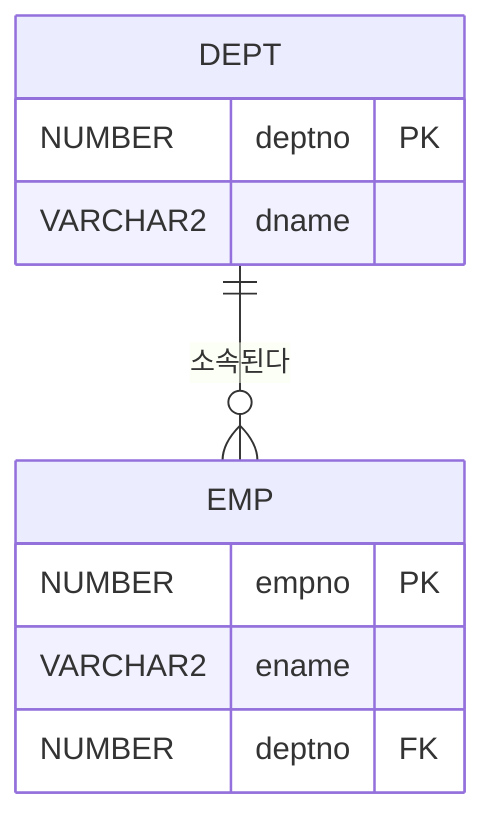

# DDL

DDL(Data Definition Language)은 테이블·뷰·인덱스 등 데이터베이스 객체의 구조를 정의·변경·삭제하는 명령어다. Oracle에서 DDL은 실행 즉시 자동 커밋된다([TCL](/theory/tcl) 참고).

## 주요 데이터 타입

| 타입 | 설명 |
|---|---|
| CHAR(n) | 고정 길이 문자열. 남는 길이는 공백으로 채움 |
| VARCHAR2(n) / VARCHAR(n) | 가변 길이 문자열. 입력한 길이만큼만 저장 (Oracle은 VARCHAR2, SQL Server는 VARCHAR) |
| NUMBER(p, s) | Oracle 숫자 타입. p는 전체 자릿수, s는 소수점 이하 자릿수 |
| INT, NUMERIC, DECIMAL | SQL Server 등 표준 숫자 타입 |
| DATE | Oracle은 날짜와 시각(초 단위)까지 저장 |
| DATETIME | SQL Server 날짜·시각 타입 |
| TIMESTAMP | 소수점 이하 초까지 저장 |
| CLOB / BLOB | 대용량 문자 / 이진 데이터 |

- `NUMBER(7,2)`는 정수부 5자리, 소수부 2자리까지 저장한다. 예: 99999.99까지 가능.

### CHAR vs VARCHAR 비교

::: compare
- **CHAR** **고정 길이**. 정의 길이보다 짧으면 공백으로 채워 저장한다. 비교할 때는 짧은 쪽에 공백을 채워 길이를 맞춘 뒤 비교한다. 길이가 일정한 코드(성별, 주민번호 등)에 적합하다.
- **VARCHAR(2)** **가변 길이**. 입력한 길이만큼만 저장한다. 비교할 때는 공백도 하나의 문자로 보고 그대로 비교한다. 길이가 들쭉날쭉한 값(이름, 주소 등)에 적합하다.
:::

::: example 공백 비교 결과
- CHAR 비교에서는 `'AB'`와 `'AB  '`가 **같다**고 판단한다.
- VARCHAR 비교에서는 `'AB'`와 `'AB '`가 서로 **다르다**.
:::

> 시험 포인트: CHAR(10) 컬럼에 'ABC'를 넣으면 실제 저장 길이는 10이다. CHAR는 뒤쪽 공백을 무시하고 비교하지만 VARCHAR는 공백까지 비교하므로 결과가 달라질 수 있다.

## CREATE TABLE과 명명 규칙

```sql
CREATE TABLE dept (
  deptno   NUMBER(2)     CONSTRAINT dept_pk PRIMARY KEY,
  dname    VARCHAR2(20)  NOT NULL,
  loc      VARCHAR2(20)  DEFAULT 'SEOUL'
);
```

::: cards 2
- **명명 규칙** 테이블·컬럼 이름을 지을 때 지켜야 할 규칙.
  - 문자(A-Z, a-z)로 시작해야 한다.
  - 문자, 숫자, `_`, `$`, `#`만 사용할 수 있다(일반 식별자 기준).
  - 길이 제한이 있다(Oracle 전통적으로 30바이트, 12.2 이후 128바이트).
  - 예약어는 사용할 수 없다.
  - 같은 스키마 안에서 객체 이름은 중복될 수 없고, 한 테이블 안에서 컬럼명도 중복될 수 없다.
  - 큰따옴표로 감싼 식별자는 예외 규칙을 따른다(대소문자 구분, 공백·예약어 사용 가능).
- **작성 규칙** CREATE TABLE 문을 쓸 때의 규칙.
  - 컬럼 정의는 콤마(,)로 구분하고 마지막 컬럼 뒤에는 콤마를 쓰지 않는다.
  - 각 컬럼에는 반드시 데이터 타입을 지정한다.
  - DEFAULT로 기본값을 지정할 수 있다.
:::

::: warning 자주 나오는 오답 이름
`10_emp`(숫자로 시작), `emp-name`(하이픈 사용), `SELECT`(예약어)는 모두 일반 식별자로 쓸 수 없다. `emp_10`, `emp$`, `emp#`은 가능하다.
:::

## 제약조건

::: cards 3
- **PRIMARY KEY** 행을 유일하게 식별한다. **UNIQUE + NOT NULL**. 테이블당 하나. 자동으로 인덱스 생성.
- **UNIQUE** 중복 불가. **NULL 허용**.
- **NOT NULL** NULL 입력 금지. **컬럼 레벨로만** 정의한다.
- **CHECK** 입력 값의 범위나 조건을 제한한다. 예: `sal > 0`.
- **FOREIGN KEY** 다른 테이블의 PK(또는 UNIQUE)를 참조. NULL 허용, 여러 개 가능.
:::

```sql
CREATE TABLE emp (
  empno   NUMBER(4),
  ename   VARCHAR2(20) NOT NULL,
  email   VARCHAR2(50),
  sal     NUMBER(7,2),
  deptno  NUMBER(2),
  CONSTRAINT emp_pk    PRIMARY KEY (empno),
  CONSTRAINT emp_uk    UNIQUE (email),
  CONSTRAINT emp_ck    CHECK (sal > 0),
  CONSTRAINT emp_fk    FOREIGN KEY (deptno)
                       REFERENCES dept(deptno) ON DELETE CASCADE
);
```

- UNIQUE 컬럼의 NULL은 Oracle에서 여러 건 허용되지만, SQL Server에서는 한 건만 허용된다.
- 복합 PK는 테이블 레벨 제약조건으로 정의한다.

### FK 참조 동작

위 예제에서 DEPT가 부모, EMP가 자식이다. 자식의 deptno가 부모의 deptno를 참조한다.



| 동작 | 부모 행 삭제(또는 수정) 시 |
|---|---|
| CASCADE | 참조하는 자식 행도 함께 삭제(수정) |
| SET NULL | 자식 행의 FK 컬럼을 NULL로 변경 |
| SET DEFAULT | 자식 행의 FK 컬럼을 기본값으로 변경 |
| RESTRICT / NO ACTION | 자식 행이 있으면 부모 행 삭제(수정) 불가 (기본 동작) |

::: example DEPT 10번을 삭제하면
10번 부서에 사원 3명이 소속되어 있을 때 `DELETE FROM dept WHERE deptno = 10;`을 실행하면

- **CASCADE**: 사원 3명도 함께 삭제된다.
- **SET NULL**: 사원 3명은 남고 deptno만 NULL이 된다.
- **NO ACTION**(생략 시): 자식 행이 있으므로 삭제 자체가 오류로 실패한다.
:::

- Oracle은 `ON DELETE CASCADE`, `ON DELETE SET NULL`만 지원하며, 생략하면 NO ACTION이다. ON UPDATE 절은 없다.
- SQL Server는 ON DELETE/ON UPDATE 모두에 CASCADE, SET NULL, SET DEFAULT, NO ACTION을 지원한다.
- 입력 측면에서는 자식 테이블에 INSERT할 때 부모 키가 없으면 기본적으로 오류다(Dependent). 이론상 Automatic(부모 자동 생성), Set Null, Set Default 같은 입력 규칙도 있다.

> 시험 포인트: ON DELETE CASCADE가 걸린 상태에서 부모 행을 지우면 자식 행도 함께 삭제된다. 문제에서 여러 단계로 FK가 이어지면 연쇄 삭제되는 행 수를 끝까지 따라가야 한다.

## CTAS로 테이블 복사

```sql
-- Oracle: 구조와 데이터 복사
CREATE TABLE emp_copy AS SELECT * FROM emp;

-- 구조만 복사
CREATE TABLE emp_empty AS SELECT * FROM emp WHERE 1 = 2;

-- SQL Server
SELECT * INTO emp_copy FROM emp;
```

- CTAS(Create Table As Select)는 컬럼명, 데이터 타입, 데이터를 복사한다.
- `WHERE 1 = 2`처럼 항상 거짓인 조건을 주면 행 없이 구조만 복사된다.

::: warning 제약조건은 NOT NULL만 따라온다
CTAS는 제약조건 중 **NOT NULL만** 복사한다. PK, UNIQUE, CHECK, FK, DEFAULT, 인덱스는 복사되지 않는다.
:::

> 시험 포인트: CTAS 후 원본 테이블의 PK가 그대로 있다고 생각하면 안 된다. 필요하면 ALTER TABLE ... ADD CONSTRAINT로 다시 추가해야 한다.

## ALTER TABLE로 구조 변경

```sql
-- 컬럼 추가 (항상 마지막 위치에 추가됨)
ALTER TABLE emp ADD (phone VARCHAR2(20));

-- 컬럼 타입·크기·기본값 변경
ALTER TABLE emp MODIFY (ename VARCHAR2(40) NOT NULL);

-- 컬럼 삭제
ALTER TABLE emp DROP COLUMN phone;

-- 컬럼명 변경
ALTER TABLE emp RENAME COLUMN ename TO emp_name;

-- 테이블명 변경
RENAME emp TO employee;            -- 또는 ALTER TABLE emp RENAME TO employee;

-- 제약조건 추가·삭제
ALTER TABLE emp ADD CONSTRAINT emp_sal_ck CHECK (sal >= 0);
ALTER TABLE emp DROP CONSTRAINT emp_sal_ck;
```

### MODIFY 시 제약

::: warning 데이터가 있으면 마음대로 못 바꾼다
- 데이터가 있을 때 컬럼 크기를 기존 값보다 작게 줄일 수 없다.
- 컬럼에 NULL만 있거나 행이 없을 때에만 데이터 타입을 바꿀 수 있다.
- 기존 행에 NULL이 있으면 NOT NULL로 바꿀 수 없다.
- DEFAULT 변경은 **이후 입력되는 행부터** 적용된다.
:::

### Oracle과 SQL Server 문법 차이

| 작업 | Oracle | SQL Server |
|---|---|---|
| 컬럼 변경 | `ALTER TABLE t MODIFY (c 타입)` | `ALTER TABLE t ALTER COLUMN c 타입` |
| 여러 컬럼 변경 | 괄호 안에 여러 개 나열 가능 | 한 번에 한 컬럼 |
| 컬럼명 변경 | `ALTER TABLE t RENAME COLUMN a TO b` | `sp_rename 't.a', 'b', 'COLUMN'` |
| 테이블명 변경 | `RENAME t TO t2` | `sp_rename 't', 't2'` |
| 컬럼 추가 | `ADD (c 타입)` | `ADD c 타입` (COLUMN 키워드 없음) |

## DROP TABLE과 TRUNCATE TABLE

```sql
DROP TABLE emp;                       -- 구조와 데이터 모두 삭제
DROP TABLE dept CASCADE CONSTRAINTS;  -- 참조하는 FK 제약조건도 함께 삭제 (Oracle)
TRUNCATE TABLE emp;                   -- 데이터만 전체 삭제, 구조 유지
```

- 자식 테이블이 참조 중인 부모 테이블은 그냥 DROP할 수 없으며 `CASCADE CONSTRAINTS`가 필요하다.
- DELETE·TRUNCATE·DROP의 차이는 [DML](/theory/dml)의 비교표 참고.

## VIEW, INDEX, SEQUENCE 생성

::: cards 3
- **VIEW** 저장된 SELECT 문. 데이터를 갖지 않는 **가상 테이블**이다. 독립성·편리성·보안성이 장점.
- **INDEX** 검색 속도 향상용 객체. 조회는 빨라지지만 DML 시 인덱스도 함께 갱신되어 부하가 생긴다.
- **SEQUENCE** 순차 번호를 생성한다(Oracle). SQL Server는 주로 IDENTITY 속성을 쓴다.
:::

```sql
-- 뷰: 저장된 SELECT 문 (데이터를 갖지 않는 가상 테이블)
CREATE OR REPLACE VIEW v_emp10 AS
SELECT empno, ename, sal FROM emp WHERE deptno = 10;
DROP VIEW v_emp10;

-- 인덱스: 검색 속도 향상용 객체
CREATE INDEX emp_ename_idx ON emp (ename);
DROP INDEX emp_ename_idx;

-- 시퀀스: 순차 번호 생성 (Oracle)
CREATE SEQUENCE emp_seq START WITH 1 INCREMENT BY 1;
INSERT INTO emp (empno, ename) VALUES (emp_seq.NEXTVAL, '이영희');
```

- 뷰는 ALTER VIEW로 정의를 바꿀 수 없어 **OR REPLACE**로 재생성한다.
- 인덱스는 조회를 빠르게 하지만 DML 시 인덱스도 함께 갱신되어 부하가 생긴다.
- SQL Server는 시퀀스 대신 IDENTITY 속성을 주로 사용한다.

## 핵심 요약

- CHAR는 고정 길이·공백 패딩 비교, VARCHAR는 가변 길이·공백 포함 비교다.
- 객체 이름은 문자로 시작하고 A-Z, 0-9, _, $, #만 쓰며 예약어·중복은 불가하다.
- PK는 UNIQUE+NOT NULL로 테이블당 하나, UNIQUE·FK는 NULL을 허용한다.
- Oracle FK는 ON DELETE CASCADE / SET NULL만 지원하고 기본은 삭제 제한이다.
- CTAS는 데이터와 구조를 복사하지만 제약조건은 NOT NULL만 복사한다.
- 컬럼 변경은 Oracle MODIFY, SQL Server ALTER COLUMN이며 이름 변경은 SQL Server에서 sp_rename을 쓴다.
- DROP은 구조까지 삭제, TRUNCATE는 구조 유지·데이터 전체 삭제이며 Oracle에서 둘 다 롤백 불가다.
