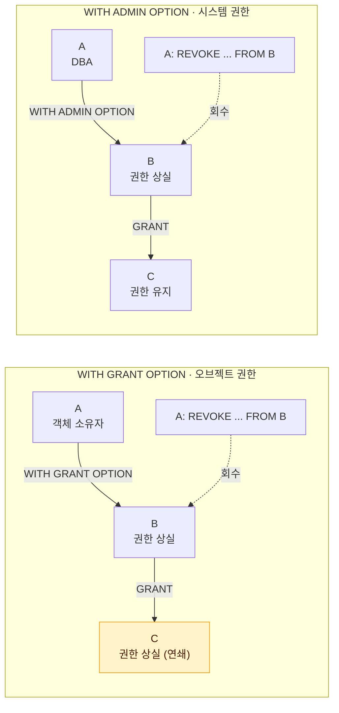

# DCL

DCL(Data Control Language)은 사용자에게 데이터베이스 접근 권한을 부여하거나 회수하는 명령어다. 보안과 데이터 보호를 위해 사용자마다 **필요한 권한만** 주는 것이 원칙이다.

## 사용자와 권한의 개념

- 데이터베이스는 사용자(계정) 단위로 접근을 통제한다.
- 새로 만든 사용자는 아무 권한이 없어 **접속조차 할 수 없다**. 최소한 CREATE SESSION 권한이 필요하다.
- 다른 사용자가 소유한 객체는 소유자 또는 권한 관리자가 권한을 줘야 사용할 수 있다.
- 객체의 소유자는 자기 객체에 대한 모든 권한을 가진다.

### 사용자 생성

::: steps
1. **CREATE USER** 계정을 만든다. 이 상태로는 접속도 못 한다.
2. **GRANT CREATE SESSION** 접속할 수 있게 된다.
3. **GRANT CREATE TABLE 등** 필요한 작업 권한을 하나씩 준다.
:::

```sql
-- Oracle
CREATE USER scott2 IDENTIFIED BY tiger2;
GRANT CREATE SESSION TO scott2;     -- 접속 권한
GRANT CREATE TABLE TO scott2;       -- 테이블 생성 권한

ALTER USER scott2 IDENTIFIED BY newpw;  -- 비밀번호 변경
DROP USER scott2 CASCADE;               -- 소유 객체까지 함께 삭제
```

- Oracle에서 사용자를 만들려면 CREATE USER 시스템 권한이 필요하다(보통 DBA가 수행).

::: info SQL Server는 두 단계
SQL Server는 서버 접속용 <strong>로그인(LOGIN)</strong>과 데이터베이스 사용용 <strong>사용자(USER)</strong>를 구분해 만든다.
:::

## 시스템 권한과 오브젝트 권한

::: compare
- **시스템 권한** DB 전반의 특정 작업을 할 수 있는 권한. DBA 또는 ADMIN OPTION 보유자가 부여하며, 재부여 옵션은 **WITH ADMIN OPTION**. 예: CREATE SESSION, CREATE TABLE, CREATE VIEW, CREATE USER
- **오브젝트 권한** 특정 객체에 대한 조작 권한. 객체 소유자 또는 GRANT OPTION 보유자가 부여하며, 재부여 옵션은 **WITH GRANT OPTION**. 예: 특정 테이블에 대한 SELECT, INSERT, UPDATE, DELETE
:::

| 구분 | 시스템 권한 | 오브젝트 권한 |
|---|---|---|
| 의미 | DB 전반의 특정 작업을 할 수 있는 권한 | 특정 객체에 대한 조작 권한 |
| 예시 | CREATE SESSION, CREATE TABLE, CREATE VIEW, CREATE USER | 특정 테이블에 대한 SELECT, INSERT, UPDATE, DELETE |
| 부여자 | DBA 또는 ADMIN OPTION 보유자 | 객체 소유자 또는 GRANT OPTION 보유자 |
| 재부여 옵션 | WITH ADMIN OPTION | WITH GRANT OPTION |

### 오브젝트 권한 종류

| 권한 | 테이블 | 뷰 | 시퀀스 | 프로시저 |
|---|---|---|---|---|
| SELECT | O | O | O | |
| INSERT | O | O | | |
| UPDATE | O | O | | |
| DELETE | O | O | | |
| ALTER | O | | O | |
| INDEX | O | | | |
| REFERENCES | O | | | |
| EXECUTE | | | | O |

- REFERENCES는 해당 테이블을 참조하는 FK 제약조건을 만들 수 있는 권한이다.
- INDEX는 해당 테이블에 인덱스를 생성할 수 있는 권한이다.

## GRANT와 REVOKE 문법

```sql
-- 시스템 권한
GRANT 시스템권한 [, ...] TO 사용자|롤|PUBLIC [WITH ADMIN OPTION];
REVOKE 시스템권한 [, ...] FROM 사용자|롤|PUBLIC;

-- 오브젝트 권한
GRANT 권한 [, ...] ON 객체 TO 사용자|롤|PUBLIC [WITH GRANT OPTION];
REVOKE 권한 [, ...] ON 객체 FROM 사용자|롤|PUBLIC;
```

```sql
-- 예제
GRANT SELECT, INSERT ON scott.emp TO kim;
GRANT UPDATE (sal) ON scott.emp TO kim;   -- 특정 컬럼에만 UPDATE 권한
GRANT ALL ON scott.dept TO lee;           -- 모든 오브젝트 권한
GRANT SELECT ON scott.emp TO PUBLIC;      -- 모든 사용자에게 부여

REVOKE INSERT ON scott.emp FROM kim;
```

- GRANT는 **TO**, REVOKE는 **FROM**을 사용한다.
- PUBLIC은 모든 사용자를 의미한다.
- 다른 스키마의 객체는 `소유자.객체명` 형식으로 지정한다.
- Oracle에서 GRANT, REVOKE는 실행 시 자동 커밋된다.

> 시험 포인트: 문법 키워드를 바꿔치기한 보기가 자주 나온다. 부여는 `GRANT ... ON ... TO`, 회수는 `REVOKE ... ON ... FROM`이다.

## WITH GRANT OPTION vs WITH ADMIN OPTION

둘 다 "받은 권한을 남에게 다시 줄 수 있다"는 옵션이지만, **회수할 때** 결과가 정반대다.

::: compare
- **WITH GRANT OPTION** **오브젝트 권한**에 붙는다. 받은 오브젝트 권한을 다른 사용자에게 재부여할 수 있다. 회수하면 재부여된 권한까지 **연쇄 회수**되며, 권한을 부여한 사용자만 회수할 수 있다.
- **WITH ADMIN OPTION** **시스템 권한, 롤**에 붙는다. 받은 시스템 권한·롤을 다른 사용자에게 재부여할 수 있다. 회수해도 재부여된 권한은 **회수되지 않으며**, ADMIN OPTION을 가진 누구나 회수할 수 있다.
:::

A가 B에게 옵션과 함께 권한을 주고, B가 다시 C에게 준 뒤, A가 B의 권한을 회수하는 상황이다.



| 구분 | WITH GRANT OPTION | WITH ADMIN OPTION |
|---|---|---|
| 적용 대상 | 오브젝트 권한 | 시스템 권한, 롤 |
| 의미 | 받은 오브젝트 권한을 다른 사용자에게 재부여 가능 | 받은 시스템 권한·롤을 다른 사용자에게 재부여 가능 |
| 회수 시 | 재부여된 권한까지 **연쇄 회수** | 재부여된 권한은 **회수되지 않음** |
| 회수 주체 | 권한을 부여한 사용자만 회수 가능 | ADMIN OPTION을 가진 누구나 회수 가능 |

### 연쇄 회수 시나리오

아래 SQL은 같은 상황을 SCOTT(또는 DBA) → A → B 순서로 재현한 것이다.

```sql
-- 1) SCOTT(소유자) → A, GRANT OPTION 포함
GRANT SELECT ON scott.emp TO a WITH GRANT OPTION;
-- 2) A → B
GRANT SELECT ON scott.emp TO b;
-- 3) SCOTT가 A의 권한 회수
REVOKE SELECT ON scott.emp FROM a;
-- 결과: A와 B 모두 SELECT 권한 상실
```

```sql
-- 1) DBA → A, ADMIN OPTION 포함
GRANT CREATE TABLE TO a WITH ADMIN OPTION;
-- 2) A → B
GRANT CREATE TABLE TO b;
-- 3) DBA가 A의 권한 회수
REVOKE CREATE TABLE FROM a;
-- 결과: A만 상실, B는 CREATE TABLE 권한 유지
```

> 시험 포인트: GRANT OPTION(오브젝트 권한)은 회수가 연쇄되고, ADMIN OPTION(시스템 권한)은 연쇄되지 않는다. 문제의 권한이 오브젝트 권한인지 시스템 권한인지 먼저 구분해야 한다.

## ROLE을 이용한 권한 관리

ROLE은 여러 권한을 하나로 묶은 이름 있는 권한 그룹이다. 사용자에게 권한을 하나하나 주는 대신, 권한을 롤에 담고 롤을 사용자에게 준다.

::: flow
- **권한** CREATE SESSION, CREATE TABLE, SELECT ON emp ...
- **ROLE** dev_role에 묶어 담는다
- **사용자** kim, lee에게 롤 하나만 부여
:::

```sql
CREATE ROLE dev_role;                                  -- 롤 생성
GRANT CREATE SESSION, CREATE TABLE, CREATE VIEW TO dev_role;
GRANT SELECT ON scott.emp TO dev_role;                 -- 오브젝트 권한도 포함 가능
GRANT dev_role TO kim, lee;                            -- 사용자에게 롤 부여

REVOKE CREATE VIEW FROM dev_role;   -- 롤의 권한을 빼면 롤을 가진 모든 사용자에게 반영
REVOKE dev_role FROM lee;           -- 사용자에게서 롤 회수
DROP ROLE dev_role;
```

### ROLE의 장점

::: cards 2
- **관리가 쉽다** 사용자마다 권한을 일일이 부여·회수하지 않아도 된다.
- **한 번에 반영** 롤의 권한을 변경하면 롤을 받은 **모든 사용자**에게 한 번에 반영된다.
- **중첩 가능** 롤 안에 다른 롤을 포함시킬 수 있다.
- **혼합 가능** 시스템 권한과 오브젝트 권한을 함께 담을 수 있다.
:::

### Oracle 기본 제공 롤

| 롤 | 주요 내용 | 용도 |
|---|---|---|
| CONNECT | CREATE SESSION | DB 접속 |
| RESOURCE | CREATE TABLE, CREATE SEQUENCE, CREATE PROCEDURE, CREATE TRIGGER 등 객체 생성 권한 | 일반 개발자 |
| DBA | 거의 모든 시스템 권한(WITH ADMIN OPTION 포함) | 데이터베이스 관리자 |

```sql
-- 일반 사용자 생성 시 흔히 쓰는 방식
CREATE USER dev1 IDENTIFIED BY pw1;
GRANT CONNECT, RESOURCE TO dev1;
```

- SQL Server는 서버 수준 롤(sysadmin 등)과 데이터베이스 수준 롤(db_owner, db_datareader, db_datawriter 등)을 제공한다.

> 시험 포인트: CONNECT 롤은 접속 권한, RESOURCE 롤은 객체 생성 권한이다. 새 사용자가 테이블을 만들려면 접속(CREATE SESSION)과 생성(CREATE TABLE) 권한이 둘 다 필요하다.

## 핵심 요약

- DCL은 GRANT(부여)와 REVOKE(회수)로 구성되며 Oracle에서 자동 커밋된다.
- 새 사용자는 권한이 없어 CREATE SESSION이 있어야 접속할 수 있다.
- 시스템 권한은 DB 작업 권한, 오브젝트 권한은 특정 객체에 대한 조작 권한이다.
- 문법은 `GRANT ... ON ... TO`, `REVOKE ... ON ... FROM`이며 PUBLIC은 전체 사용자다.
- WITH GRANT OPTION(오브젝트 권한)은 연쇄 회수, WITH ADMIN OPTION(시스템 권한·롤)은 연쇄 회수되지 않는다.
- ROLE은 권한 묶음으로, 롤 권한 변경이 롤을 받은 모든 사용자에게 즉시 반영된다.
- Oracle 기본 롤은 CONNECT(접속), RESOURCE(객체 생성), DBA(관리)다.
