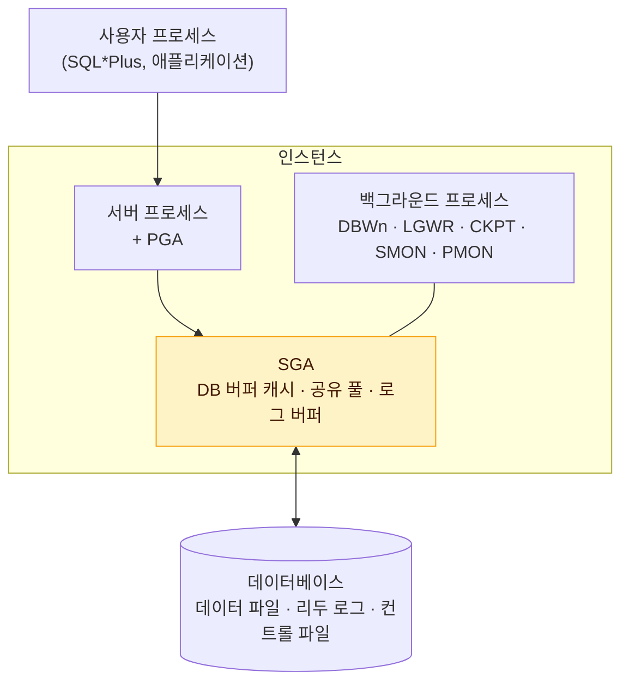
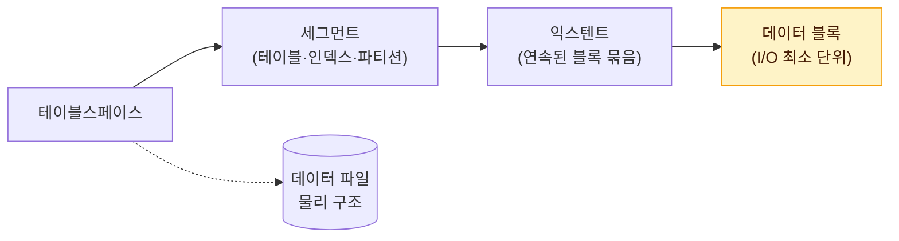

# 데이터베이스 아키텍처

SQL 튜닝은 결국 "**메모리와 디스크 사이에서 블록을 얼마나 적게 읽느냐**"의 문제다. 그 출발점으로 Oracle이 어떤 구성 요소로 이루어져 있고, 데이터를 어떤 단위로 저장하는지 정리한다.

## 데이터베이스와 인스턴스

Oracle에서 **데이터베이스**와 **인스턴스**는 서로 다른 개념이다.

::: compare
- **데이터베이스 (Database)** 디스크에 저장된 **물리적인 파일의 집합**. 데이터 파일, 리두 로그 파일, 컨트롤 파일 등으로 구성된다.
- **인스턴스 (Instance)** 데이터베이스를 관리하기 위한 **공유 메모리(SGA)와 백그라운드 프로세스의 집합**. 서버를 기동하면 메모리에 생성된다.
:::



- 일반적인 구성은 **인스턴스 1개 : 데이터베이스 1개**다.
- **RAC(Real Application Cluster)** 환경에서는 여러 인스턴스가 하나의 데이터베이스를 공유한다. 각 인스턴스의 버퍼 캐시는 <strong>캐시 퓨전(Cache Fusion)</strong>으로 서로 블록을 주고받는다.

> 시험 포인트: 인스턴스는 메모리 + 프로세스, 데이터베이스는 디스크 파일이다. RAC는 "다수 인스턴스 : 하나의 데이터베이스" 구조다.

### SQL Server와의 차이

SQL Server는 하나의 인스턴스 안에 **여러 개의 데이터베이스**를 두는 구조다. master, model, msdb, tempdb 같은 시스템 데이터베이스와 사용자 데이터베이스가 한 인스턴스에서 함께 운영된다. 데이터 파일은 주 데이터 파일(.mdf), 보조 데이터 파일(.ndf), 트랜잭션 로그 파일(.ldf)로 구분한다.

## 메모리 구조 SGA와 PGA

::: cards 2
- **SGA (System Global Area)** 모든 서버 프로세스와 백그라운드 프로세스가 **공유**하는 메모리 영역. 공유하므로 접근 시 **래치(Latch)** 등 직렬화 장치가 필요하다.
- **PGA (Process Global Area)** 서버 프로세스마다 **독립적으로** 할당되는 메모리 영역. 정렬·해시 작업 공간, 세션 정보, 커서 상태 등을 저장한다. 다른 프로세스와 공유하지 않으므로 래치가 필요 없다.
:::

### SGA 구성 요소

| 구성 요소 | 역할 |
|---|---|
| DB 버퍼 캐시 (Database Buffer Cache) | 데이터 파일에서 읽은 **데이터 블록을 캐싱**. 같은 블록을 다시 읽을 때 디스크 I/O를 피한다 |
| 공유 풀 (Shared Pool) | **라이브러리 캐시**(SQL·실행계획 캐싱)와 **딕셔너리 캐시**(테이블·컬럼·권한 등 메타정보 캐싱)로 구성 |
| 리두 로그 버퍼 (Redo Log Buffer) | 데이터 변경 내역(리두 레코드)을 디스크에 기록하기 전에 임시로 담는 버퍼 |
| Large Pool, Java Pool 등 | 병렬 처리 메시지, RMAN 백업, Shared Server의 세션 정보 등 |

### PGA 구성 요소

- **Sort Area**: ORDER BY, GROUP BY, Sort Merge Join 등 정렬 작업 공간. 부족하면 Temp 테이블스페이스를 사용한다 (Disk Sort).
- **Hash Area**: Hash Join의 Build Input(해시 맵)을 만드는 공간.
- **세션 정보, 커서 상태 정보**: 바인드 변수 값, 커서 실행 상태 등.

::: info PGA는 왜 빠른가
PGA는 자신만 쓰는 메모리라 **래치 획득 없이** 접근한다. 같은 블록이라도 SGA 버퍼 캐시에서 읽는 것보다 PGA에 올려놓고 읽는 것이 빠르다. Direct Path Read, 배열 처리, 정렬 작업이 PGA를 활용하는 대표적인 예다. 자세한 내용은 [소트 튜닝](/theory/sort-tuning)에서 다룬다.
:::

## 프로세스 구조

### 서버 프로세스

사용자 프로세스(클라이언트)의 요청을 받아 실제로 SQL을 처리한다. SQL 파싱, 최적화, 실행, 블록 읽기, 결과 전송을 담당한다. 처리 중 디스크 I/O나 다른 프로세스의 작업을 기다려야 하면 <strong>대기 이벤트(Wait Event)</strong>를 남기고 잠시 멈춘다.

::: compare
- **전용 서버 (Dedicated Server)** 사용자 프로세스마다 **전용 서버 프로세스**가 하나씩 붙는다. 연결할 때마다 프로세스를 생성하므로 비용이 크다. 그래서 애플리케이션은 **커넥션 풀**을 사용한다.
- **공유 서버 (Shared Server)** **디스패처**가 요청을 큐에 넣고, 소수의 공유 서버 프로세스가 번갈아 처리한다. 세션 정보는 SGA(Large Pool)에 둔다.
:::

### 주요 백그라운드 프로세스

| 프로세스 | 역할 |
|---|---|
| **DBWn** (Database Writer) | 버퍼 캐시의 <strong>더티 블록(Dirty Block)</strong>을 데이터 파일에 기록 |
| **LGWR** (Log Writer) | 리두 로그 버퍼의 내용을 **온라인 리두 로그 파일**에 기록 |
| **CKPT** (Checkpoint) | 체크포인트 발생 시 DBWn에게 기록을 신호하고 컨트롤 파일·데이터 파일 헤더를 갱신 |
| **SMON** (System Monitor) | 인스턴스 장애 후 재기동 시 **인스턴스 복구**, 임시 세그먼트 정리 |
| **PMON** (Process Monitor) | 비정상 종료된 프로세스 정리. 해당 세션의 **락 해제, 트랜잭션 롤백** |
| **ARCn** (Archiver) | 꽉 찬 온라인 리두 로그 파일을 아카이브 로그로 복사 (ARCHIVELOG 모드) |
| **RECO** (Recoverer) | 분산 트랜잭션 장애 복구 |

> 시험 포인트: 더티 블록을 디스크에 쓰는 것은 **DBWn**, 리두 로그를 쓰는 것은 **LGWR**이다. 서버 프로세스가 직접 데이터 파일에 쓰지 않는다는 점을 묻는 문제가 나온다.

## 버퍼 캐시·Redo·Undo의 관계

DML이 실행될 때 Oracle은 데이터를 바로 디스크에 쓰지 않는다. 메모리에서 변경하고, 변경 내역은 리두 로그로 남긴다.

::: steps
1. **블록 적재** 변경할 블록을 버퍼 캐시에서 찾고, 없으면 데이터 파일에서 읽어 적재한다
2. **Undo 기록** 변경 전 이미지를 Undo 세그먼트에 기록한다 (Undo 변경도 Redo로 남는다)
3. **Redo 기록** 변경 내역을 리두 로그 버퍼에 기록한다
4. **버퍼 블록 변경** 버퍼 캐시의 블록을 변경한다. 이 블록은 디스크와 내용이 달라진 **더티 블록**이 된다
5. **커밋** LGWR가 리두 로그 버퍼를 리두 로그 파일에 기록하면 커밋이 완료된다
6. **나중에 기록** 더티 블록은 커밋과 무관하게 나중에 DBWn이 일괄 기록한다
:::

### Redo의 목적

::: cards 3
- **Database Recovery** 디스크 손상 시 백업 + 아카이브 로그로 복구 (Media Recovery)
- **Cache Recovery** 인스턴스 비정상 종료 시 버퍼 캐시에서 유실된 변경을 Roll Forward (Instance Recovery)
- **Fast Commit** 변경된 블록을 디스크에 쓰지 않고 **로그만 순차 기록**하고 커밋을 빠르게 완료
:::

::: info Write Ahead Logging
DBWn이 더티 블록을 기록하기 **전에** 해당 블록에 대한 Redo가 먼저 리두 로그 파일에 기록되어야 한다. 이를 **Log Force at Commit**과 함께 **Write Ahead Logging** 원칙이라 한다. 덕분에 데이터 파일과 버퍼 캐시가 불일치해도 Redo로 복구할 수 있다.
:::

LGWR가 리두 로그 버퍼를 기록하는 시점은 다음과 같다.

- 3초마다
- DBWn이 더티 블록을 기록하기 전에 신호를 보낼 때
- 로그 버퍼의 1/3이 차거나 기록되지 않은 Redo가 1MB를 넘을 때
- **사용자가 커밋 또는 롤백할 때**

### Undo의 목적

::: cards 3
- **Transaction Rollback** 트랜잭션을 롤백할 때 변경 전 이미지로 되돌린다
- **Transaction Recovery** 인스턴스 복구 시 Roll Forward 후 커밋되지 않은 트랜잭션을 롤백 (Rollback Phase)
- **Read Consistency** 다른 트랜잭션이 변경 중인 블록을 읽을 때 **쿼리 시작 시점**의 이미지(CR 블록)를 만들어 일관성 있게 읽는다
:::

> 시험 포인트: Redo는 **앞으로 재실행(Roll Forward)**, Undo는 **되돌리기(Rollback)와 읽기 일관성**이다. 읽기 일관성은 Undo의 목적이라는 점을 꼭 기억한다. 읽기 일관성의 자세한 원리는 [동시성 제어](/theory/concurrency-control)를 참고한다.

### 체크포인트

체크포인트는 **버퍼 캐시의 더티 블록을 데이터 파일에 기록**해 메모리와 디스크를 동기화하는 시점이다. 체크포인트가 자주 일어나면 인스턴스 복구 시 적용할 Redo가 줄어 복구 시간이 짧아지지만, 디스크 쓰기가 늘어난다.

## 데이터 저장 구조

Oracle의 저장 구조는 **논리 구조**와 **물리 구조**로 나뉜다.



| 단위 | 설명 |
|---|---|
| **블록 (Block)** | 데이터를 읽고 쓰는 **최소 단위**. Oracle 기본 8KB. SQL Server에서는 <strong>페이지(Page)</strong>라고 하며 8KB 고정 |
| **익스텐트 (Extent)** | 공간을 확장하는 단위. **연속된 블록**의 집합. SQL Server는 8개 페이지(64KB) 단위 |
| **세그먼트 (Segment)** | 데이터 저장공간이 필요한 오브젝트. 테이블, 인덱스, 파티션, LOB 등. **여러 익스텐트**로 구성 |
| **테이블스페이스 (Tablespace)** | 세그먼트를 담는 논리적 컨테이너. **여러 데이터 파일**로 구성 |
| **데이터 파일 (Data File)** | 디스크상의 물리적인 OS 파일 |

### 꼭 구분할 관계

- 하나의 세그먼트는 **하나의 테이블스페이스**에 속한다. 단, 파티션 테이블은 파티션마다 다른 테이블스페이스에 둘 수 있다 (파티션이 각각 세그먼트이기 때문).
- 하나의 테이블스페이스는 여러 데이터 파일로 구성되므로, **한 세그먼트가 여러 데이터 파일에 걸쳐 저장될 수 있다.**
- 하나의 **익스텐트는 하나의 데이터 파일 안**에 있다. 익스텐트 안의 블록은 서로 인접해 있다.
- 세그먼트 공간이 부족하면 테이블스페이스로부터 **익스텐트 단위**로 공간을 추가 할당받는다.

::: warning 자주 틀리는 보기
- "익스텐트는 여러 데이터 파일에 걸칠 수 있다" → **틀림**. 익스텐트는 한 데이터 파일 안에 있다.
- "세그먼트는 하나의 데이터 파일에만 저장된다" → **틀림**. 세그먼트는 여러 데이터 파일에 걸칠 수 있다.
- "블록 안의 레코드 하나만 읽을 수 있다" → **틀림**. 레코드 하나를 읽어도 블록 전체를 읽는다.
:::

### 블록 단위 I/O의 의미

DBMS는 레코드 하나를 읽고 싶어도 그 레코드가 속한 **블록 전체**를 읽는다. 컬럼 하나만 SELECT해도 마찬가지다. 그래서 SQL 성능은 "몇 건을 읽느냐"보다 **"몇 개의 블록을 읽느냐"** 로 결정된다. 자세한 내용은 [데이터베이스 I/O 메커니즘](/theory/io-mechanism)에서 다룬다.

### 블록의 내부 구조와 ROWID

블록은 헤더, 테이블 디렉터리, 로우 디렉터리, 빈 공간, 로우 데이터로 구성된다. 각 레코드의 위치는 **ROWID**로 식별한다.

```text
ROWID = 오브젝트 번호 + 데이터 파일 번호 + 블록 번호 + 로우 번호
```

인덱스는 키 값과 함께 이 ROWID를 저장하고, 인덱스를 통해 테이블 레코드를 찾아갈 때 ROWID로 블록을 찾는다. 자세한 내용은 [테이블 랜덤 액세스](/theory/table-access-by-rowid)를 참고한다.

### 테이블스페이스 종류

| 종류 | 용도 |
|---|---|
| SYSTEM / SYSAUX | 데이터 딕셔너리, 시스템 관리용 오브젝트 |
| 일반(Permanent) 테이블스페이스 | 사용자 테이블, 인덱스 |
| **Undo 테이블스페이스** | Undo 세그먼트 저장 |
| **Temporary 테이블스페이스** | 정렬·해시 작업 중 PGA가 부족할 때 사용하는 임시 공간, Global Temporary Table |

## 핵심 요약

- 데이터베이스는 디스크 파일의 집합, 인스턴스는 SGA + 백그라운드 프로세스다. RAC는 다수 인스턴스가 하나의 DB를 공유한다.
- SGA는 모든 프로세스가 공유(래치 필요), PGA는 서버 프로세스 전용 메모리(래치 불필요)다.
- SGA는 DB 버퍼 캐시, 공유 풀(라이브러리 캐시·딕셔너리 캐시), 리두 로그 버퍼로 구성된다.
- 더티 블록은 DBWn, 리두 로그는 LGWR가 기록한다. 커밋은 LGWR가 Redo를 기록하면 완료된다.
- Redo의 목적은 Database Recovery, Cache Recovery, Fast Commit이다.
- Undo의 목적은 Transaction Rollback, Transaction Recovery, Read Consistency다.
- 저장 구조는 블록 → 익스텐트 → 세그먼트 → 테이블스페이스 순이며, 블록이 I/O 최소 단위다.
- 익스텐트는 한 데이터 파일 안에 있고, 세그먼트는 여러 데이터 파일에 걸칠 수 있다.
