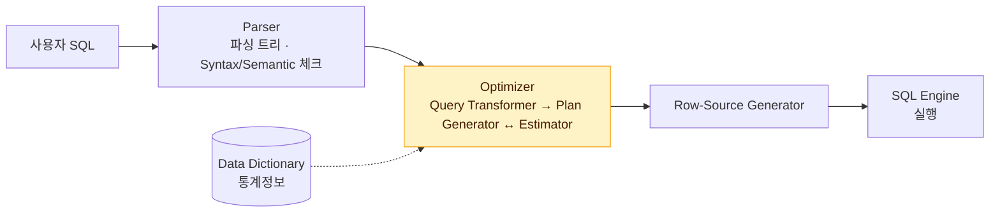
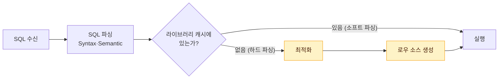

# SQL 처리 과정

SQL은 "무엇을(What)" 원하는지만 기술하는 **선언적 언어**다. "어떻게(How)" 데이터를 찾을지는 DBMS 내부의 **옵티마이저**가 결정한다. 이 문서는 SQL이 실행 가능한 프로시저로 바뀌는 과정과, 그 결과물을 재사용하는 라이브러리 캐시를 정리한다.

## SQL 최적화 과정

사용자가 SQL을 던지면 DBMS는 다음 세 단계를 거쳐 실행 가능한 형태로 만든다.

::: flow
- **SQL 파싱** 파싱 트리 생성, Syntax·Semantic 체크
- **SQL 최적화** 옵티마이저가 최적의 실행경로 선택
- **로우 소스 생성** 실행 가능한 코드(프로시저)로 포맷팅
:::

### 1. SQL 파싱 (Parser)

| 단계 | 내용 |
|---|---|
| 파싱 트리 생성 | SQL 문을 이루는 개별 요소를 분석해 파싱 트리를 만든다 |
| **Syntax 체크** | 문법적 오류가 없는지 확인. 사용할 수 없는 키워드, 순서, 누락된 키워드 등 |
| **Semantic 체크** | 의미상 오류가 없는지 확인. 존재하지 않는 테이블·컬럼, 오브젝트 권한 여부 등 |

### 2. SQL 최적화 (Optimizer)

옵티마이저는 미리 수집한 시스템·오브젝트 **통계정보**를 바탕으로 여러 실행경로를 생성해 비교하고, 가장 효율적인 하나를 선택한다. 데이터베이스 성능을 결정하는 가장 핵심 엔진이다. 세부 동작은 [옵티마이저](/theory/optimizer)와 [쿼리 변환](/theory/query-transformation)에서 다룬다.

### 3. 로우 소스 생성 (Row-Source Generator)

옵티마이저가 선택한 실행경로를 **실제 실행 가능한 코드 또는 프로시저 형태로 포맷팅**하는 단계다.



> 시험 포인트: SQL 처리 단계는 **파싱 → 최적화 → 로우 소스 생성** 순서다. 문법 오류는 Syntax 체크, 존재하지 않는 테이블·권한 오류는 Semantic 체크에서 걸러진다.

## 옵티마이저와 실행계획

옵티마이저의 최적화 과정은 다음과 같다.

::: steps
1. **실행계획 후보 생성** 사용자로부터 전달받은 쿼리를 수행하는 데 필요한 후보군 실행계획들을 찾는다
2. **비용 산정** 데이터 딕셔너리에 수집된 오브젝트 통계 및 시스템 통계정보를 이용해 각 실행계획의 예상 비용을 산정한다
3. **최저 비용 선택** 최저 비용을 나타내는 실행계획을 선택한다
:::

- **실행계획(Execution Plan)**: 옵티마이저가 생성한 처리 절차를 트리 구조로 표현한 것. 자세한 내용은 [실행계획 분석](/theory/execution-plan)을 참고한다.
- **비용(Cost)**: 쿼리를 수행하는 동안 발생할 것으로 **예상하는** I/O 횟수 또는 예상 소요시간. 실측값이 아니라 **추정치**이므로 실제 수행 성능과 다를 수 있다.
- **옵티마이저 힌트**: 옵티마이저의 판단을 사용자가 직접 지정할 때 쓴다. 자세한 내용은 [힌트](/theory/hints)를 참고한다.

```sql
SELECT /*+ INDEX(A 고객_PK) */ 고객명, 연락처
FROM   고객 A
WHERE  고객ID = '0000008';
```

## 라이브러리 캐시와 SQL 공유

SQL 최적화 과정은 하드웨어적으로 **CPU를 많이 소비하는 무거운 작업**이다. 그래서 한 번 만든 실행계획과 SQL 정보를 SGA의 <strong>공유 풀(Shared Pool) 안 라이브러리 캐시(Library Cache)</strong>에 저장해 두고 재사용한다.

::: compare
- **소프트 파싱 (Soft Parsing)** SQL을 캐시에서 찾아 곧바로 **실행 단계로 넘어가는** 경우
- **하드 파싱 (Hard Parsing)** 캐시에서 찾지 못해 **최적화 및 로우 소스 생성 단계까지 모두 거치는** 경우
:::



### 하드 파싱이 왜 무거운가

옵티마이저는 SQL 하나를 최적화할 때 다음과 같은 수많은 경우의 수를 따진다.

- 테이블·컬럼·인덱스 구조에 관한 기본 정보
- 오브젝트 통계(테이블·인덱스·컬럼 통계)와 시스템 통계(CPU 속도, Single Block I/O 속도, Multiblock I/O 속도 등)
- 옵티마이저 관련 파라미터
- 조인 순서, 조인 방식, 액세스 경로(Full Scan, 인덱스 종류별 스캔)의 조합

다섯 개 테이블을 조인하는 것만으로도 조인 순서 경우의 수가 5! = 120가지다. 여기에 조인 방식과 인덱스 선택까지 곱해지므로, 그 과정에서 딕셔너리 정보를 읽고 비용을 계산하느라 CPU와 **공유 풀 래치**를 많이 소모한다.

::: info 라이브러리 캐시가 SGA에 있는 이유
SGA는 서버 프로세스와 백그라운드 프로세스가 **공통으로 액세스**하는 메모리 공간이다. 실행계획을 SGA에 두어야 다른 사용자(세션)가 같은 SQL을 실행할 때 재사용할 수 있다.
:::

## SQL 공유 기준과 바인드 변수

### SQL 텍스트가 곧 이름이다

라이브러리 캐시에서 SQL을 찾는 키는 **SQL 문장 텍스트 그 자체**다. 테이블이나 프로시저처럼 이름을 붙여 딕셔너리에 저장하는 것이 아니라, SQL 텍스트가 일종의 이름 역할을 한다. 따라서 **의미가 같아도 텍스트가 조금이라도 다르면 다른 SQL**로 인식한다.

```sql
SELECT * FROM emp WHERE empno = 7900;
SELECT * FROM EMP WHERE EMPNO = 7900;      -- 대소문자 다름
SELECT * FROM emp  WHERE empno = 7900;     -- 공백 다름
SELECT * FROM emp WHERE empno = 7900 ;     -- 공백 다름
SELECT * FROM scott.emp WHERE empno = 7900; -- 스키마 명시
SELECT /* comment */ * FROM emp WHERE empno = 7900; -- 주석
SELECT /*+ first_rows */ * FROM emp WHERE empno = 7900; -- 힌트
```

위 SQL은 실행 결과가 같지만 **모두 각각 하드 파싱**되어 라이브러리 캐시에 별도 공간을 차지한다.

> 시험 포인트: 대소문자, 공백, 주석, 스키마 명 유무가 달라도 다른 SQL로 인식한다. "결과가 같으면 같은 SQL로 공유된다"는 보기는 틀린 설명이다.

### 리터럴 SQL의 문제

```sql
SELECT * FROM CUSTOMER WHERE LOGIN_ID = 'oraking';
SELECT * FROM CUSTOMER WHERE LOGIN_ID = 'javaking';
SELECT * FROM CUSTOMER WHERE LOGIN_ID = 'tommy';
...
```

로그인 ID마다 SQL 텍스트가 달라지므로 사용자가 로그인할 때마다 하드 파싱이 일어난다. 동시 사용자가 많으면 라이브러리 캐시와 공유 풀 경합이 심해지고, 캐시에 재사용되지 않을 SQL이 가득 차 정말 필요한 SQL이 밀려난다.

### 바인드 변수 사용

```sql
SELECT * FROM CUSTOMER WHERE LOGIN_ID = :LOGIN_ID;
```

값만 바꿔 실행하므로 SQL 텍스트가 하나로 고정된다. **최초 한 번만 하드 파싱**하고 이후에는 캐시된 실행계획을 재사용한다.

```java
// 리터럴 방식: 매번 다른 SQL
stmt.executeQuery("SELECT * FROM CUSTOMER WHERE LOGIN_ID = '" + id + "'");

// 바인드 변수 방식: 하나의 SQL을 공유
PreparedStatement ps = conn.prepareStatement(
    "SELECT * FROM CUSTOMER WHERE LOGIN_ID = ?");
ps.setString(1, id);
```

::: cards 3
- **CPU 절약** 반복적인 최적화 작업이 사라진다
- **메모리 절약** 공유 풀에 같은 SQL이 중복 저장되지 않는다
- **경합 감소** 라이브러리 캐시·공유 풀 래치 경합이 줄어든다
:::

### SQL 공유 여부 확인

```sql
SELECT SQL_ID, SQL_TEXT, PARSE_CALLS, LOADS, EXECUTIONS
FROM   V$SQL
WHERE  SQL_TEXT LIKE '%CUSTOMER%';
```

리터럴 SQL은 같은 패턴의 SQL이 여러 행으로 나오고, 바인드 변수 SQL은 한 행에 EXECUTIONS만 증가한다.

## 바인드 변수 사용 시 주의점

바인드 변수가 항상 좋은 것은 아니다. 하드 파싱 시점에 **변수에 어떤 값이 들어올지 모르는 상태**로 실행계획을 만들어야 하기 때문이다.

::: warning 바인드 변수의 부작용
- 옵티마이저는 컬럼 히스토그램을 활용하지 못하고 **평균 분포**를 가정해 선택도를 계산한다. 데이터 분포가 심하게 치우친 컬럼에서는 비효율적인 실행계획이 나올 수 있다.
- 범위 조건(`BETWEEN :A AND :B`, `> :A`)에는 값과 무관하게 고정된 선택도(`> :A`는 5%, `BETWEEN :A AND :B`는 0.25%)를 적용한다.
- 파티션 테이블에서 바인드 변수로 파티션 키를 조회하면 실행 시점에야 어느 파티션인지 알 수 있다 (Partition Pruning은 동작하지만 실행계획상 `KEY`로 표시).
:::

### 바인드 변수 Peeking

Oracle 9i부터는 하드 파싱 시점에 **처음 들어온 바인드 변수 값을 살짝 엿보고(Peeking)** 그 값의 분포를 고려해 실행계획을 만든다. 그러나 이후 다른 값이 들어와도 **처음 만든 실행계획을 그대로 재사용**하므로, 첫 실행 값이 무엇이냐에 따라 성능이 들쭉날쭉해지는 문제가 생긴다.

::: example Peeking의 함정
`STATUS` 컬럼에서 'Y'가 99%, 'N'이 1%라고 하자. 첫 실행이 `:S = 'N'`이면 인덱스 스캔 계획이 캐시되고, 이후 `:S = 'Y'`로 실행하면 99% 데이터를 인덱스로 읽는 비효율이 발생한다. 반대로 첫 실행이 'Y'면 'N' 조회도 Full Scan으로 처리된다.
:::

Oracle 11g부터는 <strong>적응적 커서 공유(Adaptive Cursor Sharing)</strong>로 입력 값 분포에 따라 다른 실행계획을 사용할 수 있게 했지만, 한 번은 비효율적으로 실행되어야 이를 감지한다는 한계가 있다.

### 바인드 변수와 리터럴 상수의 선택

| 상황 | 권장 | 이유 |
|---|---|---|
| OLTP 환경의 짧고 자주 수행되는 SQL | **바인드 변수** | 하드 파싱 부하를 줄이는 것이 중요 |
| 배치 프로그램, DW·OLAP 환경의 장시간 쿼리 | 리터럴 상수 | 수행 빈도가 낮고 오래 걸려 **파싱 비용보다 최적 실행계획이 중요** |
| 조건절 컬럼의 값 종류가 적고 분포가 치우친 경우 | 리터럴 상수 | 값마다 최적 실행계획이 달라 히스토그램을 활용해야 한다 |

> 시험 포인트: OLTP처럼 짧고 빈번한 SQL은 바인드 변수가 원칙이다. 반대로 수행 빈도가 낮고 오래 걸리는 배치·DW 쿼리, 값 종류가 적고 분포가 치우친 컬럼은 리터럴 상수가 유리할 수 있다.

## 정적 SQL과 동적 SQL

::: compare
- **정적 SQL (Static SQL)** String형 변수에 담지 않고 **코드 사이에 직접 기술**한 SQL. 컴파일 시점에 구문 분석이 가능하다 (Embedded SQL, PL/SQL 정적 SQL).
- **동적 SQL (Dynamic SQL)** String형 변수에 담아 **실행 시점에 조립**하는 SQL. 조건에 따라 SQL을 동적으로 바꿀 수 있다.
:::

라이브러리 캐시 효율과 직접 관련된 것은 정적이냐 동적이냐가 아니라 **바인드 변수를 쓰느냐**다. 동적 SQL이라도 바인드 변수를 쓰면 SQL이 공유된다. 다만 조건절 조합에 따라 SQL을 동적으로 조립하면 조합의 수만큼 서로 다른 SQL이 생긴다는 점은 유의한다.

## 핵심 요약

- SQL 처리는 파싱(Syntax·Semantic 체크) → 최적화 → 로우 소스 생성 순서다.
- 옵티마이저는 통계정보로 후보 실행계획의 비용을 추정해 최저 비용 계획을 고른다. Cost는 예상치다.
- 실행계획은 SGA 공유 풀의 라이브러리 캐시에 저장되어 재사용된다.
- 캐시에서 찾으면 소프트 파싱, 못 찾아 최적화·로우 소스 생성까지 하면 하드 파싱이다.
- SQL은 텍스트 자체가 식별자이므로 대소문자·공백·주석·스키마 명만 달라도 다른 SQL이다.
- 리터럴 SQL은 매번 하드 파싱을 유발하므로 OLTP에서는 바인드 변수를 사용한다.
- 바인드 변수는 히스토그램을 활용하지 못하고, Peeking은 첫 값 기준 계획을 고정한다는 단점이 있다.
- 배치·DW 쿼리나 분포가 치우친 소수 값 컬럼은 리터럴 상수가 나을 수 있다.
