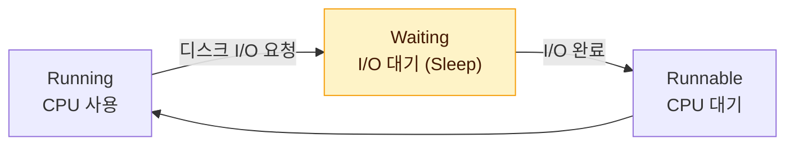
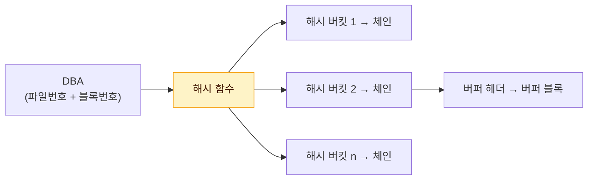

# 데이터베이스 I/O 메커니즘

SQL이 느린 이유는 대부분 **I/O 때문**이다. 디스크 I/O가 일어나는 동안 프로세스는 잠을 자며(대기) 기다린다. 이 문서는 DBMS가 블록을 어떤 단위와 방식으로 읽는지, 그리고 그것이 Full Scan과 인덱스 스캔 선택에 어떤 영향을 주는지 정리한다.

## SQL 성능과 I/O

프로세스는 CPU를 할당받아 실행 중(Running)이다가, 디스크에서 블록을 읽어야 하면 CPU를 반환하고 **대기(Waiting)** 상태로 들어간다. I/O가 끝나면 다시 실행 가능(Runnable) 큐에 들어가 CPU를 기다린다.



- I/O 한 번에 걸리는 시간이 짧아도, **I/O 횟수가 많으면** 대기 시간이 누적되어 SQL이 느려진다.
- 따라서 SQL 튜닝의 핵심은 **I/O 횟수(읽는 블록 수)를 줄이는 것**이다.

## 블록 단위 I/O

DBMS가 데이터를 읽고 쓰는 단위는 <strong>블록(Block)</strong>이다. Oracle은 기본 8KB, SQL Server는 페이지(Page)라 부르며 8KB다.

- 레코드 하나를 읽어도 그 레코드가 속한 **블록 전체**를 읽는다.
- SQL 성능 지표는 "몇 건을 읽었나"가 아니라 **"몇 블록을 읽었나"** 다.
- 테이블뿐 아니라 **인덱스도 블록 단위**로 읽고 쓴다.

::: info 시퀀셜 액세스와 랜덤 액세스
- **시퀀셜(Sequential) 액세스**: 논리적·물리적으로 연결된 순서에 따라 차례대로 블록을 읽는 방식. 인덱스 리프 블록을 앞뒤 포인터로 스캔하거나, 테이블 익스텐트를 순서대로 Full Scan하는 경우다.
- **랜덤(Random) 액세스**: 순서를 따르지 않고 레코드 하나를 읽기 위해 블록 하나씩 접근하는 방식. 인덱스 수직 탐색, 인덱스 ROWID로 테이블을 액세스하는 경우다.
- I/O 튜닝은 **시퀀셜 액세스의 선택도를 높이고, 랜덤 액세스 발생량을 줄이는 것**이다.
:::

## 논리적 I/O와 물리적 I/O

::: compare
- **논리적 I/O (Logical I/O)** SQL 처리 중 **버퍼 캐시에서** 발생한 블록 읽기 총량. 메모리 I/O이므로 빠르다. 같은 SQL을 같은 조건으로 반복 수행하면 매번 거의 같다.
- **물리적 I/O (Physical I/O)** 버퍼 캐시에서 찾지 못해 **디스크에서** 읽은 블록 수. 디스크 I/O이므로 메모리 I/O보다 훨씬 느리다. 캐시 상태에 따라 매번 달라진다.
:::

| 구분 | 의미 | 트레이스 항목 |
|---|---|---|
| 논리적 I/O | 버퍼 캐시에서 읽은 블록 수 | Query(Consistent 모드) + Current |
| 물리적 I/O | 디스크에서 읽은 블록 수 | Disk |

::: info Consistent 모드와 Current 모드
- **Consistent 모드 읽기**: SQL 시작 시점 기준으로 일관성 있게 읽는 것. 필요하면 Undo로 CR 블록을 만들어 읽는다. SELECT의 블록 읽기는 대부분 여기에 해당한다 (트레이스의 `query`, AutoTrace의 `consistent gets`).
- **Current 모드 읽기**: 그 시점의 **현재 블록**을 읽는 것. DML로 블록을 변경할 때, Full Scan 시 세그먼트 헤더를 읽을 때 등 (트레이스의 `current`, AutoTrace의 `db block gets`).
:::

### 논리적 I/O를 줄여야 하는 이유

데이터베이스 버퍼 캐시 크기는 한정되어 있고, 전체 데이터에 비해 매우 작다. 버퍼 캐시 히트율(BCHR)이 일정하다고 가정하면 다음 공식이 성립한다.

```text
물리적 I/O = 논리적 I/O × (100% − BCHR)
```

BCHR은 시스템 상황에 따라 정해지는 값이고, 개별 SQL이 통제할 수 있는 것은 **논리적 I/O**다. 논리적 I/O를 줄이면 물리적 I/O도 함께 줄어든다. 즉, **SQL 튜닝은 논리적 I/O를 줄이는 것**이다.

> 시험 포인트: 같은 SQL을 반복 수행하면 논리적 I/O는 거의 일정하지만 물리적 I/O는 캐시 상태에 따라 달라진다. 튜닝의 목표는 논리적 I/O를 줄여 결과적으로 물리적 I/O를 줄이는 것이다.

## 버퍼캐시 히트율

<strong>버퍼캐시 히트율(BCHR, Buffer Cache Hit Ratio)</strong>은 읽은 전체 블록 중 디스크를 거치지 않고 버퍼 캐시에서 바로 찾은 비율이다.

```text
BCHR = (캐시에서 곧바로 찾은 블록 수 / 총 읽은 블록 수) × 100
     = ((논리적 I/O − 물리적 I/O) / 논리적 I/O) × 100
     = (1 − (물리적 I/O / 논리적 I/O)) × 100
```

::: example 계산 예
TKPROF에서 `query = 9,000`, `current = 1,000`, `disk = 2,000`이라면 논리적 I/O는 10,000, 물리적 I/O는 2,000이다.
BCHR = (1 − 2,000 / 10,000) × 100 = **80%**
:::

::: warning BCHR이 높다고 효율적인 SQL은 아니다
같은 블록을 비효율적으로 반복해서 읽으면 BCHR은 오히려 높아진다. 예를 들어 NL 조인에서 작은 테이블을 수만 번 반복 액세스하면 히트율은 99%가 넘지만 논리적 I/O 자체가 매우 크다. **BCHR보다 논리적 I/O의 절대량**을 봐야 한다.
:::

## Single Block I/O와 Multiblock I/O

디스크에서 블록을 읽을 때 한 번의 I/O Call로 몇 개의 블록을 가져오느냐에 따라 두 방식으로 나뉜다.

::: compare
- **Single Block I/O** 한 번에 **한 블록씩** 요청해서 메모리에 적재. 인덱스 루트·브랜치·리프 블록과 인덱스를 통한 테이블 액세스는 기본적으로 이 방식이다. 대기 이벤트는 `db file sequential read`.
- **Multiblock I/O** 한 번에 **여러 블록을** 요청해 메모리에 적재. 많은 데이터를 읽을 때 유리하다. Table Full Scan, Index Fast Full Scan이 이 방식이다. 대기 이벤트는 `db file scattered read`.
:::

| 구분 | Single Block I/O | Multiblock I/O |
|---|---|---|
| 1회 Call 당 블록 수 | 1개 | `db_file_multiblock_read_count` 개까지 |
| 대표 오퍼레이션 | 인덱스 스캔, ROWID 테이블 액세스 | Table Full Scan, Index Fast Full Scan |
| 대기 이벤트 | `db file sequential read` | `db file scattered read` |
| 유리한 경우 | 소량 데이터 | 대량 데이터 |

### Multiblock I/O의 특징

- 한 번의 I/O Call로 읽는 블록 수는 `db_file_multiblock_read_count` 파라미터로 정한다.
- 캐시에서 찾지 못한 블록을 읽을 때 **인접한 블록들을 미리 함께 읽어** 캐시에 적재한다.
- 단, **익스텐트 경계를 넘지 못한다.** 한 익스텐트에 블록이 20개 남았고 파라미터가 8이면 8, 8, 4개씩 3번 읽는다.
- 이미 버퍼 캐시에 있는 블록은 건너뛰므로, 실제 한 번에 읽는 블록 수는 파라미터 값보다 작을 수 있다.

> 시험 포인트: 대기 이벤트 이름이 직관과 반대다. **db file sequential read는 Single Block I/O**(인덱스), **db file scattered read는 Multiblock I/O**(Full Scan)다. 또한 Index Range Scan은 리프 블록을 순서대로 읽어도 Single Block I/O 방식이다.

## Table Full Scan과 Index Range Scan

```sql
-- Table Full Scan
SELECT * FROM 고객 WHERE 가입일자 >= '20250101';

-- Index Range Scan → TABLE ACCESS BY INDEX ROWID
SELECT * FROM 고객 WHERE 고객번호 = '1001';
```

::: compare
- **Table Full Scan** 테이블 전체를 **시퀀셜 액세스와 Multiblock I/O**로 읽는다. 한 블록에 속한 모든 레코드를 한 번에 읽고, 캐시에서 못 찾으면 인접 블록까지 한꺼번에 읽는다. 많은 데이터를 읽을 때 유리하다.
- **Index Range Scan** 인덱스로 필요한 범위만 찾아 ROWID로 테이블을 **랜덤 액세스와 Single Block I/O**로 읽는다. 레코드 하나를 읽으려고 블록을 통째로 읽는 셈이고, 같은 블록을 반복해서 읽는 비효율도 생긴다. 소량 데이터를 읽을 때 유리하다.
:::

### 선택 기준

| 구분 | Table Full Scan | Index Range Scan |
|---|---|---|
| 읽는 방식 | 시퀀셜 + Multiblock I/O | 랜덤 + Single Block I/O |
| 성능을 좌우하는 요인 | 테이블 전체 크기 | **읽을 데이터의 양(선택도)** |
| 유리한 경우 | 대량 데이터, 집계·배치 | 소량 데이터, OLTP |
| 데이터가 늘어나면 | 전체 크기에 비례해 일정 | 읽을 건수에 비례해 급격히 증가 |

::: warning 인덱스가 항상 빠른 것은 아니다
- 인덱스 손익분기점: 일반적으로 테이블 전체의 **5~20% 이상**을 읽어야 한다면 Table Full Scan이 유리하다 (클러스터링 팩터에 따라 크게 달라진다).
- 인덱스는 큰 테이블에서 **아주 적은 일부 데이터**를 빨리 찾기 위한 도구다.
- 한 번에 많은 데이터를 처리하는 집계용 SQL과 배치 프로그램은 Full Scan과 해시 조인이 유리한 경우가 많다.
:::

```text
-- 인덱스로 100만 건 중 30만 건을 읽는 경우
Rows     Row Source Operation
-------  ---------------------------------------------------
 300000  TABLE ACCESS BY INDEX ROWID 고객 (cr=301245 pr=280512)
 300000   INDEX RANGE SCAN 고객_X01 (cr=1245 pr=980)
```

인덱스 자체는 1,245블록만 읽었지만, 테이블 랜덤 액세스로 30만 블록 가까이 읽었다. 이 경우 Full Scan이 훨씬 효율적이다. 인덱스 스캔 방식과 랜덤 액세스 부하는 [인덱스 스캔 방식](/theory/index-scan)과 [테이블 랜덤 액세스](/theory/table-access-by-rowid)에서 자세히 다룬다.

> 시험 포인트: Table Full Scan은 시퀀셜 + Multiblock I/O, Index Range Scan을 통한 테이블 액세스는 랜덤 + Single Block I/O다. 많은 데이터를 읽을 때는 인덱스가 오히려 느리다.

## 캐시 탐색 메커니즘

버퍼 캐시에서 블록을 찾을 때도 비용이 든다. Direct Path I/O를 제외한 모든 블록 I/O는 메모리 버퍼 캐시를 경유하며, 다음 오퍼레이션 모두 버퍼 캐시 탐색 과정을 거친다.

- 인덱스 루트 블록을 읽을 때, 루트에서 얻은 주소로 브랜치·리프 블록을 찾아갈 때
- 인덱스 ROWID로 테이블 블록을 액세스할 때
- 테이블 Full Scan 시, NL 조인 Inner 쪽 인덱스 탐색 시
- DML로 변경할 블록을 읽을 때, Undo 블록을 읽을 때

### 해시 구조로 관리되는 버퍼 캐시



::: steps
1. **해시 함수 적용** 읽을 블록의 주소(DBA, Data Block Address)를 해시 함수에 입력해 해시 버킷을 찾는다
2. **체인 탐색** 해시 버킷에 연결된 해시 체인을 따라가며 버퍼 헤더를 찾는다
3. **버퍼 액세스** 찾으면 버퍼 헤더가 가리키는 버퍼 블록을 읽고, 없으면 디스크에서 읽어 체인에 연결한다
:::

- 같은 입력 값은 항상 **같은 해시 체인**에 연결된다.
- 해시 체인 내에서는 정렬되지 않는다.

### 메모리 공유 자원에 대한 액세스 직렬화

버퍼 캐시는 SGA에 있어 여러 프로세스가 동시에 접근한다. 동시에 같은 체인을 변경하면 구조가 깨지므로 **직렬화(Serialization)** 장치가 필요하다.

::: cards 2
- **캐시버퍼 체인 래치 (cache buffers chains latch)** 해시 체인을 스캔하기 전에 획득해야 하는 래치. 하나의 래치가 여러 해시 체인을 보호한다. 같은 블록을 동시에 많이 읽으면 이 래치 경합이 발생한다.
- **버퍼 Lock** 원하는 버퍼를 찾은 뒤 블록 자체를 읽거나 변경하는 동안 거는 Lock. 읽는 도중 다른 프로세스가 블록 내용을 바꾸지 못하게 한다.
:::

> 시험 포인트: 캐시 탐색에도 래치 획득 비용이 든다. 논리적 I/O가 많으면 메모리 I/O라도 CPU 사용과 **래치 경합**이 커진다. 그래서 같은 블록을 반복해서 읽는 비효율을 줄이는 것이 중요하다.

### LRU 알고리즘

버퍼 캐시는 한정된 공간이므로 자주 쓰이는 블록은 남기고 오래 안 쓰인 블록부터 밀어낸다. 이를 위해 **LRU(Least Recently Used) 리스트**로 버퍼를 관리한다. Full Scan으로 읽은 블록은 LRU 리스트의 끝(밀려나기 쉬운 쪽)에 두어, 대량 스캔이 자주 쓰이는 블록을 캐시에서 밀어내지 않도록 한다.

## 핵심 요약

- SQL 성능은 읽는 레코드 수가 아니라 읽는 블록 수로 결정된다. 레코드 하나를 읽어도 블록 전체를 읽는다.
- 논리적 I/O는 버퍼 캐시 읽기(Query + Current), 물리적 I/O는 디스크 읽기(Disk)다.
- 물리적 I/O = 논리적 I/O × (100% − BCHR)이므로 튜닝은 논리적 I/O를 줄이는 것이다.
- BCHR = (1 − 물리적 I/O / 논리적 I/O) × 100이며, 높다고 효율적인 SQL은 아니다.
- Single Block I/O는 인덱스·ROWID 액세스(db file sequential read), Multiblock I/O는 Full Scan(db file scattered read)이다.
- Multiblock I/O는 익스텐트 경계를 넘지 못한다.
- Table Full Scan은 시퀀셜·Multiblock I/O로 대량 데이터에, Index Range Scan은 랜덤·Single Block I/O로 소량 데이터에 유리하다.
- 버퍼 캐시는 해시 구조로 관리되며 탐색 시 캐시버퍼 체인 래치, 블록 접근 시 버퍼 Lock이 필요하다.
