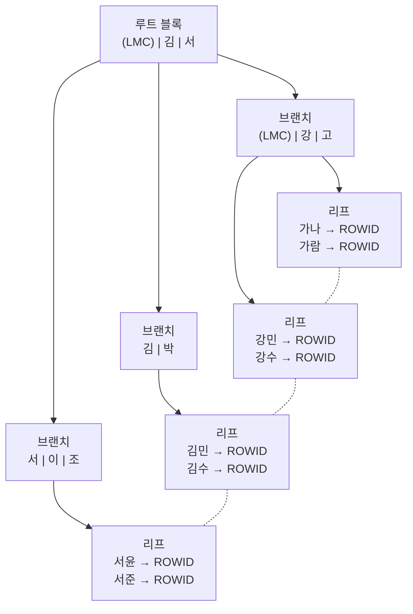

# 인덱스 구조와 탐색

인덱스는 <strong>정렬된 키 값과 테이블 레코드 위치(ROWID)</strong>를 함께 저장한 별도 구조다. 테이블 전체를 읽지 않고 원하는 범위만 골라 읽게 해 주는 것이 인덱스의 본질이며, 인덱스 튜닝의 핵심은 <strong>인덱스 스캔 효율화</strong>와 <strong>테이블 랜덤 액세스 최소화</strong> 두 가지다.

## 인덱스가 필요한 이유

테이블은 데이터가 입력 순서대로(또는 빈 공간에) 흩어져 저장된다. 조건에 맞는 행을 찾으려면 전체를 읽어야 하지만, 인덱스는 키 순으로 정렬되어 있어 **시작점을 찾고 끝점에서 멈출 수** 있다.

::: compare
- **Table Full Scan** 테이블 전체를 Multiblock I/O로 읽는다. 결과 건수와 무관하게 비용이 일정하며, 많은 데이터를 읽을 때 유리하다.
- **Index Range Scan** 인덱스에서 필요한 범위만 Single Block I/O로 읽는다. 소량 데이터를 찾을 때 유리하다.
:::

> 시험 포인트: 인덱스는 "큰 테이블에서 소량 데이터를 검색"할 때 쓰는 도구다. 대량 데이터를 읽을 때는 Full Scan이 더 빠를 수 있다. 자세한 기준은 [테이블 액세스 최소화](/theory/table-access-by-rowid)의 손익분기점에서 다룬다.

## B*Tree 인덱스 구조

Oracle, SQL Server 등 대부분 DBMS가 기본으로 쓰는 인덱스는 **B*Tree(Balanced Tree)** 구조다. 루트에서 어떤 리프까지 가든 높이(Height)가 같은 균형 트리다.



::: cards 3
- **루트 블록** 트리의 최상위 블록. 브랜치 블록을 가리키는 키와 주소를 가진다.
- **브랜치 블록** 하위 블록(브랜치 또는 리프)을 가리키는 키와 주소를 가진다. 각 레코드는 하위 블록이 담고 있는 **첫 번째 키 값**을 가진다.
- **리프 블록** 실제 인덱스 키 값과 **ROWID**를 키 순으로 저장한다. 이웃 리프와 <strong>양방향 연결 리스트(Double Linked List)</strong>로 이어져 있다.
:::

- 루트와 브랜치 블록의 첫 레코드는 키 값을 갖지 않는 <strong>LMC(Leftmost Child)</strong>다. LMC는 자식 노드 중 가장 왼쪽 끝 블록을 가리키며, 첫 번째 키 값보다 작거나 같은 값을 담는다.
- 리프 블록의 인덱스 레코드는 테이블 레코드와 **1:1** 로 대응한다. 브랜치 레코드는 하위 블록과 1:1 대응이다.
- 인덱스 키 값이 같으면 **ROWID 순**으로 정렬된다.

::: info B*Tree에서 'B'는 Balanced
"이진(Binary)"이 아니다. 하나의 블록이 수백 개의 자식을 가질 수 있어 높이가 낮다. 대개 수천만 건 테이블도 높이 3~4 수준이다. 삭제가 많아도 루트에서 리프까지의 높이는 항상 같으므로 Unbalanced Index는 생기지 않는다. 다만 리프 블록에 빈 공간이 남는 **인덱스 Fragmentation**은 생길 수 있다.
:::

## ROWID 구성

ROWID는 테이블 레코드를 찾아가기 위한 **논리적 주소**다. 인덱스 리프 블록에 키와 함께 저장된다.

::: flow
- **데이터 오브젝트 번호** 세그먼트 식별
- **데이터 파일 번호** 어느 파일인가
- **블록 번호** 파일 내 몇 번째 블록인가
- **로우 번호** 블록 내 몇 번째 행인가
:::

- `ROWID = 데이터 블록 주소(DBA) + 로우 번호`로 요약할 수 있다.
- ROWID는 "물리적 주소"가 아니라 **논리적 주소**다. ROWID로 테이블을 찾아갈 때도 해당 블록이 버퍼 캐시에 있는지 해시 탐색을 거쳐야 하며, 없으면 디스크에서 읽어 와야 한다. 그래서 인덱스 ROWID에 의한 테이블 액세스는 생각보다 비싸다.

```sql
SELECT ROWID, EMPNO, ENAME FROM EMP WHERE EMPNO = 7788;
-- ROWID 예: AAAR3sAAEAAAACXAAH
--            객체번호(6) 파일번호(3) 블록번호(6) 로우번호(3)
```

> 시험 포인트: ROWID는 포인터처럼 메모리 주소를 직접 가리키는 것이 아니다. 버퍼 캐시 탐색 과정(래치, 해시 체인 탐색)을 거치므로 "ROWID로 액세스하면 비용이 거의 없다"는 보기는 틀리다.

## 인덱스 탐색 과정

인덱스 탐색은 **수직적 탐색 → 수평적 탐색** 두 단계로 이루어진다.

::: steps
1. **수직적 탐색** 루트에서 리프 블록까지 내려가며 **스캔 시작점**을 찾는다.
2. **수평적 탐색** 리프 블록을 연결 리스트를 따라 옆으로 읽으며 조건을 만족하는 데이터를 찾고, 조건을 벗어나는 첫 값에서 멈춘다.
3. **테이블 액세스** 필요한 컬럼이 인덱스에 없으면 ROWID로 테이블 블록을 읽는다.
:::

### 수직적 탐색

수직적 탐색은 "조건을 만족하는 **첫 번째 레코드**"를 찾는 과정이다. 브랜치 블록에서는 찾는 값보다 **크거나 같은 첫 키를 만나면 그 바로 앞 레코드**가 가리키는 하위 블록으로 내려간다.

::: example '김민'을 찾는 수직적 탐색
루트 블록 `(LMC) | 김 | 서`에서 '김민'은 '김'보다 크거나 같고 '서'보다 작다. 따라서 **'김' 레코드**가 가리키는 브랜치로 내려간다.

단, 찾는 값과 **같은 키**를 만났을 때는 주의한다. 중복 값이 앞 블록에도 있을 수 있으므로 "같은 값을 만나면 그 **바로 앞** 레코드의 하위로" 내려가 시작점을 찾는다. 예를 들어 `ENAME = '서'`를 찾는다면 '서'가 아니라 그 앞 '김' 레코드가 가리키는 블록부터 탐색한다.
:::

### 수평적 탐색

리프 블록에 도달하면 **양방향 링크**를 따라 오른쪽(또는 역순이면 왼쪽)으로 이동하며 키 값을 읽는다. 수평적 탐색의 목적은 두 가지다.

- 조건절을 만족하는 데이터를 **모두** 찾는다.
- 찾은 레코드의 **ROWID**를 얻는다. 인덱스에 없는 컬럼이 필요하면 이 ROWID로 테이블을 액세스한다.

```sql
CREATE INDEX EMP_X1 ON EMP (DEPTNO, SAL);

SELECT * FROM EMP WHERE DEPTNO = 20 AND SAL >= 2000;
```

```text
-----------------------------------------------------------
| Id | Operation                           | Name   |
-----------------------------------------------------------
|  0 | SELECT STATEMENT                    |        |
|  1 |  TABLE ACCESS BY INDEX ROWID BATCHED| EMP    |
|* 2 |   INDEX RANGE SCAN                  | EMP_X1 |
-----------------------------------------------------------
Predicate Information
   2 - access("DEPTNO"=20 AND "SAL">=2000)
```

`(DEPTNO=20, SAL=2000)` 지점까지 수직적 탐색으로 내려간 뒤, DEPTNO가 20이 아닌 값을 만나는 순간 수평적 탐색을 멈춘다.

> 시험 포인트: 인덱스는 **정렬**되어 있기 때문에 "시작점과 끝점"을 정할 수 있다. 인덱스 컬럼을 가공하면 이 시작점을 찾을 수 없어 Range Scan이 불가능해진다. 상세 조건은 [인덱스 스캔 방식](/theory/index-scan)을 참고한다.

## 인덱스의 특징

| 특징 | 설명 |
|---|---|
| 정렬 상태 유지 | 키 순으로 항상 정렬되어 있어 ORDER BY, MIN/MAX 처리 시 **소트 연산을 생략**할 수 있다 |
| NULL 처리 | Oracle 단일 컬럼 인덱스는 **NULL을 저장하지 않는다**. 결합 인덱스는 모든 컬럼이 NULL인 레코드만 저장하지 않는다. SQL Server는 NULL도 저장한다 |
| NULL 정렬 위치 | Oracle은 NULL을 **맨 뒤**, SQL Server는 **맨 앞**에 저장한다 |
| DML 부하 | INSERT, DELETE, 인덱스 컬럼 UPDATE 시 인덱스도 함께 갱신되므로 인덱스가 많을수록 DML이 느려진다 |
| 인덱스 UPDATE | 인덱스는 정렬 구조라 UPDATE가 "삭제 후 삽입" 방식으로 처리된다 |
| 저장 공간 | 테이블과 별도의 세그먼트로 공간을 차지한다 |

::: warning IS NULL 조건과 인덱스
Oracle에서 단일 컬럼 인덱스 `EMP_X(COMM)`은 COMM이 NULL인 행을 담고 있지 않다. 따라서 `WHERE COMM IS NULL`은 이 인덱스로 처리할 수 없다. NOT NULL 컬럼을 뒤에 붙인 결합 인덱스 `(COMM, EMPNO)`나 상수를 붙인 `(COMM, 0)` 형태로 만들면 IS NULL 조건도 인덱스로 찾을 수 있다.
:::

## 비트맵 인덱스

비트맵(Bitmap) 인덱스는 키 값마다 **각 행의 해당 여부를 0/1 비트**로 저장하는 인덱스다.

| ROWID 범위 | 성별='M' | 성별='F' |
|---|---|---|
| 행1~행6 | 1 0 1 1 0 0 | 0 1 0 0 1 1 |

::: cards 2
- **장점** Distinct Value 개수가 **적은** 컬럼에서 저장 공간이 매우 작다. 여러 비트맵을 **AND/OR 비트 연산**으로 빠르게 결합할 수 있어 정형화되지 않은 다양한 조건 조합(Ad-hoc 질의)에 강하다. NULL도 저장한다.
- **단점** 하나의 비트맵 엔트리가 많은 행을 커버해 DML 시 **Lock 범위가 넓다**. 동시 DML이 많은 OLTP 환경에는 부적합하고, 주로 DW·OLAP 환경에서 쓴다.
:::

> 시험 포인트: 비트맵 인덱스는 "카디널리티가 낮은 컬럼 + 읽기 위주 DW 환경"에 적합하다. OLTP에서 동시 DML이 많은 테이블에 쓰면 Lock 경합이 심해진다.

## IOT와 클러스터형 인덱스

일반 테이블은 **힙(Heap) 구조**로 데이터를 아무 빈 공간에나 저장한다. 반면 테이블 자체를 인덱스 구조로 만들어 **데이터를 PK 순으로 정렬해 저장**하는 방식이 있다.

::: compare
- **Oracle IOT (Index-Organized Table)** PK 인덱스의 리프 블록에 테이블 데이터 전체를 저장한다. 별도 테이블 블록이 없으므로 ROWID 랜덤 액세스가 생기지 않는다. `ORGANIZATION INDEX`로 생성한다.
- **SQL Server 클러스터형 인덱스 (Clustered Index)** 테이블당 하나만 만들 수 있으며, 리프 레벨이 곧 데이터 페이지다. 데이터가 클러스터형 인덱스 키 순으로 정렬 저장된다.
:::

```sql
-- Oracle IOT
CREATE TABLE ORDER_ITEM (
  ORD_NO   NUMBER,
  ITEM_NO  NUMBER,
  QTY      NUMBER,
  CONSTRAINT ORDER_ITEM_PK PRIMARY KEY (ORD_NO, ITEM_NO)
) ORGANIZATION INDEX;
```

```sql
-- SQL Server 클러스터형 인덱스
CREATE CLUSTERED INDEX IX_ORDER_ITEM ON ORDER_ITEM (ORD_NO, ITEM_NO);
```

- 클러스터형 인덱스가 있는 SQL Server 테이블의 **비클러스터형 인덱스**는 리프에 RID 대신 **클러스터형 인덱스 키**를 저장한다. Oracle IOT의 보조 인덱스도 PK 값과 추정 위치(Logical ROWID)를 저장한다.
- 범위 검색이 많은 테이블(예: 주문번호별 주문상세 조회)에서 같은 키의 데이터가 한 블록에 모여 있어 I/O가 크게 줄어든다.
- 반면 데이터 입력 시 정렬 위치를 찾아 넣어야 하므로 **INSERT 부하가 크고**, 인덱스 분할(Split)이 발생할 수 있다.

상세한 활용은 [테이블 액세스 최소화](/theory/table-access-by-rowid)에서 다룬다. 블록 단위 I/O와 버퍼 캐시 개념은 [I/O 메커니즘](/theory/io-mechanism)을 참고한다.

## 핵심 요약

- B*Tree 인덱스는 루트·브랜치·리프로 구성된 균형 트리이며, 리프 블록은 키+ROWID를 정렬 저장하고 양방향 연결 리스트로 이어진다.
- 루트·브랜치의 첫 레코드는 키 값이 없는 LMC다.
- ROWID는 데이터 오브젝트 번호·파일 번호·블록 번호·로우 번호로 구성된 논리적 주소이며, 테이블 액세스 시 버퍼 캐시 탐색 비용이 든다.
- 인덱스 탐색은 시작점을 찾는 수직적 탐색과 리프를 따라 읽는 수평적 탐색으로 이루어진다.
- Oracle은 모든 인덱스 컬럼이 NULL인 레코드를 인덱스에 저장하지 않고, NULL을 맨 뒤에 둔다. SQL Server는 NULL을 저장하며 맨 앞에 둔다.
- 비트맵 인덱스는 카디널리티가 낮고 DML이 적은 DW 환경에 적합하며, 동시 DML 시 Lock 경합이 크다.
- IOT·클러스터형 인덱스는 데이터를 키 순으로 정렬 저장해 범위 검색 시 랜덤 액세스를 줄이지만 INSERT 부하가 크다.
