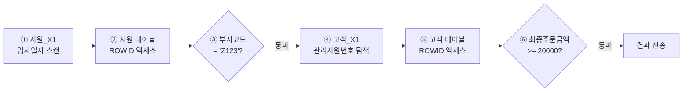

# NL 조인

NL 조인(Nested Loop Join)은 **바깥 테이블(Outer, 드라이빙 테이블)의 레코드 한 건마다 안쪽 테이블(Inner)을 탐색**하는 조인이다. 프로그래밍의 중첩 반복문과 구조가 같고, 안쪽 테이블은 조인 컬럼 인덱스로 찾아가는 것이 전제다. 소량 데이터를 빠르게 처리하는 OLTP 환경의 기본 조인 방식이다.

## 기본 메커니즘

NL 조인은 아래 PL/SQL 이중 루프와 같은 방식으로 동작한다.

```sql
BEGIN
  FOR outer IN (SELECT DEPTNO, DNAME FROM DEPT WHERE LOC = 'SEOUL') LOOP      -- Outer
    FOR inner IN (SELECT ENAME FROM EMP WHERE DEPTNO = outer.DEPTNO) LOOP    -- Inner
      DBMS_OUTPUT.PUT_LINE(outer.DNAME || ' : ' || inner.ENAME);
    END LOOP;
  END LOOP;
END;
```

같은 결과를 SQL과 힌트로 쓰면 다음과 같다.

```sql
SELECT /*+ ORDERED USE_NL(E) */
       D.DNAME, E.ENAME
FROM   DEPT D, EMP E
WHERE  D.LOC    = 'SEOUL'
AND    E.DEPTNO = D.DEPTNO;
```

::: cards 2
- **Outer(드라이빙) 테이블** 먼저 읽는 테이블. 조건에 맞는 건수만큼 Inner 탐색이 반복된다.
- **Inner(드리븐) 테이블** Outer 한 건마다 반복 탐색되는 테이블. 조인 컬럼에 인덱스가 반드시 있어야 효율적이다.
:::

::: warning Inner 쪽 인덱스가 핵심
Inner 테이블 조인 컬럼에 인덱스가 없으면 Outer 건수만큼 Inner 테이블을 Full Scan 하게 된다. Outer가 1만 건이면 Inner를 1만 번 Full Scan 하는 셈이므로, 옵티마이저는 이런 상황에서 NL 조인을 거의 선택하지 않는다.
:::

## 드라이빙 테이블과 조인 순서

NL 조인의 성능은 **어느 테이블을 먼저 읽느냐**에 크게 좌우된다. Inner 탐색 횟수 = Outer에서 조건을 통과한 건수이기 때문이다.

| 구분 | 드라이빙 DEPT(10건 통과) | 드라이빙 EMP(1만 건 통과) |
|---|---|---|
| Inner 인덱스 탐색 횟수 | 10회 | 1만 회 |
| 랜덤 액세스 부담 | 작음 | 큼 |

- 일반적으로 **필터 조건으로 걸러진 결과 건수가 적은 쪽**을 드라이빙 테이블로 둔다.
- 테이블 크기가 아니라 **조건 적용 후 건수**가 기준이다. 큰 테이블이라도 조건이 선택적이면 드라이빙이 될 수 있다.

> 시험 포인트: NL 조인에서 Inner 테이블 인덱스 탐색 횟수는 Outer 테이블에서 조건을 통과한 레코드 수와 같다. "드라이빙 집합의 크기를 줄이는 것"이 첫 번째 튜닝 포인트다.

## NL 조인 수행 과정

SQLP에서 자주 나오는 형태로 수행 순서를 따라가 보자.

```sql
SELECT /*+ ORDERED USE_NL(C) */
       E.사원명, C.고객명, C.전화번호
FROM   사원 E, 고객 C
WHERE  E.입사일자    >= '19960101'
AND    E.부서코드     = 'Z123'
AND    C.관리사원번호 = E.사원번호
AND    C.최종주문금액 >= 20000;
```

인덱스 구성은 다음과 같다.

| 인덱스 | 컬럼 |
|---|---|
| 사원_PK | 사원번호 |
| 사원_X1 | 입사일자 |
| 고객_PK | 고객번호 |
| 고객_X1 | 관리사원번호 |
| 고객_X2 | 최종주문금액 |

::: steps
1. **사원_X1 인덱스 범위 스캔** 입사일자 >= '19960101' 조건으로 인덱스를 스캔한다.
2. **사원 테이블 액세스** 인덱스에서 얻은 ROWID로 사원 테이블을 랜덤 액세스한다.
3. **사원 필터링** 테이블에서 부서코드 = 'Z123' 조건을 확인해 걸러낸다.
4. **고객_X1 인덱스 범위 스캔** 통과한 사원번호로 관리사원번호 인덱스를 탐색한다.
5. **고객 테이블 액세스** 고객_X1에서 얻은 ROWID로 고객 테이블을 랜덤 액세스한다.
6. **고객 필터링** 최종주문금액 >= 20000 조건을 확인하고 통과한 행을 결과로 보낸다.
:::



각 단계의 수행 건수가 곧 튜닝 포인트다.

::: info 단계별 튜닝 포인트
- **①→②** 입사일자 조건을 만족하는 건수만큼 테이블 랜덤 액세스가 발생한다. ③에서 대부분 버려진다면 **부서코드를 인덱스에 추가**(예: 부서코드 + 입사일자)해 테이블 액세스 전에 거른다.
- **④** 고객_X1 탐색 횟수 = ③을 통과한 사원 수. 조인 순서를 바꾸는 것이 유리한지 검토한다.
- **⑤→⑥** 고객 테이블 액세스 후 최종주문금액 조건으로 대부분 버려진다면 고객_X1에 최종주문금액을 추가한다.
:::

## NL 조인 실행계획 읽기

```
------------------------------------------------------------
| Id | Operation                      | Name               |
------------------------------------------------------------
|  0 | SELECT STATEMENT               |                    |
|  1 |  NESTED LOOPS                  |                    |
|  2 |   TABLE ACCESS BY INDEX ROWID  | DEPT               |
|  3 |    INDEX RANGE SCAN            | DEPT_LOC_IDX       |
|  4 |   TABLE ACCESS BY INDEX ROWID  | EMP                |
|  5 |    INDEX RANGE SCAN            | EMP_DEPTNO_IDX     |
------------------------------------------------------------
```

- NESTED LOOPS 바로 아래 **위쪽 자식(Id 2)이 Outer**, **아래쪽 자식(Id 4)이 Inner**다.
- 읽는 순서: 3 → 2 → 5 → 4 → 1. Outer에서 한 건을 얻을 때마다 5 → 4가 반복된다.
- 실행계획 자체는 [실행계획](/theory/execution-plan)에서, 반복 횟수(Starts)와 블록 수는 [SQL 트레이스](/theory/sql-trace)의 Row Source 통계로 확인한다.

## NL 조인 힌트

| 힌트 | 의미 |
|---|---|
| `ORDERED` | FROM 절에 나열한 순서대로 조인 |
| `LEADING(T1 T2 ...)` | 괄호 안 순서대로 조인. ORDERED보다 우선하며 FROM 순서와 무관 |
| `USE_NL(T)` | T를 Inner로 하여 NL 조인 |
| `INDEX(T 인덱스명)` | Inner 테이블 탐색 인덱스 지정 |

```sql
-- DEPT → EMP → SALGRADE 순서, 모두 NL 조인
SELECT /*+ LEADING(D E S) USE_NL(E) USE_NL(S) */
       D.DNAME, E.ENAME, S.GRADE
FROM   EMP E, DEPT D, SALGRADE S
WHERE  D.LOC    = 'SEOUL'
AND    E.DEPTNO = D.DEPTNO
AND    E.SAL BETWEEN S.LOSAL AND S.HISAL;
```

::: warning USE_NL의 대상
`USE_NL(E)`는 "E를 NL 조인하라"가 아니라 <strong>"E를 Inner 테이블로 하여 NL 조인하라"</strong>는 의미다. 조인 순서는 ORDERED나 LEADING으로 따로 지정해야 의도대로 동작한다. 순서를 지정하지 않으면 옵티마이저가 E를 Outer로 둘 수 있다.
:::

힌트 전반은 [힌트](/theory/hints)에서 정리한다.

## NL 조인의 특징

::: cards 3
- **랜덤 액세스 위주** 레코드 하나를 읽으려고 블록을 통째로 읽는 랜덤 액세스 방식이다. 버퍼 캐시 히트율이 낮으면 디스크 I/O가 급증해 대량 처리에 불리하다.
- **한 레코드씩 순차 진행** Outer 한 건을 Inner와 조인하고 다음 건으로 넘어간다. 대량이라도 부분범위 처리가 가능하면 첫 결과가 매우 빠르다.
- **인덱스 구성이 결정적** 다른 조인보다 인덱스 설계에 따라 성능 차이가 크다. 조인 컬럼과 필터 컬럼의 인덱스 구성이 성패를 가른다.
:::

- **소량 데이터·OLTP 온라인 트랜잭션**에 유리하다. 대량 데이터 조인은 [해시 조인](/theory/hash-join)이나 [소트 머지 조인](/theory/sort-merge-join)을 고려한다.
- 조인 조건의 연산자 종류와 관계없이(등치, 비등치, LIKE 등) 사용할 수 있다. 어떤 조인 조건이든 Inner 탐색만 가능하면 된다.

> 시험 포인트: "NL 조인은 랜덤 액세스 위주, 한 레코드씩 순차 진행, 인덱스 구성 전략이 중요" 세 가지 특징이 보기로 그대로 나온다. 대량 데이터에서 유리하다는 보기는 틀린 보기다.

## 부분범위 처리

NL 조인은 Outer를 한 건씩 읽으며 결과를 바로 만들기 때문에, **필요한 만큼(Array Size)만 결과를 만들어 먼저 전송**하는 부분범위 처리에 잘 어울린다.

```sql
-- 게시판 첫 페이지: 최근 글 10건과 작성자 이름
SELECT *
FROM  (SELECT /*+ LEADING(B) USE_NL(U) INDEX_DESC(B 게시글_등록일시_IDX) */
              B.글번호, B.제목, U.이름
       FROM   게시글 B, 회원 U
       WHERE  U.회원번호 = B.작성자번호
       ORDER BY B.등록일시 DESC)
WHERE  ROWNUM <= 10;
```

- Outer 인덱스가 정렬 순서와 일치하면 ORDER BY에 의한 소트가 생략되고(SORT ORDER BY 미발생), 10건을 찾자마자 멈춘다(COUNT STOPKEY).
- 해시·소트 머지 조인은 한쪽 집합을 모두 읽어야 조인을 시작할 수 있어 이런 이점이 약하다.

::: example 부분범위 처리의 조건
정렬 순서와 같은 인덱스로 Outer를 읽고, Inner는 NL 조인으로 처리하며, 중간에 소트나 해시 같은 전체범위 처리 오퍼레이션이 끼어 있지 않아야 한다. 자세한 내용은 [Top-N 쿼리](/theory/top-n)와 [소트 튜닝](/theory/sort-tuning) 참고.
:::

## 테이블 프리페치와 배치 I/O

Oracle은 NL 조인의 랜덤 I/O 부담을 줄이기 위해 버전별로 실행계획 모양을 바꿔 왔다. 시험에서는 **같은 NL 조인이 세 가지 모양으로 나타날 수 있다**는 점이 중요하다.

```
-- (1) 전통적 방식
NESTED LOOPS
  TABLE ACCESS BY INDEX ROWID  DEPT
    INDEX RANGE SCAN           DEPT_LOC_IDX
  TABLE ACCESS BY INDEX ROWID  EMP
    INDEX RANGE SCAN           EMP_DEPTNO_IDX

-- (2) 테이블 프리페치 (9i~): Inner 테이블 액세스가 NESTED LOOPS 위로 올라감
TABLE ACCESS BY INDEX ROWID    EMP
  NESTED LOOPS
    TABLE ACCESS BY INDEX ROWID DEPT
      INDEX RANGE SCAN         DEPT_LOC_IDX
    INDEX RANGE SCAN           EMP_DEPTNO_IDX

-- (3) 배치 I/O (11g~): NESTED LOOPS가 두 번 나타남
NESTED LOOPS
  NESTED LOOPS
    TABLE ACCESS BY INDEX ROWID DEPT
      INDEX RANGE SCAN         DEPT_LOC_IDX
    INDEX RANGE SCAN           EMP_DEPTNO_IDX
  TABLE ACCESS BY INDEX ROWID  EMP
```

::: compare
- **테이블 프리페치(Prefetch)** 디스크 I/O가 필요할 때 곧 읽을 블록까지 미리 한꺼번에 읽어 버퍼 캐시에 적재한다. `NLJ_PREFETCH` / `NO_NLJ_PREFETCH` 힌트로 제어한다.
- **배치 I/O(Batch I/O)** Inner 인덱스로 찾은 ROWID 중 버퍼 캐시에 없는 블록을 모았다가 한 번에 처리한다. `NLJ_BATCHING` / `NO_NLJ_BATCHING` 힌트로 제어한다.
:::

::: warning 정렬 순서가 달라질 수 있다
프리페치나 배치 I/O가 동작하면 Inner 쪽 결과가 기존처럼 **인덱스 순서대로 나온다는 보장이 없다**. ORDER BY 없이 인덱스 순서에 의존하던 쿼리는 결과 순서가 바뀔 수 있으므로, 정렬이 필요하면 반드시 ORDER BY를 명시한다.
:::

랜덤 I/O 자체의 원리는 [I/O 메커니즘](/theory/io-mechanism)과 [테이블 액세스 최소화](/theory/table-access-by-rowid)에서 다룬다.

## NL 조인 튜닝 실습 포인트

실행 통계(Rows, 블록 수)를 보고 어디가 문제인지 판단하는 유형이 자주 나온다.

```
Rows    Row Source Operation
------  ---------------------------------------------------
     5  NESTED LOOPS
     3   TABLE ACCESS BY INDEX ROWID 사원
  2780    INDEX RANGE SCAN 사원_X1
     5   TABLE ACCESS BY INDEX ROWID 고객
     8    INDEX RANGE SCAN 고객_X1
```

| 관찰 | 해석 | 개선 |
|---|---|---|
| 사원_X1 2780건 → 사원 3건 | 테이블 액세스 후 필터에서 대부분 버려짐 | 필터 컬럼(부서코드)을 사원_X1에 추가 |
| 고객_X1 8건 → 고객 5건 | Inner 쪽 필터 비효율 작음 | 개선 효과 작음 |
| 결과 5건 | Inner 탐색이 3회뿐 | 조인 순서는 적절 |

::: tip 튜닝 순서
1) Outer 인덱스 스캔 범위와 테이블 액세스 후 필터링 비율을 확인하고, 2) Inner 탐색 횟수(= Outer 통과 건수)를 확인한 뒤, 3) Inner 인덱스 구성과 필터링 비율을 본다. 마지막으로 조인 순서 변경, 조인 방식 변경(해시 조인)을 검토한다. 인덱스 구성 원칙은 [인덱스 설계](/theory/index-design) 참고.
:::

## 핵심 요약

- NL 조인은 Outer 한 건마다 Inner를 인덱스로 탐색하는 중첩 루프 구조다.
- Inner 탐색 횟수는 Outer에서 조건을 통과한 건수와 같으므로, 필터 후 건수가 적은 쪽을 드라이빙으로 둔다.
- 특징: 랜덤 액세스 위주, 한 레코드씩 순차 진행, 인덱스 구성 전략이 성능을 좌우한다.
- 소량·OLTP와 부분범위 처리에 유리하고, 대량 조인에는 불리하다.
- 등치·비등치 등 조인 조건 종류와 관계없이 사용할 수 있다.
- `ORDERED`는 FROM 순서, `LEADING`은 지정 순서로 조인하며, `USE_NL(T)`는 T를 Inner로 NL 조인하라는 뜻이다.
- 실행계획에서 NESTED LOOPS 아래 위쪽이 Outer, 아래쪽이 Inner다.
- 프리페치(Inner 테이블 액세스가 위로)와 배치 I/O(NESTED LOOPS 두 번)는 NL 조인의 변형이며, 결과 정렬 순서가 보장되지 않는다.
