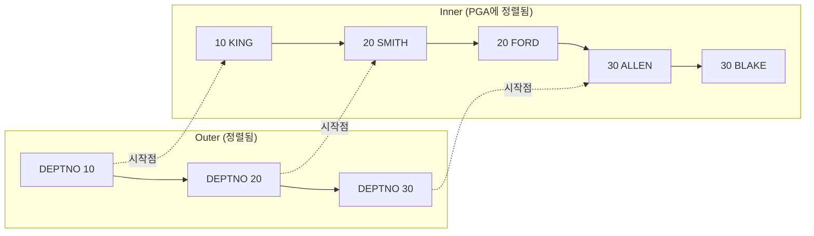

# 소트 머지 조인

소트 머지 조인(Sort Merge Join)은 <strong>두 집합을 조인 컬럼 기준으로 정렬한 뒤, 정렬된 순서를 따라 병합(Merge)</strong>하는 조인이다. 조인 컬럼에 인덱스가 없어 NL 조인이 비효율적일 때, 특히 해시 조인을 쓸 수 없는 비등치 조인에서 대량 데이터를 처리하는 데 쓴다.

## 기본 메커니즘

소트 머지 조인은 두 단계로 진행된다.

::: flow
- **소트 단계** 양쪽 집합을 조인 컬럼 기준으로 정렬해 PGA(부족하면 Temp)에 저장
- **머지 단계** 정렬된 두 집합을 위에서부터 차례로 비교하며 조인
:::

```sql
SELECT /*+ ORDERED USE_MERGE(E) */
       D.DEPTNO, D.DNAME, E.ENAME
FROM   DEPT D, EMP E
WHERE  E.DEPTNO = D.DEPTNO;
```

```
------------------------------------------------
| Id | Operation             | Name            |
------------------------------------------------
|  0 | SELECT STATEMENT      |                 |
|  1 |  MERGE JOIN           |                 |
|  2 |   SORT JOIN           |                 |
|  3 |    TABLE ACCESS FULL  | DEPT            |
|  4 |   SORT JOIN           |                 |
|  5 |    TABLE ACCESS FULL  | EMP             |
------------------------------------------------
```

- MERGE JOIN 아래 **위쪽 자식(DEPT)이 Outer(First)**, <strong>아래쪽 자식(EMP)이 Inner(Second)</strong>다.
- 각 집합을 읽은 뒤 SORT JOIN 오퍼레이션으로 정렬하고, MERGE JOIN에서 병합한다.

## 머지 단계는 NL 조인과 닮았다

머지 단계의 동작은 사실 NL 조인과 비슷하다. Outer를 한 건씩 읽으며 Inner를 탐색하는데, 차이는 **Inner를 인덱스가 아니라 PGA에 정렬해 둔 집합에서 찾는다**는 점이다.



::: steps
1. **Outer에서 한 건 읽기** 정렬된 Outer에서 DEPTNO 10을 읽는다.
2. **Inner 시작점 찾기** 정렬된 Inner에서 10이 시작하는 위치를 찾는다. 정렬되어 있으므로 이전에 멈춘 지점부터 이어서 찾으면 된다.
3. **조건을 벗어나면 멈춤** 10과 같은 값을 모두 조인하고, 다른 값을 만나면 그 자리에서 스캔을 멈춘다.
4. **반복** Outer의 다음 값(20)으로 넘어가 Inner의 직전 멈춘 위치부터 다시 진행한다.
:::

정렬되어 있기 때문에 **Inner 전체를 매번 처음부터 스캔할 필요가 없다**는 것이 핵심이다.

::: compare
- **NL 조인** Inner를 인덱스로 탐색한다. 탐색마다 버퍼 캐시 래치·블록 경합이 발생하고, 테이블 랜덤 액세스가 따른다.
- **소트 머지 조인** Inner를 PGA의 정렬 집합에서 탐색한다. PGA는 프로세스 전용 메모리라 래치 획득 과정이 없어 훨씬 빠르다.
:::

PGA와 SGA의 차이는 [데이터베이스 아키텍처](/theory/db-architecture)에서 다룬다.

## PGA 소트와 인덱스에 의한 소트 생략

정렬은 Sort Area(PGA)에서 수행하며, 공간이 부족하면 **Temp 테이블스페이스**를 사용한다. Temp를 쓰면 디스크 I/O가 늘어 성능이 크게 떨어지므로, 정렬 대상 집합의 크기가 성능을 좌우한다.

Outer 쪽 조인 컬럼에 인덱스가 있으면 **인덱스를 순서대로 읽어 Outer의 소트를 생략**할 수 있다.

```
------------------------------------------------------
| Id | Operation                     | Name          |
------------------------------------------------------
|  0 | SELECT STATEMENT              |               |
|  1 |  MERGE JOIN                   |               |
|  2 |   TABLE ACCESS BY INDEX ROWID | DEPT          |
|  3 |    INDEX FULL SCAN            | PK_DEPT       |
|  4 |   SORT JOIN                   |               |
|  5 |    TABLE ACCESS FULL          | EMP           |
------------------------------------------------------
```

::: warning Inner 쪽은 정렬된다
Oracle 소트 머지 조인에서 **Inner 쪽은 인덱스가 있어도 SORT JOIN이 나타난다.** Inner 집합은 머지 단계에서 반복 탐색해야 하므로 PGA에 정렬해 두기 때문이다. 소트 생략은 Outer 쪽에서만 기대할 수 있다.
:::

> 시험 포인트: "소트 머지 조인은 항상 양쪽을 정렬한다"는 틀린 보기다. Outer는 조인 컬럼 인덱스를 이용해 정렬을 생략할 수 있다.

정렬 부하의 원리와 튜닝은 [소트 튜닝](/theory/sort-tuning)에서 다룬다.

## 소트 머지 조인의 특징

::: cards 2
- **양쪽 집합을 각각 읽고 시작** 조인 전에 양쪽 집합을 조건에 맞게 읽어 정렬한다. 이때 조인 컬럼 조건이 아니라 **각자의 필터 조건**으로 독립적으로 읽는다.
- **인덱스 의존도 낮음** 조인 컬럼에 인덱스가 없어도 된다. 각 집합은 Full Scan으로 읽어도 되므로 대량 데이터에서 랜덤 액세스 부담이 작다.
- **스캔 위주 액세스** Inner를 PGA에서 탐색하므로 랜덤 액세스가 거의 없다. 다만 양쪽 집합을 읽을 때 인덱스를 쓰면 그 과정의 랜덤 액세스는 남는다.
- **전체범위 처리 성격** 정렬이 끝나야 머지를 시작할 수 있으므로 첫 결과가 늦다. Outer 소트를 인덱스로 생략하면 일부 부분범위 처리도 가능하다.
:::

::: info NL 조인과의 비교
NL 조인은 Outer에서 읽은 값을 **조인 조건으로 Inner에 넘겨** 탐색 범위를 줄인다. 소트 머지 조인은 각 집합을 따로 읽기 때문에, Inner를 읽을 때 조인 컬럼 값으로 범위를 좁힐 수 없다. 그래서 Inner 쪽에 **자체 필터 조건**이 있으면 정렬 대상이 줄어 유리하다.
:::

## 언제 유리한가

| 상황 | 이유 |
|---|---|
| 조인 컬럼에 인덱스가 없음 | NL 조인이면 Inner Full Scan을 반복해야 하므로 비현실적 |
| 대량 데이터 조인 | 랜덤 액세스 대신 스캔·정렬로 처리 |
| **비등치 조인**(`<`, `>`, `BETWEEN`) | 해시 조인은 등치 조인만 가능하므로 대안이 된다 |
| 양쪽 집합이 이미 정렬되어 있음 | 인덱스나 앞 단계 결과로 소트 부담이 작음 |

해시 조인이 등장한 뒤로 일반적인 대량 등치 조인은 [해시 조인](/theory/hash-join)이 더 빠른 경우가 많다. 따라서 소트 머지 조인은 주로 **비등치 조인이면서 대량 데이터**인 경우나, 이미 정렬된 입력을 활용할 수 있는 경우에 선택된다.

```sql
-- 급여 등급 조인: 비등치 조인이므로 해시 조인 불가
SELECT /*+ ORDERED USE_MERGE(S) */
       E.ENAME, E.SAL, S.GRADE
FROM   EMP E, SALGRADE S
WHERE  E.SAL BETWEEN S.LOSAL AND S.HISAL;
```

```
MERGE JOIN
  SORT JOIN
    TABLE ACCESS FULL  EMP
  FILTER
    SORT JOIN
      TABLE ACCESS FULL  SALGRADE
```

비등치 조인에서는 한쪽 범위 조건으로 머지를 진행하고, 나머지 범위 조건은 FILTER로 확인하는 형태가 나타난다.

::: warning 부정형 조인 조건
`<>`(같지 않음) 조인 조건으로는 소트 머지 조인을 할 수 없다. 정렬된 순서로 범위를 좁히는 것이 불가능하기 때문이며, 이 경우 NL 조인만 가능하다.
:::

> 시험 포인트: 해시 조인은 등치 조인에서만 사용할 수 있다. "조인 컬럼에 인덱스가 없고, 비등치 조건의 대량 조인"이라면 소트 머지 조인이 정답이다.

## USE_MERGE 힌트

| 힌트 | 의미 |
|---|---|
| `USE_MERGE(T)` | T와 조인할 때 소트 머지 조인 사용 |
| `ORDERED` / `LEADING(...)` | 조인 순서(Outer, Inner) 지정 |
| `NO_USE_MERGE(T)` | 소트 머지 조인을 쓰지 않도록 지정 |

```sql
-- DEPT를 Outer(First), EMP를 Inner(Second)로 소트 머지 조인
SELECT /*+ LEADING(D) USE_MERGE(E) */
       D.DNAME, E.ENAME, E.SAL
FROM   DEPT D, EMP E
WHERE  E.DEPTNO = D.DEPTNO
AND    E.SAL   >= 2000;
```

- USE_NL과 마찬가지로 USE_MERGE만으로는 순서가 고정되지 않으므로 LEADING이나 ORDERED와 함께 쓴다.
- 힌트 전반은 [힌트](/theory/hints)를 참고한다.

## 핵심 요약

- 소트 머지 조인은 양쪽 집합을 조인 컬럼 기준으로 정렬(소트 단계)한 뒤 병합(머지 단계)한다.
- 정렬은 PGA Sort Area에서 하며, 부족하면 Temp 테이블스페이스를 사용해 성능이 떨어진다.
- 머지 단계는 NL 조인과 비슷하지만 Inner를 PGA 정렬 집합에서 찾으므로 래치 경합이 없어 빠르다.
- Outer는 조인 컬럼 인덱스로 소트를 생략할 수 있지만, Inner는 SORT JOIN이 나타난다.
- 각 집합을 독립적으로 읽으므로 조인 컬럼 인덱스가 없어도 되고, 대량 데이터에서 랜덤 액세스가 적다.
- 조인 컬럼 인덱스가 없을 때, 비등치(`<`, `>`, `BETWEEN`) 대량 조인에 유리하다. `<>` 조건에는 쓸 수 없다.
- 실행계획: MERGE JOIN 아래 SORT JOIN 두 개. 힌트는 `USE_MERGE`.
