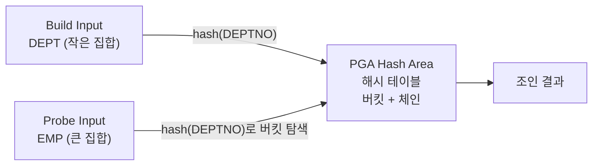
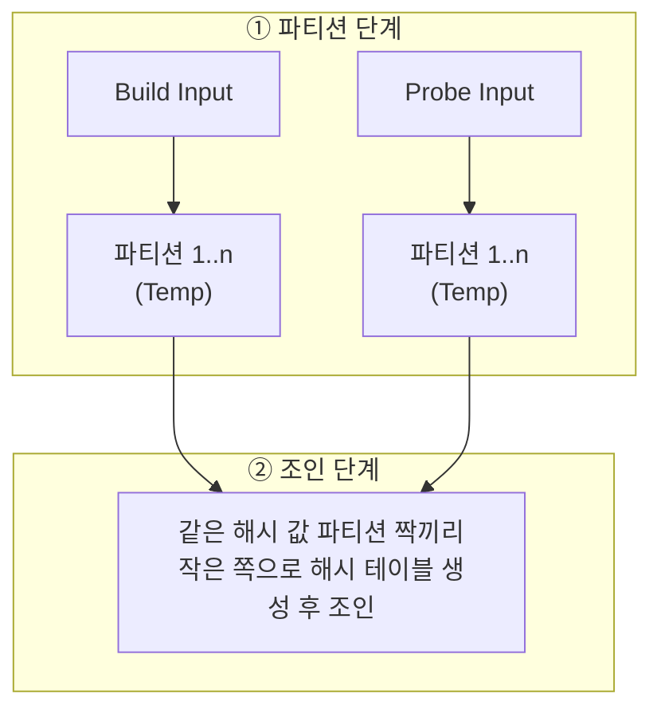

# 해시 조인

해시 조인(Hash Join)은 **작은 집합(Build Input)으로 PGA에 해시 테이블을 만들고, 큰 집합(Probe Input)을 읽으며 해시 테이블을 탐색**하는 조인이다. NL 조인의 랜덤 액세스 부담과 소트 머지 조인의 정렬 부담을 모두 피할 수 있어, 대량 데이터의 등치 조인에서 가장 많이 쓰인다.

## 기본 메커니즘

해시 조인은 Build 단계와 Probe 단계로 나뉜다.

::: steps
1. **Build 단계** 한쪽 집합(Build Input)을 읽어 조인 컬럼을 해시 함수에 넣고, 반환된 해시 값으로 해시 버킷을 찾아 해시 체인에 데이터를 연결한다. 해시 테이블은 PGA의 Hash Area에 만들며, 부족하면 Temp 테이블스페이스를 사용한다.
2. **Probe 단계** 반대쪽 집합(Probe Input)을 읽으며 조인 컬럼을 같은 해시 함수에 넣어 버킷을 찾고, 해당 체인을 스캔해 일치하는 데이터를 찾는다.
:::



```sql
SELECT /*+ LEADING(D) USE_HASH(E) */
       D.DNAME, E.ENAME, E.SAL
FROM   DEPT D, EMP E
WHERE  E.DEPTNO = D.DEPTNO;
```

```
------------------------------------------------
| Id | Operation            | Name             |
------------------------------------------------
|  0 | SELECT STATEMENT     |                  |
|  1 |  HASH JOIN           |                  |
|  2 |   TABLE ACCESS FULL  | DEPT             |
|  3 |   TABLE ACCESS FULL  | EMP              |
------------------------------------------------
```

- HASH JOIN 아래 **위쪽 자식(DEPT)이 Build Input**, **아래쪽 자식(EMP)이 Probe Input**이다.
- Probe 단계는 NL 조인처럼 Probe 집합을 한 건씩 읽으며 해시 테이블을 탐색하는 구조다.

## 해시 조인이 빠른 이유

::: cards 3
- **PGA에서 탐색** 해시 테이블이 PGA에 있으므로 래치 획득 없이 빠르게 탐색한다. 소트 머지 조인과 같은 장점이다.
- **랜덤 액세스 없음** Inner 쪽을 인덱스로 탐색하지 않으므로 NL 조인의 랜덤 액세스 부담이 없다.
- **정렬 없음** 양쪽을 정렬할 필요가 없고, 작은 쪽으로 해시 테이블만 만들면 된다. 대량 데이터를 정렬하는 소트 머지 조인보다 유리하다.
:::

::: info 해시 테이블은 재사용되지 않는다
해시 테이블은 쿼리 수행이 끝나면 바로 소멸하는 **일회성 자료구조**다. 같은 쿼리가 초당 수십·수백 번 실행되는 OLTP 환경에서는 매번 해시 테이블을 만들고 버리는 비용(CPU, 메모리)이 커진다. 반면 인덱스는 영구적으로 유지되며 여러 쿼리가 공유한다.
:::

## Build Input 선택

해시 조인 성능은 **Build Input이 Hash Area에 담길 만큼 작은가**에 달려 있다.

- 작은 쪽을 Build Input으로 두어야 해시 테이블이 메모리에 모두 들어간다.
- 크기는 테이블 전체가 아니라 **조건을 적용한 뒤 실제로 읽는 집합**의 크기가 기준이다.
- 해시 키 컬럼에 **중복 값이 적어야** 한다. 같은 값이 많으면 한 버킷의 체인이 길어져 Probe 때마다 긴 체인을 스캔한다.

::: tip 해시 조인이 효과적인 두 조건
1) 한쪽 테이블이 Hash Area에 담길 정도로 충분히 작아야 하고, 2) Build Input 해시 키 컬럼에 중복 값이 거의 없어야 한다.
:::

## In-Memory · Grace · Hybrid 해시 조인

Build Input이 Hash Area 크기를 넘으면 처리 방식이 달라진다. 시험에서는 개념 수준으로 구분할 수 있으면 된다.

::: compare
- **In-Memory 해시 조인** Build Input 전체가 Hash Area에 들어가는 경우. 디스크 I/O 없이 메모리에서 조인이 끝나 가장 빠르다.
- **Grace 해시 조인** Build Input이 메모리를 넘는 경우. 양쪽 집합을 조인 컬럼 해시 값으로 파티션을 나눠 Temp에 저장한 뒤(파티션 단계), 같은 해시 값을 가진 파티션 짝끼리 조인한다(조인 단계).
:::



| 방식 | 핵심 |
|---|---|
| In-Memory | Build Input이 메모리에 모두 적재 |
| Grace | 양쪽을 해시 파티션으로 분할해 디스크에 쓴 뒤 파티션 짝 단위로 조인. 파티션 짝마다 작은 쪽을 Build로 쓸 수 있다 |
| Hybrid | Grace 방식을 개선해 **가능한 만큼은 메모리에서 바로 조인**하고 넘치는 파티션만 디스크에 내림. 비트-벡터 필터링으로 조인 대상이 아닌 Probe 행을 미리 걸러 디스크 I/O를 줄임 |
| Recursive | 파티션 짝 하나도 메모리에 안 들어가면 그 파티션을 다시 분할하는 방식(Nested-loops Hash Join, Multipass) |

Oracle은 실제로 Hybrid 방식을 사용한다. 디스크를 쓰는 순간 성능이 크게 떨어지므로 Build Input을 작게 유지하는 것이 중요하다.

## 등치 조인에서만 사용

해시 함수는 **같은 값이면 같은 해시 값**을 반환할 뿐, 값의 크고 작음은 보존하지 않는다. 따라서 해시 조인은 **등치(=) 조인 조건에서만** 사용할 수 있다.

```sql
-- 불가: 비등치 조인은 해시 조인으로 처리할 수 없음
SELECT /*+ USE_HASH(S) */ E.ENAME, S.GRADE
FROM   EMP E, SALGRADE S
WHERE  E.SAL BETWEEN S.LOSAL AND S.HISAL;   -- 힌트가 무시되고 NL 또는 소트 머지 조인
```

> 시험 포인트: "해시 조인은 조인 컬럼 인덱스가 없어도 되고, 대량 데이터에 유리하지만 **등치 조인에서만** 사용 가능하다." 비등치 조인에 해시 조인을 쓸 수 있다는 보기는 틀린 보기다. 비등치 대량 조인은 [소트 머지 조인](/theory/sort-merge-join)의 몫이다.

## 해시 조인이 유리한 경우와 불리한 경우

| 유리한 경우 | 불리한 경우 |
|---|---|
| 조인 컬럼에 적당한 인덱스가 없어 NL 조인이 비효율적일 때 | 조인 조건이 등치가 아닐 때(사용 불가) |
| 인덱스가 있어도 NL 조인 드라이빙 집합에서 Inner로의 랜덤 액세스가 과다할 때 | 수행 빈도가 매우 높은 OLTP성 쿼리 |
| 소트 머지 조인을 하기에는 양쪽 테이블이 너무 커서 정렬 부담이 클 때 | Build Input이 커서 Temp를 많이 쓸 때 |
| 수행 빈도가 낮고 오래 걸리는 **대량 데이터 조인**(배치, DW, 집계) | 소량 결과를 빨리 보여 줘야 하는 부분범위 처리 |

::: warning 해시 조인 남용 주의
해시 조인은 일회성 해시 테이블을 매번 생성하고, 양쪽 집합을 통째로 읽는 경우가 많다. **수행 빈도가 낮고, 쿼리 수행 시간이 오래 걸리는, 대량 데이터 조인**에 쓰는 것이 원칙이며, 자주 실행되는 OLTP 쿼리는 인덱스와 NL 조인으로 해결한다.
:::

## USE_HASH와 SWAP_JOIN_INPUTS

| 힌트 | 의미 |
|---|---|
| `USE_HASH(T)` | T와 조인할 때 해시 조인 사용 |
| `LEADING(T1 T2)` / `ORDERED` | 먼저 오는 테이블이 Build Input |
| `SWAP_JOIN_INPUTS(T)` | T를 Build Input으로 지정 |
| `NO_SWAP_JOIN_INPUTS(T)` | T를 Probe Input으로 지정 |

```sql
-- 기본: LEADING 첫 번째(D)가 Build Input
SELECT /*+ LEADING(D) USE_HASH(E) */ ...

-- 순서는 D → E로 두되, Build Input은 E로 바꿈
SELECT /*+ LEADING(D) USE_HASH(E) SWAP_JOIN_INPUTS(E) */ ...
```

### 세 테이블 이상의 해시 조인

조인 순서는 그대로 두고 각 단계의 Build Input만 바꾸고 싶을 때 SWAP_JOIN_INPUTS를 쓴다.

```sql
SELECT /*+ LEADING(T1 T2 T3) USE_HASH(T2) USE_HASH(T3) SWAP_JOIN_INPUTS(T3) */
       ...
FROM   T1, T2, T3
WHERE  T1.KEY = T2.KEY
AND    T2.KEY = T3.KEY;
```

```
HASH JOIN                       -- 두 번째 조인
  TABLE ACCESS FULL  T3         -- Build (SWAP_JOIN_INPUTS)
  HASH JOIN                     -- 첫 번째 조인 결과가 Probe
    TABLE ACCESS FULL  T1       -- Build
    TABLE ACCESS FULL  T2       -- Probe
```

::: example 실행계획 모양 읽기
SWAP_JOIN_INPUTS를 쓰지 않으면 T1⋈T2 결과가 두 번째 조인의 Build, T3가 Probe가 된다. T1⋈T2 결과가 크고 T3가 작다면, 큰 중간 결과로 해시 테이블을 만드는 셈이라 Hash Area를 넘쳐 Temp를 쓰기 쉽다. 위처럼 작은 T3를 Build로 바꾸고 T1⋈T2 결과를 Probe로 흘려보내면 해시 테이블이 작아진다.
:::

조인 순서와 Build Input 결정은 [옵티마이저](/theory/optimizer)가 통계로 판단하며, 힌트 문법은 [힌트](/theory/hints)를 참고한다.

## 세 조인 방식 비교

| 구분 | NL 조인 | 소트 머지 조인 | 해시 조인 |
|---|---|---|---|
| 동작 방식 | Outer 한 건마다 Inner를 인덱스로 탐색 | 양쪽 정렬 후 병합 | Build로 해시 테이블 생성, Probe로 탐색 |
| 조인 조건 | 제한 없음(등치·비등치) | 등치·비등치(`<>` 제외) | 등치만 |
| 인덱스 필요 | Inner 조인 컬럼 인덱스 필수 | 불필요 | 불필요 |
| 액세스 특성 | 랜덤 액세스 위주 | 스캔 + 정렬 | 스캔 + 해싱 |
| 메모리 사용 | 거의 없음 | PGA Sort Area | PGA Hash Area |
| 부분범위 처리 | 유리 | 불리(Outer 소트 생략 시 일부 가능) | 불리(Build 완료 후 Probe) |
| 적합한 환경 | 소량, OLTP | 비등치 대량 조인, 정렬된 입력 | 대량 등치 조인, 배치·DW |
| 실행계획 | NESTED LOOPS | MERGE JOIN / SORT JOIN | HASH JOIN |
| 힌트 | USE_NL | USE_MERGE | USE_HASH |

::: cards 3
- **NL 조인** 소량을 빨리, 인덱스가 생명. 자세히: [NL 조인](/theory/nl-join)
- **소트 머지 조인** 인덱스가 없거나 비등치일 때의 대량 조인. 자세히: [소트 머지 조인](/theory/sort-merge-join)
- **해시 조인** 작은 쪽을 메모리에 올려 대량 등치 조인. 서브쿼리와의 조인은 [서브쿼리 조인](/theory/subquery-join)
:::

## 핵심 요약

- 해시 조인은 작은 집합(Build Input)으로 PGA Hash Area에 해시 테이블을 만들고, 큰 집합(Probe Input)으로 탐색한다.
- PGA에서 탐색하므로 래치 경합이 없고, 랜덤 액세스와 정렬 부담이 없어 대량 조인에 유리하다.
- Build Input이 Hash Area에 담길 만큼 작고, 해시 키 중복이 적어야 효과적이다.
- 메모리를 넘으면 Grace(파티션 분할 후 짝별 조인) 방식으로 Temp를 쓰며, Oracle은 Hybrid 방식을 사용한다.
- 해시 조인은 **등치 조인에서만** 사용할 수 있다.
- 해시 테이블은 일회성이므로 수행 빈도가 높은 OLTP 쿼리에는 불리하다.
- 실행계획 HASH JOIN의 위쪽 자식이 Build, 아래쪽이 Probe다. `SWAP_JOIN_INPUTS(T)`로 T를 Build Input으로 지정한다.
