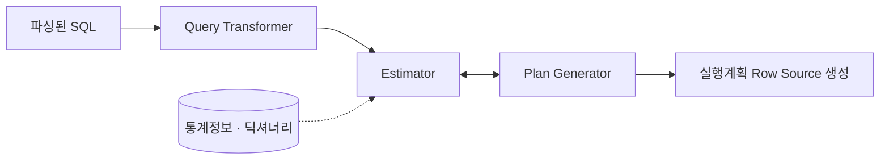

# 옵티마이저와 통계정보

옵티마이저(Optimizer)는 사용자가 요청한 SQL을 가장 효율적으로 처리할 수 있는 **실행계획**을 만드는 DBMS의 핵심 엔진이다. SQL은 "무엇을" 원하는지만 기술하고 "어떻게" 처리할지는 옵티마이저가 결정한다. SQL 파싱과 공유 커서의 전체 흐름은 [SQL 처리 과정](/theory/sql-processing)을, 결과물인 실행계획을 읽는 법은 [실행계획](/theory/execution-plan)을 참고한다.

## 규칙기반 vs 비용기반 옵티마이저

::: compare
- **규칙기반 (RBO, Rule-Based)** 미리 정한 **우선순위 규칙**(액세스 경로별 순위)에 따라 계획을 고른다. 데이터 양·분포를 고려하지 않으므로 같은 SQL이면 항상 같은 계획이 나온다.
- **비용기반 (CBO, Cost-Based)** **통계정보**를 바탕으로 후보 계획들의 예상 비용을 계산해 가장 낮은 것을 고른다. 데이터가 바뀌면 계획도 바뀔 수 있다.
:::

RBO는 액세스 경로에 1~15순위를 매겨 두었다. 1순위는 ROWID에 의한 단일 행 액세스, 마지막 15순위는 Full Table Scan이다. 예를 들어 인덱스가 있으면 테이블 대부분을 읽어야 하는 조건이라도 인덱스를 우선 사용한다.

| 구분 | RBO | CBO |
|---|---|---|
| 판단 기준 | 액세스 경로 우선순위 규칙 | 통계정보 기반 예상 비용 |
| 데이터 양·분포 반영 | 하지 않음 | 반영 |
| 계획 예측 | 쉬움 (규칙만 알면 됨) | 통계에 따라 달라짐 |
| Oracle 지원 | 10g부터 공식 지원 중단 (RULE 힌트로만 사용 가능) | 현재 표준 |

::: info 비용(Cost)이란
CBO의 비용은 **쿼리 수행에 드는 예상 일량 또는 시간**이다. 초기에는 I/O 횟수만 따졌고(I/O 비용 모델), 지금은 I/O와 CPU 시간을 함께 고려한다(CPU 비용 모델). 실행계획의 Cost는 예상치이며 실제 수행 시간과 다를 수 있다.
:::

> 시험 포인트: RBO는 "인덱스가 있으면 무조건 인덱스" 식의 규칙을 따른다. 데이터 분포나 테이블 크기를 반영하지 못한다는 것이 RBO의 한계이고, 이를 해결한 것이 CBO다.

## 옵티마이저 모드

옵티마이저 모드는 **최적화 목표**를 정한다. 같은 SQL이라도 "전체 처리 시간"을 줄일지, "첫 화면 응답 속도"를 높일지에 따라 다른 계획이 나온다.

| 모드 | 최적화 목표 | 특징 |
|---|---|---|
| ALL_ROWS | 전체 결과를 끝까지 처리하는 **총 비용 최소화** (처리량) | Oracle 기본값. 배치·DW·리포트에 적합. 해시 조인·Full Scan 선호 경향 |
| FIRST_ROWS_n | **처음 n건**을 가장 빨리 반환 (응답 시간) | n = 1, 10, 100, 1000. 화면 페이징 등 OLTP에 적합. 인덱스·NL 조인 선호 경향 |
| FIRST_ROWS | 첫 건 응답 위주 (비용과 규칙 혼합) | 하위 호환용. FIRST_ROWS_n 사용을 권장 |
| RULE | RBO 사용 | 지원 중단 |
| CHOOSE | 통계가 있으면 CBO(ALL_ROWS), 없으면 RBO | 9i 이전 기본값 |

```sql
-- 시스템/세션 수준
ALTER SYSTEM  SET OPTIMIZER_MODE = ALL_ROWS;
ALTER SESSION SET OPTIMIZER_MODE = FIRST_ROWS_10;

-- 문장 수준 (힌트)
SELECT /*+ FIRST_ROWS(10) */ * FROM t WHERE ...;
SELECT /*+ ALL_ROWS */ * FROM t WHERE ...;
```

::: warning FIRST_ROWS의 함정
FIRST_ROWS_n은 사용자가 **앞쪽 일부만 보고 멈출 것**을 전제로 한다. 결과를 끝까지 Fetch한다면 인덱스·NL 조인 위주의 계획 때문에 오히려 ALL_ROWS보다 느려질 수 있다. 전체 집계 후 보여주는 화면에는 맞지 않는다.
:::

> 시험 포인트: Oracle의 기본 모드는 ALL_ROWS다. "OLTP 페이징 화면에서 첫 페이지를 빨리 보여주려면" → FIRST_ROWS_n, "대량 배치" → ALL_ROWS로 짝짓는다.

## 최적화 과정

CBO는 내부적으로 세 단계를 거쳐 실행계획을 만든다.

::: steps
1. **Query Transformer** 파싱된 SQL을 더 나은 계획을 만들 수 있는, 의미상 동일한 형태로 변환한다 ([쿼리 변환](/theory/query-transformation)).
2. **Estimator** 통계정보로 각 단계의 **선택도·카디널리티·비용**을 계산한다.
3. **Plan Generator** 액세스 경로, 조인 순서, 조인 방식을 조합해 후보 계획을 만들고 Estimator에 비용을 물어 가장 낮은 계획을 고른다.
:::



조인 테이블이 n개면 가능한 조인 순서만 n!개다. 옵티마이저는 모든 경우를 다 따지지 않고, 일정 기준을 넘으면 탐색을 멈추고(pruning) 그때까지의 최적안을 고른다. 그래서 "가장 좋은" 계획이 아니라 "주어진 시간 안에서 좋다고 판단한" 계획이 나온다.

## 통계정보의 종류

CBO가 참조하는 통계는 주로 `DBMS_STATS` 패키지로 수집한다.

```sql
BEGIN
  DBMS_STATS.GATHER_TABLE_STATS(ownname => 'SCOTT', tabname => 'EMP',
                                cascade => TRUE,          -- 인덱스 통계도 함께
                                method_opt => 'FOR ALL COLUMNS SIZE AUTO');
END;
/
```

::: cards 2
- **테이블 통계** 전체 레코드 수(NUM_ROWS), 사용 블록 수(BLOCKS), 평균 행 길이(AVG_ROW_LEN) 등. `USER_TABLES`에서 확인한다.
- **인덱스 통계** 인덱스 높이(BLEVEL), 리프 블록 수(LEAF_BLOCKS), 고유 키 수(DISTINCT_KEYS), **클러스터링 팩터**(CLUSTERING_FACTOR) 등. `USER_INDEXES`에서 확인한다.
- **컬럼 통계** 고유값 개수(NUM_DISTINCT), 최소·최대값(LOW_VALUE, HIGH_VALUE), NULL 개수(NUM_NULLS), 밀도(DENSITY), 히스토그램 버킷 수 등. `USER_TAB_COLUMNS`에서 확인한다.
- **시스템 통계** CPU 속도, Single Block I/O 평균 시간, Multiblock I/O 평균 시간과 평균 읽기 블록 수 등 **하드웨어 특성**. `DBMS_STATS.GATHER_SYSTEM_STATS`로 수집한다.
:::

### 히스토그램

컬럼 값이 고르게 분포하지 않으면 "고유값 개수"만으로는 선택도를 제대로 계산할 수 없다. 히스토그램은 **값별 분포**를 저장해 이 문제를 보완한다.

| 유형 | 내용 |
|---|---|
| 도수분포 (Frequency) | 값별로 빈도를 저장. 고유값 수가 버킷 수 이하일 때 |
| 높이균형 (Height-Balanced) | 각 버킷에 같은 수의 행이 담기도록 나눠 경계값 저장. 고유값이 많을 때 (11g까지) |
| 상위도수분포 (Top-Frequency) | 상위 n개 값만 도수분포로 저장 (12c) |
| 하이브리드 (Hybrid) | 높이균형 + 도수분포 결합 (12c) |

::: example 히스토그램이 필요한 경우
주문 테이블의 상태 컬럼 값이 '완료' 99%, '취소' 1%라고 하자. 히스토그램이 없으면 옵티마이저는 두 값을 똑같이 1/2(50%)로 보고 같은 계획을 쓴다. 히스토그램이 있으면 `상태 = '취소'`는 인덱스, `상태 = '완료'`는 Full Scan을 선택할 수 있다.
:::

> 시험 포인트: 클러스터링 팩터는 **인덱스 정렬 순서와 테이블 데이터 저장 순서가 얼마나 일치하는지**를 나타낸다. 값이 블록 수에 가까울수록 좋고, 레코드 수에 가까울수록 나쁘다(테이블 Random 액세스 증가). 자세한 내용은 [테이블 액세스 (ROWID)](/theory/table-access-by-rowid)를 참고한다.

## 선택도·카디널리티·비용

::: cards 3
- **선택도 (Selectivity)** 전체 레코드 중 조건절에 의해 **선택될 것으로 예상되는 비율** (0~1)
- **카디널리티 (Cardinality)** 조건절에 의해 반환될 것으로 예상되는 **레코드 수**
- **비용 (Cost)** 그 레코드를 얻는 데 필요한 예상 I/O·CPU 일량
:::

```text
카디널리티 = 총 레코드 수 × 선택도
등치(=) 조건 선택도  = 1 / NUM_DISTINCT   -- 히스토그램 없음, 균등분포 가정
```

::: example 계산 예
사원 10,000명, 직급(NDV) 5종류일 때 `WHERE 직급 = :job`의 선택도는 1/5 = 0.2, 카디널리티는 10,000 × 0.2 = **2,000건**이다. 여기에 `AND 부서 = :dept`(NDV 20)가 더해지면 두 조건을 **독립**으로 가정해 0.2 × 0.05 = 0.01, 카디널리티는 **100건**으로 추정한다.
:::

범위 조건의 선택도는 최소·최대값으로 계산한다. 예를 들어 값이 1~1,000에 고르게 분포할 때 `col > 900`은 약 (1000 − 900) / (1000 − 1) ≈ 0.1이다. 바인드 변수로 범위 조건을 쓰면 값을 알 수 없으므로 **고정 비율**(부등호 하나는 5%, BETWEEN은 0.25%)을 쓴다.

### 인덱스 액세스 비용

I/O 비용 모델 기준으로 인덱스를 이용한 테이블 액세스 비용은 다음과 같이 계산한다.

```text
비용 = BLEVEL                                     -- 수직적 탐색
     + (LEAF_BLOCKS × 유효 인덱스 선택도)          -- 수평적 탐색
     + (CLUSTERING_FACTOR × 유효 테이블 선택도)    -- 테이블 Random 액세스
```

Full Table Scan 비용은 High Water Mark 아래 블록 수를 Multiblock I/O 단위로 읽는 횟수로 계산한다. 그래서 같은 조건이라도 선택도가 높아지면(많이 읽을수록) 어느 순간 Full Scan이 더 싸진다. 인덱스 구조는 [인덱스 구조](/theory/index-structure), 스캔 방식은 [인덱스 스캔](/theory/index-scan)을 참고한다.

## 옵티마이저의 한계

CBO가 늘 최적 계획을 고르는 것은 아니다. 대표적인 원인은 다음과 같다.

- **통계정보 부재·부정확**: 수집하지 않았거나, 수집 후 데이터가 크게 바뀌었거나, 샘플링이 부정확한 경우
- **히스토그램 한계**: 버킷 수 제한 때문에 분포를 완벽히 표현하지 못한다.
- **컬럼 간 상관관계 무시**: 여러 조건의 선택도를 서로 독립으로 보고 곱한다. `시도 = '서울' AND 구 = '강남구'`처럼 연관된 조건은 카디널리티를 과소 추정한다. (확장 통계로 보완 가능)
- **바인드 변수**: 실행 시점 값을 모르므로 평균 분포를 가정한다.
- **가공된 컬럼·함수**: `SUBSTR(col, 1, 2) = 'AB'` 같은 조건의 선택도는 정확히 알기 어렵다.
- **비현실적 가정**: 블록 캐싱 효과, 동시 사용자 부하 등을 정확히 반영하지 못한다.
- **최적화 시간 제약**: 모든 경우의 수를 탐색하지 않는다.

::: tip 그래서 튜닝이 필요하다
통계 갱신, 히스토그램 수집, 확장 통계, 동적 샘플링으로 옵티마이저에 더 좋은 정보를 주거나, [힌트](/theory/hints)로 직접 계획을 지정한다.
:::

## 바인드 변수와 바인드 변수 피킹

바인드 변수를 쓰면 값만 다른 SQL이 하나의 공유 커서를 재사용하므로 **하드 파싱이 줄어든다**. 반면 옵티마이저는 최적화 시점에 값을 모르므로 **컬럼 히스토그램을 활용하지 못한다**는 단점이 있다.

```sql
-- 리터럴: 값마다 별도 SQL → 하드 파싱 반복, 대신 값별 최적 계획
SELECT * FROM 주문 WHERE 상태 = '취소';
-- 바인드 변수: 커서 공유 → 파싱 부하 감소, 대신 평균 분포로 계획
SELECT * FROM 주문 WHERE 상태 = :status;
```

::: compare
- **바인드 변수 피킹 (9i)** 하드 파싱할 때 **처음 들어온 바인드 값을 엿보고** 히스토그램을 이용해 계획을 만든다. 이후 실행은 그 계획을 그대로 재사용한다. 첫 값이 소수 값('취소')이면 인덱스 계획이 굳어져, 다수 값('완료')에도 인덱스를 써서 느려진다.
- **적응적 커서 공유 (11g, ACS)** 바인드 값 분포에 민감한 커서(Bind Sensitive)의 실행 통계를 지켜보다가, 값에 따라 일량 차이가 크면 Bind Aware 상태로 바꿔 <strong>값의 선택도 범위별로 다른 자식 커서(계획)</strong>를 만든다.
:::

::: warning 적응적 커서 공유의 한계
ACS는 이미 **비효율적으로 한 번 이상 실행된 뒤에야** 반응한다. 또한 커서가 늘어나 공유 풀 부담이 생길 수 있다. 분포가 심하게 치우친 컬럼은 값에 따라 SQL을 분기하거나 리터럴을 쓰는 방안을 함께 고려한다.
:::

> 시험 포인트: 바인드 변수의 장점은 하드 파싱 감소, 단점은 **히스토그램을 사용하지 못하는 것**이다. 바인드 변수 피킹은 첫 실행 값으로 계획을 고정하는 부작용이 있고, 이를 보완한 것이 적응적 커서 공유다.

## 핵심 요약

- RBO는 액세스 경로 우선순위 규칙, CBO는 통계정보 기반 예상 비용으로 계획을 고르며 Oracle 표준은 CBO다.
- Oracle 기본 옵티마이저 모드는 ALL_ROWS(전체 처리량), FIRST_ROWS_n은 처음 n건 응답 속도를 최적화한다.
- CBO는 Query Transformer → Estimator → Plan Generator 순서로 계획을 만든다.
- 통계정보는 테이블·인덱스·컬럼(히스토그램 포함)·시스템 통계로 나뉜다.
- 선택도 = 1/NDV(균등분포), 카디널리티 = 총 레코드 수 × 선택도이며 여러 조건은 독립으로 보고 곱한다.
- 인덱스 액세스 비용은 BLEVEL + 리프 블록 × 선택도 + 클러스터링 팩터 × 선택도로 계산한다.
- 통계 부정확, 컬럼 상관관계, 바인드 변수, 가공 컬럼 등이 옵티마이저 한계의 원인이다.
- 바인드 변수는 하드 파싱을 줄이지만 히스토그램을 못 쓰며, 피킹(9i)과 적응적 커서 공유(11g)로 보완한다.
