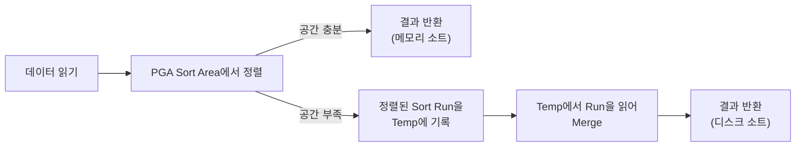

# 소트 튜닝

소트(Sort)는 CPU와 메모리를 많이 쓰고, 데이터가 많으면 디스크(Temp)까지 사용해 성능을 크게 떨어뜨린다. 또 소트가 끝나야 첫 행을 반환할 수 있으므로 **부분범위 처리를 불가능하게** 만든다. 소트 튜닝의 핵심은 세 가지다.

::: cards 3
- **소트 없애기** SQL을 바꿔 불필요한 소트 오퍼레이션을 제거한다 (UNION → UNION ALL, DISTINCT → EXISTS)
- **인덱스로 대체** 인덱스가 이미 정렬되어 있다는 점을 이용해 ORDER BY, MIN/MAX, Top N 소트를 생략한다
- **소트 영역 줄이기** 꼭 필요한 컬럼만, 꼭 필요한 건수만 정렬해 메모리 안에서 끝나게 한다
:::

## 소트 수행 과정

Oracle은 소트를 **PGA의 Sort Area**에서 수행한다. 할당받은 메모리 안에서 끝나면 메모리 소트, 공간이 부족하면 중간 결과(Sort Run)를 **Temp 테이블스페이스**에 내려 쓰는 디스크 소트가 된다.

::: compare
- **메모리 소트 (In-Memory Sort)** 전체 데이터 정렬을 Sort Area 안에서 완료한다. Internal Sort라고도 한다.
- **디스크 소트 (To-Disk Sort)** Sort Area를 넘는 데이터를 Temp 영역에 나눠 쓰고 다시 읽어 병합한다. External Sort라고도 한다.
:::



디스크 소트는 Run을 병합하는 횟수에 따라 다음과 같이 나눈다.

| 구분 | 설명 |
|---|---|
| Optimal 소트 | 메모리 안에서 소트 완료 |
| One-pass 소트 | 정렬 대상을 Temp에 한 번만 쓰고 한 번 읽어 병합 |
| Multi-pass 소트 | Temp에 쓰고 읽기를 여러 번 반복. 가장 느림 |

AutoTrace 통계의 `sorts (memory)`, `sorts (disk)` 항목으로 소트가 어디서 수행됐는지 확인할 수 있다. Sort Area는 9i 이후 `WORKAREA_SIZE_POLICY = AUTO`에서 `PGA_AGGREGATE_TARGET` 범위 안에 자동 관리된다. 메모리 구조는 [DB 아키텍처](/theory/db-architecture)를 참고한다.

::: info 소트가 성능을 떨어뜨리는 이유
- CPU 집약적인 비교 연산이 많다.
- 디스크 소트는 Temp 쓰기·읽기(direct path write/read temp) I/O가 추가된다.
- 정렬이 끝나야 첫 행이 나오므로 **부분범위 처리**가 불가능하다.
:::

## 소트를 발생시키는 오퍼레이션

| 오퍼레이션 | 발생 상황 |
|---|---|
| SORT AGGREGATE | GROUP BY 없이 전체 집계(SUM, MAX, COUNT 등). 실제로 정렬하지는 않는다 |
| SORT ORDER BY | ORDER BY 절 |
| SORT GROUP BY | GROUP BY 절 (소트 방식 그룹핑) |
| HASH GROUP BY | GROUP BY 절 (10gR2+, 해시 방식). 정렬하지 않음 |
| SORT UNIQUE | DISTINCT, UNION, MINUS, INTERSECT, 서브쿼리 Unnesting 후 중복 제거 |
| HASH UNIQUE | DISTINCT (10gR2+, 해시 방식) |
| SORT JOIN | 소트 머지 조인 |
| WINDOW SORT | 분석 함수(윈도우 함수)의 PARTITION BY / ORDER BY |

```text
-----------------------------------------
| Id | Operation            | Name     |
-----------------------------------------
|  0 | SELECT STATEMENT     |          |
|  1 |  SORT GROUP BY       |          |
|  2 |   TABLE ACCESS FULL  | EMP      |
-----------------------------------------
```

::: warning SORT AGGREGATE와 GROUP BY 정렬 함정
- `SELECT SUM(SAL), MAX(SAL) FROM EMP`의 SORT AGGREGATE는 Sort Area를 사용하지만 **실제 정렬은 하지 않는다**. 값을 하나씩 읽으며 합계와 최댓값만 갱신한다.
- 10gR2부터 GROUP BY는 HASH GROUP BY로 처리될 수 있어 **결과가 정렬된다는 보장이 없다**. 정렬된 결과가 필요하면 반드시 ORDER BY를 쓴다. GROUP BY와 ORDER BY 컬럼이 같으면 SORT GROUP BY 하나로 함께 처리된다.
:::

> 시험 포인트: 실행계획에 나타나는 소트 오퍼레이션을 SQL 구문과 연결하는 문제가 나온다. DISTINCT·UNION·MINUS → SORT(HASH) UNIQUE, 분석 함수 → WINDOW SORT, 소트 머지 조인 → SORT JOIN, 전체 집계 → SORT AGGREGATE다.

## 소트가 발생하지 않도록 SQL 작성

### UNION을 UNION ALL로

UNION은 중복 제거를 위해 SORT UNIQUE(또는 HASH UNIQUE)를 수행한다. 두 집합이 **상호 배타적**이라면 UNION ALL로 바꿔 소트를 없앤다.

```sql
-- 결제수단 조건이 서로 배타적이므로 UNION ALL로 충분
SELECT 결제번호, 주문번호, 결제금액
FROM   결제
WHERE  결제수단코드 = 'M' AND 결제일자 = '20241020'
UNION ALL
SELECT 결제번호, 주문번호, 결제금액
FROM   결제
WHERE  결제수단코드 = 'C' AND 결제일자 = '20241020';
```

조건이 겹칠 수 있는 경우에는 그대로 UNION ALL로 바꾸면 중복이 생긴다. 아래쪽 집합에 위쪽 조건의 반대 조건을 추가해 배타적으로 만든다.

```sql
SELECT 결제번호, 결제금액 FROM 결제 WHERE 결제일자 = '20241020'
UNION ALL
SELECT 결제번호, 결제금액 FROM 결제
WHERE  주문일자 = '20241020'
AND    결제일자 <> '20241020';      -- 결제일자가 NULL 허용이면 LNNVL(결제일자 = '20241020')
```

::: warning UNION ALL 변환 시 NULL
반대 조건 `col <> 값`은 col이 NULL인 행을 걸러낸다. NULL 허용 컬럼이면 `(col <> 값 OR col IS NULL)` 또는 `LNNVL(col = 값)`을 써야 결과가 같다.
:::

### DISTINCT를 EXISTS로

DISTINCT는 조건을 만족하는 **모든 행을 읽은 뒤** 중복을 제거한다. 존재 여부만 확인하면 되는 경우 EXISTS로 바꾸면 조인 대상 행을 하나 찾는 순간 멈추므로 소트와 불필요한 I/O가 함께 사라진다.

```sql
-- 변경 전: 계약을 모두 조인한 뒤 SORT(HASH) UNIQUE
SELECT DISTINCT P.상품번호, P.상품명
FROM   상품 P, 계약 C
WHERE  P.상품유형코드 = :pclscd
AND    C.상품번호 = P.상품번호
AND    C.계약일자 BETWEEN :dt1 AND :dt2;

-- 변경 후: 상품마다 계약 1건만 확인
SELECT P.상품번호, P.상품명
FROM   상품 P
WHERE  P.상품유형코드 = :pclscd
AND    EXISTS (SELECT 'x' FROM 계약 C
               WHERE  C.상품번호 = P.상품번호
               AND    C.계약일자 BETWEEN :dt1 AND :dt2);
```

MINUS도 같은 원리로 NOT EXISTS로 바꿔 소트를 없앨 수 있다. 서브쿼리 처리 방식은 [서브쿼리 조인](/theory/subquery-join)을 참고한다.

### 조인 방식 변경

해시 조인이나 소트 머지 조인으로 처리한 뒤 ORDER BY 하면 SORT ORDER BY가 따로 발생한다. ORDER BY 컬럼 순으로 정렬된 인덱스가 드라이빙 테이블에 있다면 **NL 조인**으로 바꿔 소트를 없애고 부분범위 처리까지 가능하게 할 수 있다.

```sql
SELECT /*+ LEADING(C) USE_NL(O) INDEX(C 계약_X01) */
       C.계약번호, C.상품코드, O.주문금액
FROM   계약 C, 주문 O
WHERE  C.지점ID = :brch_id
AND    O.계약번호 = C.계약번호
ORDER  BY C.계약일시 DESC;    -- 계약_X01 = (지점ID, 계약일시)
```

NL 조인은 드라이빙 테이블 순서대로 결과가 나오므로 정렬 순서가 유지된다. 소트 머지 조인은 조인 키 기준 정렬을 위한 SORT JOIN이 발생한다는 점도 함께 기억한다. 자세한 동작은 [NL 조인](/theory/nl-join), [소트 머지 조인](/theory/sort-merge-join), [해시 조인](/theory/hash-join)을 참고한다.

## 인덱스를 이용한 소트 연산 생략

인덱스는 키 순으로 정렬되어 있다. 조건절과 ORDER BY가 인덱스 구성과 맞으면 옵티마이저는 SORT ORDER BY를 생략한다.

### ORDER BY 생략

인덱스 선두 컬럼이 `=` 조건이고, 그 뒤 컬럼 순서와 ORDER BY가 일치하면 소트가 생략된다.

```sql
-- 인덱스: 주문_X01 (고객ID, 주문일자)
SELECT 주문번호, 주문일자, 주문금액
FROM   주문
WHERE  고객ID = :cust_id
ORDER  BY 주문일자 DESC;
```

```text
----------------------------------------------------
| Id | Operation                     | Name       |
----------------------------------------------------
|  0 | SELECT STATEMENT              |            |
|  1 |  TABLE ACCESS BY INDEX ROWID  | 주문        |
|  2 |   INDEX RANGE SCAN DESCENDING | 주문_X01    |
----------------------------------------------------
```

::: warning 소트가 생략되지 않는 경우
- 선두 컬럼이 범위 조건(`BETWEEN`, `IN`, `LIKE`)이고 ORDER BY가 뒤 컬럼만 지정할 때. 예: 인덱스 (고객ID, 주문일자)에 `고객ID IN (:a, :b) ORDER BY 주문일자` — IN-List Iterator로 고객별로 따로 읽으므로 전체 순서가 보장되지 않는다.
- ORDER BY에 인덱스에 없는 컬럼이나 가공된 컬럼이 있을 때.
- SELECT 절에서 가공한 컬럼의 **별칭**으로 정렬할 때. 예: `TO_CHAR(주문일자,'YYYYMMDD') AS 주문일자 ... ORDER BY 주문일자`는 가공된 값 기준 정렬이 된다.
:::

> 시험 포인트: "인덱스 (A, B)에서 `A = :x ORDER BY B`는 소트 생략, `A IN (...) ORDER BY B`나 `A BETWEEN ... ORDER BY B`는 소트 발생"을 구분하는 문제가 자주 나온다. `ORDER BY A, B`라면 범위 조건이어도 소트가 생략된다.

### MIN / MAX 구하기

인덱스 컬럼의 최솟값·최댓값은 인덱스 양 끝에서 한 건만 읽으면 된다. 실행계획에 **FIRST ROW**와 `INDEX (MIN/MAX)`가 나타난다.

```sql
-- 인덱스: 주문_X02 (주문일자, 주문금액)
SELECT MAX(주문금액) FROM 주문 WHERE 주문일자 = :ord_dt;
```

```text
------------------------------------------------------
| Id | Operation                     | Name         |
------------------------------------------------------
|  0 | SELECT STATEMENT              |              |
|  1 |  SORT AGGREGATE               |              |
|  2 |   FIRST ROW                   |              |
|  3 |    INDEX RANGE SCAN (MIN/MAX) | 주문_X02      |
------------------------------------------------------
```

First Row Stopkey가 작동하려면 **조건절 컬럼과 MIN/MAX 대상 컬럼이 모두 인덱스에 포함**되어 있어야 하고, MIN/MAX 대상 컬럼을 가공하지 않아야 한다. `MAX(주문금액 + 0)`, `MAX(NVL(주문금액, 0))`처럼 가공하면 범위 전체를 읽는다.

조건절에 인덱스에 없는 컬럼이 섞여 First Row Stopkey가 불가능할 때는 **Top N 쿼리**로 바꾼다. Top N은 테이블 필터 조건을 만족하는 첫 행에서 멈추므로 효과가 같다.

```sql
SELECT 주문금액
FROM  (SELECT 주문금액 FROM 주문
       WHERE  주문일자 = :ord_dt
       AND    주문상태코드 = '1'      -- 인덱스에 없는 컬럼
       ORDER  BY 주문금액 DESC)
WHERE  ROWNUM <= 1;
```

### Top N 쿼리

인덱스로 정렬 순서대로 읽으면서 ROWNUM으로 N건을 제한하면 **COUNT STOPKEY**가 작동해 N건만 읽고 멈춘다.

```text
-------------------------------------------------------
| Id | Operation                       | Name        |
-------------------------------------------------------
|  0 | SELECT STATEMENT                |             |
|  1 |  COUNT STOPKEY                  |             |
|  2 |   VIEW                          |             |
|  3 |    TABLE ACCESS BY INDEX ROWID  | 주문         |
|  4 |     INDEX RANGE SCAN DESCENDING | 주문_X01     |
-------------------------------------------------------
```

인덱스로 소트를 생략할 수 없더라도 Top N 쿼리는 **Top N 소트 알고리즘**(`SORT ORDER BY STOPKEY`)으로 처리되어 상위 N건만 Sort Area에 유지한다. 전체를 정렬하는 일반 소트보다 메모리 사용량이 매우 적다. ROW_NUMBER로 순위를 구해 `RN <= N`으로 거르는 경우에도 `WINDOW SORT PUSHED RANK`로 같은 효과를 낸다. 문법은 [Top N 쿼리](/theory/top-n)를 참고한다.

## 소트 영역 크기 줄이기

소트를 피할 수 없다면 **정렬할 데이터의 양**을 줄여 메모리 소트로 끝내는 것이 목표다.

### 필요한 컬럼만 정렬

Sort Area에는 정렬 키뿐 아니라 **SELECT 절의 컬럼 전체**가 올라간다. `SELECT *`로 정렬하면 쓰지 않는 컬럼까지 메모리를 차지한다.

::: compare
- **❌ 가공 후 정렬** 문자열을 결합(LPAD, `||`)한 긴 값을 만든 뒤 정렬한다. 가공된 큰 레코드가 Sort Area를 차지한다.
- **✅ 정렬 후 가공** 인라인 뷰에서 필요한 컬럼만 정렬하고, 바깥에서 가공한다. 정렬 대상 레코드 크기가 작아진다.
:::

```sql
-- 변경 전: 가공한 긴 문자열 전체를 정렬
SELECT LPAD(상품번호, 30) || LPAD(상품명, 30) || LPAD(고객ID, 10)
    || LPAD(주문금액, 8)  AS 결과
FROM   주문상품
WHERE  주문일시 BETWEEN :start AND :end
ORDER  BY 상품번호;

-- 변경 후: 원래 컬럼으로 정렬한 뒤 가공
SELECT LPAD(상품번호, 30) || LPAD(상품명, 30) || LPAD(고객ID, 10)
    || LPAD(주문금액, 8)  AS 결과
FROM  (SELECT 상품번호, 상품명, 고객ID, 주문금액
       FROM   주문상품
       WHERE  주문일시 BETWEEN :start AND :end
       ORDER  BY 상품번호);
```

### 필요한 건수만 정렬

페이징 처리에서 ROWNUM 조건을 가장 바깥에만 두면 Top N 소트가 작동하지 않고 전체를 정렬한다. 끝 번호 조건(`ROWNUM <= :end`)은 반드시 **정렬된 인라인 뷰 바로 바깥**에 둔다.

```sql
SELECT *
FROM  (SELECT ROWNUM NO, A.*
       FROM  (SELECT 거래일시, 체결건수, 체결수량
              FROM   종목거래
              WHERE  종목코드 = 'KR123456'
              ORDER  BY 거래일시) A
       WHERE  ROWNUM <= (:page * 10))     -- Top N 소트 작동
WHERE  NO >= (:page - 1) * 10 + 1;
```

> 시험 포인트: 바깥 쿼리에서 `WHERE NO BETWEEN :start AND :end`로만 거르면 COUNT STOPKEY가 없어 Top N 소트가 동작하지 않는다. 같은 결과를 내는 두 SQL 중 소트 부하가 작은 쪽을 고르는 문제로 출제된다.

## 핵심 요약

- 소트는 PGA Sort Area에서 수행되며, 부족하면 Temp를 사용하는 디스크 소트(One-pass, Multi-pass)가 된다.
- 소트는 부분범위 처리를 불가능하게 하므로 OLTP 응답 속도에 치명적이다.
- SORT AGGREGATE는 실제 정렬을 하지 않으며, GROUP BY 결과는 정렬이 보장되지 않는다(HASH GROUP BY).
- 배타적 집합의 UNION은 UNION ALL로, 존재 확인용 DISTINCT·MINUS는 EXISTS·NOT EXISTS로 바꿔 소트를 없앤다.
- 인덱스 선두 컬럼이 `=` 조건이고 ORDER BY가 뒤 컬럼과 일치하면 SORT ORDER BY가 생략된다.
- MIN/MAX는 조건·대상 컬럼이 모두 인덱스에 있고 가공하지 않을 때 FIRST ROW로 한 건만 읽는다.
- Top N 쿼리는 COUNT STOPKEY와 Top N 소트 알고리즘으로 정렬 부하를 줄인다.
- 필요한 컬럼만 정렬하고 가공은 정렬 후에 하며, 페이징의 끝 번호 조건은 정렬된 인라인 뷰 바로 바깥에 둔다.
