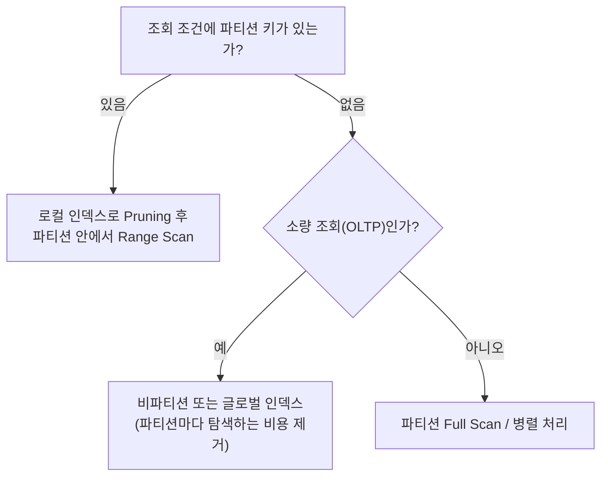

# 파티션 활용

파티셔닝(Partitioning)은 테이블이나 인덱스를 파티션 키 값에 따라 **물리적으로 여러 세그먼트로 나누어 저장**하는 기능이다. 논리적으로는 하나의 테이블이지만 저장은 파티션별로 따로 된다. 그래서 필요한 파티션만 읽거나, 파티션 단위로 관리 작업을 할 수 있다.

::: cards 3
- **성능** 조건에 해당하는 파티션만 읽는다(Pruning). 인덱스 대신 파티션 Full Scan으로 대량 데이터를 효율적으로 읽는다.
- **관리 용이성** 파티션 단위로 백업·삭제(DROP, TRUNCATE)·교체(Exchange)·재구성할 수 있다.
- **가용성** 장애가 특정 파티션에 국한되어 나머지 파티션은 계속 사용할 수 있다.
:::

## 파티션 유형

### Range 파티셔닝

파티션 키 값의 **범위**로 나눈다. 일자 컬럼으로 월·연 단위 파티션을 만드는 경우가 가장 흔하며, 오래된 데이터 삭제·보관 같은 관리 작업에 유리하다.

```sql
CREATE TABLE 주문 (
  주문번호  NUMBER,
  주문일자  VARCHAR2(8),
  고객ID   VARCHAR2(10),
  주문금액  NUMBER )
PARTITION BY RANGE (주문일자) (
  PARTITION P2023 VALUES LESS THAN ('20240101'),
  PARTITION P2024 VALUES LESS THAN ('20250101'),
  PARTITION PMAX  VALUES LESS THAN (MAXVALUE) );
```

`VALUES LESS THAN`은 지정 값 **미만**이다. 11g부터는 일정 간격으로 파티션을 자동 생성하는 Interval 파티셔닝도 제공한다.

### Hash 파티셔닝

파티션 키의 **해시 값**으로 파티션을 결정한다. 데이터가 고르게 분산되므로 특정 범위로 나누기 어려운 고객ID 같은 컬럼에 쓴다. 파티션 개수는 2의 거듭제곱으로 지정하는 것이 분산에 유리하다.

```sql
CREATE TABLE 고객 ( 고객ID VARCHAR2(10), 고객명 VARCHAR2(50) )
PARTITION BY HASH (고객ID) PARTITIONS 8;
```

Hash 파티션은 **`=` 조건이나 IN-List 조건**으로만 Pruning된다. 범위 조건으로는 Pruning되지 않는다. 동시 INSERT가 많은 테이블이나 인덱스의 경합(Hot Block)을 분산하는 데도 쓴다.

### List 파티셔닝

**불연속적인 값 목록**으로 나눈다. 지역, 상태코드처럼 값의 종류가 정해진 컬럼에 쓰며, 순서와 무관하게 값을 묶을 수 있다.

```sql
CREATE TABLE 매장 ( 매장ID NUMBER, 지역 VARCHAR2(10) )
PARTITION BY LIST (지역) (
  PARTITION P_수도권 VALUES ('서울', '경기', '인천'),
  PARTITION P_영남   VALUES ('부산', '대구', '울산'),
  PARTITION P_기타   VALUES (DEFAULT) );
```

### Composite 파티셔닝

메인 파티션을 다시 **서브 파티션**으로 나눈다. Range-Hash, Range-List가 대표적이며 11g부터 Range-Range, List-Range, List-Hash, List-List 등도 지원한다. 실제 데이터는 서브 파티션 세그먼트에 저장된다.

```sql
PARTITION BY RANGE (주문일자)
SUBPARTITION BY HASH (고객ID) SUBPARTITIONS 4 (
  PARTITION P2023 VALUES LESS THAN ('20240101'),
  PARTITION P2024 VALUES LESS THAN ('20250101') );
```

| 유형 | 기준 | Pruning 조건 | 주 용도 |
|---|---|---|---|
| Range | 값의 범위 | `=`, 범위 조건 | 일자별 데이터 관리 |
| Hash | 해시 함수 값 | `=`, IN-List | 균등 분산, 경합 분산 |
| List | 값 목록 | `=`, IN-List | 지역·코드별 분리 |
| Composite | 메인 + 서브 | 각 키별 | 관리(Range) + 분산(Hash) 동시 |

> 시험 포인트: Hash 파티션은 범위 조건(`BETWEEN`, `>`)으로 Pruning되지 않는다. 관리 목적(오래된 데이터 삭제)에는 Range, 균등 분산에는 Hash가 적합하다.

## 파티션 Pruning

**파티션 Pruning**은 SQL 조건절을 분석해 읽지 않아도 되는 파티션을 액세스 대상에서 제외하는 기능이다. 파티셔닝 성능 효과의 핵심이다.

::: compare
- **정적 Pruning** 파티션 키 조건이 **상수**라서 하드파싱 시점에 읽을 파티션이 결정된다. 실행계획 Pstart/Pstop에 **파티션 번호**가 표시된다.
- **동적 Pruning** 바인드 변수, 서브쿼리, NL 조인 Inner 쪽 조건처럼 **실행 시점**에 파티션이 결정된다. Pstart/Pstop에 **KEY**가 표시된다.
:::

```sql
SELECT COUNT(*) FROM 주문
WHERE  주문일자 BETWEEN '20240301' AND '20240331';
```

```text
-------------------------------------------------------------
| Id | Operation               | Name | Pstart | Pstop |
-------------------------------------------------------------
|  0 | SELECT STATEMENT        |      |        |       |
|  1 |  SORT AGGREGATE         |      |        |       |
|  2 |   PARTITION RANGE SINGLE|      |      2 |     2 |
|  3 |    TABLE ACCESS FULL    | 주문  |      2 |     2 |
-------------------------------------------------------------
```

바인드 변수를 쓰면 Pstart/Pstop이 `KEY`로 바뀐다.

```text
|  2 |   PARTITION RANGE ITERATOR |      |    KEY |   KEY |
|  3 |    TABLE ACCESS FULL       | 주문  |    KEY |   KEY |
```

| 오퍼레이션 | 의미 |
|---|---|
| PARTITION RANGE SINGLE | 파티션 하나만 액세스 |
| PARTITION RANGE ITERATOR | 연속된 여러 파티션 액세스 |
| PARTITION RANGE INLIST | IN-List 값에 해당하는 파티션 액세스 |
| PARTITION RANGE ALL | 전체 파티션 액세스 (Pruning 실패) |

### 조인과 서브쿼리 Pruning

- **NL 조인**: Inner 테이블이 조인 컬럼으로 파티셔닝되어 있으면 Outer 행마다 해당 파티션만 액세스한다(동적 Pruning).
- **해시·소트 머지 조인**: 조인 시점에 파티션을 알 수 없으므로 Oracle은 드라이빙 집합으로 대상 파티션 목록을 먼저 구하는 **서브쿼리 Pruning**이나 11g의 **조인 필터(Bloom Filter) Pruning**을 사용한다. 실행계획에 `KEY(SQ)`, `:BF0000` 같은 표시가 나타난다.

::: warning Pruning이 실패하는 경우
- 파티션 키 컬럼을 가공하면 Pruning되지 않는다. 예: `SUBSTR(주문일자, 1, 6) = '202403'`
- 파티션 키와 다른 타입의 값으로 비교해 **묵시적 형변환**이 컬럼 쪽에 일어나는 경우. 예: VARCHAR2 파티션 키에 `주문일자 = 20240301`(숫자)
- 파티션 키 조건이 아예 없으면 모든 파티션을 읽는다.
:::

> 시험 포인트: 실행계획의 Pstart/Pstop이 숫자면 정적 Pruning, KEY면 동적 Pruning이다. 바인드 변수를 쓰면 동적 Pruning이 되지만 Pruning 자체는 정상적으로 일어난다.

## 로컬 인덱스와 글로벌 인덱스

::: compare
- **로컬 파티션 인덱스** 테이블과 **똑같이 파티셔닝**된 인덱스. 테이블 파티션과 인덱스 파티션이 1:1로 대응하며, 파티션 DDL(DROP, SPLIT, EXCHANGE 등) 시 Oracle이 자동으로 함께 관리한다.
- **글로벌 파티션 인덱스** 테이블과 **다른 기준으로 파티셔닝**하거나, 테이블 파티션과 1:1 관계가 아닌 인덱스. 테이블 파티션 DDL 시 Unusable 상태가 되므로 재생성하거나 `UPDATE GLOBAL INDEXES` 옵션을 써야 한다.
:::

```sql
CREATE INDEX 주문_X01 ON 주문 (주문일자, 고객ID) LOCAL;

CREATE INDEX 주문_X02 ON 주문 (고객ID)
GLOBAL PARTITION BY RANGE (고객ID) (
  PARTITION G1 VALUES LESS THAN ('M'),
  PARTITION G2 VALUES LESS THAN (MAXVALUE) );

CREATE INDEX 주문_X03 ON 주문 (주문번호);   -- 비파티션 인덱스 (글로벌 인덱스로 취급)
```

비파티션 테이블에도 글로벌 파티션 인덱스를 만들 수 있고, 파티션 테이블에 만든 비파티션 인덱스도 테이블 파티션과 1:1 관계가 아니므로 **글로벌 인덱스처럼 동작**한다.

### Prefixed와 Non-prefixed

| 구분 | 의미 |
|---|---|
| Prefixed | 인덱스 **파티션 키 컬럼이 인덱스 선두 컬럼**인 경우 |
| Non-prefixed | 인덱스 파티션 키 컬럼이 선두가 아니거나 인덱스에 없는 경우 |

조합하면 다음과 같다. Oracle은 **글로벌 Non-prefixed 인덱스를 지원하지 않는다.**

| 조합 | 지원 |
|---|---|
| 로컬 Prefixed | O |
| 로컬 Non-prefixed | O |
| 글로벌 Prefixed | O |
| 글로벌 Non-prefixed | X |

> 시험 포인트: "글로벌 Non-prefixed 파티션 인덱스"는 Oracle에서 만들 수 없다. 또 로컬 Unique 인덱스는 **파티션 키 컬럼을 인덱스 컬럼에 포함**해야 한다. 그렇지 않으면 파티션마다 따로 유일성을 검사하므로 전체 유일성을 보장할 수 없기 때문이다.

## 파티션 인덱스 설계 주의점



::: info 설계 시 고려할 점
- **파티션 키 조건이 없는 소량 조회**에 로컬 Non-prefixed 인덱스를 쓰면 모든 인덱스 파티션을 하나씩 수직 탐색해야 한다. 파티션이 100개면 수직 탐색도 100번이다. 이런 쿼리에는 비파티션(글로벌) 인덱스가 유리하다.
- **관리 편의성**은 로컬 인덱스가 압도적이다. 파티션 DROP·TRUNCATE·Exchange 후 글로벌 인덱스는 Unusable이 되어 재생성이 필요하다(`UPDATE GLOBAL INDEXES`를 쓰면 유지되지만 작업이 느려진다).
- 일자 범위로 파티셔닝된 테이블에서 `고객ID = :id AND 주문일자 BETWEEN :d1 AND :d2` 조건이라면 Pruning으로 파티션이 제한되므로 로컬 인덱스를 **(고객ID, 주문일자)** 순으로 만들어 파티션 안에서 `=` 조건 컬럼이 선두에 오게 한다.
- 파티션 단위로 대량 데이터를 읽는 배치에서는 인덱스 대신 **파티션 Full Scan**이 더 효율적인 경우가 많다.
:::

인덱스 컬럼 순서 결정은 [인덱스 설계](/theory/index-design)를 참고한다.

## 대용량 데이터 삭제와 교체

DELETE는 건마다 인덱스 갱신, Undo·Redo 생성이 따르므로 수천만 건 삭제는 매우 오래 걸린다. 파티션 단위로 처리하면 **딕셔너리만 바꾸는 DDL**로 끝낼 수 있다.

```sql
-- 파티션 전체 삭제
ALTER TABLE 주문 DROP PARTITION P2023;
ALTER TABLE 주문 TRUNCATE PARTITION P2023;

-- 글로벌 인덱스를 함께 유지
ALTER TABLE 주문 DROP PARTITION P2023 UPDATE GLOBAL INDEXES;
```

### 조건부 삭제: Exchange 활용

파티션 안의 **일부 행만** 지워야 할 때는 남길 데이터를 임시 테이블로 옮긴 뒤 파티션과 바꿔치기한다.

::: steps
1. **임시 테이블 생성** 남길 데이터만 Direct Path로 적재한다. `CREATE TABLE 주문_T NOLOGGING AS SELECT * FROM 주문 PARTITION (P2024) WHERE 주문상태 <> 'X'`
2. **인덱스 생성** 로컬 인덱스와 같은 구조로 임시 테이블에 인덱스를 만든다
3. **파티션 교체** `ALTER TABLE 주문 EXCHANGE PARTITION P2024 WITH TABLE 주문_T INCLUDING INDEXES WITHOUT VALIDATION`
4. **정리** 임시 테이블(이제 원래 파티션 데이터가 들어 있음)을 DROP하고, 필요하면 테이블을 LOGGING으로 되돌린다
:::

Exchange는 실제 데이터를 복사하지 않고 **세그먼트 소유 정보만 교환**하므로 순식간에 끝난다. 대량 적재도 같은 방식으로 임시 테이블에 미리 적재·인덱스 생성 후 Exchange하면 서비스 중인 테이블에 주는 영향을 최소화할 수 있다. 일반 테이블 대량 삭제 기법은 [DML 튜닝](/theory/dml-tuning)을 참고한다.

> 시험 포인트: DROP·TRUNCATE·EXCHANGE PARTITION은 DDL이라 롤백할 수 없고, 글로벌 인덱스를 Unusable로 만든다. 로컬 인덱스는 자동으로 함께 처리된다.

## 핵심 요약

- 파티셔닝은 성능(Pruning), 관리 용이성(파티션 단위 DDL), 가용성을 높인다.
- Range는 범위, Hash는 해시 값, List는 값 목록으로 나누며 Composite는 이를 2단계로 결합한다.
- Hash 파티션은 `=`와 IN-List 조건에서만 Pruning된다.
- 상수 조건은 정적 Pruning(Pstart/Pstop 숫자), 바인드 변수·서브쿼리·NL 조인은 동적 Pruning(KEY)이다.
- 파티션 키를 가공하거나 묵시적 형변환이 일어나면 Pruning이 실패한다.
- 로컬 인덱스는 테이블과 1:1로 파티셔닝되어 자동 관리되고, 글로벌 인덱스는 파티션 DDL 시 Unusable이 된다.
- Oracle은 글로벌 Non-prefixed 인덱스를 지원하지 않으며, 로컬 Unique 인덱스는 파티션 키를 포함해야 한다.
- 파티션 키 조건 없는 소량 조회는 비파티션(글로벌) 인덱스가 유리하다.
- 대량 삭제는 DROP/TRUNCATE PARTITION, 일부 삭제나 대량 적재는 임시 테이블 + EXCHANGE PARTITION으로 처리한다.
