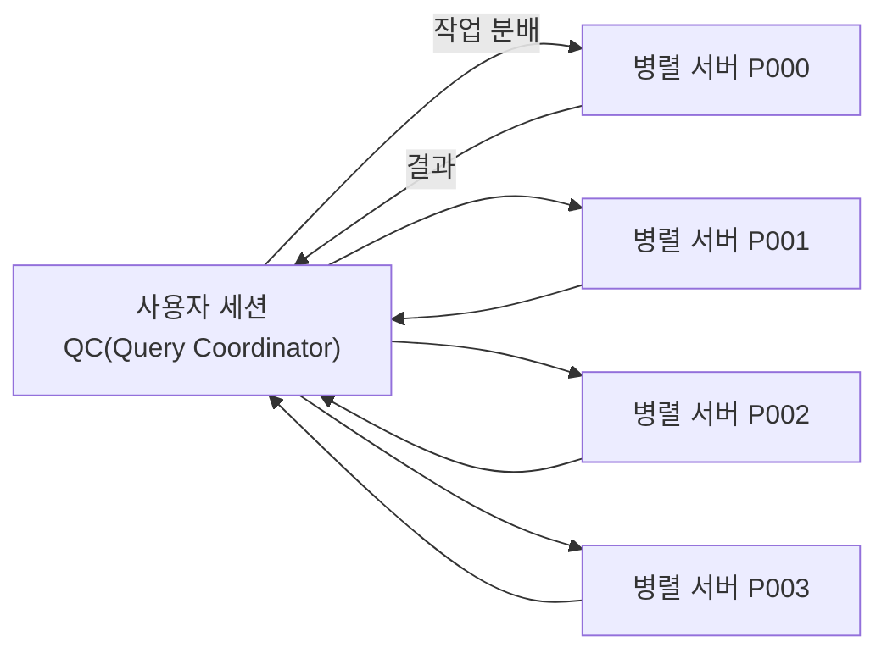
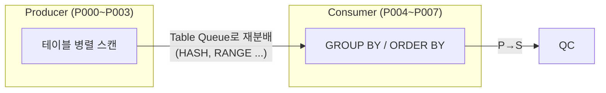

# 대용량 배치와 병렬 처리

배치(Batch) 프로그램은 사용자와 상호작용 없이 대량 데이터를 정해진 시간에 일괄 처리한다. OLTP가 **첫 행 응답 속도**를 중시한다면, 배치는 <strong>전체 처리 시간(Throughput)</strong>을 줄이는 것이 목표다. 그래서 인덱스 랜덤 액세스보다 Full Scan과 해시 조인, 병렬 처리가 주로 쓰인다.

## 배치 프로그램 튜닝 개요

::: cards 3
- **전체 처리량 중심** 옵티마이저 모드는 ALL_ROWS가 적합하다. 첫 행이 늦게 나와도 전체가 빨리 끝나면 된다.
- **개별 SQL보다 전체 흐름** 배치 윈도우 안에서 여러 작업이 자원을 나눠 쓰므로 동시 실행 프로그램 간 경합과 실행 순서를 함께 조정한다.
- **One SQL 지향** 가능한 한 집합적 사고로 하나의 SQL에서 처리를 끝낸다.
:::

### 절차형 처리의 문제점

전통적인 배치는 커서로 데이터를 한 건씩 읽고, 건마다 다른 테이블을 조회·변경하는 **절차형(Row-by-Row)** 방식으로 작성되는 경우가 많다.

```sql
-- 절차형: 고객 건마다 SELECT, UPDATE를 반복
FOR c IN (SELECT 고객번호 FROM 고객 WHERE 고객구분 = 'A') LOOP
  SELECT SUM(거래금액) INTO l_amt FROM 거래 WHERE 고객번호 = c.고객번호;
  UPDATE 고객 SET 월거래금액 = l_amt WHERE 고객번호 = c.고객번호;
  COMMIT;
END LOOP;
```

::: warning 절차형 처리가 느린 이유
- **반복적인 DB Call**: 건마다 SQL을 실행해 Call 부하와 SQL·PL/SQL 엔진 간 컨텍스트 스위칭이 쌓인다.
- **랜덤 I/O**: 건마다 인덱스를 통해 테이블을 액세스하므로 대량 처리에 비효율적인 Single Block I/O가 반복된다.
- **잦은 커밋**: 건마다 커밋하면 log file sync 대기가 누적된다.
- **옵티마이저 활용 불가**: 처리 순서가 프로그램 로직에 고정되어 해시 조인, Full Scan, 병렬 처리 같은 집합 처리를 쓸 수 없다.
:::

### One SQL로 구현

같은 처리를 하나의 SQL로 쓰면 옵티마이저가 대량 처리에 적합한 방식(Full Scan, 해시 조인, 병렬)을 선택할 수 있다.

```sql
MERGE INTO 고객 T
USING (SELECT 고객번호, SUM(거래금액) 금액
       FROM   거래 GROUP BY 고객번호) S
ON    (T.고객번호 = S.고객번호)
WHEN MATCHED THEN UPDATE SET T.월거래금액 = S.금액
                  WHERE  T.고객구분 = 'A';
```

| One SQL 구현 기법 | 활용 |
|---|---|
| CASE / DECODE | 조건별 분기 처리를 한 번의 스캔으로 |
| MERGE | 있으면 UPDATE, 없으면 INSERT |
| 다중 테이블 INSERT (INSERT ALL/FIRST) | 한 번 읽어 여러 테이블에 적재 |
| 수정 가능 조인 뷰 | 조인 결과로 UPDATE |
| 분석 함수 | 셀프 조인·반복 서브쿼리 대체 |
| WITH 절, UNION ALL | 중간 집합 재사용, 집합 결합 |

절차형으로 남겨야 한다면 최소한 [DML 튜닝](/theory/dml-tuning)의 Array Processing(BULK COLLECT, FORALL)을 적용하고, 커밋 단위를 키운다. 기법별 예시는 [고급 SQL 활용](/theory/advanced-sql)을 참고한다.

> 시험 포인트: 배치 튜닝의 핵심은 "건별 처리 → 집합 처리(One SQL)"다. 절차형 처리는 반복 Call, 랜덤 I/O, 잦은 커밋 때문에 느리다.

## 병렬 처리 기본

병렬 처리(Parallel Processing)는 하나의 SQL을 여러 프로세스가 나눠 처리하는 것이다. PARALLEL 힌트로 병렬도(DOP, Degree of Parallelism)를 지정한다.

```sql
SELECT /*+ FULL(O) PARALLEL(O 4) */
       고객번호, SUM(주문금액)
FROM   주문 O
GROUP  BY 고객번호;
```

::: info 병렬 관련 힌트
- `PARALLEL(테이블 n)`: 테이블을 DOP n으로 병렬 스캔. 11gR2부터는 문장 수준 `PARALLEL(n)`도 쓸 수 있다.
- `PARALLEL_INDEX(테이블 인덱스 n)`: 인덱스를 병렬로 스캔. Index Fast Full Scan이나 **파티션 인덱스**의 Range Scan(파티션 단위 분배)에 쓴다.
- `NO_PARALLEL(테이블)`: 병렬 처리를 막는다.
- PARALLEL 힌트는 병렬도만 지정할 뿐 액세스 경로를 강제하지 않는다. Full Scan을 확실히 하려면 **FULL 힌트를 함께** 쓴다.
:::

### QC와 병렬 서버



- **QC(Query Coordinator)**: 병렬 SQL을 실행한 사용자 세션의 서버 프로세스다. 병렬 서버 풀에서 서버를 할당받아 작업을 나눠 주고, 결과를 받아 최종 집계하거나 사용자에게 전달한다. 병렬로 처리할 수 없는 부분(직렬 연산)도 QC가 맡는다.
- **병렬 서버(Parallel Execution Server)**: 실제로 데이터를 읽고 가공하는 프로세스(P000, P001 …).
- **Granule**: 병렬 서버에 나눠 주는 작업 단위다. 블록 범위 단위(`PX BLOCK ITERATOR`) 또는 파티션 단위(`PX PARTITION RANGE ALL`)로 나눈다.

### Producer / Consumer와 Inter-Operation Parallelism

정렬, 그룹핑, 조인처럼 단계가 둘 이상인 병렬 작업은 **두 개의 서버 집합**이 동시에 일한다. 한 집합이 데이터를 읽어 다른 집합에 넘기는 **Producer**, 받은 데이터를 가공하는 집합이 **Consumer**다.



::: compare
- **Intra-Operation Parallelism** 한 오퍼레이션(예: 테이블 스캔)을 같은 서버 집합의 여러 서버가 나눠 처리한다. 서버끼리는 통신하지 않는다.
- **Inter-Operation Parallelism** 서로 다른 오퍼레이션을 두 서버 집합이 나눠 처리하며, 집합 사이에 **데이터 재분배**가 일어난다. 이때 실제 사용 서버 수는 **DOP × 2**다.
:::

### 병렬 실행계획 읽기

```text
-------------------------------------------------------------------------
| Id | Operation                | Name     |  TQ  |IN-OUT| PQ Distrib |
-------------------------------------------------------------------------
|  0 | SELECT STATEMENT         |          |      |      |            |
|  1 |  PX COORDINATOR          |          |      |      |            |
|  2 |   PX SEND QC (RANDOM)    | :TQ10001 | Q1,01| P->S | QC (RAND)  |
|  3 |    HASH GROUP BY         |          | Q1,01| PCWP |            |
|  4 |     PX RECEIVE           |          | Q1,01| PCWP |            |
|  5 |      PX SEND HASH        | :TQ10000 | Q1,00| P->P | HASH       |
|  6 |       PX BLOCK ITERATOR  |          | Q1,00| PCWC |            |
|  7 |        TABLE ACCESS FULL | 주문      | Q1,00| PCWP |            |
-------------------------------------------------------------------------
```

| IN-OUT | 의미 |
|---|---|
| P->P | Parallel to Parallel. 서버 집합 간 데이터 재분배 (Inter-Operation) |
| P->S | Parallel to Serial. 병렬 서버가 QC에게 결과 전송 |
| PCWP | Parallel Combined With Parent. 부모 오퍼레이션과 같은 서버 집합이 함께 처리 |
| PCWC | Parallel Combined With Child. 자식 오퍼레이션과 같은 서버 집합이 함께 처리 |
| S->P | Serial to Parallel. QC가 직렬로 처리한 결과를 병렬 서버에 분배 (병목 가능) |

> 시험 포인트: `S->P`가 나타나면 직렬 처리 구간이 있어 병목이 될 수 있다. `P->P`는 두 서버 집합 사이 재분배가 있다는 뜻이며 이때 서버는 DOP의 2배가 쓰인다.

## 병렬 분배 방식과 PQ_DISTRIBUTE

Producer가 Consumer에게 데이터를 나눠 주는 방식은 오퍼레이션에 따라 달라진다.

| 분배 방식 | 설명 | 주 사용 |
|---|---|---|
| RANGE | 정렬 키 값의 범위로 분배 | ORDER BY |
| HASH | 키의 해시 값으로 분배 | GROUP BY, 해시 조인 |
| BROADCAST | 한쪽 집합 전체를 모든 서버에 복제 | 작은 테이블과의 조인 |
| KEY | 파티션 키 기준 분배 | Partial Partition-Wise 조인 |
| ROUND-ROBIN | 순서대로 고르게 분배 | 특정 키가 필요 없을 때 |

### 병렬 조인 분배 유형

`PQ_DISTRIBUTE(inner테이블 outer분배 inner분배)` 힌트로 병렬 조인 시 양쪽 집합의 분배 방식을 지정한다. 힌트의 테이블 별칭은 **Inner 테이블**이다.

| 힌트 | 방식 | 설명 |
|---|---|---|
| `PQ_DISTRIBUTE(B NONE NONE)` | Full Partition-Wise | 두 테이블이 **조인 키로 같게 파티셔닝**되어 있어 재분배 없이 파티션끼리 조인. 서버 집합 하나로 처리 |
| `PQ_DISTRIBUTE(B PARTITION NONE)` | Partial Partition-Wise | Inner가 조인 키로 파티셔닝되어 있을 때 Outer를 Inner 파티션 기준으로 재분배 |
| `PQ_DISTRIBUTE(B NONE PARTITION)` | Partial Partition-Wise | Outer가 파티셔닝되어 있을 때 Inner를 재분배 |
| `PQ_DISTRIBUTE(B HASH HASH)` | 동적 파티셔닝 | 양쪽 모두 조인 키 해시 값으로 재분배. 두 테이블이 모두 크고 파티셔닝이 안 맞을 때 |
| `PQ_DISTRIBUTE(B BROADCAST NONE)` | Broadcast | Outer(작은 쪽)를 모든 병렬 서버에 복제 |
| `PQ_DISTRIBUTE(B NONE BROADCAST)` | Broadcast | Inner(작은 쪽)를 모든 병렬 서버에 복제 |

```sql
SELECT /*+ LEADING(D) USE_HASH(E) FULL(D) FULL(E)
           PARALLEL(D 4) PARALLEL(E 4)
           PQ_DISTRIBUTE(E BROADCAST NONE) */
       D.DNAME, E.ENAME
FROM   DEPT D, EMP E
WHERE  E.DEPTNO = D.DEPTNO;
```

::: info PQ_DISTRIBUTE를 쓰는 경우
옵티마이저가 테이블 크기나 카디널리티를 잘못 판단해 **큰 테이블을 Broadcast**하거나 불필요한 재분배를 선택할 때 분배 방식을 직접 지정한다. Broadcast는 작은 집합에만 유리하며, 큰 집합을 Broadcast하면 DOP배만큼 데이터가 복제되어 오히려 느려진다.
:::

> 시험 포인트: Full Partition-Wise 조인은 재분배가 없어 서버 집합 하나만 쓰고 가장 효율적이다. 두 테이블 모두 파티셔닝되어 있지 않고 둘 다 크면 HASH-HASH, 한쪽이 매우 작으면 BROADCAST가 적합하다.

## 병렬 DML

병렬 힌트만 주면 SELECT 부분만 병렬로 처리되고 INSERT·UPDATE·DELETE는 QC가 **직렬로** 수행한다. DML까지 병렬로 하려면 세션에서 병렬 DML을 활성화해야 한다.

```sql
ALTER SESSION ENABLE PARALLEL DML;

INSERT /*+ PARALLEL(T 4) */ INTO 주문_집계 T
SELECT /*+ FULL(O) PARALLEL(O 4) */ 고객번호, SUM(주문금액)
FROM   주문 O
GROUP  BY 고객번호;

COMMIT;
```

::: compare
- **병렬 DML 미활성화** 실행계획에서 `LOAD AS SELECT`(또는 UPDATE/DELETE)가 **PX COORDINATOR 위**에 있다. 즉 QC가 직렬로 DML을 수행한다.
- **병렬 DML 활성화** `LOAD AS SELECT`·UPDATE·DELETE가 **PX COORDINATOR 아래**에 있어 병렬 서버가 DML을 수행한다.
:::

12c부터는 `ENABLE_PARALLEL_DML` 힌트로 문장 단위 활성화도 가능하다.

::: warning 병렬 DML 특징
- 병렬 INSERT는 **Direct Path Insert**로 동작한다.
- 대상 테이블에 **Exclusive 모드 테이블 Lock**이 걸려 다른 트랜잭션의 DML이 막힌다.
- 커밋(또는 롤백) 전에는 같은 세션도 그 테이블을 조회·변경할 수 없다(ORA-12838).
:::

## 병렬 처리 주의점

::: warning 병렬 처리를 피하거나 조심할 상황
- **OLTP 환경, 소량 데이터**: 병렬 서버 할당·분배·취합 비용이 처리 이득보다 크다. 동시 사용자가 많은 시스템에서 남용하면 CPU·메모리 자원이 고갈된다.
- **객체에 남은 병렬 속성**: `CREATE INDEX ... PARALLEL 8`이나 `ALTER TABLE ... PARALLEL`로 작업한 뒤 속성을 그대로 두면, 이후 일반 SQL까지 병렬로 수행될 수 있다. 작업 후 `ALTER INDEX ... NOPARALLEL`로 되돌린다.
- **병렬 DML 후 커밋 누락**: 커밋 전까지 테이블 Lock이 유지된다.
- **직렬 구간**: ROWNUM, 일부 함수 등 직렬로 처리해야 하는 연산이 있으면 QC에 데이터가 모였다가 다시 분배(S->P)되어 병목이 된다.
- **비파티션 인덱스 Range Scan**은 병렬로 처리되지 않는다. 대량 처리에는 Full Scan + 병렬을 쓴다.
:::

- 병렬 DOP는 클수록 좋은 것이 아니다. Inter-Operation 병렬에서는 서버가 DOP×2 필요하고, 시스템 전체 병렬 서버 수(`PARALLEL_MAX_SERVERS`)를 넘으면 요청한 DOP보다 낮게 실행된다.
- 병렬 쿼리는 Direct Path Read로 버퍼 캐시를 거치지 않고 읽으므로, 시작 전에 해당 세그먼트의 Dirty 버퍼를 디스크에 기록하는 Checkpoint가 발생한다.

## 핵심 요약

- 배치는 전체 처리 시간이 목표이며, 절차형 건별 처리 대신 One SQL로 집합 처리한다.
- 절차형 처리는 반복 DB Call, 랜덤 I/O, 잦은 커밋, 옵티마이저 활용 불가 때문에 느리다.
- PARALLEL 힌트는 병렬도만 지정하므로 FULL 힌트와 함께 쓴다.
- QC는 작업 분배·취합과 직렬 연산을 맡고, 병렬 서버가 실제 처리를 한다.
- 두 단계 이상의 병렬 작업은 Producer/Consumer 두 서버 집합이 쓰여 DOP×2 서버가 필요하다.
- IN-OUT의 P->P는 재분배, P->S는 QC로 전송, PCWP/PCWC는 같은 서버 집합 내 결합, S->P는 직렬 병목 신호다.
- PQ_DISTRIBUTE(inner outer분배 inner분배)로 NONE NONE(Full Partition-Wise), PARTITION NONE(Partial), HASH HASH, BROADCAST 방식을 지정한다.
- 병렬 DML은 `ALTER SESSION ENABLE PARALLEL DML`이 필요하며, Direct Path·Exclusive Lock·커밋 전 조회 불가 특징이 있다.
- OLTP·소량 데이터에서는 병렬 처리를 피하고, 작업 후 객체의 병렬 속성을 원래대로 되돌린다.
