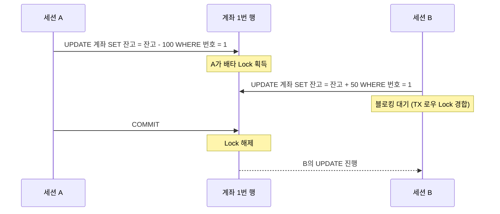
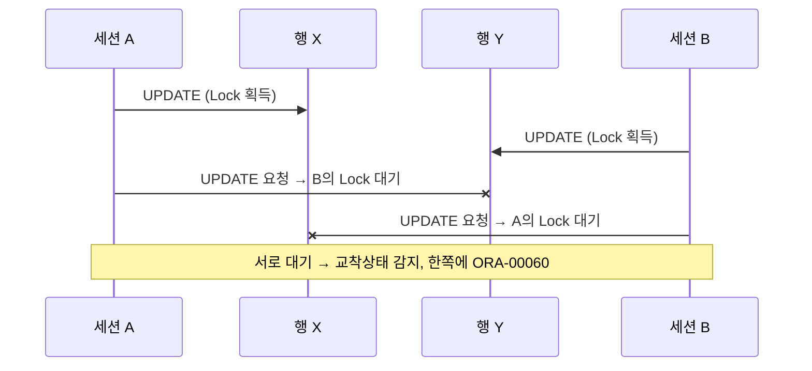

# Lock

Lock은 여러 트랜잭션이 같은 데이터를 동시에 변경하지 못하도록 막아 **데이터 일관성과 무결성**을 지키는 장치다. Lock이 없으면 동시 변경으로 데이터가 깨지고, Lock을 과하게 쓰면 대기가 늘어 동시성이 떨어진다. 트랜잭션 기본 개념은 [TCL](/theory/tcl)을 먼저 보면 좋다.

## Lock 기본: 공유 Lock과 배타 Lock

::: compare
- **공유 Lock (Shared Lock)** 데이터를 **읽을 때** 사용한다. 다른 공유 Lock과는 호환되어 여러 트랜잭션이 함께 읽을 수 있지만, 배타 Lock은 막는다.
- **배타 Lock (Exclusive Lock)** 데이터를 **변경할 때** 사용한다. 트랜잭션이 끝날 때까지 유지되며, 다른 어떤 Lock(공유·배타)과도 호환되지 않는다.
:::

| 현재 걸린 Lock \ 요청 Lock | 공유 | 배타 |
|---|---|---|
| 공유 | 허용 | 대기 |
| 배타 | 대기 | 대기 |

::: info Oracle은 공유 Lock을 쓰지 않는다
위 호환성은 일반적인 DBMS(SQL Server, DB2 등) 기준이다. **Oracle은 일반 SELECT에 Lock을 걸지 않는다.** 다중버전 읽기 일관성(MVCC)으로 커밋된 과거 버전을 읽기 때문이다. 그래서 Oracle에서는 읽기가 쓰기를, 쓰기가 읽기를 막지 않는다 ([동시성 제어](/theory/concurrency-control) 참고).
:::

## 블로킹과 교착상태

<strong>블로킹(Blocking)</strong>은 선행 트랜잭션이 Lock을 잡고 있어 후행 트랜잭션이 대기하는 상태다. 선행 트랜잭션이 커밋하거나 롤백해야 풀린다.



<strong>교착상태(Deadlock)</strong>는 두 트랜잭션이 각각 Lock을 잡은 채 상대의 Lock을 기다려 영원히 진행하지 못하는 상태다.



- Oracle은 교착상태를 자동 감지해 한 세션에 **ORA-00060**을 발생시키고 그 **문장만** 롤백한다. 트랜잭션 전체가 롤백되는 것은 아니므로, 애플리케이션이 커밋 또는 롤백을 결정해야 한다.
- SQL Server는 희생자(Victim)로 고른 **트랜잭션 전체**를 롤백한다(오류 1205).
- 예방: 여러 테이블·행을 갱신할 때 **모든 트랜잭션이 같은 순서로** 접근한다.

> 시험 포인트: 블로킹은 Lock 경합으로 인한 "대기"이고 언젠가 풀리지만, 교착상태는 서로 기다려 스스로 풀리지 않는다. Oracle은 교착상태 시 문장 수준 롤백만 한다.

## Oracle Lock: 로우 Lock과 테이블 Lock

Oracle DML은 <strong>로우 Lock(TX)</strong>과 <strong>테이블 Lock(TM)</strong>을 함께 사용한다.

::: cards 2
- **로우 Lock (TX Lock)** 변경하는 행에 **항상 배타적**으로 건다. 트랜잭션 정보는 블록 헤더의 ITL 슬롯에, Lock 여부는 각 로우 헤더의 Lock Byte에 기록한다. 별도 Lock 관리 메모리를 쓰지 않으므로 **로우 Lock 개수에 제한이 없고 Lock 에스컬레이션도 없다**.
- **테이블 Lock (TM Lock)** DML을 수행하는 테이블에 함께 건다. 테이블 전체를 잠그는 것이 아니라, 선행 트랜잭션이 이 테이블에서 **어떤 작업을 하고 있는지 알리는 푯말** 역할이다. 주로 DML과 DDL의 충돌을 막는다.
:::

### DML별 로우 Lock 동작

| 선행 \ 후행 | UPDATE / DELETE 같은 행 | INSERT 같은 키 | SELECT |
|---|---|---|---|
| UPDATE / DELETE | 대기 | (해당 없음) | 대기 없음 |
| INSERT | (커밋 전이라 행이 안 보임) | **Unique 인덱스가 있으면 대기** | 대기 없음 |

- 같은 행을 UPDATE·DELETE하는 트랜잭션끼리는 블로킹된다.
- INSERT끼리는 **Unique 인덱스**가 있을 때만 같은 값 입력 시 대기한다. 선행이 커밋하면 후행은 Unique 제약 위반, 롤백하면 후행 INSERT가 성공한다.
- 일반 SELECT는 어떤 경우에도 블로킹되지 않는다.

### 테이블 Lock 모드

| 모드 | 이름 | 주로 거는 명령 |
|---|---|---|
| RS (2) | Row Share | SELECT ... FOR UPDATE (10g까지) |
| RX (3) | Row Exclusive | INSERT, UPDATE, DELETE, MERGE, SELECT ... FOR UPDATE (11g부터) |
| S (4) | Share | LOCK TABLE ... IN SHARE MODE |
| SRX (5) | Share Row Exclusive | LOCK TABLE ... IN SHARE ROW EXCLUSIVE MODE |
| X (6) | Exclusive | LOCK TABLE ... IN EXCLUSIVE MODE, Direct Path Insert 등 |

| 선행 \ 후행 | RS | RX | S | SRX | X |
|---|---|---|---|---|---|
| RS | O | O | O | O | - |
| RX | O | O | - | - | - |
| S | O | - | O | - | - |
| SRX | O | - | - | - | - |
| X | - | - | - | - | - |

(O는 호환, -는 대기) 여러 세션이 같은 테이블에 DML을 하면 모두 RX 모드라 서로 호환된다(행이 다르면 동시에 진행). 반면 DML 중인 테이블에 DDL을 하려면 X 모드가 필요하므로 충돌한다.

```sql
LOCK TABLE emp IN EXCLUSIVE MODE;             -- 명시적 테이블 Lock
LOCK TABLE emp IN EXCLUSIVE MODE NOWAIT;      -- 못 얻으면 즉시 ORA-00054
ALTER SESSION SET DDL_LOCK_TIMEOUT = 30;      -- DDL이 TM Lock을 최대 30초 대기 (11g)
```

> 시험 포인트: Oracle의 테이블 Lock은 "테이블 전체를 잠근다"는 뜻이 아니다. 여러 트랜잭션이 같은 테이블의 서로 다른 행을 동시에 갱신할 수 있다. 로우 Lock은 블록에 저장되므로 Lock 에스컬레이션이 발생하지 않는다.

## SELECT FOR UPDATE

일반 SELECT는 Lock을 걸지 않지만, `FOR UPDATE`를 붙이면 **읽은 행에 로우 Lock**을 건다. 읽은 값을 바탕으로 곧 갱신할 때, 그 사이 다른 트랜잭션의 변경을 막기 위해 쓴다(비관적 동시성 제어).

```sql
SELECT 잔고 FROM 계좌 WHERE 번호 = :no FOR UPDATE;           -- Lock 얻을 때까지 무한 대기
SELECT 잔고 FROM 계좌 WHERE 번호 = :no FOR UPDATE NOWAIT;    -- 즉시 ORA-00054
SELECT 잔고 FROM 계좌 WHERE 번호 = :no FOR UPDATE WAIT 3;    -- 3초 대기 후 ORA-30006
```

::: cards 3
- **NOWAIT** 대기하지 않고 즉시 예외. "다른 사용자가 처리 중" 메시지를 바로 보여줄 때
- **WAIT n** n초까지만 대기 후 예외
- **SKIP LOCKED** Lock이 걸린 행은 **건너뛰고** 나머지만 읽어 Lock. 큐(Queue) 테이블에서 여러 세션이 작업을 나눠 가져갈 때 유용
:::

```sql
-- 조인 시 특정 테이블의 행만 잠그기
SELECT o.주문번호, c.고객명
FROM   주문 o, 고객 c
WHERE  o.고객번호 = c.고객번호 AND o.상태 = '접수'
FOR UPDATE OF o.상태;     -- 주문 테이블 행에만 Lock
```

::: warning FOR UPDATE의 Lock은 언제 풀리나
SELECT FOR UPDATE로 건 Lock도 **커밋 또는 롤백 시점**에 풀린다. 조회 후 사용자 입력을 기다리는 동안 Lock을 쥐고 있으면 심각한 블로킹이 생긴다.
:::

## SQL Server Lock

SQL Server는 Lock을 메모리의 Lock 관리자에서 관리하며, 읽기에도 공유 Lock을 사용한다.

| Lock 종류 | 용도 |
|---|---|
| 공유 (S) | 읽기. 기본(READ COMMITTED)에서는 **읽는 즉시 해제** |
| 배타 (X) | 변경. 트랜잭션 종료까지 유지 |
| 갱신 (U) | 읽은 뒤 갱신할 대상에 건다. 두 세션이 공유 Lock을 잡고 동시에 배타로 바꾸려다 생기는 **변환 교착상태를 방지** |
| 의도 (IS, IX, SIX) | 하위 리소스에 Lock이 있음을 상위(테이블·페이지)에 표시 |
| 스키마 (Sch-S, Sch-M) | 컴파일·DDL 시 스키마 보호 |
| 대량 업데이트 (BU) | 대량 로딩 시 |
| 키 범위 | SERIALIZABLE에서 Phantom 방지를 위해 인덱스 키 범위 잠금 |

- Lock 레벨: 로우(RID, KEY) → 페이지 → 익스텐트 → 테이블 → 데이터베이스
- **Lock 에스컬레이션**: 한 문장이 잡은 로우·페이지 Lock이 많아지면(약 5,000개 기준) 메모리 절약을 위해 **테이블 Lock으로 승격**한다. 관리 부담은 줄지만 동시성이 크게 떨어진다.
- 기본 READ COMMITTED에서는 갱신 중인 행을 읽으려는 SELECT가 **블로킹된다**. `READ_COMMITTED_SNAPSHOT` 옵션이나 SNAPSHOT 격리 수준을 쓰면 버전 기반 읽기로 이를 피할 수 있다.

::: compare
- **Oracle** 로우 Lock 정보를 데이터 블록에 저장 → Lock 수 제한 없음, 에스컬레이션 없음. 읽기는 Lock 없이 Undo로 일관성 확보
- **SQL Server** Lock 관리자 메모리에 저장 → 개수 증가 시 에스컬레이션. 읽기도 공유 Lock 사용
:::

## 블로킹 최소화 방안

::: steps
1. **트랜잭션을 짧게** 불필요하게 긴 트랜잭션을 나누고, 사용자 입력 대기를 트랜잭션 안에 넣지 않는다.
2. **SQL을 빠르게** Lock을 잡은 시간 = 문장 수행 시간이다. 인덱스·튜닝으로 수행 시간을 줄인다.
3. **같은 순서로 접근** 여러 자원을 갱신할 때 모든 프로그램이 같은 순서로 Lock을 잡아 교착상태를 예방한다.
4. **Lock 범위 최소화** FOR UPDATE OF로 필요한 테이블만, 필요한 행만 잠근다.
5. **대기 시간 제한** NOWAIT, WAIT n, SKIP LOCKED로 무한 대기를 피한다.
6. **배치와 온라인 분리** 대량 갱신 배치는 온라인 피크 시간을 피해서 수행한다.
:::

SQL Server에서는 여기에 더해 격리 수준을 낮추거나 `WITH (NOLOCK)`을 쓰는 방법이 있지만, Dirty Read를 허용하므로 정합성이 중요한 데이터에는 쓰면 안 된다. 격리 수준은 [트랜잭션 격리성](/theory/transaction-isolation)에서 다룬다.

## 핵심 요약

- 공유 Lock끼리는 호환되고 배타 Lock은 어떤 Lock과도 호환되지 않는다.
- Oracle은 일반 SELECT에 Lock을 걸지 않으며(MVCC), 읽기와 쓰기가 서로 막지 않는다.
- 블로킹은 Lock 대기, 교착상태는 상호 대기이며 Oracle은 ORA-00060과 함께 문장만 롤백한다.
- Oracle DML은 로우 Lock(TX, 항상 배타)과 테이블 Lock(TM, 주로 RX 모드)을 함께 건다.
- Oracle 로우 Lock은 블록에 기록되어 개수 제한과 Lock 에스컬레이션이 없다.
- INSERT끼리는 Unique 인덱스가 있을 때 같은 값을 넣으면 블로킹된다.
- SELECT FOR UPDATE는 읽은 행에 Lock을 걸며 NOWAIT, WAIT n, SKIP LOCKED로 대기 방식을 정한다.
- SQL Server는 읽기에 공유 Lock을 쓰고, Lock이 많아지면 테이블 Lock으로 에스컬레이션한다.
- 블로킹 최소화: 짧은 트랜잭션, 빠른 SQL, 같은 접근 순서, 최소 Lock 범위, 대기 시간 제한.
