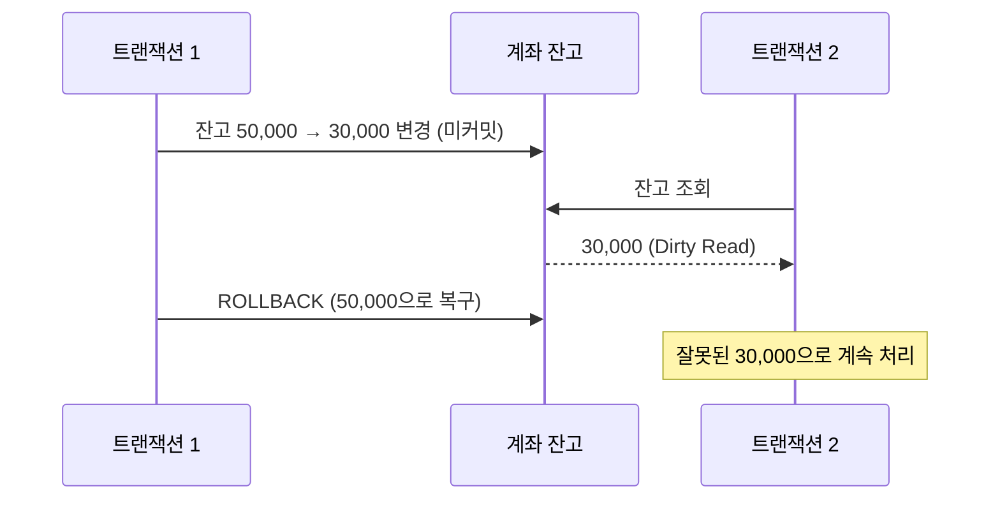

# 트랜잭션 격리성

트랜잭션 격리성(Isolation)은 실행 중인 트랜잭션이 다른 트랜잭션의 영향을 얼마나 받지 않는지를 나타낸다. 격리성을 높이면 일관성은 좋아지지만 Lock 대기가 늘어 동시성이 떨어진다. 이 둘의 균형을 잡는 기준이 <strong>격리성 수준(Isolation Level)</strong>이다. Lock의 동작은 [Lock](/theory/lock)을, 트랜잭션 기본은 [TCL](/theory/tcl)과 [트랜잭션 모델](/theory/transaction-model)을 참고한다.

## 트랜잭션의 특징 ACID

::: cards 2
- **원자성 (Atomicity)** 트랜잭션의 연산은 전부 실행되거나 전혀 실행되지 않아야 한다(All or Nothing).
- **일관성 (Consistency)** 트랜잭션이 성공하면 데이터베이스는 실행 전과 마찬가지로 모순 없는 일관된 상태를 유지한다.
- **격리성 (Isolation)** 실행 중인 트랜잭션의 중간 결과에 다른 트랜잭션이 접근할 수 없다.
- **영속성 (Durability)** 트랜잭션이 성공적으로 끝나면 그 결과는 장애가 나도 영구 보존된다.
:::

이 중 격리성을 완벽히 보장하려면 트랜잭션을 하나씩 순서대로(직렬로) 실행해야 한다. 현실에서는 동시성을 위해 격리성을 일부 낮추고, 그 대가로 아래 현상을 어느 정도 허용한다.

## 낮은 격리성에서 생기는 현상

### Dirty Read

다른 트랜잭션이 **변경 후 아직 커밋하지 않은** 데이터를 읽는 현상이다. 그 트랜잭션이 롤백하면, 존재한 적 없는 값으로 업무를 처리한 셈이 된다.



### Non-Repeatable Read

한 트랜잭션 안에서 **같은 쿼리를 두 번 수행했는데 결과가 다른** 현상이다. 그 사이 다른 트랜잭션이 해당 행을 **수정 또는 삭제하고 커밋**했기 때문이다. Inconsistent Read(일관성 없는 읽기)라고도 한다.

```sql
-- 트랜잭션 1: 잔고 조회 후 그 값을 기준으로 처리
SELECT 잔고 FROM 계좌 WHERE 번호 = 1;    -- 50,000
                                        -- (트랜잭션 2: 잔고를 10,000으로 UPDATE 후 COMMIT)
SELECT 잔고 FROM 계좌 WHERE 번호 = 1;    -- 10,000  ← 같은 쿼리, 다른 결과
```

### Phantom Read

한 트랜잭션 안에서 **같은 조건으로 두 번 조회했는데 처음에 없던 행이 나타나는** 현상이다. 그 사이 다른 트랜잭션이 조건에 맞는 **새 행을 삽입하고 커밋**했기 때문이다.

::: example 집계 불일치
트랜잭션 1이 "지역별 고객 수"를 집계하고 이어서 "연령대별 고객 수"를 집계하는 사이, 트랜잭션 2가 신규 고객을 등록하고 커밋했다. 두 집계 결과의 전체 합계가 서로 맞지 않는다.
:::

| 현상 | 원인이 되는 다른 트랜잭션의 작업 | 핵심 |
|---|---|---|
| Dirty Read | 변경 후 **미커밋** | 커밋 안 된 값을 읽음 |
| Non-Repeatable Read | 기존 행 **수정·삭제** 후 커밋 | 같은 행의 값이 바뀜 |
| Phantom Read | 새 행 **삽입** 후 커밋 | 없던 행이 생김 |

> 시험 포인트: Non-Repeatable Read는 **기존 행의 UPDATE·DELETE**, Phantom Read는 **새 행의 INSERT**로 발생한다. 보기에서 원인을 바꿔 제시하는 함정이 많다.

## 격리성 수준 4단계

ANSI/ISO SQL 표준은 네 가지 격리성 수준을 정의한다. 아래로 갈수록 격리성이 높다.

| 레벨 | 격리성 수준 | Dirty Read | Non-Repeatable Read | Phantom Read |
|---|---|---|---|---|
| 0 | READ UNCOMMITTED | 발생 | 발생 | 발생 |
| 1 | READ COMMITTED | 방지 | 발생 | 발생 |
| 2 | REPEATABLE READ | 방지 | 방지 | 발생 |
| 3 | SERIALIZABLE | 방지 | 방지 | 방지 |

::: cards 2
- **READ UNCOMMITTED** 커밋되지 않은 데이터도 읽는다. Oracle은 지원하지 않는다.
- **READ COMMITTED** 커밋된 데이터만 읽는다. **대부분 DBMS의 기본값** (Oracle, SQL Server, DB2)
- **REPEATABLE READ** 선행 트랜잭션이 읽은 데이터는 트랜잭션이 끝날 때까지 다른 트랜잭션이 수정·삭제할 수 없다. 단, 새 행 삽입은 막지 못한다.
- **SERIALIZABLE** 읽은 범위에 새 행 삽입도 막아, 트랜잭션을 순서대로 실행한 것과 같은 결과를 보장한다.
:::

### Lock 기반 DBMS의 구현

SQL Server, DB2처럼 Lock으로 격리성을 구현하는 DBMS에서는 수준이 높아질수록 공유 Lock을 오래, 넓게 유지한다.

| 격리성 수준 | 공유 Lock 처리 (Lock 기반 DBMS) |
|---|---|
| READ UNCOMMITTED | 읽을 때 공유 Lock을 걸지 않음 |
| READ COMMITTED | 읽는 순간만 공유 Lock, 읽고 나면 바로 해제 |
| REPEATABLE READ | 읽은 행의 공유 Lock을 트랜잭션 끝까지 유지 |
| SERIALIZABLE | 읽은 범위(키 범위)에 Lock을 걸어 트랜잭션 끝까지 유지 |

```sql
-- SQL Server
SET TRANSACTION ISOLATION LEVEL REPEATABLE READ;
BEGIN TRAN;
  SELECT 잔고 FROM 계좌 WHERE 번호 = 1;   -- 공유 Lock 유지
  ...
COMMIT;
```

## Oracle의 격리성 수준 지원

Oracle은 Lock이 아닌 <strong>다중버전 읽기 일관성(MVCC)</strong>으로 격리성을 구현한다. 지원하는 수준은 다음 두 가지(+ 읽기 전용)다.

::: compare
- **READ COMMITTED (기본값)** **문장(쿼리) 시작 시점**에 커밋된 데이터를 읽는다. 문장 하나 안에서는 일관되지만, 같은 트랜잭션 안의 다음 문장은 그 사이 커밋된 변경을 본다. 즉 Non-Repeatable Read와 Phantom Read가 생길 수 있다.
- **SERIALIZABLE** **트랜잭션 시작 시점**에 커밋된 데이터를 기준으로 모든 문장을 읽는다. 트랜잭션 시작 후 다른 트랜잭션이 커밋한 행을 갱신하려 하면 **ORA-08177**(can't serialize access) 오류가 발생한다.
:::

```sql
-- 트랜잭션 단위 설정 (트랜잭션 첫 문장이어야 함)
SET TRANSACTION ISOLATION LEVEL SERIALIZABLE;
-- 세션 단위 설정
ALTER SESSION SET ISOLATION_LEVEL = SERIALIZABLE;
-- 읽기 전용 트랜잭션: 트랜잭션 시작 시점 기준으로 읽고 DML 불가
SET TRANSACTION READ ONLY;
```

::: warning Oracle에서 혼동하기 쉬운 점
- Oracle은 READ UNCOMMITTED와 REPEATABLE READ를 지원하지 않는다. Dirty Read는 **어떤 경우에도 발생하지 않는다**.
- Oracle은 읽기에 Lock을 쓰지 않으므로, SERIALIZABLE로 올려도 읽기 때문에 블로킹이 생기지 않는다. 대신 갱신 충돌 시 ORA-08177로 실패하므로 재시도 로직이 필요하다.
- Oracle의 SERIALIZABLE은 엄밀히 스냅샷 격리(Snapshot Isolation)에 가까워, 서로 다른 행을 읽고 쓰는 두 트랜잭션 사이의 이상 현상(Write Skew)까지 막지는 못한다.
:::

> 시험 포인트: Oracle·SQL Server의 기본 격리성 수준은 READ COMMITTED다. Oracle은 READ COMMITTED와 SERIALIZABLE만 지원하며, Lock이 아닌 Undo 기반 다중버전으로 읽기 일관성을 구현한다. 읽기 일관성 세부는 [동시성 제어](/theory/concurrency-control)에서 다룬다.

## 격리성 수준과 동시성의 관계

격리성 수준을 높이면 일관성은 강해지지만 다음 비용이 따른다.

- **Lock 기반 DBMS**: 공유 Lock을 더 오래, 더 넓게 유지하므로 갱신 트랜잭션이 대기하고 교착상태 가능성이 커진다.
- **MVCC 기반 DBMS(Oracle)**: 블로킹은 늘지 않지만, 갱신 충돌 오류(ORA-08177)와 오래된 버전 유지를 위한 Undo 부담이 커진다.

그래서 기본은 READ COMMITTED로 두고, 일관성이 꼭 필요한 부분만 SELECT FOR UPDATE 같은 **명시적 Lock**이나 낙관적 동시성 제어로 보완하는 것이 일반적이다.

## 트랜잭션 설계 시 주의사항

::: steps
1. **트랜잭션은 짧게** 원자성이 필요한 최소 단위로 묶는다. 길어질수록 Lock 보유 시간이 길어지고 블로킹이 늘어난다.
2. **사용자 대기를 포함하지 않는다** 조회 → 화면에서 사용자 확인 → 저장 과정 전체를 하나의 트랜잭션(Lock 유지)으로 묶지 않는다. 사용자가 자리를 비우면 Lock이 무한정 유지된다.
3. **필요한 격리성 수준만** 업무 정합성에 필요한 만큼만 격리성을 높이고, 특정 부분만 명시적 Lock으로 보완한다.
4. **원자성 단위는 지킨다** 반대로 너무 잘게 커밋하면 중간 실패 시 데이터가 어긋난다. 함께 성공·실패해야 하는 작업은 반드시 한 트랜잭션으로 묶는다.
5. **같은 순서로 자원에 접근** 교착상태를 예방한다.
:::

::: info 대량 배치의 커밋 주기
배치에서 루프마다 커밋하면 Redo·로그 동기화 부하가 크고, 열어 둔 커서를 계속 읽으면 Snapshot too old 위험도 커진다. 반대로 커밋 없이 너무 오래 끌면 Undo 공간과 Lock 보유가 문제다. 업무 단위와 재처리 방식을 고려해 적절한 주기를 정한다 ([배치 프로그램 튜닝](/theory/batch-tuning) 참고).
:::

## 핵심 요약

- ACID는 원자성·일관성·격리성·영속성이며, 격리성은 동시성과 상충 관계다.
- Dirty Read는 미커밋 데이터, Non-Repeatable Read는 기존 행 수정·삭제, Phantom Read는 새 행 삽입 때문에 생긴다.
- 격리성 수준은 READ UNCOMMITTED → READ COMMITTED → REPEATABLE READ → SERIALIZABLE 순으로 높아진다.
- READ COMMITTED는 Dirty Read만, REPEATABLE READ는 Phantom Read를 제외한 둘을, SERIALIZABLE은 셋 모두 방지한다.
- Oracle·SQL Server의 기본값은 READ COMMITTED다.
- Oracle은 READ COMMITTED(문장 시작 시점 기준)와 SERIALIZABLE(트랜잭션 시작 시점 기준), READ ONLY만 지원하며 MVCC로 구현한다.
- Oracle SERIALIZABLE에서 다른 트랜잭션이 커밋한 행을 갱신하면 ORA-08177이 발생한다.
- 트랜잭션은 짧게, 사용자 대기를 포함하지 않게, 원자성 단위는 지키도록 설계한다.
