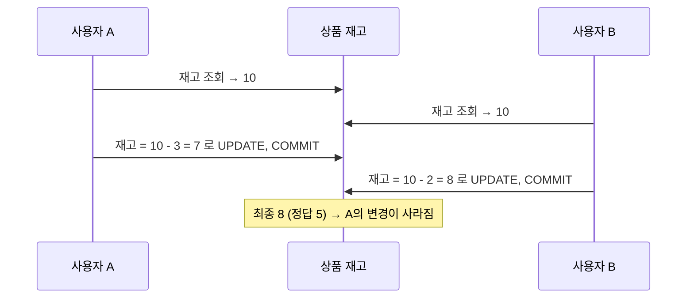

# 동시성 제어

동시성 제어(Concurrency Control)는 여러 사용자가 같은 데이터를 동시에 다룰 때 **일관성을 지키면서 동시성(처리량)을 최대한 높이는** 기법이다. 동시성과 일관성은 반비례 관계다. Lock을 많이, 오래 쓰면 일관성은 좋아지지만 대기가 늘어난다. [Lock](/theory/lock)과 [트랜잭션 격리성](/theory/transaction-isolation)을 바탕으로, 애플리케이션과 DBMS 수준의 제어 방법을 정리한다.

## 갱신 손실 문제

동시성 제어가 없을 때 가장 대표적인 문제는 <strong>갱신 손실(Lost Update)</strong>이다.



조회한 값을 기준으로 갱신하는 사이 다른 트랜잭션이 끼어들었기 때문이다. 이를 막는 방법이 비관적·낙관적 동시성 제어다.

## 비관적 vs 낙관적 동시성 제어

::: compare
- **비관적 동시성 제어 (Pessimistic)** "같은 데이터를 동시에 변경할 것"이라고 가정한다. 데이터를 **읽는 시점에 Lock**을 걸고, 처리가 끝날 때까지 유지한다. 일관성은 확실하지만 동시성이 떨어진다.
- **낙관적 동시성 제어 (Optimistic)** "동시에 변경하는 일은 드물 것"이라고 가정한다. 읽을 때는 Lock을 걸지 않고, **변경하는 시점에 그 사이 다른 사용자가 바꿨는지 확인**한다. 동시성은 높지만 충돌 시 재처리가 필요하다.
:::

### 비관적 동시성 제어 구현

```sql
-- 고객 등급 산정 후 적립 포인트 지급
SELECT 적립포인트, 방문횟수, 최근방문일시, 구매실적
FROM   고객
WHERE  고객번호 = :cust_num
FOR UPDATE;                         -- 읽는 순간 로우 Lock

-- 새로운 적립포인트 계산 ...

UPDATE 고객 SET 적립포인트 = :new_point
WHERE  고객번호 = :cust_num;
COMMIT;                             -- Lock 해제
```

- 대기 없이 바로 실패시키려면 `FOR UPDATE NOWAIT`, 일정 시간만 기다리려면 `FOR UPDATE WAIT n`을 쓴다. 예외가 나면 "다른 사용자가 처리 중입니다" 같은 메시지를 보여줄 수 있다.
- 큐 테이블처럼 여러 세션이 미처리 건을 나눠 가져가는 경우 `FOR UPDATE SKIP LOCKED`로 Lock 걸린 행을 건너뛴다.

### 낙관적 동시성 제어 구현

읽은 시점의 값을 기억해 두었다가, UPDATE의 WHERE 절에서 **그 값이 그대로인지** 비교한다.

```sql
-- 1) 조회 (Lock 없음)
SELECT 적립포인트, 방문횟수, 최근방문일시, 구매실적
INTO   :a, :b, :c, :d
FROM   고객 WHERE 고객번호 = :cust_num;

-- 2) 변경: 읽은 값이 그대로일 때만 반영
UPDATE 고객 SET 적립포인트 = :new_point
WHERE  고객번호   = :cust_num
AND    적립포인트 = :a
AND    방문횟수   = :b
AND    최근방문일시 = :c
AND    구매실적   = :d;

-- 3) 0건이면 그 사이 누군가 변경한 것 → 롤백 후 재처리 안내
IF SQL%ROWCOUNT = 0 THEN
  ROLLBACK;
  RAISE_APPLICATION_ERROR(-20001, '다른 사용자에 의해 변경되었습니다.');
END IF;
```

비교할 컬럼이 많으면 번거로우므로 **변경일시 컬럼**이나 **버전 컬럼**을 두고 그것 하나만 비교한다.

```sql
UPDATE 고객
SET    적립포인트 = :new_point,
       변경일시   = SYSDATE              -- 또는 버전 = 버전 + 1
WHERE  고객번호   = :cust_num
AND    변경일시   = :mod_dt;             -- 읽을 때의 변경일시와 같아야 반영
```

::: warning 변경일시 컬럼 방식의 전제
모든 프로그램이 해당 테이블을 갱신할 때 **반드시 변경일시(버전)를 함께 갱신**해야 한다. 한 곳이라도 빠뜨리면 동시 변경을 감지하지 못한다. 이런 규칙에 의존하지 않으려면 Oracle 10g의 `ORA_ROWSCN` 의사 컬럼을 활용할 수 있다. 단, 테이블을 `ROWDEPENDENCIES` 옵션으로 생성해야 행 단위 SCN이 기록되며, 기본값은 블록 단위다.
:::

::: example 낙관적 제어 + 즉시 확인
UPDATE 전에 `SELECT ... WHERE 고객번호 = :cust_num AND 변경일시 = :mod_dt FOR UPDATE NOWAIT`로 먼저 확인하면, 다른 트랜잭션이 갱신 중일 때 대기하지 않고 바로 알 수 있다. 0건이면 이미 변경된 것이고, ORA-00054면 지금 누군가 변경 중이다.
:::

> 시험 포인트: 비관적 = 읽을 때 Lock(SELECT FOR UPDATE), 낙관적 = 변경 시 비교(WHERE 절에 읽었던 값·변경일시·버전 비교, 결과 0건이면 충돌). 낙관적 방식에서 변경일시를 갱신하지 않는 프로그램이 있으면 충돌을 감지하지 못한다.

## 다중버전 동시성 제어 (MVCC)

Oracle은 **Undo 데이터**를 이용해 데이터의 과거 버전을 만들어 읽는 다중버전 동시성 제어(MVCC, Multi-Version Concurrency Control)를 사용한다.

::: steps
1. **쿼리 시작 시점의 SCN 확보** 쿼리(또는 트랜잭션)가 시작될 때의 SCN(System Commit Number)을 기억한다.
2. **블록 SCN 비교** 읽는 블록의 SCN이 쿼리 SCN보다 작거나 같으면 그대로 읽는다(Current 블록 사용).
3. **CR 블록 생성** 쿼리 시작 이후 변경·커밋되었거나 아직 커밋되지 않은 변경이 있으면, Undo를 적용해 **쿼리 시작 시점으로 되돌린 복사본**(CR Copy)을 만들어 읽는다.
:::

::: compare
- **Current 모드 읽기** 디스크에서 캐시로 올라온 원본 블록을 **지금 시점** 그대로 읽는다. DML이 갱신할 대상을 찾을 때 사용한다.
- **Consistent 모드 읽기** 쿼리가 시작된 시점 기준으로 **일관성 있게** 읽는다. 필요하면 CR 블록을 만든다. 일반 SELECT가 사용한다.
:::

- 읽기는 Lock 없이 과거 버전을 읽으므로 **읽기와 쓰기가 서로 블로킹하지 않는다**.
- 대신 Undo 공간이 필요하고, 과거 버전이 Undo에서 사라지면 일관된 읽기를 할 수 없다(Snapshot too old).

SGA·Undo 등 구조는 [데이터베이스 아키텍처](/theory/db-architecture)를 참고한다.

## 문장수준·트랜잭션수준 읽기 일관성

::: cards 2
- **문장수준 읽기 일관성 (Statement-Level)** 하나의 쿼리가 **시작된 시점**을 기준으로 일관된 데이터를 읽는다. 쿼리 수행 중 다른 트랜잭션이 변경·커밋해도 결과에 반영되지 않는다. Oracle의 기본 동작(READ COMMITTED)이다.
- **트랜잭션수준 읽기 일관성 (Transaction-Level)** 트랜잭션이 **시작된 시점**을 기준으로, 트랜잭션 안의 모든 쿼리가 일관된 데이터를 읽는다. 단, 자기 트랜잭션이 변경한 내용은 본다. SERIALIZABLE 또는 READ ONLY 트랜잭션에서 제공한다.
:::

::: example 문장수준 읽기 일관성
계좌 1,000만 건의 잔고 합계를 구하는 SELECT가 실행되는 동안, 다른 트랜잭션이 이미 읽은 1번 계좌에서 아직 읽지 않은 9,000번 계좌로 돈을 옮기고 커밋했다. Lock 기반 READ COMMITTED라면 옮긴 금액이 두 번 더해질 수 있지만, Oracle은 9,000번 계좌를 읽을 때 Undo로 **쿼리 시작 시점의 잔고**를 만들어 읽으므로 합계가 정확하다.
:::

> 시험 포인트: Oracle은 Undo를 이용해 Lock 없이 문장수준 읽기 일관성을 항상 보장한다. 트랜잭션수준 읽기 일관성은 SERIALIZABLE이나 SET TRANSACTION READ ONLY로 얻는다.

## Snapshot too old

쿼리 시작 시점의 CR 블록을 만들어야 하는데, 필요한 Undo가 **다른 트랜잭션에 의해 이미 덮어써져** 과거 버전을 만들 수 없을 때 발생한다(**ORA-01555**).

| 원인 | 설명 |
|---|---|
| Undo 공간 부족 | 커밋된 Undo가 금방 재사용되어 덮어써진다 |
| 오래 걸리는 쿼리 | 쿼리 수행 시간이 길수록 필요한 과거 버전이 오래된다 |
| Fetch Across Commit | 커서를 열어 둔 채 루프를 돌며 **자주 커밋**하면, 자기 Undo도 재사용 가능해진다 |
| Delayed Block Cleanout | 대량 변경 후 커밋 정보가 블록에 정리되지 않은 상태에서, 트랜잭션 테이블 슬롯이 재사용되어 커밋 시점을 확인할 수 없게 된다 |

::: tip 해결 방안
- Undo 테이블스페이스 크기와 `UNDO_RETENTION`을 늘린다.
- 쿼리를 튜닝해 **수행 시간을 줄인다**.
- 루프 안에서 불필요하게 자주 커밋하지 않는다(Fetch Across Commit 회피).
- 큰 테이블을 읽으며 같은 테이블을 갱신하는 배치는 정렬된 임시 결과(ORDER BY 등)로 먼저 받아 처리한다.
- 대량 변경 직후 Full Scan으로 블록을 한 번 읽어 Block Cleanout을 유도한다.
:::

## 채번 방식과 동시성

주문번호처럼 **순차 증가하는 일련번호**를 만드는 방식은 동시성에 큰 영향을 준다.

### MAX + 1 조회

```sql
INSERT INTO 주문 (주문일자, 주문순번, ...)
VALUES (:dt, (SELECT NVL(MAX(주문순번), 0) + 1 FROM 주문 WHERE 주문일자 = :dt), ...);
```

- 별도 테이블이 없고, `주문일자 + 주문순번` PK 인덱스가 있으면 MAX 조회가 빠르다(인덱스 끝 한 건만 읽음).
- 두 트랜잭션이 동시에 같은 MAX 값을 읽으면 **같은 번호로 INSERT** → 뒤 트랜잭션은 PK 위반(ORA-00001). 예외 처리 후 재시도 로직이 필요하다.
- 구분 단위(예: 주문일자)별로 채번하므로 동시 INSERT가 몰리지 않으면 성능이 좋다.

### 채번 테이블

```sql
SELECT 최종번호 + 1 INTO :next FROM 채번 WHERE 구분 = '주문' FOR UPDATE;
UPDATE 채번 SET 최종번호 = :next WHERE 구분 = '주문';
-- 주문 INSERT ... 후 COMMIT
```

- 별도 테이블에 마지막 번호를 관리하고, `FOR UPDATE`로 Lock을 건 뒤 번호를 증가시킨다. 중복이 없고 번호가 빠지지 않는다.
- 같은 구분값으로 채번하는 트랜잭션은 **모두 직렬화**된다. 메인 트랜잭션이 끝날 때까지 Lock이 유지되면 경합이 심하다.
- 채번 부분만 **자율 트랜잭션**(`PRAGMA AUTONOMOUS_TRANSACTION`) 함수로 분리해 즉시 커밋하면 Lock 보유 시간이 줄어든다. 대신 메인 트랜잭션이 롤백되면 번호가 빠진다.

### 시퀀스 오브젝트

```sql
CREATE SEQUENCE ord_seq START WITH 1 INCREMENT BY 1 CACHE 1000;
INSERT INTO 주문 (주문번호, ...) VALUES (ord_seq.NEXTVAL, ...);
```

- 트랜잭션과 무관하게 번호를 발급하므로 **Lock 경합 없이 가장 빠르다**.
- 롤백해도 이미 발급한 번호는 반환되지 않고, 인스턴스 재기동 시 캐시에 남은 번호는 사라진다. 즉 **번호가 빠질(Gap) 수 있다**. 연속성이 꼭 필요한 업무에는 맞지 않는다.

::: warning CACHE / NOCACHE 주의
- `NOCACHE`이거나 CACHE 크기가 작으면 NEXTVAL 호출마다(또는 자주) 딕셔너리(SEQ$)를 갱신해야 해서 **SQ Lock**과 Row Cache Lock 경합이 생긴다. 동시 INSERT가 많으면 CACHE를 충분히 크게 준다.
- RAC 환경에서 `ORDER` 옵션은 노드 간 순서를 맞추느라 성능이 떨어진다. 순서가 꼭 필요하지 않으면 `NOORDER`(기본값)를 쓴다.
- 시퀀스로 순차 증가하는 값을 PK로 쓰면 모든 INSERT가 인덱스 **맨 오른쪽 리프 블록**에 몰려 경합(Right-Growing Index)이 생길 수 있다.
:::

| 방식 | 중복 | 번호 누락 | 동시성 | 비고 |
|---|---|---|---|---|
| MAX + 1 | 동시 실행 시 PK 위반 → 재시도 | 없음 | 구분값이 분산되면 양호 | 별도 오브젝트 불필요 |
| 채번 테이블 | 없음 | 없음 (자율 트랜잭션 시 가능) | 직렬화로 낮음 | 구분별 채번 쉬움 |
| 시퀀스 | 없음 | 발생 가능 | 가장 높음 | CACHE 크기 중요 |

> 시험 포인트: 시퀀스는 Lock 경합이 없어 가장 빠르지만 번호 누락이 생길 수 있다. 채번 테이블은 누락이 없지만 동시성이 낮고, MAX+1은 동시 INSERT 시 중복 오류에 대비해야 한다. NOCACHE 시퀀스는 SQ Lock 경합의 원인이다.

## 핵심 요약

- 동시성과 일관성은 반비례하며, 갱신 손실(Lost Update)을 막는 것이 동시성 제어의 기본이다.
- 비관적 동시성 제어는 읽을 때 SELECT FOR UPDATE로 Lock을 건다(NOWAIT, WAIT n, SKIP LOCKED).
- 낙관적 동시성 제어는 변경 시 WHERE 절에서 읽었던 값·변경일시·버전을 비교하고 0건이면 충돌로 처리한다.
- Oracle MVCC는 Undo로 쿼리 시작 시점의 CR 블록을 만들어 읽으므로 읽기와 쓰기가 서로 막지 않는다.
- 문장수준 읽기 일관성은 Oracle 기본, 트랜잭션수준 읽기 일관성은 SERIALIZABLE·READ ONLY로 얻는다.
- Snapshot too old(ORA-01555)는 필요한 Undo가 덮어써질 때 발생하며, Undo 확대·쿼리 튜닝·잦은 커밋 회피로 대응한다.
- 채번은 MAX+1(중복 재시도), 채번 테이블(직렬화), 시퀀스(가장 빠름, 번호 누락 가능, CACHE 중요) 방식의 장단점을 구분한다.
